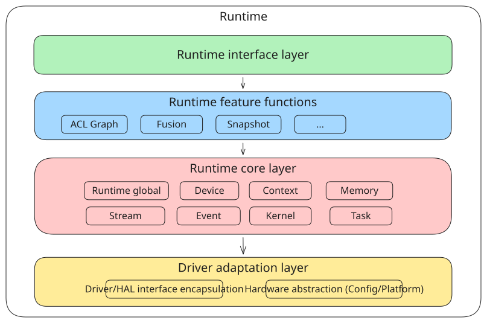
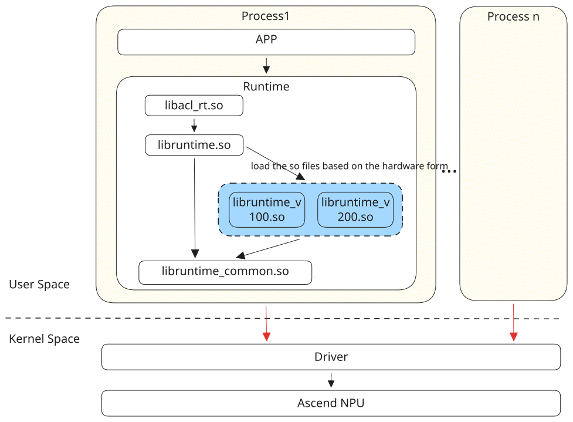
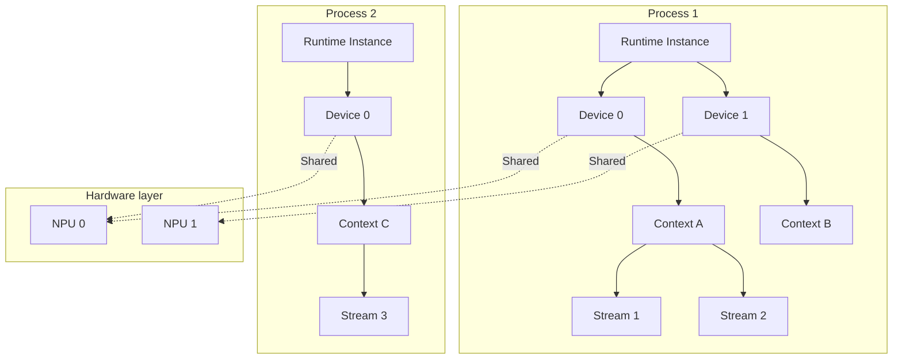
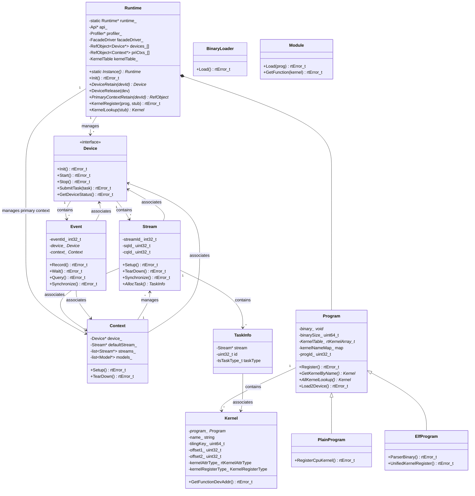
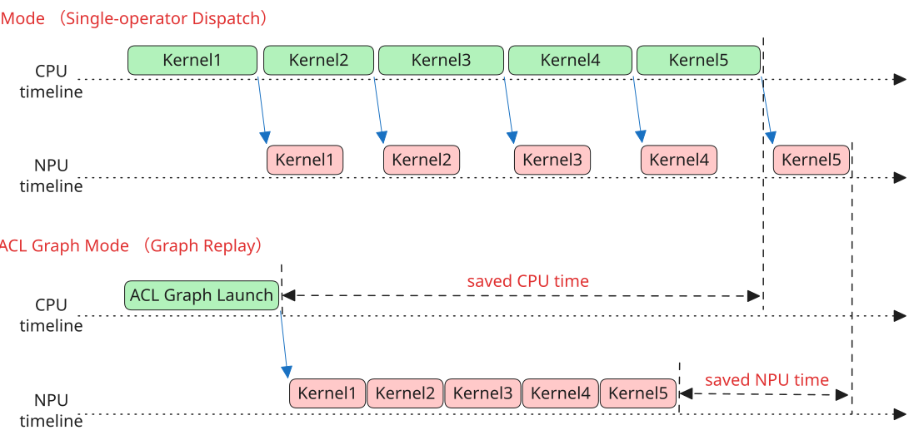
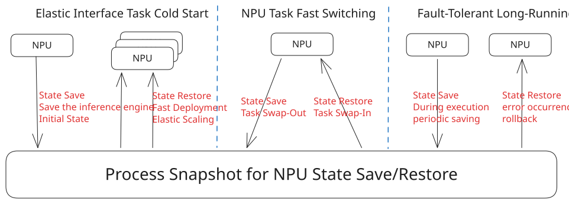
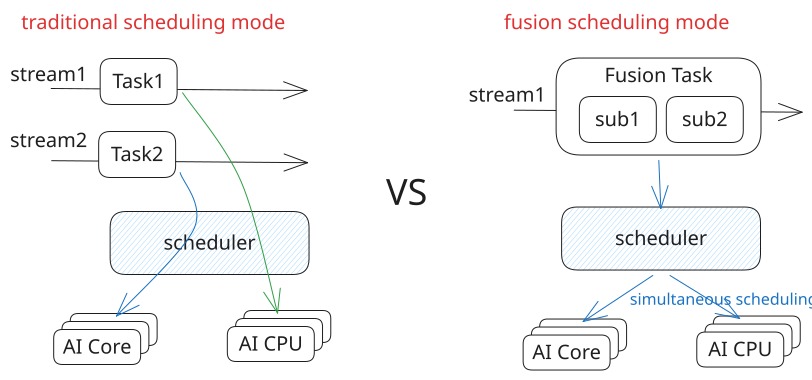

# Runtime Architecture Introduction

## 1 System Architecture Overview

**Function overview**: CANN Runtime is the runtime component of the Ascend AI processor. It provides core functions such as device management, task scheduling, memory management, and kernel execution. It is the bridge between upper-layer AI computing frameworks (such as PyTorch, MindSpore, and TensorFlow) and acceleration libraries (such as operator libraries, communication libraries, domain acceleration libraries, and graph engines) and the underlying driver.

### 1.1 Runtime Logical Architecture Diagram

* Runtime interface layer: provides C/C++ APIs externally, encapsulating the core implementation and feature functions. It is mainly divided into three categories: low-level runtime interfaces prefixed with rt (such as rtSetDevice and rtMalloc), ACL runtime function interfaces prefixed with aclrt (such as aclrtStreamCreate and aclrtLaunchKernel), and ACL Graph/Model feature interfaces prefixed with aclmdlRI. The interface layer uniformly handles parameter validation and error code conversion.
* Runtime feature layer: builds pluggable feature functions based on core layer capabilities, including ACL Graph (stream capture and graph construction), Model (model loading and execution), Fusion (operator fusion), Snapshot (process snapshot and fault diagnosis), and so on.
* Runtime core layer: provides core functions such as device management (Device), context management (Context/primary context), stream management (Stream/SQ-CQ asynchronous mechanism), task scheduling (Engine/TaskFactory), memory management (MemoryPool), kernel execution (Kernel/Program), event synchronization (Event), and notification mechanism (Notify). It is the main body of the Runtime core implementation.
* Driver adaptation layer: the adaptation layer provides abstraction and adaptation for different generations of chips for the Runtime **core layer** and **feature layer**, and shields hardware and driver interface differences. It supports multiple generations of chips through version directories such as driver/v100 and v200; manages chip feature configuration through the config/ directory (such as 910, 310P, and BS9SX1A); and unifies the driver call entry through the HAL driver interface (ascend_hal.h).

### 1.2 Runtime Deployment View

Runtime is deployed as a dynamic library in the user-mode process space and serves as the bridge between upper-layer applications and the underlying driver. The following figure shows the deployment position and hierarchical relationship of Runtime in the system:

**Deployment hierarchy description**:

| Layer | Component | Deployment Location | Description |
|------|------|----------|------|
| Application layer | AI frameworks, operator libraries, communication libraries | User-mode process | AI frameworks such as PyTorch, MindSpore, and TensorFlow, and ACL operator libraries, HCCL communication libraries, and so on |
| Runtime layer | CANN Runtime | User-mode dynamic library | Provides the `libacl_rt.so`, `libruntime.so`, `libruntime_v100/v200.so`, and `libruntime_common.so` library files, and loads them into the application process through dynamic linking |
| Driver layer | Ascend Driver | Kernel mode | The driver module `ascend_km` runs in the kernel space and interacts with user mode through the `/dev/davinci*` device files |
| Hardware layer | Ascend NPU | Physical device | Ascend AI processors (such as 910, 310P, and 950) providing computing units such as AI Core, AI CPU, and CCU |

**Process model**:

Runtime runs in in-process singleton mode:

- **Single process, multiple devices**: one process can manage multiple NPU devices (switch through `aclrtSetDevice`)
- **Single process, multiple contexts**: one process can create multiple Contexts (each Context is associated with one Device)
- **Single process, multiple Streams**: one Context can create multiple Streams to implement task parallelism
- **Multi-process isolation**: Runtime instances in different processes are completely isolated and each maintains its own resource status

### 1.3 Core Module Introduction

#### 1.3.1 Runtime Global Management

**Component responsibility**: manages global resources in singleton mode, including the creation, reference count, and destruction of devices, contexts, programs, and kernels.

**Core flow**:

- Global resource initialization and deinitialization
- Device acquisition and release (DeviceRetain/DeviceRelease)
- Primary context management (PrimaryContextRetain/PrimaryContextRelease)
- Kernel registration and lookup (KernelRegister/KernelLookup)
- Profiling start and stop (ProfilerStart/ProfilerStop)

#### 1.3.2 Device Management

**Component responsibility**: manages device resources of the Ascend AI processor and provides computing device setting, reset, query, and configuration functions externally. Internally, it covers capabilities such as device initialization, start, stop, status management, task submission, and resource pool management.

**Core flow**:

- Device initialization: driver initialization → obtain device attributes → create resource pool → start scheduling engine
- Task submission: check device status → Engine.SubmitTask → Stream allocation → send to SQ
- Error handling: detect error → set device status → stop device → trigger callback

#### 1.3.3 Context Management

**Component responsibility**: manages the execution context environment of the computing device. It provides context creation, destruction, attribute query, and configuration interfaces externally. Internally, it associates Device and Stream, and manages program loading and kernel execution.

**Core flow**:

- Context creation: associate Device → create default Stream
- Program loading: BinaryLoad → load kernel binary to device
- Kernel execution: KernelLaunch → submit task to Stream

#### 1.3.4 Memory Management

**Component responsibility**: manages the allocation, operation, and release of device memory and host memory. It provides memory allocation and release, memory copy, and memory setting interfaces externally. Internally, it supports multiple memory type management, memory pool mechanism, asynchronous memory operation, physical memory management, and inter-process memory sharing.

**Core flow**:

- Memory allocation: parameter validation → select memory type → call driver allocation → return address
- Memory copy: determine copy direction → create copy task → submit to Stream → DMA execution
- Memory release: address validation → call driver release → update resource pool

#### 1.3.5 Stream Management

**Component responsibility**: manages the logical task queue provided by Device, and provides Stream creation, destruction, attribute configuration, stream synchronization, and status management interfaces externally. Internally, it interacts with hardware through the SQ/CQ mechanism to implement asynchronous task execution.

**Core flow**:

- Stream creation: allocate streamId → bind SQ/CQ → initialize resources
- Task submission: AllocTask → fill parameters → send to SQ → wait for CQ completion
- Stream synchronization: Synchronize → wait for all tasks to complete → return result

#### 1.3.6 Kernel Management

**Component responsibility**: manages the registration, lookup, and execution of operator binaries such as AI Core (AI Cube, AI Vector) and AICPU. It supports two lookup methods: by kernel name and by kernel identifier.

**Core flow**:

- Binary registration: aclrtBinaryLoadFromFile/FromData → BinaryLoader::Load → Program::Register → UnifiedKernelRegister (ElfProgram) or RegisterCpuKernel (PlainProgram)
- Kernel lookup: aclrtBinaryGetFunction → Program::GetKernelByName (by kernel name) or aclrtBinaryGetFunctionByEntry → Program::AllKernelLookup (binary search by kernel identifier)
- Device loading: Program::Load2Device → allocate device memory + 4K alignment + H2D copy
- Kernel execution: Kernel::GetFunctionDevAddr → return device-side function address → load parameters with ArgLoader → deliver Task

#### 1.3.7 Task Management

**Component responsibility**: manages the creation, execution, and reclamation of various tasks, and supports multiple task types including compute tasks, memory copy tasks, event synchronization tasks, and so on.

**Core flow**:

- Task allocation: TaskFactory.AllocTask → fill TaskInfo
- Task submission: fill SQE → send to SQ → wait for CQ
- Task reclamation: get completion status from CQ → RecycleTask → update resource pool

#### 1.3.8 Event Synchronization

**Component responsibility**: provides a synchronization mechanism (Event is used for synchronization of tasks between streams), and supports event recording, waiting, status query, and event timestamp functions.

**Core flow**:

- Event recording: EventRecord → record position in Stream
- Event waiting: EventWait → wait for event completion
- Status query: EventQuery → return event status

### 1.4 Core Module Class Relationships

**Module class diagram**

**Core module relationships**

| Relationship                     | Description                                                             |
| ------------------------ | ---------------------------------------------------------------- |
| Runtime → Device        | Runtime manages all device instances and manages reference counts through DeviceRetain/Release |
| Runtime → Context       | Runtime manages primary contexts, and each device corresponds to one primary context |
| Runtime → Program       | Runtime maintains Programs and supports kernel binary management |
| Program → Kernel        | Program contains multiple Kernels and supports lookup registration by name and tilingKey through kernelNameMap_ and KernelTable_ |
| PlainProgram → Program  | PlainProgram inherits Program and manages simple binaries of CPU operators |
| ElfProgram → Program    | ElfProgram inherits Program and manages ELF kernel parsing and registration |
| BinaryLoader → Program  | BinaryLoader loads binaries to create Program |
| Module → Program        | Module loads Program binaries to device-side memory |
| Device → Stream      | Device contains multiple Stream instances |
| Device → Event       | Device contains multiple Event instances and manages event registration and destruction |
| Context → Stream        | Context creates and manages Streams and serves as the container of Streams |
| Context → Device        | Context associates Device and holds a device reference |
| Stream → TaskInfo       | Stream allocates and manages task information |
| Stream → Context        | Stream associates Context and holds a context reference |
| Stream → Device         | Stream associates Device and holds a device reference |
| Event → Device          | Event associates Device and holds a device reference |
| Event → Context         | Event associates Context and holds a context reference |
| TaskInfo → Kernel       | TaskInfo associates Kernel and points to the kernel function to be executed |

## 2 Feature Introduction

### 2.1 ACL Graph (Stream Capture)

**Feature description**: supports stream capture, which allows capturing the task sequence in a Stream as a reusable graph structure, implementing task sinking to Device execution and reducing host-side task delivery overhead. The performance benefits are shown in the following figure:

**Feature design intent**: in the Eager mode adopted by mainstream frameworks (such as PyTorch), each operation or task is delivered and executed simultaneously. This mode provides convenient debugging capabilities, but it also introduces host delivery overhead. As performance optimization deepens, this host overhead gradually becomes a bottleneck. By capturing Stream tasks into a model and executing the model, the related tasks can be sunk to the Device for execution, thereby reducing host overhead.

**ACL Graph supports the following functions**:

- **Single-stream capture**: captures the task sequence on a single Stream as a reusable graph structure, temporarily stores tasks into a model through the `aclmdlRICaptureBegin/End` interfaces, and supports multiple calls to `aclmdlRIExecuteAsync` for execution, reducing repetitive host-side delivery overhead. During capture, synchronous or query operations on Stream, Event, Device, and Context are prohibited.
- **Cross-stream capture**: establishes dependencies between Streams through Events and captures tasks on multiple Streams into the same model. The main stream calls `aclmdlRICaptureBegin` to start capture. Other Streams directly or indirectly depend on the main stream through `aclrtRecordEvent/StreamWaitEvent` to enter the capture state. Finally, they need to return to the main stream through an Event, implementing cross-Stream collaborative task execution.
- **Task update**: supports updating the parameters of captured tasks or the tasks themselves at runtime. It provides two methods: boundary point capture (executing tasks before and after the task to be updated as separate models, suitable for a large number of task updates) and task group mark update (marking tasks to be updated through `aclmdlRICaptureTaskGrpBegin/End`, supporting concurrent updates, suitable for a small number of task updates), adapting to dynamic shape or parameter adjustment scenarios.

### 2.2 Snapshot (Process Snapshot)

**Feature description**: provides aclrtSnapShot* interfaces externally and supports full-stack control information of Context/operator/Driver/device for process status save and restore, used for fast fault recovery. It supports Device memory snapshots and can choose whether to include optional memory. This feature supports a callback mechanism, which allows the service layer to customize the save and restore logic of snapshot status, providing stronger scalability at the architecture level.

**Feature design intent**: the fault recovery efficiency of large-scale AI clusters directly affects the availability and resource utilization of training tasks. The traditional fault recovery data path involves multiple serial steps such as container scheduling, process reconstruction, host and device link establishment, operator compilation, and weight loading. A single recovery can take more than ten minutes, and the computing power loss caused by training interruption at the 10,000-card scale is extremely considerable. The snapshot mechanism persists key execution status in advance. After a fault occurs, it skips the lengthy initialization process and restores directly from the snapshot point, compressing the training task recovery time to within minutes. Cold start of inference services also achieves an order-of-magnitude improvement.

**Feature usage scenarios and value**:

- Fast cold start of elastic inference tasks
- Fast switching of NPU tasks
- Fault-tolerant long-running tasks

### 2.3 Fusion (Task Fusion)

**Feature description**: provides the rtFusionLaunch interface externally and supports fused execution of multiple subtasks of different types (AI Core, AI CPU, CCU, and so on). By combining multiple operators or tasks into one fusion task for submission, task scheduling overhead is reduced. More importantly, the scheduler adopts the gang-sched scheduling mode and initiates scheduling together after ensuring that all computing units required by the fusion operator are satisfied.

**Feature design intent**: in the traditional mode, to schedule multiple tasks of different types in parallel, multiple tasks must be submitted to different Streams separately. However, the scheduler does not perceive the correlation between tasks on different streams, so it does not ensure that these parallel tasks are scheduled at the same time after their resources are satisfied. Therefore, the traditional scheduling method either causes previously scheduled tasks to wait for later scheduled tasks, resulting in idle core waste, or even causes task deadlock. The task fusion scheduling function emerges to address this.

**Fusion supports the following subtask types**:

- **AI Core task**: AI Core operator execution, supporting different computing units such as AI Core, AI Cube, and AI Vector.
- **AI CPU task**: AI CPU operator execution, that is, operators running on the CPU.
- **CCU task**: CCU task (Collective Communication Unit).

**Typical fusion combination modes**:

- AI CPU + AI Core: fused scheduling and execution of AI CPU operators and AI Core operators, implementing parallel computing of AI CPU and AI Core or parallel computing and communication services.
- CCU + AI Core: fused scheduling and execution of CCU tasks and AI Core operators, implementing parallel computing and communication services.

## 3 Design Principles

### 3.1 Architecture Design Principles

| Principle         | Description                                                                  | Implementation                                                              |
| ------------ | --------------------------------------------------------------------- | --------------------------------------------------------------------- |
| Layered design     | Adopts the four-layer architecture separation of API/Feature/Core/Driver to ensure clear responsibilities and definite boundaries for each layer | The directory structure is divided by layer: api/, feature/, core/src/, driver/                |
| Streamlined core layer   | The core layer serves as the minimal function set of Runtime and supports reuse and dependency of all forms             | Defines the core function set and defines the capability boundary of core objects based on the single responsibility principle              |
| High feature cohesion   | The feature function layer implements end-to-end interface definition and function implementation to ensure module independence              | Features are organized in independent directories: feature/aclgraph, feature/snapshot, feature/model |
| Pluggable features   | Feature functions are managed in independent directories and support on-demand loading and flexible extension                      | Compilation and dynamic loading can be selectively performed by feature directory                                  |
| Abstract interface     | Device adopts an abstract interface design to decouple interface and implementation                           | Device → GroupDevice → RawDevice three-layer inheritance system                       |
| Hardware difference adaptation | Centrally manages configuration differences of different chips through the config/ directory                           | Configurations are organized by chip model: config/as31xm1/, config/bs9sx1a/, and so on               |

### 3.2 High-Performance Design Principles

Runtime provides ultimate-performance runtime functions, and the code follows high-performance design principles.

| Principle           | Description                                         |
| -------------- | -------------------------------------------- |
| Task preallocation     | TaskFactory preallocates task objects to reduce allocation overhead     |
| Resource pool reuse     | Memory, Event, and Notify pools are reused to avoid frequent creation and destruction |
| SQ/CQ pooling     | Multiple Streams share SQ/CQ resources                    |
| Atomic status       | Key statuses use atomic operations to reduce lock overhead             |
| Asynchronous task submission   | Tasks are submitted asynchronously without blocking the calling thread                 |
| Fast kernel table lookup | KernelTable uses binary search to optimize lookup efficiency       |

---

_This architecture document is based on source code analysis of `src/runtime/core/src/`._
