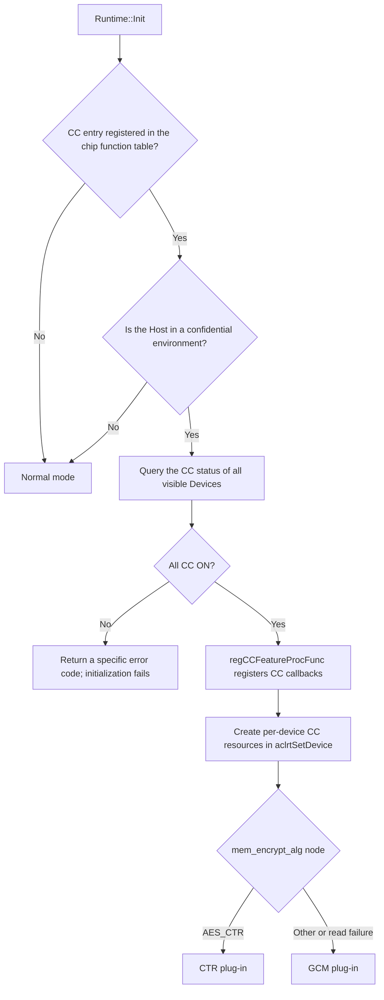
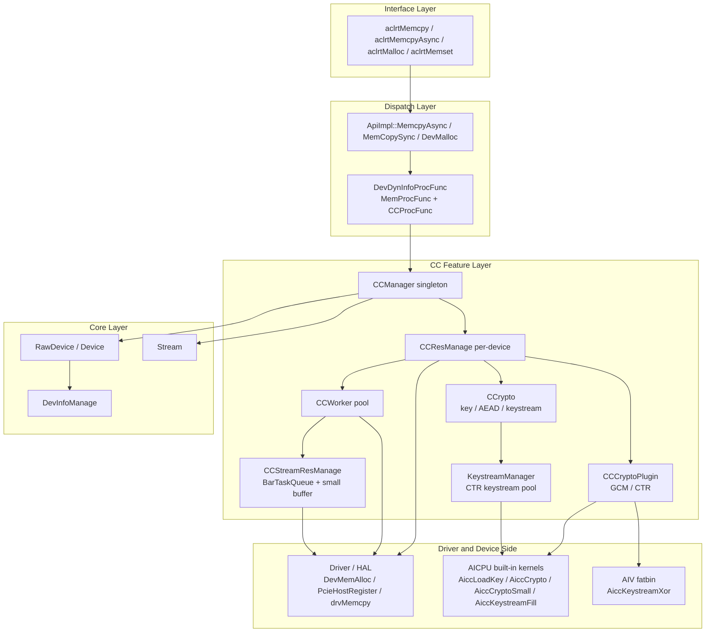
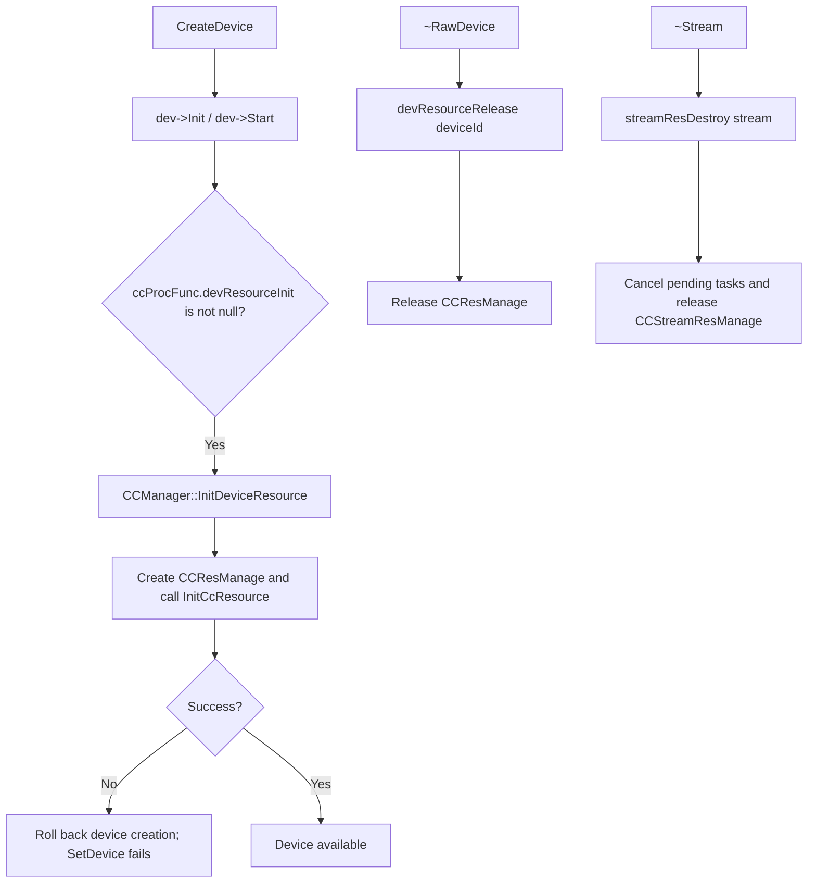
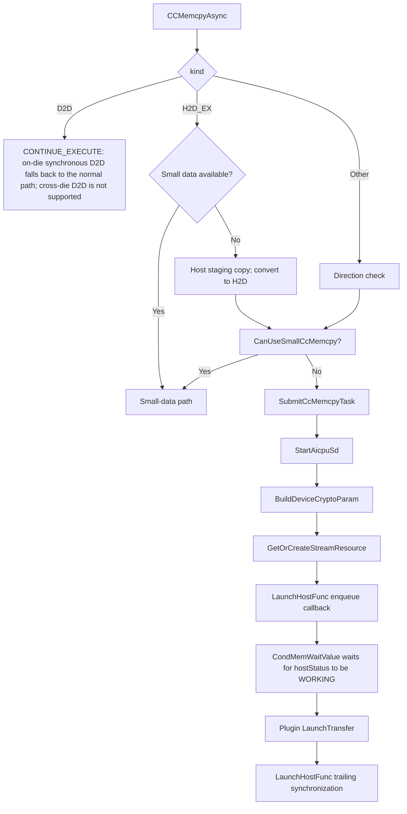
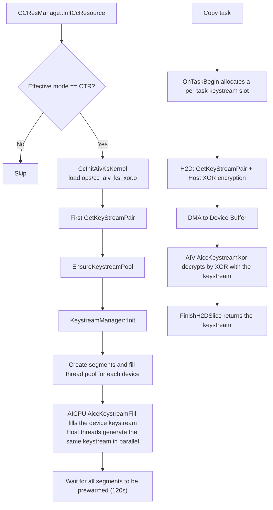
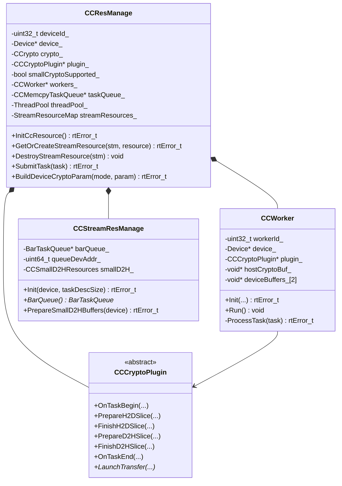
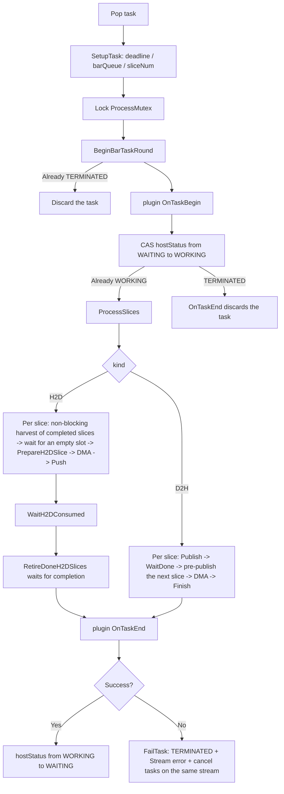
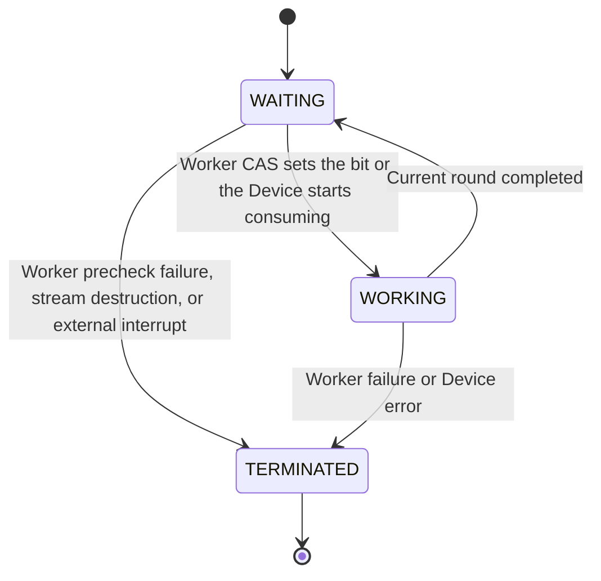
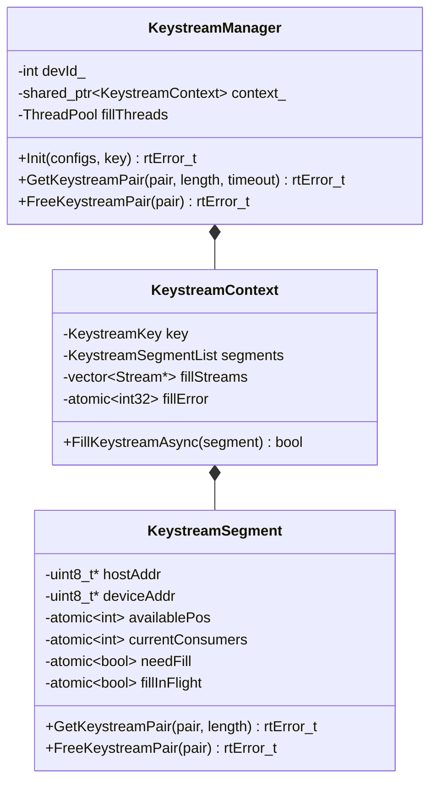
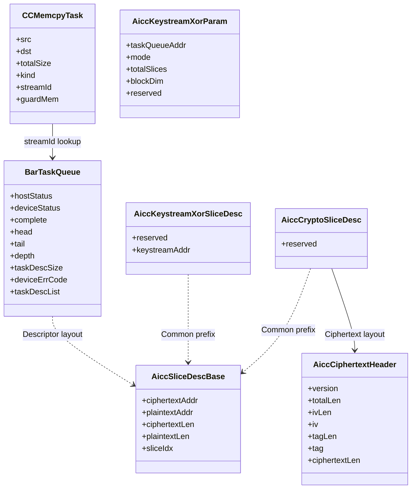

# Confidential Computing (CC Mode) Feature

## 1. Feature Overview

### 1.1 Feature Introduction

The Confidential Computing (CC) feature targets deployments where the Host runs in a confidential VM and the Device runs in an NPU TEE. Runtime takes over H2D/D2H data transfer at the feature layer: service data is encrypted on the Host, transferred through a plaintext DMA channel, and then decrypted on the Device and written to private memory. The whole process is transparent to upper-layer services.

The CC feature is implemented in `src/runtime/feature/cc_manager/` and compiled into `libruntime_v200.so`. It is at the same level as features such as ACL Graph and jetty. Currently, it supports two encryption and decryption modes (GCM and CTR) and a simplified path for small data on single-operator streams.

### 1.2 Problem Background

- Host memory in a confidential VM is protected by hardware encryption, but the PCIe DMA channel between the Host and the Device does not provide confidentiality. Transferring service data directly exposes it in plaintext.
- Control plane data (SQE, task args, and queue control headers) cannot be encrypted as a whole block and must be handled separately from the data plane.
- When all data goes through the "Host callback + multi-task submission + worker thread" path, the thread wake-up and scheduling overhead for small data (tens of bytes) exceeds the encryption and decryption cost. A bypass is therefore required.

### 1.3 Design Goals

- Transparent encryption of H2D/D2H service data. Upper-layer `aclrtMemcpy*` interfaces require no modification.
- The control plane is not encrypted. It cooperates with the device kernel through a shared memory queue and a slice protocol.
- Support two modes: GCM (with integrity authentication) and CTR (low-overhead keystream). The mode is determined by the deployment form and the kernel node.
- Support a simplified path for small data on single-operator streams to avoid Host callbacks and worker thread wake-ups.
- Fail closed on environment exceptions: initialization fails when the Host is in a confidential environment but the Device does not support CC, and no plaintext fallback occurs.
- Zero overhead in non-confidential environments: no callback is registered, and the normal path is unaffected.

### 1.4 Comparison of the Two Encryption Modes

The encryption mode is determined by the deployment form. SEV confidential VMs on A+X (x86 server + Ascend NPU) support only GCM. Confidential VMs on A+K (Kunpeng server + Ascend NPU) support switching between GCM and CTR, which is controlled by the kernel node `/sys/kernel/security/cvm_guest/mem_encrypt_alg` (CTR when the node value is `AES_CTR`; GCM in all other cases or when reading fails). The mode is cached after the first read in the process, and runtime switching is not supported.

| Dimension | GCM (AES-128-GCM) | CTR (AES-128-CTR) |
|------|--------------------|--------------------|
| Effective condition | A+X: fixed GCM; A+K: GCM when the node value is not `AES_CTR` | A+K: CTR when the node value is `AES_CTR` |
| Host-side primitive | OpenSSL EVP AEAD (encryption and authentication) | AES-CTR keystream generation + local XOR |
| Device-side kernel | AICPU `AiccCrypto` | AIV `AiccKeystreamXor` (AICPU `AiccKeystreamFill` for filling) |
| Slice descriptor | `AiccCryptoSliceDesc` (32B) | `AiccKeystreamXorSliceDesc` (40B, including `keystreamAddr`) |
| Ciphertext format | 84B `AiccCiphertextHeader` + ciphertext body | Ciphertext body only, no header |
| Keys used | Two directional keys for H2D and D2H | Both directions share the H2D key |
| Additional resources | None | Per-device keystream pool + fill and generation threads |
| Typical scenario | Default configuration; tamper resistance required | Low overhead and high throughput |

Additional notes:

- `CC_CRYPTO_CIPHER` reserves an `SM4` slot, but only `AES_128` is registered. Encryption and decryption return `ACL_ERROR_RT_FEATURE_NOT_SUPPORT` (207000, `crypto/cc_crypto.cc:454-458`) when SM4 is selected.
- CTR has no authentication tag, so tampering with the ciphertext is not detected. Use GCM in scenarios that require integrity.

### 1.5 Abbreviations

| Abbreviation | Full Name | Description |
|--------|------|------|
| GCM | Galois/Counter Mode | Galois/counter mode |
| CTR | Counter Mode | Counter mode |
| AES | Advanced Encryption Standard | Advanced Encryption Standard; this document uses AES-128 |
| AEAD | Authenticated Encryption with Associated Data | Authenticated encryption with associated data |
| AAD | Additional Authenticated Data | Additional authenticated data |
| IV | Initialization Vector | Initialization vector |
| SM4 | ShangMi 4 | ShangMi 4 block cipher algorithm |
| XOR | Exclusive OR | Exclusive OR |
| TEE | Trusted Execution Environment | Trusted execution environment |
| SEV | AMD Secure Encrypted Virtualization | AMD Secure Encrypted Virtualization |
| NPU | Neural Processing Unit | Neural processing unit |
| H2D | Host-to-Device | Host to Device |
| D2H | Device-to-Host | Device to Host |
| D2D | Device-to-Device | Device to Device |
| AICPU | AI CPU | AI processor |
| AIV | AI Vector Core | AI vector core |

## 2. Usage Scenarios and External Interfaces

### 2.1 Usage Scenarios

The CC feature adds no public interfaces, and user code is the same as in normal mode. In the following snippets, `stream`, `devBuf`, `hostSrc`, and `hostDst` are prepared objects.

- **Scenario 1**: Large-block GCM copy on a single-operator stream (default mode)

  ```cpp
  aclrtSetDevice(devId);
  aclrtMalloc(&devBuf, size, ACL_MEM_MALLOC_HUGE_FIRST);

  // H2D: Host encryption -> DMA -> AICPU decryption and write to private HBM
  aclrtMemcpyAsync(devBuf, size, hostSrc, size, ACL_MEMCPY_HOST_TO_DEVICE, stream);

  // D2H: AICPU encryption to staging buffer -> DMA -> Host decryption
  aclrtMemcpyAsync(hostDst, size, devBuf, size, ACL_MEMCPY_DEVICE_TO_HOST, stream);
  aclrtSynchronizeStream(stream);
  ```

  Each asynchronous copy that uses the full path expands into four tasks on the stream: `[HostCallback][MemWait][AiccCrypto][HostCallback]` (see §4.1.3). The first HostCallback only pushes the task into the shared queue. The last HostCallback is the trailing synchronization that waits for the Worker to complete the task. Host-side encryption, decryption, and DMA are performed by CCWorker, and device-side encryption and decryption are performed by AICPU `AiccCrypto`.

  Other scenarios, such as synchronous and asynchronous copies, 2D, Batch, and memset, use the same interfaces as normal copies. CC takes effect transparently at the dispatch layer and requires no extra adaptation.

### 2.2 External Interfaces

The CC feature registers the `MemProcFunc` and `CCProcFunc` function tables through `DevDynInfoProcFunc`. The ApiImpl layer performs a single null-check dispatch at the entry of existing memory interfaces. When the callback is null or returns `RT_ERROR_CONTINUE_EXECUTE` (an internal signal), the original logic resumes.

The body text and tables use ACL error codes. Later code snippets retain internal return codes (such as `RT_ERROR_NONE`), which are mapped to `ACL_RT_SUCCESS` externally after error code mapping.

| Interface | Actual Dispatch Point | Description |
|------|-----------|------|
| `aclrtMemcpyAsync` | `src/runtime/api/impl/api_impl_david.cc:997` | Enters `CCManager::CCMemcpyAsync` (`cc_manager.cc:676`) |
| `aclrtMemcpy` | `src/runtime/api/impl/api_impl.cc:2547` | Enters `CCManager::CCMemCopySync` (`cc_manager.cc:635`) |
| `aclrtMemcpy2dAsync` | `src/runtime/api/impl/api_impl_david.cc:806` | Enters `CCManager::CCMemCopy2DAsync` |
| `aclrtMemcpy2d` | `src/runtime/api/impl/api_impl_memory.cc:197` | Enters `CCManager::CCMemCopy2DSync` |
| `aclrtMemcpyBatchAsync` | `src/runtime/api/impl/api_impl_david.cc:958` | Enters `CCManager::CCMemcpyBatchAsync` |
| `aclrtMemcpyBatch` | `src/runtime/api/impl/api_impl_memory.cc:422` | Enters `CCManager::CCMemcpyBatch` |
| `aclrtMalloc` | `src/runtime/api/impl/api_impl.cc:2419` | Enters `CCManager::CCDevMalloc`, aligns to 32B, and sets the private memory flag |
| `aclrtMallocWithCfg` | `src/runtime/api/impl/api_impl_memory.cc:405` | Enters `CCManager::CCDevMallocWithCfg` |
| `aclrtMemsetAsync` | `src/runtime/core/src/launch/memory_common.cc:264` | Enters `CCManager::CCDevMemSetAsync` |

Note: `memProcFunc.devMemset32` (`CCManager::CCDevMemSetD32`) is registered, and the main memset path is currently dispatched through `devMemsetAsync`.

### 2.3 Environment Detection and Mode Selection



Key points:

- The Host confidential environment check supports two forms (`runtime_adapt.cc:59`): the existence of `/dev/sev-guest`, or a value of 1 in `/sys/kernel/security/cvm_guest/mem_encrypt_enable`.
- The Device status query uses `NpuDriver::QueryDeviceCcStatus` (`npu_driver_mem.cc:2319`). Both `HAL_CC_MODE_NORMAL` and `HAL_CC_MODE_ADDITIONAL` are treated as CC ON.
- Only chips whose configuration table statically sets `regCCFeatureProcFunc` enter detection (currently 950, `config/950/dev_info_proc_func.cc:24`). Other chips return directly, and v100 uses an empty implementation (`runtime_v100/runtime_adapt.cc:134`).

### 2.4 Key Data Types and Constants

```cpp
// Slice queue control header (PCIe BAR space, shared ld/st by the Host and the device kernel)
struct BarTaskQueue {
    volatile TaskQueueStatus hostStatus;   // Host status: WAITING / WORKING / TERMINATED
    volatile TaskQueueStatus deviceStatus; // Device status
    volatile uint32_t complete;            // Number of tasks completed by the device
    volatile uint32_t head;                // Host publish position
    volatile uint32_t tail;                // Device consume position
    volatile uint32_t depth;               // Ring depth; available slots = depth - 1
    volatile uint32_t taskDescSize;        // Size of one descriptor
    volatile uint32_t deviceErrCode;       // Device-side error code
    uint8_t taskDescList[];                // Descriptor array
};

// Common prefix of slice descriptors
struct AiccSliceDescBase {
    volatile uint64_t ciphertextAddr;
    volatile uint64_t plaintextAddr;
    volatile uint32_t ciphertextLen;
    volatile uint32_t plaintextLen;
    volatile uint32_t sliceIdx;
};
```

Constants (`cc_task_queue.h:26-32`, `cc_crypto.h:80-82`):

| Constant | Value | Meaning |
|------|----|------|
| `CC_SLICE_SIZE` | 2MB | Size of the Worker staging buffer; for GCM, ciphertext header + plaintext; for CTR, ciphertext |
| `CC_CIPHER_HEADER_SIZE` | 84B | `sizeof(AiccCiphertextHeader)` |
| `CC_PLAINTEXT_SLICE_SIZE` | 2MB − 84B | Maximum plaintext per slice |
| `CC_SLICE_DESC_SLOT_NUM` | 3 | Ring depth; 2 available slots |
| `CC_BUFFER_SLOT_NUM` | 2 | Worker Device Buffers A/B |
| `CC_SMALL_PLAINTEXT_CAPACITY` | 64B | Plaintext upper limit for small data |
| `CC_SMALL_CIPHER_CAPACITY` | 84B + 64B | Ciphertext buffer capacity for small data |

The GCM ciphertext header (`cc_crypto.h:62`) is 84 bytes and contains `version`, `totalLen`, `ivLen`, `iv[32]`, `tagLen`, `tag[32]`, and `ciphertextLen`.

## 3. Architecture Overview

### 3.1 Overall Design

CC uses the structure of **a process-level singleton CCManager + a per-device CCResManage + a per-device algorithm plug-in + a Worker pool**. ApiImpl dispatches memory interfaces to CCManager through a function pointer table. CCManager locates CCResManage by deviceId. CCResManage holds the key context, algorithm plug-in, shared task queue, and Workers. Workers cooperate with the device kernel through a Stream-level `BarTaskQueue`. Session data is processed by OpenSSL primitives on the Host side and by AICPU (GCM and keystream filling) or AIV (CTR XOR) on the Device side.

### 3.2 Layered Architecture



### 3.3 Module Dependencies

- `CCManager`: depends on `CCResManage`, `DevInfoManage`, and `Runtime`. It does not hold a Device and attaches to the device lifecycle only through callbacks.
- `CCResManage`: depends on `CCrypto`, `CCCryptoPlugin`, `CCWorker`, `CCMemcpyTaskQueue`, and `CCStreamResManage`.
- `CCWorker`: depends on plug-in hooks, `BarTaskQueue`, `Stream`, and `Driver`. It does not directly hold `CCrypto`.
- `CCrypto`: depends on `OpenSSLLoader`, `KeystreamManager`, and `GetSlotKey`.
- The Core layer (`RawDevice`, `Stream`, and `ApiImpl`) does not include CC headers and interacts only through `MemProcFunc` / `CCProcFunc` function pointers.

### 3.4 Full-Path Sequence Diagram (GCM Asynchronous H2D)

```mermaid
sequenceDiagram
    participant App as Service Thread
    participant Api as ApiImpl
    participant CCM as CCManager
    participant STM as Stream
    participant W as CCWorker
    participant BAR as BarTaskQueue
    participant AICPU as AiccCrypto

    App->>Api: aclrtMemcpyAsync H2D
    Api->>CCM: CCMemcpyAsync
    CCM->>CCM: Direction check / small-data admission check
    CCM->>CCM: BuildDeviceCryptoParam / GetOrCreateStreamResource
    CCM->>STM: Enqueue HostCallback
    CCM->>STM: MemWait hostStatus == WORKING
    CCM->>STM: LaunchTransfer AiccCrypto
    CCM->>STM: HostCallback trailing synchronization
    CCM-->>App: Return

    STM->>W: Callback triggers Push task
    W->>BAR: BeginBarTaskRound resets the ring
    W->>W: OnTaskBegin / calculate the slice count
    W->>BAR: hostStatus from WAITING to WORKING
    Note over STM: MemWait condition is met; AICPU starts execution

    loop Each slice
        W->>W: PrepareH2DSlice (Host encrypts to hostCryptoBuf)
        W->>W: drvMemcpy to Device Buffer A/B
        W->>BAR: PushBarTask publishes the descriptor
        AICPU->>BAR: Poll head != tail
        AICPU->>AICPU: Decrypt to plaintextAddr
        AICPU->>BAR: tail++ / complete++
    end

    W->>BAR: WaitH2DConsumed complete >= totalSlices
    W->>BAR: hostStatus from WORKING to WAITING
    AICPU->>STM: Task completed
```

## 4. Detailed Design

### 4.1 Core Flows

#### 4.1.1 CC Environment Detection and Callback Registration

At the end of `Runtime::Init()`, `InitCcFeature()` (`runtime_adapt.cc:150`) is called. It performs the chip entry check, Host environment check, visible device validation, and callback registration in sequence:

```cpp
// File location: src/runtime/core/src/runtime_v200/runtime_adapt.cc:150-174
rtError_t Runtime::InitCcFeature() const
{
    DevDynInfoProcFunc func{};
    COND_RETURN_INFO(
        (GET_DEV_INFO_PROC_FUNC(chipType_, func) != RT_ERROR_NONE) || (func.regCCFeatureProcFunc == nullptr),
        RT_ERROR_NONE, "CC feature is not registered for chip_type=%d.", static_cast<int32_t>(chipType_));

    COND_RETURN_INFO(!IsHostCcMode(), RT_ERROR_NONE, "CC mode is disabled because host CC is off.");

    rtError_t error = CheckVisibleDevicesCcStatus();
    COND_RETURN_ERROR(error != RT_ERROR_NONE, error, "Failed to validate visible devices for confidential computing.");

    error = func.regCCFeatureProcFunc(chipType_);
    COND_RETURN_ERROR(error != RT_ERROR_NONE, error, "Failed to register CC process functions.");
    return RT_ERROR_NONE;
}
```

`RegCCManagerProcFunc` (`cc_manager.cc:338`) fills the function table field by field and then calls `DevInfoManage::RegDevInfoProcFunc` for dynamic registration. Existing callbacks in the chip table are preserved:

```cpp
procFunc.memProcFunc.memcpyAsync     = &CCManager::CCMemcpyAsync;
procFunc.memProcFunc.memCopySync     = &CCManager::CCMemCopySync;
procFunc.memProcFunc.memCopy2DAsync  = &CCManager::CCMemCopy2DAsync;
procFunc.memProcFunc.memCopy2DSync   = &CCManager::CCMemCopy2DSync;
procFunc.memProcFunc.memcpyBatchAsync = &CCManager::CCMemcpyBatchAsync;
procFunc.memProcFunc.memcpyBatch     = &CCManager::CCMemcpyBatch;
procFunc.memProcFunc.devMalloc       = &CCManager::CCDevMalloc;
procFunc.memProcFunc.devMallocWithCfg = &CCManager::CCDevMallocWithCfg;
procFunc.memProcFunc.devMemsetAsync  = &CCManager::CCDevMemSetAsync;
procFunc.memProcFunc.devMemset32     = &CCManager::CCDevMemSetD32;

procFunc.ccProcFunc.devResourceInit    = &CCManager::InitDeviceResource;
procFunc.ccProcFunc.devResourceRelease = &CCManager::ReleaseDeviceResource;
procFunc.ccProcFunc.streamResDestroy   = &CCManager::DestroyStreamResource;
```

Note: `CheckVisibleDevicesCcStatus` (`runtime_adapt.cc:83`) expands `ASCEND_RT_VISIBLE_DEVICES` and calls `CheckDeviceCcStatus` for each visible Device. If any device query fails or CC is disabled, it returns an error, which makes `Runtime::Init` fail. No plaintext fallback occurs.

#### 4.1.2 Device and Stream Lifecycle Integration



Key code:

```cpp
// File location: src/runtime/core/src/runtime.cc:3386-3394
if ((GET_DEV_INFO_PROC_FUNC(dev->GetChipType(), devInfoProcFunc) == RT_ERROR_NONE) &&
    (devInfoProcFunc.ccProcFunc.devResourceInit != nullptr)) {
    error = devInfoProcFunc.ccProcFunc.devResourceInit(dev);
    if (error != RT_ERROR_NONE) {
        dev->SetDeviceRelease();
        (void)dev->Stop();
        goto DEV_ROLLBACK;
    }
}

// File location: src/runtime/core/src/device/raw_device.cc:158-159
if ((GET_DEV_INFO_PROC_FUNC(chipType_, devInfoProcFunc) == RT_ERROR_NONE) &&
    (devInfoProcFunc.ccProcFunc.devResourceRelease != nullptr)) {
    devInfoProcFunc.ccProcFunc.devResourceRelease(deviceId_);
}

// File location: src/runtime/core/src/stream/stream.cc:332-333
if ((GET_DEV_INFO_PROC_FUNC(chipType_, func) == RT_ERROR_NONE) &&
    (func.ccProcFunc.streamResDestroy != nullptr)) {
    func.ccProcFunc.streamResDestroy(this);
}
```

`CCManager::InitDeviceResource` (`cc_manager.cc:369`) uses `resourceInitMutex_` to serialize initialization and `resourceMutex_` to protect array writes. Device kernels are launched during initialization, which may call back into CCManager from the same thread. Therefore, `resourceMutex_` is not held during resource creation.

#### 4.1.3 GCM Full Path

GCM is the default mode. Each asynchronous copy that uses the full path (not small data and not D2D) submits four tasks on the stream. Together they provide complete semantics for enqueueing, waiting for the worker to become ready, device encryption and decryption, and worker completion.



Key code (`cc_manager.cc:477-549`, excerpt):

```cpp
rtError_t CCManager::SubmitCcMemcpyTask(...)
{
    ...
    ret = Runtime::Instance()->StartAicpuSd(device);
    ...
    CCStreamResManage* streamResource = nullptr;
    ret = manager.resources_[deviceId]->GetOrCreateStreamResource(resourceStm, streamResource);
    const uint64_t taskQueueAddr = streamResource->DeviceQueueAddr();

    CCHostCallbackParam* cbParam = nullptr;
    ret = AllocCcCallbackParam(ownerModel, deviceId, task, cbParam);

    std::unique_lock<std::mutex> memSubmitLock(streamResource->MemSubmitMutex());
    ret = Runtime::Instance()->ApiImpl_()->LaunchHostFunc(stm, &CCManager::SubmitCcTaskCallback, cbParam);

    const uint64_t memWaitAddr = taskQueueAddr + static_cast<uint64_t>(offsetof(BarTaskQueue, hostStatus));
    ret = CondMemWaitValue(
        RtValueToPtr<void*>(memWaitAddr), static_cast<uint64_t>(TASK_QUEUE_STATUS_WORKING),
        static_cast<uint32_t>(MEM_WAIT_VALUE_TYPE_EQ), stm, RT_STARS_WRITE_VALUE_SIZE_TYPE_32BIT);

    ret = plugin->LaunchTransfer(stm, taskQueueAddr, task);

    // For D2H, the worker must still move and decrypt the data to the user buffer after the device kernel
    // completes, so stream completion must wait for the worker to finish.
    ret = Runtime::Instance()->ApiImpl_()->LaunchHostFunc(
        stm,
        [](void* data) {
            auto* resource = static_cast<CCStreamResManage*>(data);
            const std::lock_guard<std::mutex> lock(resource->ProcessMutex());
        },
        streamResource);
    return RT_ERROR_NONE;
}
```

Direction handling rules (`cc_manager.cc:676-725`):

- `RT_MEMCPY_DEVICE_TO_DEVICE` returns `RT_ERROR_CONTINUE_EXECUTE` (an internal signal) directly. On-die synchronous D2D is handled by the normal path. Cross-die D2D (synchronous or asynchronous) is not supported (see §6).
- `RT_MEMCPY_HOST_TO_DEVICE_EX` first tries the small-data path. Otherwise, it allocates a Host staging buffer, copies the source data into pinned memory, and then handles the copy as H2D (`PrepareCcAsyncH2dEx`).
- When `checkKind == false`, the direction is inferred from the address attributes. If the copy still cannot be determined as H2D or D2H, it falls back.
- Only H2D and D2H copies enter the CC channel.

The GCM plug-in encrypts on the Host side and decrypts on the Device side:

```cpp
// File location: src/runtime/feature/cc_manager/crypto/gcm/cc_gcm_plugin.cc:26-43
rtError_t CCGcmPlugin::PrepareH2DSlice(CCCryptoSliceCtx& ctx, size_t& dmaLen)
{
    auto* const desc = reinterpret_cast<AiccCryptoSliceDesc*>(ctx.desc);
    desc->ciphertextLen = CC_CIPHER_HEADER_SIZE + static_cast<uint32_t>(ctx.sliceSize);
    size_t ctLen = 0U;
    const rtError_t ret = crypto_->Encrypt(
        ctx.deviceId, Cipher(), static_cast<const uint8_t*>(ctx.src), ctx.sliceSize,
        reinterpret_cast<const uint8_t*>(desc), sizeof(*desc), static_cast<uint8_t*>(ctx.hostBuf), &ctLen);
    dmaLen = ctLen;
    return ret;
}
```

The D2H direction is the reverse. The device kernel encrypts and writes to the Device Buffer. After the Worker reads the data back through DMA, it calls `FinishD2HSlice` to decrypt on the Host. The AAD is still the descriptor.

#### 4.1.4 CTR Keystream Path

CTR mode replaces block-by-block cipher encryption with pre-generated keystreams and pure XOR. The Host and the Device jointly maintain keystreams split into segments, and the transfer performs only XOR.



Key implementation details:

- Segment configuration (`keystream_manager.cc:498`): 7 tiers with a uniform segment size of 4MB and thresholds from 32KB to 2MB. Each of the first 6 tiers has 2 segments, and the last tier has 4 segments, for a total of 16 segments per device. Request lengths are allocated with 16B alignment, and a refill is triggered when `availablePos` of a segment is insufficient.
- Device keystream filling (`keystream_manager.cc:258`): `BuildKsFillTasks` generates tasks in 128KB pages. The Host uses OpenSSL AES-CTR to encrypt all-zero blocks and generate the same keystream, and the Device uses `AiccKeystreamFill` to fill in parallel. The Host generation pool is a process-level elastic pool of 2 to 8 threads.
- Transfer kernel (`cc_ctr_plugin.cc:65-79`): `PrepareH2DSlice` obtains a keystream pair and performs local XOR, and `dmaLen = sliceSize`. `FinishH2DSlice` returns the keystream. For D2H, the device kernel encrypts, and the Worker reads the data back and calls `KeystreamDecrypt`.
- Device kernel launch (`cc_ctr_plugin.cc:112-127`): the parameter is `AiccKeystreamXorParam`. `mode` indicates ENCRYPT/D2H or DECRYPT/H2D, and `reserved` carries the plaintext byte count for the current launch, which is used to select the AIV blockDim.
- AIV blockDim (`cc_defs.h:41`): 256KB per core. The value is rounded up to a power of 2 and clamped to `AICC_MAX_BLOCK_DIM = 8`. AIV kernels use `SyncAll<true>()`, and the synchronization granularity is 8 AIV cores, so the upper limit is 8.
- Failure fallback: when a task fails, `OnTaskEnd` returns the keystreams still held slice by slice (`cc_ctr_plugin.cc:129-141`).

#### 4.1.5 Synchronous, 2D, Batch, and memset Copies

- **Synchronous copies** (`cc_manager.cc:635`): the direction is inferred from the address attributes, and the default Stream of the current Context is reused. Small data uses the simplified path first, and other data uses the full path followed by `Stream::Synchronize()`. If the Context is in a failed state, the copy returns `ACL_ERROR_RT_FEATURE_NOT_SUPPORT` (207000) directly with an error description.
- **2D asynchronous and synchronous copies**: the copy is split into rows by `height`, and one 1D copy is submitted for each row. In the synchronous version with the full path or small-data H2D, all rows are synchronized once after submission. For small-data D2H, each row is already synchronized inside the simplified path, and the outer layer synchronizes again. Synchronous 2D checks the capture mode.
- **Batch asynchronous and synchronous copies**: the copy is split into entries by `count`, and each entry is validated for attributes and addresses before a 1D copy is submitted. The number of synchronizations in the synchronous version is the same as for 2D (once at the end of H2D, and per entry for small-data D2H).
- **memset and memset32**: the Host allocates a temporary buffer of 64MB (or the remaining size), fills it, and then sends it through the H2D encryption path in blocks. `guardMem` keeps the temporary buffer alive until the asynchronous task completes (`cc_manager.cc:908-948`).
- **Direction fallback**: in 2D and Batch copies, when the small-data path returns `RT_ERROR_CONTINUE_EXECUTE` (an internal signal), the copy falls back to the full CC path. If Batch detects that the source and destination have the same location type (both Host or both Device), it reports `ACL_ERROR_RT_PARAM_INVALID` (107000, EE1016) directly. Only H2D and D2H are supported.

#### 4.1.6 Small-Data Path for Single-Operator Streams

The small-data path targets single-operator streams with very small data. It reduces the Host callback, MemWait, and Worker wake-up to a single AICPU launch. Admission conditions (`cc_manager.cc:551-568`):

- `count <= CC_SMALL_PLAINTEXT_CAPACITY` (64B);
- the stream is not capturing, and `stm->Model_() == nullptr` (ACL Graph and normal models are excluded);
- the stream does not have the `RT_STREAM_AICPU` flag set;
- the effective mode is GCM, the effective cipher is `AES_128`, and the device supports the `AiccCryptoSmall` kernel (detected at initialization through `AicpuTimeoutControl::CheckKernelSupported`);
- direction limits: H2D supports both synchronous and asynchronous copies; D2H supports only synchronous copies.

**H2D (3 steps)**: the calling thread performs AEAD encryption directly, and the ciphertext is inlined into `CCSmallCryptoKernelParam.ciphertext`. The metadata as a whole block (with zero padding) is used as the AAD. Only one AICPU `AiccCryptoSmall` kernel is launched (DECRYPT mode), with no Host callback, no MemWait, and no Worker.

**D2H (5 steps)**: obtain the Stream-level dedicated small buffer (device buffer + pinned host buffer; the lock covers synchronization and post-processing) -> launch AICPU `AiccCryptoSmall` (ENCRYPT mode) -> synchronize the stream -> read back through DMA and verify the ciphertext header -> AEAD-decrypt to a private stack buffer and then `memcpy_s` to the user dst.

| Dimension | Small-Data H2D | Small-Data D2H |
|------|-----------|-----------|
| Tasks on the stream | 1 (AICPU) | 1 (AICPU) |
| Synchronization semantics | Asynchronous submission; returns immediately | Synchronous interface only; internal stream synchronization |
| Data buffer | Ciphertext inlined in the kernel args | Stream-level dedicated small buffer |
| Failure behavior | If admission fails, the entry selects the full path directly; after the small-data path is selected, errors are returned directly | `CONTINUE_EXECUTE` falls back to the full path; `copyError` isolates the buffer to prevent reuse |

Key code (`cc_manager.cc:551-633`, excerpt):

```cpp
bool CCManager::CanUseSmallCcMemcpy(uint64_t count, rtMemcpyKind_t kind, Stream* stm, bool isSync)
{
    if (count > CC_SMALL_PLAINTEXT_CAPACITY) { return false; }
    if (stm->IsCapturing() || (stm->Model_() != nullptr) || ((stm->Flags() & RT_STREAM_AICPU) != 0U)) { return false; }
    if ((kind != RT_MEMCPY_HOST_TO_DEVICE) && (!isSync || (kind != RT_MEMCPY_DEVICE_TO_HOST))) { return false; }
    const CCResManage* const resource = Instance().resources_[stm->Device_()->Id_()].get();
    return (resource != nullptr) && resource->SupportsSmallCrypto();
}
```

### 4.2 Core Mechanisms

#### 4.2.1 CCManager

**Design idea**: a process-level singleton that holds `resources_[RT_MAX_DEV_NUM]`. It exposes only static dispatch entries and three lifecycle callbacks.

```cpp
// File location: src/runtime/feature/cc_manager/cc_manager.h:24-89
class CCManager : public NoCopy {
public:
    static CCManager& Instance();
    static rtError_t InitDeviceResource(Device* device);
    static void ReleaseDeviceResource(const uint32_t deviceId);
    static void DestroyStreamResource(Stream* stm);

    static rtError_t CCDevMalloc(...);
    static rtError_t CCMemcpyAsync(...);
    static rtError_t CCMemCopySync(...);
    static rtError_t CCMemCopy2DAsync(...);
    static rtError_t CCMemcpyBatchAsync(...);
    static rtError_t CCDevMemSetAsync(...);
    ...
private:
    std::unique_ptr<CCResManage> resources_[RT_MAX_DEV_NUM]{};
    std::mutex resourceMutex_;      // Protects the resources_ array
    std::mutex resourceInitMutex_;  // Serializes the first initialization of the same device
};
```

`CCDevMalloc` aligns the size to 32B through `CcAlignUp` and allocates private memory in the TEE by setting `DevMemAllocConfig.privateFlag = true` (`cc_manager.cc:426-440`).

#### 4.2.2 CCResManage and Worker Pool



Initialization order (`cc_res_manage.cc:56-112`): `InitKey` -> create the plug-in -> `LoadKeyToAicpu` -> `CcInitAivKsKernel` for CTR -> `InitWorkerPool(6, 2MB)` -> detect the small kernel. If any step fails, created resources are rolled back and `ACL_ERROR_RT_INTERNAL_ERROR` (507000) is returned externally.

The Worker pool is managed by `ThreadPool` (`threadPool_.Init("CC_WORKER", 1, 6)`). Initially, only 1 Worker is created, and each `SubmitTask` call attempts to add 1 Worker until the upper limit of 6 is reached (`cc_res_manage.cc:213-308`). Each Worker holds:

- 1 pinned Host staging buffer (`HostDmaMap`, falling back to `HostRegister` when not supported);
- 2 Device staging buffers of 2MB each (A/B, `SNAPSHOT_NO_BACKUP`).

#### 4.2.3 CCWorker Slice Orchestration



Key points:

- All tasks on the same stream are serialized inside `resource->ProcessMutex()`, covering ring reset, publish, and consumption acknowledgement, so that multiple Workers do not reset the ring state for each other (`cc_worker.cc:295`).
- For H2D, completed slices are harvested in a non-blocking way before each publish. After H2D ends, the Worker waits for `complete >= totalSlices` to ensure that the device kernel has consumed all A/B buffers before returning.
- For D2H, the first slice is published, and the next slice is published in advance after the previous one completes, so that device encryption and Host transfer and decryption run in parallel. The stream can finish only after the last slice completes.
- `ShouldWorkerExit` (`cc_worker.cc:171`) checks the cancel flag, stream destruction, stream abort, device failure, `ABORT_ON_FAILURE`, missing CC resources, and the 18-minute timeout.

#### 4.2.4 BarTaskQueue Protocol

`BarTaskQueue` is an SPSC ring shared by the Host and the device kernel (`task_queue/task_queue_abi.h:29`):

| Field | Writer | Meaning |
|------|--------|------|
| `hostStatus` | Host | `WAITING` / `WORKING` / `TERMINATED` |
| `deviceStatus` | Device | Same as above; the device is consuming or has terminated |
| `head` | Host | Next publish slot |
| `tail` | Device | Next consume slot |
| `complete` | Device | Number of completed tasks; the Host harvests based on this field |
| `depth` | Host | Ring depth (fixed at 3) |
| `taskDescSize` | Host | Descriptor size (32B for GCM / 40B for CTR) |
| `deviceErrCode` | Device | Device-side error code |

State machine:



Host-side wrappers (`task_queue/host_task_queue.cc`):

- `CreateBarTaskQueue`: `DevMemAllocWithBackupFlag(RT_MEMORY_P2P_HBM)` + `PcieHostRegister`. It clears and initializes the control header, and records metadata in a separate Host table (without changing the device-side layout).
- `BeginBarTaskRound`: if the Host has terminated, it preserves the signal and sets `proceed=false`; otherwise, `ResetBarTaskQueue` resets `complete/head/tail/status`.
- `PushBarTask`: waits for a non-full slot (default timeout 30s), copies the descriptor, and then advances `head` after `__sync_synchronize()`.
- `GetCompletedBarTaskNum`: adds a memory barrier after reading `complete` so that descriptor results written by the device can be read afterwards.

#### 4.2.5 CCStreamResManage

Stream-level resources (`cc_stream_res_manage.cc:24`) include:

- `BarTaskQueue`: depth 3; the descriptor size is determined by the plug-in (32B for GCM and 40B for CTR).
- `processMutex_`: the main lock for task processing on the same stream.
- `memSubmitMutex_`: protects the four submission stages (enqueue callback + MemWait + device kernel + trailing synchronization) from interleaving by multiple threads.
- `CCSmallD2HResources`: dedicated buffers for small-data D2H (device buffer + pinned host buffer), `pending`, `copyError`, and a mutex. If allocation or mapping fails, it returns `RT_ERROR_CONTINUE_EXECUTE` (an internal signal) and rolls back.

Resources are created lazily on the first CC copy and registered in `CCResManage::streamResources_`. In the Stream destructor callback, the resource is removed from the map before it is released to prevent double release (`cc_res_manage.cc:169-211`).

#### 4.2.6 CCCryptoPlugin and CCrypto

**Plug-in registration** (`cc_crypto_plugin.cc:107-147`): factories are registered through `CC_REGISTER_CRYPTO_PLUGIN` during static initialization, and `CreateCryptoPlugin` creates an instance based on the effective mode. The plug-in stores:

- `algType`, `kernelName`, and `sliceDescSize`;
- an atomic reference to the globally effective cipher; existing plug-ins immediately read the new value after the cipher is switched.

**Mode selection** (`cc_crypto_plugin.cc:135`): the first call reads `/sys/kernel/security/cvm_guest/mem_encrypt_alg`. `AES_CTR` maps to CTR, and all other values and read failures map to GCM. The result is cached in `g_activeCryptoAlg`.

**CCrypto** (`cc_crypto.cc`) handles keys and Host primitives:

- `InitKey`: reads directional keys from driver slots (H2D/D2H for GCM, H2D only for CTR), generates an 8B random IV base, and allocates a 32B private device key area.
- `Encrypt`/`Decrypt`: looks up the cipher in the registry based on `CC_CRYPTO_CIPHER`; an unregistered cipher (such as SM4) returns `ACL_ERROR_RT_FEATURE_NOT_SUPPORT` (207000). The IV is an 8B random base plus a 4B incrementing counter, and the base is regenerated when the counter wraps around.
- `GetDeviceKeyAddr`: returns the device key area address for a direction (ENCRYPT offset 16B).
- CTR-related: `GetKeyStreamPair` / `FreeKeyStream` / `KeystreamEncrypt` / `KeystreamDecrypt`, where XOR uses `XorBytesOptimized` (dispatched to NEON / AVX2 / SSE2).
- `BuildLoadKeyParam`: fills the H2D slot for both directions in CTR mode, and fills the H2D/D2H slots separately in GCM mode.

Key loading (`cc_res_manage.cc:125`) launches `AiccLoadKey` through the Ctrl SQ Stream during device open and waits synchronously. The last task/stream ID of `InnerThreadLocalContainer` is saved and restored before and after the launch to prevent control plane tasks from being counted in DFX statistics.

#### 4.2.7 KeystreamManager



- Acquisition policy: lower segments are preferred. Segments that have `needFill` set, are not `ready`, or have insufficient capacity are skipped. Within a segment, `availablePos` advances with 16B alignment, and `needFill` is set when the threshold is exceeded. `FreeKeystreamPair` refills asynchronously after the consumer count reaches zero.
- Prewarming: all segments are filled for the first time during Init, with `KS_INIT_FILL_TIMEOUT_SEC = 120`. Filling failures fail fast, and subsequent keystream acquisitions return an error immediately.
- Resource ownership: segment host buffers use plain `malloc`, and device buffers use `DevMemAllocWithBackupFlag(HBM)`. Each `CCrypto` (that is, each device) has its own exclusive `KeystreamManager`.

#### 4.2.8 AIV Device Kernel Build and Load

- Build: when `CC_BUILD_AIV_KERNELS=ON` (the default), `cmake/cc_aiv_kernels.cmake` compiles `crypto/device/kernel_ks_xor_aiv.cpp` with bisheng and then uses `ld.lld` to generate `cc_aiv_ks_xor.o`. UT builds disable this automatically.
- Installation: in non-standalone builds, the file is installed to `<arch>-linux/lib64/ops` (open-source build) or `lib/ops`, in the same directory as `libruntime*.so`.
- Loading: during CTR initialization, `CcInitAivKsKernel` (`crypto/aiv/cc_aiv_launch.cc:45`) locates the runtime directory through `dladdr`, appends `ops/cc_aiv_ks_xor.o`, and calls `BinaryLoadFromFile` and `BinaryGetFunctionByName` to obtain the kernel handle.
- Launch: `CcLaunchAivKsXor` (`cc_aiv_launch.cc:76`) packs the ring address and `{mode, totalSlices}` into two 8B scalar input parameters. `blockDim` is calculated by `CcSelectAivBlockDim`, and then `Api::LaunchKernel` is called.
- Device kernel: only core 0 in `KernelKsXorAiv` advances `tail/complete`; the other cores only read descriptors. `SyncAll<true>()` is called at the end of each slice. Within a block, data is divided into 24KB chunks. Even byte counts use vector XOR, and tail single bytes use scalar XOR.

### 4.3 Module Responsibilities

| Module | Responsibility | Location |
|------|------|------|
| CCManager | Process-level singleton, function table registration, device resource lifecycle, and memory interface dispatch | `cc_manager.h` / `cc_manager.cc` |
| CCResManage | Per-device keys, plug-ins, Worker pool, task queue, and Stream resource management | `cc_res_manage.h` / `cc_res_manage.cc` |
| CCWorker | Slice orchestration, Host encryption and decryption, DMA, ring publish, and consumption acknowledgement | `cc_worker.h` / `cc_worker.cc` |
| CCStreamResManage | Stream-level BarTaskQueue and small-data D2H buffer | `cc_stream_res_manage.h` / `.cc` |
| BarTaskQueue | Cross-end SPSC ring protocol and Host-side wrappers | `task_queue/task_queue_abi.h`, `task_queue/host_task_queue.*` |
| CCCryptoPlugin | Algorithm routing and slice hooks | `crypto/cc_crypto_plugin.*` |
| CCGcmPlugin | GCM descriptors, Host AEAD, and AICPU parameters | `crypto/gcm/*` |
| CCCtrPlugin | CTR keystream acquisition and return, and AIV XOR parameters | `crypto/ctr/*` |
| CCrypto | Key management, AEAD primitives, cipher registry, and keystream interfaces | `crypto/cc_crypto.*` |
| KeystreamManager | CTR keystream pool, segment allocation, and parallel filling | `crypto/keystream/*` |
| AIV Launch | fatbin loading and AIV kernel launch | `crypto/aiv/*`, `crypto/device/*` |
| Common Utilities | Alignment, spin waiting, XOR, and sysfs reading | `common/cc_defs.h`, `common/cc_utils.*` |

### 4.4 Core Data Structures



## 5. Key Design Ideas

### 5.1 Transparent Interception and Zero-Overhead Fallback

CC does not change ACL interface signatures. It performs a single null-check dispatch on function pointers at the memory entry in ApiImpl. In non-confidential environments, no callback is registered, and the original path runs after the null check. When callbacks are registered but the direction does not apply (such as on-die synchronous D2D), CC returns `RT_ERROR_CONTINUE_EXECUTE` (an internal signal) and continues with the original logic. Cross-die D2D is not supported. Neither case introduces extra system calls.

### 5.2 Dual-Mode Plug-in Design

`CCCryptoPlugin` extracts algorithm metadata and slice hooks from the main Worker flow, and the Worker calls the hooks in a fixed order. The differences between GCM and CTR are concentrated in the plug-ins:

- GCM uses 32B descriptors, an 84B ciphertext header, AAD, bidirectional keys, and AICPU kernels.
- CTR uses 40B descriptors, no header, a single key, AIV kernels, and a keystream pool.

Adding a new algorithm (such as SM4) does not require a new plug-in. Plug-ins are reused by GCM/CTR mode, and ciphers are registered through `RegisterCryptoAlg`. A plug-in extension is needed only when a completely new encryption mode is added.

### 5.3 Ring + AB Double-Buffer Pipeline

`BarTaskQueue` has a fixed depth of 3 (2 usable slots), which strictly corresponds to the two Device Buffers A/B of the Worker. Slice `sliceIdx` maps to a physical slot by parity, and descriptor slots advance by `head/tail` modulo. Protocol constraints:

- The producer must complete the ciphertext DMA and field writes before publishing a descriptor, and use a memory barrier to guarantee ordering.
- After all H2D slices are published, the Worker still waits for `complete >= totalSlices` to prevent the next task from overwriting A/B buffers that have not been consumed.
- D2H publishes the next slice in advance so that device encryption overlaps with Host readback and decryption.

### 5.4 Zero Wake-Up for Small Data

Single-operator stream copies of 64B or less no longer go through Host callbacks and Workers. The calling thread encrypts the data directly and places the ciphertext in the kernel parameters, so the stream has only one AICPU task. This removes thread wake-ups, task enqueueing, and ring protocol overhead. The cost is that the parameter size is limited by the small-data upper limit, and D2H must be synchronous (an asynchronous D2H copy cannot read back and decrypt before returning).

### 5.5 Trailing Synchronization and Stream Semantics

The full path appends a Host trailing synchronization callback after the device kernel, and the callback acquires `ProcessMutex`. Because the Worker holds this lock while processing the task, the callback returning means:

- H2D: all slices have been published and consumed by the device.
- D2H: all slices have been read back and decrypted to the user buffer.

Therefore, `aclrtSynchronizeStream` waits until the data is truly available instead of waiting only for the device kernel to exit.

### 5.6 Error Handling and Scenario Adaptation

- **Initialization**: if the environment or device CC status validation, keys, plug-ins, Workers, or keystream pool fails to initialize, `Runtime::Init` or `SetDevice` returns an error and rolls back created resources. No plaintext fallback occurs.
- **Runtime**: when Host encryption or decryption, DMA, or the device kernel fails, the Worker sets the send queue to `TERMINATED`, sets the Stream error and abort status, and cancels unexecuted tasks on the same stream. Subsequent tasks are discarded.
- **Interrupt scenarios**: under fast recovery, snapshot, Model abort, and Stream abort/stop, the Worker only exits silently on a best-effort basis. Task completion and data consistency are not guaranteed. For details, see §6.
- **Timeout**: the Worker task-level deadline is 18 minutes. The device kernel and MemWait rely on the SQE timeout as a fallback. Millisecond-level operator timeout detection is not supported.
- **Small-data D2H**: a readback failure records `copyError` to isolate the Stream-level dedicated buffer, and subsequent requests fall back to the full path.

Error code mapping:

| Scenario | External ACL Error Code |
|------|------------------|
| CC initialization, key, encryption and decryption, Worker failure or timeout, GCM tag verification failure | `ACL_ERROR_RT_INTERNAL_ERROR` (507000) |

CC internal error codes are used only to distinguish scenarios in logs and are no longer used as external error codes.

In addition to the runtime error handling behavior described above, the capability boundaries of the driver and Runtime are described in Section 6.

## 6. Confidential Computing Constraints

CC mode has the following boundaries in driver adaptation and Runtime capabilities. Evaluate whether your service scenarios meet them before use. Constraints may change as driver adaptation progresses, and the actual release version prevails. §6.1 lists the capability confirmation results, including unsupported, to-be-verified, and supported items.

| No. | Constraint | Description |
|------|--------|------|
| 1 | Abort-related capabilities are not supported | The encryption, decryption, and DMA transfer performed by CCWorker do not participate in the completion and rollback semantics of fast recovery, Snapshot, Model abort, Stream abort, and Stream stop. In these scenarios, the Worker only exits silently on a best-effort basis. Task completion, resource reclamation timing, and data consistency are not guaranteed (a Runtime limitation). |
| 2 | Millisecond-level operator timeout fault detection is not supported | Driver adaptation is not complete, so an operator timeout cannot be detected at the millisecond level. The SQE default timeout (about 18 minutes) is currently used as a fallback. |
| 3 | Profiling DFX capabilities cannot be enabled in CC dev mode | Driver adaptation is not complete, so profiling DFX cannot be enabled in CC dev mode. |
| 4 | Direct PCIe access is not supported after Host memory is mapped to Device memory | Driver adaptation is not complete. |
| 5 | Cross-die D2D copies are not supported | Cross-die synchronous D2D and asynchronous D2D are not supported (driver adaptation is not complete and is pending driver confirmation). On-die synchronous D2D is outside the scope of this constraint and is handled by the normal path. |
| 6 | Synchronous copies are not supported after an error stop | This is a Runtime limitation. After the Context enters a failed state, `CCMemCopySync` returns `ACL_ERROR_RT_FEATURE_NOT_SUPPORT` (207000, `cc_manager.cc:654-660`) directly. |
| 7 | Each Stream consumes an extra notify and groupId | Copies use HostCallback for enqueueing and trailing synchronization, so each Stream consumes an extra notify and an extra groupId. Reserve these resources for scenarios with a large number of streams. |
| 8 | Worker initialization allocates staging buffers | Each Worker allocates 1 Host staging buffer and 2 Device staging buffers (2MB each) during initialization. This changes process memory usage and adjacent memory layout. Out-of-bounds copy test cases that depend on the layout must be evaluated separately for expected results. |

### 6.1 Capability Confirmation Results

| No. | Capability | Conclusion |
|------|------|------|
| 1 | Unified Virtual Memory (UVM) | Not supported: the UVM allocation and callback paths are not adapted for CC. Existing UVM UTs cover only 910B (`tests/ut/runtime/runtime/test/platform/910B/rt_utest_uvm.cc`), and no 950/CC-specific test cases exist. |
| 2 | mbuf | To be verified: the compatibility of mbuf memory and copies (`RT_FEATURE_MEM_MBUF_COPY`) with the CC dispatch path requires verification. Do not use it in CC mode until the conclusion is clear. |
| 3 | IPC Memory | Supported: IPC memory import and export (`aclrtIpcMemGetExportKey` / `aclrtIpcMemImportByKey`) are available. |
| 4 | Stream-ordered memory allocation (SOMA) | Not supported for now (pending testing): no adaptation is required based on the assessment. Existing `rt_utest_soma.cc` / `rt_utest_api_soma.cc` cover SOMA functionality but lack CC scenario testing. Treat it as unsupported until the conclusion is clear. |
| 5 | Tensor data transfer / shared queue management | No application scenarios; not supported: Tensor data transfer interfaces such as `acltdtCreateChannel` and shared queue management interfaces such as `acltdtEnqueueData` have no application scenarios (driver adaptation is not complete). |
| 6 | DVPP | The allocation interface requires adaptation for `aclrtDvppMalloc`. The CC flag is not currently adapted, and the availability of DVPP tasks and stream groups in confidential VMs requires confirmation. |

## 7. Key File Index

| Module | File Path | Main Content |
|------|----------|----------|
| Feature entry | `src/runtime/feature/cc_manager/cc_manager.h` / `.cc` | Singleton, function table registration, memory dispatch, and device lifecycle |
| Per-device resources | `src/runtime/feature/cc_manager/cc_res_manage.h` / `.cc` | Keys, plug-ins, Worker pool, and Stream resources |
| Worker | `src/runtime/feature/cc_manager/cc_worker.h` / `.cc` | Slice orchestration, Host encryption and decryption, and DMA |
| Stream resources | `src/runtime/feature/cc_manager/cc_stream_res_manage.h` / `.cc` | BarTaskQueue and small-data D2H buffer |
| Cross-end queue ABI | `src/runtime/feature/cc_manager/task_queue/task_queue_abi.h` | `BarTaskQueue`, descriptors, and XOR parameter layout |
| Host queue implementation | `src/runtime/feature/cc_manager/task_queue/host_task_queue.h` / `.cc` | Ring creation, reset, publish, and completion count |
| Device queue helper | `src/runtime/feature/cc_manager/task_queue/aivec_task_queue.h` | Device-side Pop/Peek/Complete |
| Host task structures | `src/runtime/feature/cc_manager/cc_task_queue.h` | `CCMemcpyTask`, shared task queue, and slice constants |
| Plug-in base class | `src/runtime/feature/cc_manager/crypto/cc_crypto_plugin.h` / `.cc` | Plug-in registration, mode selection, and device kernel launch |
| GCM plug-in | `src/runtime/feature/cc_manager/crypto/gcm/cc_gcm_plugin.h` / `.cc` | GCM descriptors and slice hooks |
| CTR plug-in | `src/runtime/feature/cc_manager/crypto/ctr/cc_ctr_plugin.h` / `.cc` | Keystream acquisition and AIV XOR parameters |
| Crypto primitives | `src/runtime/feature/cc_manager/crypto/cc_crypto.h` / `.cc` | Keys, AEAD, cipher registry, and keystream interfaces |
| Keystream pool | `src/runtime/feature/cc_manager/crypto/keystream/keystream_manager.h` / `.cc` | Segment management, parallel filling, and keystream acquisition and return |
| AIV launch | `src/runtime/feature/cc_manager/crypto/aiv/cc_aiv_launch.h` / `.cc` | fatbin loading and kernel startup |
| AIV device kernel | `src/runtime/feature/cc_manager/crypto/device/kernel_ks_xor_aiv.cpp` | KeystreamXor implementation |
| Device ABI | `src/runtime/feature/cc_manager/crypto/device/cc_kernel_abi.h` | `AICC_MAX_BLOCK_DIM` |
| Device kernel build | `src/runtime/feature/cc_manager/crypto/device/CMakeLists.txt`, `src/runtime/cmake/cc_aiv_kernels.cmake` | bisheng compilation and installation to `ops/` |
| Common definitions | `src/runtime/feature/cc_manager/common/cc_defs.h` | Kernel names, alignment, and AIV blockDim selection |
| Common utilities | `src/runtime/feature/cc_manager/common/cc_utils.h` / `.cc` | Spin waiting, XOR, and sysfs reading |
| OpenSSL loading | `src/runtime/feature/cc_manager/crypto/openssl_loader.h` / `.cc` | Dynamic loading of `libcrypto.so.3` |
| Registration entry | `src/runtime/config/950/dev_info_proc_func.cc` | `regCCFeatureProcFunc = &RegCCManagerProcFunc` |
| Environment detection | `src/runtime/core/src/runtime_v200/runtime_adapt.cc` | Host and Device CC detection and registration |
| Device status query | `src/runtime/driver/npu_driver_mem.cc` | `QueryDeviceCcStatus` |
| Device integration | `src/runtime/core/src/runtime.cc`, `device/raw_device.cc` | `devResourceInit` / `devResourceRelease` |
| Stream integration | `src/runtime/core/src/stream/stream.cc` | `streamResDestroy` |
| Build | `src/runtime/cmake/v200.cmake` | CC source file list |
| Unit tests | `tests/ut/runtime/runtime/test/platform/950/rt_utest_cc_manager.cc` | 98 test cases covering plug-ins, keystreams, Workers, the small-data path, and similar areas |
