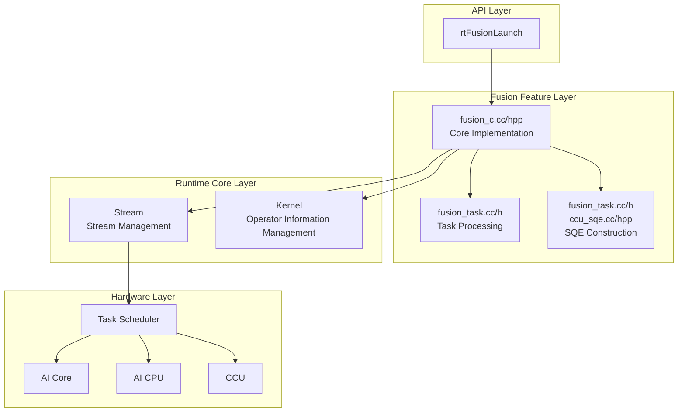
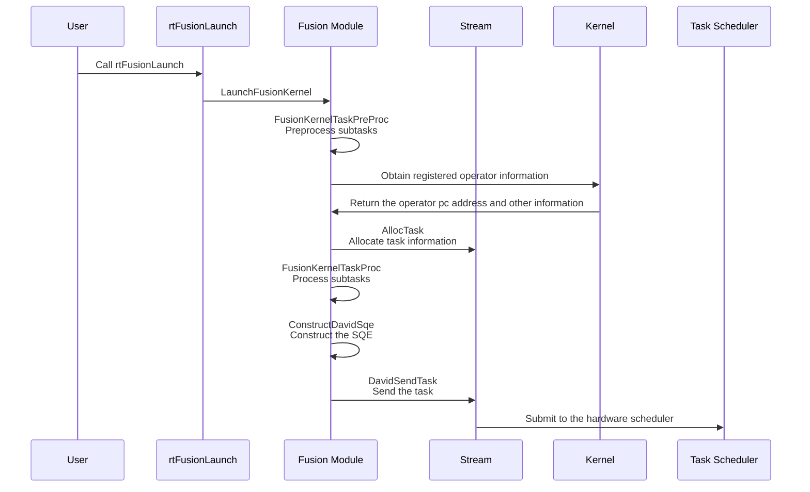
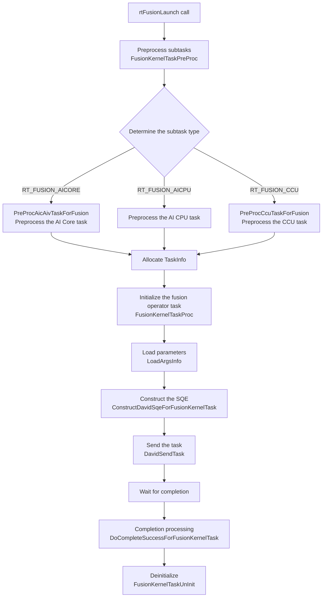

# Fusion (Operator Fusion) Feature

## 1. Feature Overview

- **Feature introduction**: Fusion is a feature supported by Ascend 950 and later chip generations. It supports fusion delivery and execution of multiple operator tasks of different categories (AI Core, AI CPU, HCOM CPU, CCU). By combining multiple operator tasks into one complete fusion operator task and submitting it to a stream, it reduces task scheduling overhead and improves execution efficiency.
- **Background**: In the traditional execution mode, each operator or task must be submitted to a stream separately and wait for scheduling and execution, which incurs considerable Host-side scheduling overhead. For some fixed operator combinations or computation patterns, submitting and delivering tasks one by one causes a performance bottleneck. The feature also provides a way for operators to cooperate with each other in a fusion scenario, so that operators can be scheduled and executed concurrently when resources are sufficient.
- **Design goals**:
  - Support fusion execution of multiple subtask types
  - Reduce Host-side task submission overhead
  - Improve overall computing performance
  - Provide flexible fusion combination modes

## 2. Usage Scenarios and External Interfaces

### 2.1 Usage Scenarios

- **Scenario 1**: Compute (or communication) and compute operator fusion
1) AI CPU + AI Core fusion
  ```cpp
  // Create fusion operator task information
  rtFunsionTaskInfo_t fusionInfo;
  fusionInfo.subTaskNum = 2;
  
  // Configure the AI CPU subtask
  fusionInfo.subTask[0].type = RT_FUSION_AICPU;
  fusionInfo.subTask[0].task.aicpuInfo.kernelType = ...;
  fusionInfo.subTask[0].task.aicpuInfo.blockDim = 1;
  
  // Configure the AI Core subtask
  fusionInfo.subTask[1].type = RT_FUSION_AICORE;
  fusionInfo.subTask[1].task.aicoreInfo.stubFunc = stubFunc;
  fusionInfo.subTask[1].task.aicoreInfo.config = launchConfig;
  
  // Submit the fusion operator task
  rtFusionLaunch(&fusionInfo, stream, &argsInfo);
  ```

- **Scenario 2**: Communication and compute operator fusion
1) CCU + AI Core fusion
  ```cpp
  // Create fusion operator task information
  rtFunsionTaskInfo_t fusionInfo;
  fusionInfo.subTaskNum = 2;
  
  // Configure the CCU subtask
  fusionInfo.subTask[0].type = RT_FUSION_CCU;
  fusionInfo.subTask[0].task.ccuInfo.taskNum = 1;
  fusionInfo.subTask[0].task.ccuInfo.ccuTaskInfo[0].dieId = 0;
  fusionInfo.subTask[0].task.ccuInfo.ccuTaskInfo[0].missionId = 0;
  
  // Configure the AI Core subtask
  fusionInfo.subTask[1].type = RT_FUSION_AICORE;
  fusionInfo.subTask[1].task.aicoreInfo.stubFunc = stubFunc;
  fusionInfo.subTask[1].task.aicoreInfo.config = launchConfig;
  
  // Submit the fusion operator task
  rtFusionLaunch(&fusionInfo, stream, &argsInfo);
  ```

### 2.2 External Interfaces

| Interface | File location | Description |
|------|----------|------|
| `rtFusionLaunch` | `pkg_inc/runtime/rt_external_kernel.h:545` | Submit and deliver a fusion operator task |

**Interface parameter description**:
```cpp
rtError_t rtFusionLaunch(
    void * const fusionInfo,       // Fusion operator task information (rtFunsionTaskInfo_t*)
    rtStream_t const stm,          // Associated stream
    rtFusionArgsEx_t *argsInfo     // Parameter information
);
```

## 3. Architecture Overview

### Overall Design Approach

The Fusion feature builds on Runtime core layer modules such as Stream, Task, and Kernel. It provides the Fusion module with complete end-to-end API-level functions, including preprocessing of fusion operator task input information, task initialization, SQE construction, task submission, and post-completion processing.

### Layered Architecture Diagram



### Core Module Interaction Diagram



## 4. Detailed Design

### 4.1 Core Flows



#### LaunchFusionKernel (Start the Fusion Kernel)

**Location**: `src/runtime/feature/fusion/fusion_c.cc:450`

**Responsibilities**:

1. Preprocess subtasks. This function involves the handler logic of each subtask, including handler modules for AI CPU, AI Core, and CCU subtasks. The specific processing logic acquires and preprocesses required fields based on the subtask combination type and the information carried by the subtask in the parameters (calls `FusionKernelTaskPreProc`)
2. Allocate TaskInfo using stream resources
3. Process the fusion operator task. After the required field information of each subtask type is processed, initialize and assign fields of the overall Fusion task (calls `FusionKernelTaskProc`)
4. Load parameters. Specifically, load the args data passed by the rtFusionLaunch interface to the device side for access during operator execution (calls `LoadArgsInfo`)
5. Send the task. After converting taskInfo into an SQE that the hardware recognizes, send it to the hardware task scheduler through the driver channel (calls `DavidSendTask`)

#### ConstructDavidSqeForFusionKernelTask (Construct the SQE)

**Location**: `src/runtime/feature/fusion/fusion_task.cc:279`

**Responsibilities**: Construct the corresponding SQE based on the subtask type
- AI Core: Calls `ConstructAicAivSubSqe` and determines whether the task is AIC, AIV, or Mix by mixType
- AI CPU/HCOM CPU: Calls `ConstructAicpuSubSqe`
- CCU: Calls `ConstructCcuSubSqe`

### 4.2 Supported Subtask Types

| Subtask type | Enumeration value | Description | SQE construction function |
|-----------|--------|------|------------|
| AI CPU | `RT_FUSION_HCOM_CPU = 0`or`RT_FUSION_AICPU = 1` | AI CPU (communication or compute) operator execution | `ConstructAicpuSubSqe` |
| AI Core | `RT_FUSION_AICORE = 2` | AI Core/Vector operator execution | `ConstructAicAivSubSqe` |
| CCU | `RT_FUSION_CCU = 3` | Collective communication task | `ConstructCcuSubSqe` |

### 4.3 Fusion Combination Modes

The fusion sub tasks support the following combination modes:

1. **aicpu + aic**: AI CPU + AI Core fusion. The AI CPU operator here is usually a compute operator task or a communication operator task
2. **ccu + aic**: CCU + AI Core fusion

### 4.4 Core Data Structures

#### rtFunsionTaskInfo_t (Combination Information of Fused Operator Subtasks)
◆ Summary structure of the subtask information in a Fusion task.
```cpp
#define FUSION_SUB_TASK_MAX_NUM     (2U)
typedef struct tagRtFunsionTaskInfo {
    uint32_t subTaskNum;                              // Number of subtasks
    rtFusionSubTaskInfo_t subTask[FUSION_SUB_TASK_MAX_NUM];  // Subtask array (maximum 2)
} rtFunsionTaskInfo_t;
```

#### FusionTaskInfo (Internal Information of a Fusion Operator Task)
◆ Stores required field information related to the fusion operator during task initialization and delivery, for example the subtask combination type, task count, and whether the task contains a CCU task.
```cpp
struct FusionTaskInfo;
```

#### FusionTaskInfoAicPart (AI Core Task Part)
◆ Stores required field information of the AI Core subtask in a fusion operator task, for example the pc address, args parameter address, dimensions required for core splitting, and SIMT memory size.
```cpp
struct FusionTaskInfoAicPart;
```

## 5. Key Design Ideas

### 5.1 Reduce Scheduling Overhead

By merging multiple subtasks into one fusion operator task, the feature reduces the number of task submissions and thereby lowers Host-side scheduling overhead.

### 5.2 Flexible Combination Modes

The feature supports combinations of multiple subtask types. You can select the optimal fusion combination for different computation patterns or scenarios.

### 5.3 Task Update Support

Fusion operator tasks support updating the parameters of captured tasks or the tasks themselves in ACL Graph scenarios.

## 6. Key File Index

| Module | File path | Core content |
|------|----------|----------|
| Fusion API | `pkg_inc/runtime/rt_external_kernel.h` | `rtFusionLaunch` interface definition and data structures such as `rtFunsionTaskInfo_t` and `rtFusionArgsEx_t` |
| Fusion core implementation | `src/runtime/feature/fusion/fusion_c.cc` | `LaunchFusionKernel`, `FusionKernelTaskPreProc`, `AixKernelTaskInitForFusion` |
| Fusion task processing | `src/runtime/feature/fusion/fusion_task.cc` | `BuildFusionKernelTaskName`, `DoCompleteSuccessForFusionKernelTask`, `FusionKernelTaskUnInit` |
| Fusion SQE construction | `src/runtime/feature/fusion/fusion_task.cc`<br>`src/runtime/feature/ccu/ccu_sqe.cc` | `ConstructDavidSqeForFusionKernelTask`, `ConstructAicAivSubSqe`, `ConstructCcuSubSqe` |
| Task data structures | `src/runtime/core/inc/task/task_info.hpp` | `TaskInfo` structure definition, including `FusionTaskInfo` |
| Task base structures | `src/runtime/core/inc/task/task_info_base.hpp` | Detailed definitions of `FusionTaskInfo` and `FusionTaskInfoAicPart` |
