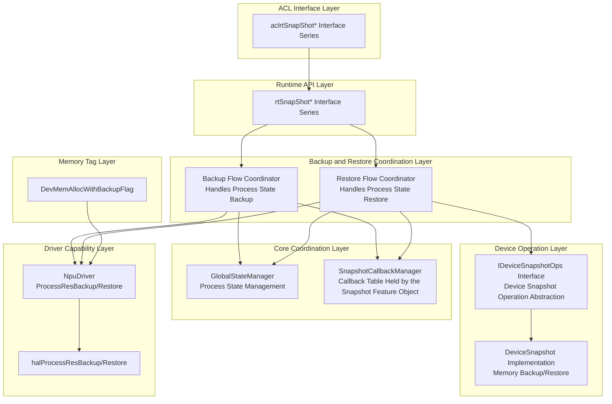
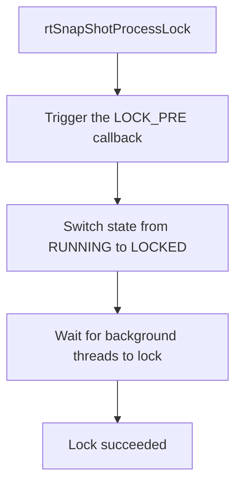
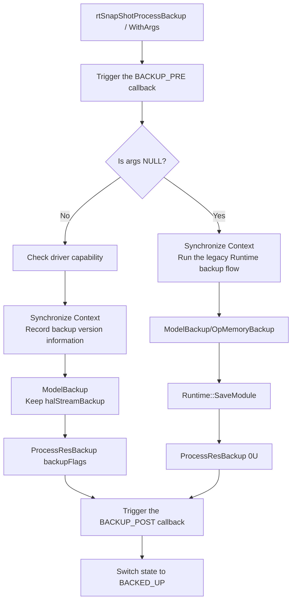
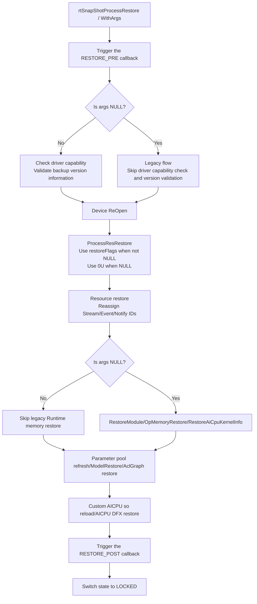
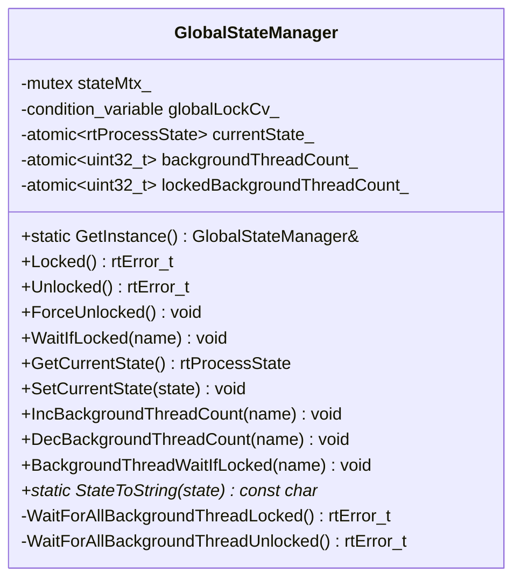
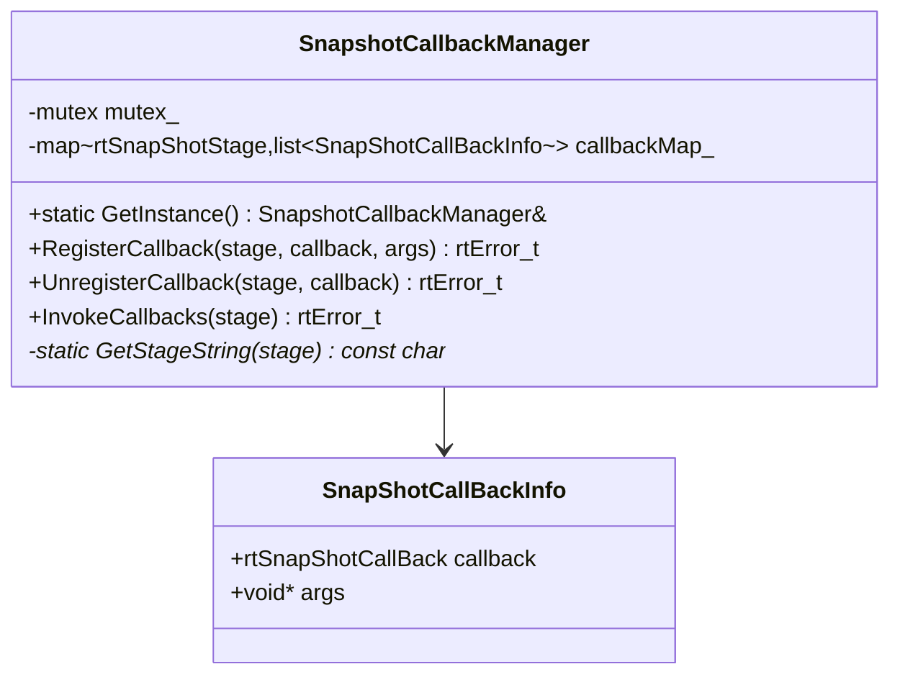
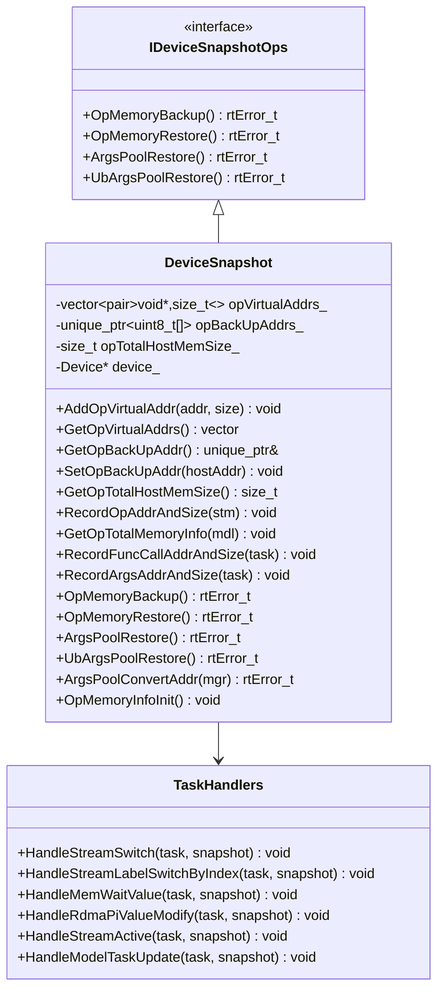
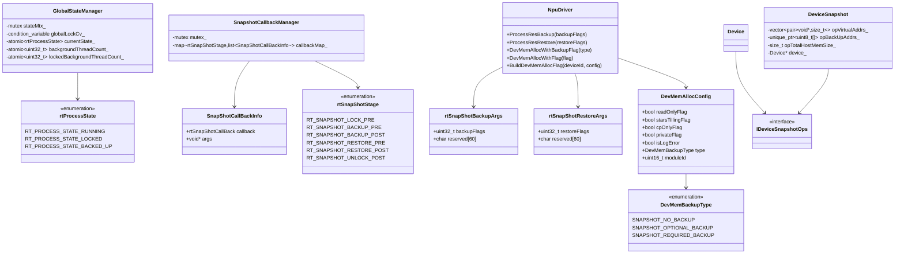
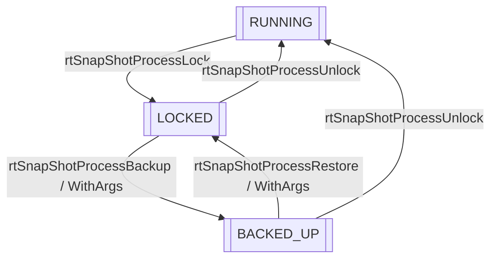

# Snapshot Feature

## 1. Feature Overview

- **Feature introduction**: The Snapshot feature supports saving and restoring NPU process state for process-level snapshot backup/restore scenarios (fault recovery). By locking the process, backing up critical state, and restoring resources, it achieves complete save and restore of process state.
- **Background**: A process needs to save its complete state during execution so that it can restore later. The fault recovery efficiency of large-scale AI clusters directly affects the availability and resource utilization of training tasks. The traditional fault recovery data path involves multiple serial stages, including container scheduling, process rebuild, host and device link setup, operator compilation, and weight loading. A single recovery can take more than ten minutes.
- **Design goals**:
  - Support process lock/unlock control
  - Support process state backup
  - Support process state restore
  - Support switching the backup/restore flow based on driver capabilities
  - Support Runtime internal device memory participating in snapshots by required/optional/no_backup tag
  - Provide a multi-stage callback mechanism

## 2. Usage Scenarios and External Interfaces

### 2.1 Usage Scenarios

- **Scenario 1**: Process snapshot backup
  ```cpp
  // 1. Lock the process
  aclError ret = aclrtSnapShotProcessLock(pid, nullptr);
  // 2. Back up the process state
  aclrtSnapShotBackupArgs backupArgs = {};
  backupArgs.backupFlags = 0U;
  ret = aclrtSnapShotProcessBackup(pid, &backupArgs);
  // 3. Restore the process state on the target side
  aclrtSnapShotRestoreArgs restoreArgs = {};
  restoreArgs.restoreFlags = 0U;
  ret = aclrtSnapShotProcessRestore(pid, &restoreArgs);
  // 4. Unlock the process
  ret = aclrtSnapShotProcessUnlock(pid, nullptr);
  ```

- **Scenario 2**: Register callbacks for snapshot stages
  ```cpp
  // Register the pre-backup callback
  aclrtSnapShotCallBack callback = MyBackupPreCallback;
  aclrtSnapShotCallbackRegister(ACL_RT_SNAPSHOT_BACKUP_PRE, callback, nullptr);
  // Register the post-restore callback
  aclrtSnapShotCallbackRegister(ACL_RT_SNAPSHOT_RESTORE_POST, MyRestorePostCallback, nullptr);
  ```

### 2.2 External Interfaces

| Interface | File location | Description |
|------|----------|------|
| `aclrtSnapShotProcessLock()` | `include/external/acl/acl_rt.h` | Lock the process |
| `aclrtSnapShotProcessUnlock()` | `include/external/acl/acl_rt.h` | Unlock the process |
| `aclrtSnapShotProcessBackup()` | `include/external/acl/acl_rt.h` | Back up the process state |
| `aclrtSnapShotProcessRestore()` | `include/external/acl/acl_rt.h` | Restore the process from the backup point |
| `aclrtSnapShotCallbackRegister()` | `include/external/acl/acl_rt.h` | Register a snapshot stage callback |
| `aclrtSnapShotCallbackUnregister()` | `include/external/acl/acl_rt.h` | Unregister a snapshot stage callback |

### 2.3 Snapshot Stage Definitions

```cpp
// File location: include/external/acl/acl_rt.h
typedef enum {
    ACL_RT_SNAPSHOT_LOCK_PRE = 0,
    ACL_RT_SNAPSHOT_BACKUP_PRE,
    ACL_RT_SNAPSHOT_BACKUP_POST,
    ACL_RT_SNAPSHOT_RESTORE_PRE,
    ACL_RT_SNAPSHOT_RESTORE_POST,
    ACL_RT_SNAPSHOT_UNLOCK_POST,
} aclrtSnapShotStage;
```

### 2.4 Backup and Restore Parameters

`aclrtSnapShotBackupArgs.backupFlags` and `aclrtSnapShotRestoreArgs.restoreFlags` control the driver backup and restore scope:

| Value | Meaning |
|------|------|
| `0U` | Process only required-level snapshot memory. |
| `1U` | Process both required-level and optional-level snapshot memory. |

When `args` is not `NULL`, the ACL layer validates the parameters: `backupFlags` / `restoreFlags` can only be `0U` or `1U`. If validation fails, the ACL layer returns an invalid parameter error directly.

`reserved` is a redundant reserved field. The current backup and restore flow does not use this field.

When `args` is `NULL`, the runtime is compatible with legacy interface semantics and directly runs the legacy Runtime backup and restore flow. `backupFlags` / `restoreFlags` do not participate in the judgment. When `args` is not `NULL`, the runtime checks whether the driver supports process-level device memory snapshots. If the driver supports them, the runtime controls the driver backup and restore scope by flags. If the driver does not support them, the runtime returns not supported directly and does not fall back to the legacy Runtime flow.

## 3. Architecture Overview

### Overall Design Approach

The original `ApiImplSnapshot` implementation resides entirely in feature/snapshot and directly holds the service thread and callback table. Local calls and cross-process distribution share its service flow. The runtime uses the existing Snapshot API object to start the service at the end of initialization and stops and joins the service thread on exit.

The Snapshot feature uses a layered architecture:
- **ACL interface layer**: Provides C language interfaces (aclrtSnapShot* series)
- **Runtime API layer**: When ACL parameters are empty, calls the legacy parameterless `rtSnapShotProcessBackup` / `rtSnapShotProcessRestore` to keep legacy flow compatibility semantics. When ACL parameters are not empty, uses `rtSnapShotProcessBackupWithArgs` / `rtSnapShotProcessRestoreWithArgs` to carry and pass through `backupFlags` / `restoreFlags`
- **Core coordination layer**: GlobalStateManager manages process state and version information. SnapshotCallbackManager manages callbacks
- **Backup and restore coordination layer**: Namespace-level functions implement backup and restore flow coordination
- **Device operation layer**: DeviceSnapshot implements legacy Runtime memory backup and restore and handles parameter pool address refresh
- **Driver capability layer**: NpuDriver calls `halProcessResBackup` / `halProcessResRestore` to perform process-level device memory snapshots
- **Memory tag layer**: Runtime internal device memory requests specify required/optional/no_backup tags for the driver to select the backup scope by flags

### Layered Architecture Diagram



### Core Module Interaction Diagram

```mermaid
sequenceDiagram
participant App as Application Layer
participant ACL as ACL API
participant RT as Runtime API
participant ApiImpl as ApiImpl
participant SCM as SnapshotCallbackManager
participant GSM as GlobalStateManager
participant Process as SnapShotProcessBackup
participant Dev as Device
participant DS as DeviceSnapshot
participant Drv as NpuDriver
App->>ACL: aclrtSnapShotProcessLock()
ACL->>RT: rtSnapShotProcessLock()
RT->>ApiImpl: SnapShotProcessLock()
ApiImpl->>SCM: InvokeCallbacks(RT_SNAPSHOT_LOCK_PRE)
SCM->>SCM: Iterate the callback map and invoke callbacks for each device
SCM-->>ApiImpl: Callback result
ApiImpl->>GSM: Locked()
GSM->>GSM: Switch state from RUNNING to LOCKED
GSM->>GSM: WaitForAllBackgroundThreadLocked()
GSM-->>ApiImpl: Lock succeeded
ApiImpl-->>App: Return result
App->>ACL: aclrtSnapShotProcessBackup()
ACL->>RT: Invoke rtSnapShotProcessBackup when args is empty; otherwise invoke rtSnapShotProcessBackupWithArgs(args)
RT->>ApiImpl: SnapShotProcessBackup()
ApiImpl->>SCM: InvokeCallbacks(RT_SNAPSHOT_BACKUP_PRE)
SCM-->>ApiImpl: Callback result
ApiImpl->>Process: SnapShotProcessBackup()
alt args != NULL
    Process->>Drv: CheckIsSupportFeature(FEATURE_SVM_PROCESS_DEVICE_MEM_SNAPSHOT)
    Process->>Process: SnapShotPreProcessBackup(Synchronize Context)
    Process->>Process: SnapShotVersionInfoBackup()
else args == NULL
    Process->>Process: SnapShotPreProcessBackup(Synchronize Context)
    Process->>Process: Legacy flow; skip driver compatibility check and version recording
end
Process->>Dev: Iterate all devices
Process->>Process: QueryCustomAicpuProcess/ModelBackup(devId)
alt args != NULL and compatibility check passes
    Process->>Process: Model::SinkSqTasksBackup(Keep halStreamBackup)
    Process->>Drv: ProcessResBackup(backupFlags)
else args == NULL legacy flow
    Process->>DS: OpMemoryBackup()
    Process->>Process: Runtime::SaveModule()
    Process->>Drv: ProcessResBackup(0U)
end
ApiImpl->>SCM: InvokeCallbacks(RT_SNAPSHOT_BACKUP_POST)
ApiImpl->>GSM: SetCurrentState(BACKED_UP)
ApiImpl-->>App: Return result
App->>ACL: aclrtSnapShotProcessRestore()
ACL->>RT: Invoke rtSnapShotProcessRestore when args is empty; otherwise invoke rtSnapShotProcessRestoreWithArgs(args)
RT->>ApiImpl: SnapShotProcessRestore()
ApiImpl->>SCM: InvokeCallbacks(RT_SNAPSHOT_RESTORE_PRE)
ApiImpl->>Process: SnapShotProcessRestore()
alt args != NULL
    Process->>Drv: CheckIsSupportFeature(FEATURE_SVM_PROCESS_DEVICE_MEM_SNAPSHOT)
    Process->>Process: CheckSnapShotVersionInfo()
else args == NULL
    Process->>Process: Legacy flow; skip driver compatibility check and version validation
end
Process->>Process: SnapShotDeviceRestore(ReOpen)
Process->>Drv: ProcessResRestore(args != NULL ? restoreFlags : 0U)
Process->>Process: SnapShotResourceRestore(Stream/Event/Notify)
alt args == NULL legacy flow
    Process->>Process: Runtime::RestoreModule()
else args != NULL new flow
    Process->>Process: Skip Runtime module restore
end
Process->>Dev: Iterate all devices
alt args == NULL legacy flow
    Process->>DS: OpMemoryRestore()
    Process->>Dev: RestoreAiCpuKernelInfo()
else args != NULL new flow
    Process->>Process: Skip legacy Runtime memory restore
end
Process->>DS: ArgsPoolRestore()
Process->>DS: UbArgsPoolRestore()
Process->>Process: ModelRestore(devId)
Process->>Process: SnapShotAclGraphRestore(dev)
Process->>Process: BatchLoadCustomAicpuSo/SetAicpuDfxForRestore
ApiImpl->>SCM: InvokeCallbacks(RT_SNAPSHOT_RESTORE_POST)
ApiImpl->>GSM: SetCurrentState(LOCKED)
ApiImpl-->>App: Return result
App->>ACL: aclrtSnapShotProcessUnlock()
ACL->>RT: rtSnapShotProcessUnlock()
RT->>ApiImpl: SnapShotProcessUnlock()
ApiImpl->>GSM: Unlocked()
GSM->>GSM: Switch state from LOCKED to RUNNING
GSM->>GSM: Notify blocked threads
GSM->>GSM: WaitForAllBackgroundThreadUnlocked()
ApiImpl->>SCM: InvokeCallbacks(RT_SNAPSHOT_UNLOCK_POST)
ApiImpl-->>App: Return result
```

## 4. Detailed Design

### 4.1 Core Flows

#### Process Lock Flow



**Function description**:
- **Callback trigger**: Triggers the LOCK_PRE stage callback so that the upper layer can perform preparation work
- **State switch**: GlobalStateManager switches the process state from RUNNING to LOCKED
- **Thread synchronization**: Waits for all registered background threads to enter the blocked state to ensure state consistency
- **Error handling**: If the current state is not RUNNING or the wait times out, returns an error code

Key file location: `src/runtime/api/impl/api_impl_snapshot.cc`

#### Process Backup Flow



**Function description**:
- **Preprocessing stage**: Triggers the BACKUP_PRE callback. When `args` is not `NULL`, checks the driver capability first and then synchronizes all Contexts to ensure that no task is executing
- **Non-NULL parameter flow**: Checks whether the driver supports `FEATURE_SVM_PROCESS_DEVICE_MEM_SNAPSHOT` and returns not supported directly if it does not. If supported, synchronizes Contexts and records version information, skips legacy Runtime memory backup, and hands over to the driver through `NpuDriver::ProcessResBackup(backupFlags)`
- **NULL parameter flow**: Compatible with legacy interface semantics. Skips the driver capability check and version recording, runs legacy Runtime backup logic such as `OpMemoryBackup` and `Runtime::SaveModule`, and passes `0U` to the driver
- **Postprocessing stage**: Triggers the BACKUP_POST callback and switches the process state to BACKED_UP

Key file locations:
- `src/runtime/api/impl/api_impl_snapshot.cc`
- `src/runtime/feature/snapshot/snapshot_process_helper.cc`

#### Process Restore Flow



**Function description**:
- **Preprocessing stage**: Triggers the RESTORE_PRE callback and prepares the restore environment
- **Non-NULL parameter flow**: Checks whether the driver supports `FEATURE_SVM_PROCESS_DEVICE_MEM_SNAPSHOT` and returns not supported directly if it does not. If supported, validates the Runtime/Driver API versions recorded during backup. If the versions do not match, the restore fails
- **NULL parameter flow**: Compatible with legacy interface semantics. Skips the driver capability check and version consistency validation, and runs the legacy Runtime restore flow
- **Device restore stage**: Reopens all devices and calls the driver to restore process resources
- **Resource restore stage**: Clears and reassigns Stream IDs, Event IDs, and Notify IDs
- **Non-NULL parameter new flow**: Skips legacy Runtime memory restore such as `RestoreModule`, `OpMemoryRestore`, and `RestoreAiCpuKernelInfo` to avoid overlap with driver restore
- **NULL parameter legacy flow**: Keeps the legacy Runtime memory restore logic
- **Retained flow**: Parameter pool address refresh, `ModelRestore`, ACL Graph restore, custom AICPU so reload, and AICPU DFX restore continue to run. `halStreamRestore` is retained in `ModelRestore`
- **Postprocessing stage**: Triggers the RESTORE_POST callback and switches the process state to LOCKED

Key file locations:
- `src/runtime/api/impl/api_impl_snapshot.cc`
- `src/runtime/feature/snapshot/snapshot_process_helper.cc`

#### Compatibility and Memory Tag Policy

The Snapshot feature selects the new or legacy flow based on whether `args` is empty. It checks the driver feature only when `args` is not empty:

| Condition | Backup behavior | Restore behavior |
|------|----------|----------|
| `args == NULL` | Compatible with legacy interface semantics. Skips the `FEATURE_SVM_PROCESS_DEVICE_MEM_SNAPSHOT` check and runs the legacy Runtime backup flow. | Compatible with legacy interface semantics. Skips the `FEATURE_SVM_PROCESS_DEVICE_MEM_SNAPSHOT` check and skips backup/restore version consistency validation. Runs the legacy Runtime restore flow. |
| `args != NULL` and `FEATURE_SVM_PROCESS_DEVICE_MEM_SNAPSHOT` is supported | The underlying driver performs backup by the passed `backupFlags` and device memory tags. When `backupFlags` is `1U`, the driver backs up memory with the optional and required tags. When `backupFlags` is `0U`, the driver backs up only memory with the required tag. | Validates backup/restore version consistency first. After validation passes, the underlying driver performs restore by the passed `restoreFlags` and device memory tags. When `restoreFlags` is `1U`, the driver restores memory with the optional and required tags. When `restoreFlags` is `0U`, the driver restores only memory with the required tag. |
| `args != NULL` and `FEATURE_SVM_PROCESS_DEVICE_MEM_SNAPSHOT` is not supported | The current driver version does not provide process-level device memory backup capability. Returns not supported directly and does not fall back to the legacy Runtime backup flow. | The current driver version does not provide process-level device memory restore capability. Returns not supported directly and does not fall back to the legacy Runtime restore flow. |

When `args` is not empty and compatibility passes, the driver side determines the backup and restore scope by device memory tags and `backupFlags` / `restoreFlags`. When `args` is empty, the legacy Runtime flow completes the backup and restore logic. In this case, tags do not participate in the legacy flow judgment, and the tags themselves have no actual meaning. The runtime applies the following tag principles:

| Tag | Usage principle |
|------|----------|
| `SNAPSHOT_REQUIRED_BACKUP` | Memory that the driver must back up and restore when compatibility passes, regardless of whether `backupFlags` / `restoreFlags` is `0U` or `1U`. Applies to Runtime internal device memory whose contents must remain consistent after restore. |
| `SNAPSHOT_OPTIONAL_BACKUP` | Memory that the driver backs up and restores only when compatibility passes and `backupFlags` / `restoreFlags` is `1U`. Applies to Runtime auxiliary memory that does not require backup or can be rebuilt or redelivered during the restore stage. |
| `SNAPSHOT_NO_BACKUP` | Memory that does not require driver backup or restore even when compatibility passes. Applies to external user memory requested by aclrt related interfaces, which does not participate in Snapshot backup and restore. |

Only device memory requested inside the runtime needs to participate in snapshot backup. Select the required or optional tag based on the content consistency requirement after restore. External user memory requested by aclrt related interfaces uniformly uses `SNAPSHOT_NO_BACKUP` and does not participate in snapshots. Device memory requests use two methods: `DevMemAllocWithBackupFlag` and `DevMemAllocWithFlag` (see `docs/zh/design/modules/memory/memory.md` for interface descriptions):

- When all config members use default values, call `DevMemAllocWithBackupFlag` and pass the backup tag explicitly through the positional `type` parameter;
- When the config has members that do not apply default values, call `DevMemAllocWithFlag`. Construct the config first and assign values to non-default members, then generate `drvFlag` through `NpuDriver::BuildDevMemAllocFlag(deviceId, &config)` and request with both.

### 4.2 Core Component Details

#### GlobalStateManager Process State Management

**Design idea**: Manages global process state, controls API call blocking, and coordinates background thread locking. Located in the `cce::runtime` namespace.



Key file locations:
- Header file: `src/runtime/core/inc/common/global_state_manager.hpp`
- Implementation file: `src/runtime/core/src/common/global_state_manager.cc`

#### SnapshotCallbackManager Callback Manager

**Design idea**: An independent singleton manages snapshot callback functions and provides callback registration, unregistration, and triggering. Located in the `cce::runtime` namespace.



Key file locations:
- Header file: `src/runtime/feature/snapshot/snapshot_callback_manager.hpp`
- Implementation file: `src/runtime/feature/snapshot/snapshot_callback_manager.cc`

#### IDeviceSnapshotOps Device Snapshot Operations Interface

**Design idea**: The abstract interface defines the core device snapshot operations for easy extension and adaptation to different hardware versions. In the legacy flow where `args` is empty, `DeviceSnapshot` performs legacy Runtime memory backup and restore. When `args` is not empty and compatibility passes, the driver takes over legacy memory backup and restore, and `ArgsPoolRestore` / `UbArgsPoolRestore` still refresh parameter pool address information.



Key file locations:
- Interface definition: `src/runtime/core/inc/common/idevice_snapshot_ops.hpp`
- Implementation class header file: `src/runtime/feature/snapshot/device_snapshot.hpp`
- Implementation file: `src/runtime/feature/snapshot/device_snapshot.cc`

#### SnapShotProcessHelper Snapshot Processing Helper

**Design idea**: Provides helper functions such as pre-backup processing, version recording and validation, device restore, resource restore, model backup and restore, and ACL Graph restore. This module selects the new or legacy Snapshot flow based on whether `args` is empty. When `args` is not empty, it checks the driver feature and passes `backupFlags` / `restoreFlags` to the driver.

Key file locations:
- Header file: `src/runtime/feature/snapshot/snapshot_process_helper.hpp`
- Implementation file: `src/runtime/feature/snapshot/snapshot_process_helper.cc`

#### NpuDriver Snapshot Capabilities

**Design idea**: Encapsulates the driver-side process-level resource backup and restore capability and uniformly handles device memory snapshot tags.

Core responsibilities:
- `ProcessResBackup`: Calls `halProcessResBackup` and carries the optional backup flag when `backupFlags == 1U`.
- `ProcessResRestore`: Calls `halProcessResRestore` and carries the optional restore flag when `restoreFlags == 1U`.
- `DevMemAllocWithBackupFlag` / `DevMemAllocWithFlag`: Writes the `DevMemBackupType` tag when requesting device memory. The former receives it through the `type` parameter. For the latter, the caller sets `config.type` and then uses `NpuDriver::BuildDevMemAllocFlag(deviceId, &config)` to encode the backup type and other request attributes into the flag.

Key file locations:
- Header file: `src/runtime/driver/npu_driver.hpp`
- Implementation files: `src/runtime/driver/npu_driver.cc`, `src/runtime/driver/npu_driver_mem.cc`
- Driver abstraction interface: `src/runtime/core/inc/drv/driver.hpp`

### 4.3 Module Responsibilities

| Module | Responsibility | Location |
|------|------|------|
| GlobalStateManager | Process state management and API call blocking control | `core/inc/common/global_state_manager.hpp` |
| SnapshotCallbackManager | Callback management singleton | `feature/snapshot/snapshot_callback_manager.hpp` |
| IDeviceSnapshotOps | Device snapshot operation abstract interface | `core/inc/common/idevice_snapshot_ops.hpp` |
| DeviceSnapshot | Device memory backup and restore implementation | `feature/snapshot/device_snapshot.hpp` |
| SnapShotProcessHelper | Backup and restore helper functions | `feature/snapshot/snapshot_process_helper.hpp` |
| NpuDriver | Driver-side process resource backup and restore and memory tag conversion | `driver/npu_driver.hpp` |
| DevMemAllocWithBackupFlag | General fast path entry (the backup tag is passed explicitly through the positional `type` parameter; internal runtime memory uses required / optional as needed, and aclrt related interfaces pass `SNAPSHOT_NO_BACKUP`) | `core/inc/drv/driver.hpp` |
| DevMemAllocWithFlag | Regular interface (used when the config has non-default members): the caller sets the config first, then builds the flag through `NpuDriver::BuildDevMemAllocFlag(deviceId, &config)`, and passes it together with the config explicitly | `core/inc/drv/driver.hpp` |
| ApiImpl | API implementation and flow coordination | `api/impl/api_impl_snapshot.cc` |
| TaskHandlers | Task type handlers | `feature/snapshot/device_snapshot.hpp` |

### 4.4 Core Data Structures



## 5. Key Design Ideas

### 5.1 Process State Machine

#### State Definitions

The process state is defined by the `rtProcessState` enumeration and has three states:

| State | Description | Allowed operations |
|------|------|-----------|
| **RT_PROCESS_STATE_RUNNING** | The process runs normally | All APIs can execute normally. You can call Lock() to enter the LOCKED state |
| **RT_PROCESS_STATE_LOCKED** | The process is locked | You can call Backup() to enter the BACKED_UP state, or Unlock() to return to the RUNNING state |
| **RT_PROCESS_STATE_BACKED_UP** | The process is backed up | You can call Restore() to return to the LOCKED state, or Unlock() to return to the RUNNING state |

#### State Transition Rules

Process state transitions follow a strict state machine:



#### State Transition Constraints

**Normal transition paths**:
- RUNNING → LOCKED: Lock() succeeds only when the current state is RUNNING
- LOCKED → BACKED_UP: Backup() succeeds only when the current state is LOCKED
- BACKED_UP → LOCKED: Restore() succeeds only when the current state is BACKED_UP
- LOCKED/BACKED_UP → RUNNING: Unlock() succeeds only when the state is LOCKED or BACKED_UP

**State transition failure handling**:
- **Lock failure**: If the current state is not RUNNING or the background thread synchronization times out, the state reverts to RUNNING and all blocked threads are notified
- **Unlock failure**: If the current state is not LOCKED or BACKED_UP, returns the error code RT_ERROR_SNAPSHOT_UNLOCK_FAILED
- **Backup/Restore failure**: Does not affect state transitions. The specific flow handles it internally

#### Forced Unlock Scenarios

`ForceUnlocked()` forcibly unlocks the process on exit.

**Trigger timing**: Process exit (main function return, exit() call, or process termination)

Register it as a process exit cleanup function through `atexit()`:
```cpp
(void)atexit(&ThreadGuard::ThreadExit);
```
File location: `src/runtime/core/src/utils/osal.cc:218`

**Necessity**:
- If the process is still in the `LOCKED` or `BACKED_UP` state on exit, other threads may block on the condition variable waiting for unlock
- Without a forced unlock, these threads can never exit, and the process cannot end normally
- A forced unlock notifies all blocked threads to release blocking and allows the process to exit normally

**Design purpose**: Cleanup on abnormal process exit to avoid resource deadlocks and thread hangs

Key file locations:
- `src/runtime/core/src/common/global_state_manager.cc`
- `src/runtime/core/src/utils/osal.cc`

### 5.2 API Blocking Mechanism

#### Blocking Scenario Description

After the process is locked, APIs that modify device resources block and wait in the **Host-side calling thread** until the process is unlocked.

#### Blocking Mechanism Implementation

The API layer implements blocking through the `GLOBAL_STATE_WAIT_IF_LOCKED()` macro:

```cpp
#define GLOBAL_STATE_WAIT_IF_LOCKED() \
    GlobalStateManager::GetInstance().WaitIfLocked(__func__)
```

Blocking logic:
- **Blocking condition**: The process state is `RT_PROCESS_STATE_LOCKED` or `RT_PROCESS_STATE_BACKED_UP`
- **Blocking behavior**: The Host-side calling thread blocks on the condition variable `globalLockCv_` and waits for the state to become `RT_PROCESS_STATE_RUNNING`
- **Non-blocking scenario**: If the process state is `RUNNING`, returns directly and continues execution

Key file location: `src/runtime/core/inc/common/global_state_manager.hpp`

#### Blocking API Examples (Involving Device Resource Modifications)

| API category | Blocking interface examples |
|---------|---------------|
| **Memory API** | rtMalloc, rtFree, rtsMemcpy2D, rtsMallocHost, rtMallocHost, rtsHostRegister, rtHostRegisterV2, rtHostGetDevicePointer |
| **Stream API** | rtStreamCreate, rtStreamDestroy, rtStreamDestroyForce, rtStreamWaitEvent, rtStreamSwitchN, rtSetStreamSqLock, rtSetStreamSqUnlock |
| **Kernel API** | rtKernelLaunch, rtCccKernelLaunch |
| **Device API** | rtSetDevice, rtDeviceReset, rtsResetDevice |
| **Model API** | rtModelLoad, rtModelExecute |
| **Event API** | rtsEventCreate, rtEventDestroy |
| **Context API** | rtCtxCreate, rtCtxDestroy |

**Blocking statistics**: The source code has 249 places where APIs use the `GLOBAL_STATE_WAIT_IF_LOCKED()` macro.

#### Non-Blocking API Examples (Not Involving Resource Modifications)

**Query APIs**:
- rtGetDeviceCount, rtGetDevice, rtGetDeviceIDs
- rtStreamQuery, rtStreamGetPriority, rtStreamGetFlags
- rtSnapShotProcessGetState

**Synchronization APIs**:
- rtStreamSynchronize, rtStreamSynchronizeWithTimeout
- rtEventSynchronize

**Snapshot management APIs**:
- rtSnapShotProcessLock, rtSnapShotProcessUnlock
- rtSnapShotProcessBackup, rtSnapShotProcessRestore, rtSnapShotProcessBackupWithArgs, rtSnapShotProcessRestoreWithArgs
- rtSnapShotCallbackRegister, rtSnapShotCallbackUnregister

**Design principle**: The comment states "For any api that involves modifications to device resources, this should be added". That is, only APIs that involve device resource modifications block. Query and synchronization APIs do not block.

### 5.3 Callback Stage Design

Callbacks trigger at each key stage and allow upper-layer applications to run custom logic:

| Stage | Trigger timing | Typical purpose |
|------|----------|----------|
| LOCK_PRE | Before locking | Preparation work |
| BACKUP_PRE | Before backup | Save extra state |
| BACKUP_POST | After backup | Confirm backup completion |
| RESTORE_PRE | Before restore | Prepare the restore environment |
| RESTORE_POST | After restore | Confirm restore completion |
| UNLOCK_POST | After unlock | Cleanup work |

### 5.4 Background Thread Management

Locking requires waiting for all background threads to enter the blocked state:
- `IncBackgroundThreadCount(name)`: A background thread registers that it needs to block
- `BackgroundThreadWaitIfLocked(name)`: A background thread checks and blocks
- `DecBackgroundThreadCount(name)`: A background thread unregisters on exit

## 6. Key File Index

| Module | File path | Core content |
|------|----------|----------|
| API header file | `pkg_inc/runtime/rts/rts_snapshot.h` | External interface definitions and state enumeration |
| ACL implementation | `src/acl/aclrt_impl/snapshot.cpp` | ACL layer interface encapsulation |
| Runtime API | `src/runtime/api/api_c_snapshot.cc` | C API implementation |
| API implementation | `src/runtime/api/impl/api_impl_snapshot.cc` | SnapShotProcess interface implementation |
| State management | `src/runtime/core/inc/common/global_state_manager.hpp` | GlobalStateManager class definition |
| State management implementation | `src/runtime/core/src/common/global_state_manager.cc` | Process state management implementation |
| Callback management | `src/runtime/feature/snapshot/snapshot_callback_manager.hpp` | SnapshotCallbackManager class definition |
| Callback management implementation | `src/runtime/feature/snapshot/snapshot_callback_manager.cc` | Callback registration, unregistration, and trigger implementation |
| Driver abstraction | `src/runtime/core/inc/drv/driver.hpp` | `DevMemAllocWithBackupFlag` abstract interface |
| Driver encapsulation | `src/runtime/driver/npu_driver.hpp`, `src/runtime/driver/npu_driver.cc` | Process resource backup and restore and memory tag conversion |
| Device memory request | `src/runtime/driver/npu_driver_mem.cc` | Write the snapshot tag when requesting device memory |
| Device snapshot interface | `src/runtime/core/inc/common/idevice_snapshot_ops.hpp` | IDeviceSnapshotOps abstract interface |
| Device snapshot | `src/runtime/feature/snapshot/device_snapshot.hpp` | DeviceSnapshot class definition |
| Device snapshot implementation | `src/runtime/feature/snapshot/device_snapshot.cc` | Legacy Runtime memory backup and restore and parameter pool restore implementation |
| Snapshot helper | `src/runtime/feature/snapshot/snapshot_process_helper.hpp` | Processing helper function declarations |
| Snapshot helper implementation | `src/runtime/feature/snapshot/snapshot_process_helper.cc` | Compatibility judgment, backup and restore flow selection, and driver calls |
| Device adaptation v100 | `src/runtime/feature/snapshot/v100/device_snapshot_adapter.cc` | v100 version adaptation |
| Device adaptation v200 | `src/runtime/feature/snapshot/v200_base/device_snapshot_adapter.cc` | v200 version adaptation |

## 7. Typical Issues and Troubleshooting

### 7.1 Key Log Points

- `locked success.`: Lock succeeded
- `unlocked success.`: Unlock succeeded
- `start to restore resource`: Start resource restore
- `the resource is restored successfully`: Restore succeeded
- `current state is not the running state, current state is %s`: State error
- `Timeout: only %u/%u background threads locked`: Background thread lock timeout

### 7.2 Problem Localization Methods

1. **Lock failure**: Check whether the current process state is RUNNING
2. **Lock timeout**: Check whether background threads register and block correctly
3. **Backup failure**: Check whether Context synchronization succeeds and whether the model is of the AICPU type (not supported)
4. **Restore failure**: Check steps such as Device ReOpen and Stream ID reassignment

### 7.3 State Check

Use `rtSnapShotProcessGetState()` to get the current process state.

---

_This feature document is based on analysis of the source code in `src/runtime/feature/snapshot/` and `src/runtime/core/src/common/global_state_manager.cc`._
