# Context Module Architecture

## 1. Module Overview

- **Function introduction**: The Context maintains the execution context of the runtime on a specified Device. The Context is bound to a Device and manages the default Stream, user Streams, Model, CaptureModel, Module, error states, and so on. When a Runtime API runs, it first obtains the Context associated with the current thread. It then determines the target Device through that Context. Later task delivery, synchronization, exception handling, and resource reclaim all complete on that Context and its Device.
- **Design goals**:
  - Support `aclrtSetDevice` to associate the default Context, and support `aclrtCreateContext` to explicitly create a user Context.
  - Save the current Context in a thread local variable in thread local storage (TLS) to isolate the execution environment of each thread.
  - Manage the association between the Context and related resources, and manage resource reclaim.
  - Combine the lifecycle state machine, USER/INTERNAL access modes, and thread association to protect Context access safety.

Contexts fall into two types by creation and binding method:

| Form | Creation entry | Core object | Lifecycle management |
| --- | --- | --- | --- |
| Default Context | `aclrtSetDevice()` | `Context(dev, true)` | Managed by Device set/reset. The runtime maintains the default Context object and its **reference count** through `RefObject<Context *>`. Reset releases associated resources but keeps the Context object for later reuse |
| User Context | `aclrtCreateContext()` | `Context(dev, false)` | Registered by `ContextManage` and explicitly destroyed by `aclrtDestroyContext()`. Final deletion of the Context object is controlled by the thread binding reference count |

## 2. Usage Scenarios and External Interfaces

### 2.1 Usage Scenarios

- **Scenario 1**: Set a Device and use the default Context.

  ```cpp
  aclrtSetDevice(0);
  // The runtime internally creates or reuses the default Context for device 0 and binds it to the current thread.
  ```

- **Scenario 2**: Explicitly create two user Contexts, then switch between them and destroy them.

  ```cpp
  aclrtContext ctxA = nullptr;
  aclrtContext ctxB = nullptr;
  aclrtCreateContext(&ctxA, 0);
  aclrtCreateContext(&ctxB, 0);
  // After ctxB is created, ctxB is the current Context.
  
  aclrtSetCurrentContext(ctxA);
  // The current Context switches from ctxB to ctxA.
  // ... Deliver tasks under ctxA ...
  
  aclrtSetCurrentContext(ctxB);
  // The current Context switches from ctxA back to ctxB.
  // ... Deliver tasks under ctxB ...
  
  aclrtDestroyContext(ctxA);
  aclrtDestroyContext(ctxB);
  ```

- **Scenario 3**: Obtain the default Stream of the current Context.

  ```cpp
  aclrtStream stream = nullptr;
  aclrtCtxGetCurrentDefaultStream(&stream);
  ```

- **Scenario 4**: Reuse one user Context across multiple threads.

  ```cpp
  aclrtContext sharedCtx = nullptr;
  aclrtCreateContext(&sharedCtx, 0);
  
  auto worker = [sharedCtx]() {
      aclrtSetCurrentContext(sharedCtx);    // Reuse the same Context
      // ... Deliver tasks under sharedCtx ...
  };
  
  std::thread threadA(worker);
  std::thread threadB(worker);
  threadA.join();
  threadB.join();
  aclrtDestroyContext(sharedCtx);
  ```

### 2.2 External Interfaces

| ACL interface | Description |
| --- | --- |
| `aclrtSetDevice()` | Set the Device used by the current thread. The runtime internally creates or reuses the corresponding default Context and associates it with the current thread |
| `aclrtResetDevice()` | Reset the specified Device and release resources associated with the default Context. The Context object can be retained for reuse when the Device is set again later |
| `aclrtCreateContext()` | Create a user Context and set it as the Context of the current thread |
| `aclrtDestroyContext()` | Destroy a user Context. It cannot destroy a default Context |
| `aclrtSetCurrentContext()` | Associate the specified Context with the current thread |
| `aclrtGetCurrentContext()` | Obtain the Context associated with the current thread |
| `aclrtCtxGetCurrentDefaultStream()` | Obtain the default Stream of the current Context |
| `aclrtGetPrimaryCtxState()` | Query whether the default Context of the specified Device is in the active state |

## 3. Architecture Overview

### 3.1 Overall Design Approach

The overall design of the Context module includes Context lifecycle management, thread association of the current Context, Context resource management, and validity protection and exception state handling.

| Design point | Description |
| --- | --- |
| Context lifecycle management | The default Context is managed by the Device set and reset paths and supports reuse. The user Context is explicitly created and destroyed by the user. For details, see [4.1 Core Flows](#41-core-flows) |
| Thread association | Runtime APIs without an explicit Context parameter find the Context through the current thread association and determine the execution environment. They support inter-thread isolation and Context switching. For details, see [4.3.1 Thread Association Mechanism](#431-thread-association-mechanism) |
| Resource management | Stream, Model, Module, and so on are managed by their owning Context. Related operations must complete under that Context. For details, see [4.2 Context Resource Management](#42-context-resource-management) |
| Validity protection | Centrally manage Context validity, state access, concurrent destruction, and exception state propagation. For details, see [4.3 Core Mechanism Details](#43-core-mechanism-details) |

### 3.2 Context Core Module Relationship Diagram

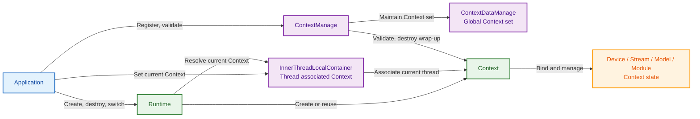

### 3.3 Core Module Interaction Diagram

#### 3.3.1 Default Context

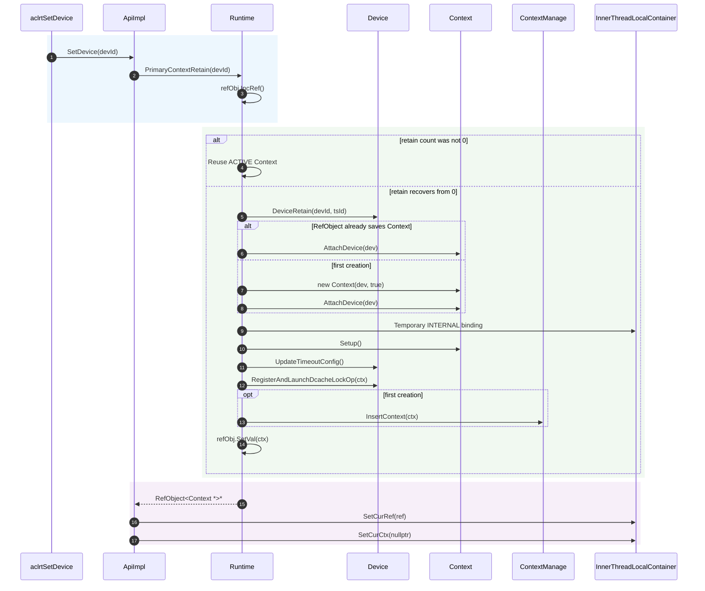

#### 3.3.2 User Context

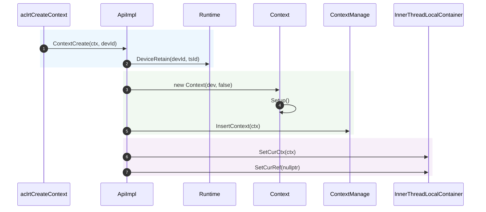

## 4. Detailed Design

### 4.1 Core Flows

#### 4.1.1 Default Context Core Flows

##### Creation and Reuse Flow

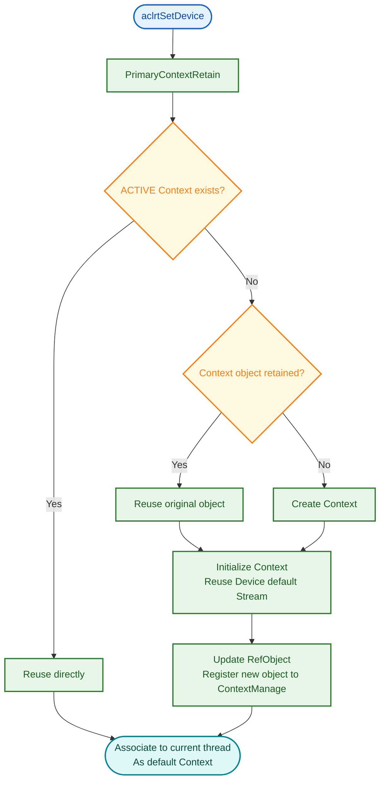

The runtime maintains a default Context by Device/TS. `aclrtSetDevice()` creates or reuses the corresponding Context, completes initialization when necessary, and associates it with the current thread.

**Key code**:

```cpp
// File location: src/runtime/api/impl/api_impl.cc
rtError_t ApiImpl::SetDevice(const int32_t devId)
{
    Runtime * const rt = Runtime::Instance();
    RefObject<Context *> *context = rt->PrimaryContextRetain(static_cast<uint32_t>(devId));
    NULL_PTR_RETURN_MSG(context, RT_ERROR_DEVICE_RETAIN);
    InnerThreadLocalContainer::SetCurRef(context);
    Context * const curCtx = context->GetVal();
    CHECK_CONTEXT_VALID_WITH_RETURN(curCtx, RT_ERROR_CONTEXT_NULL);
    InnerThreadLocalContainer::SetCurCtx(nullptr);
    return RT_ERROR_NONE;
}
```

##### Reset Release Flow

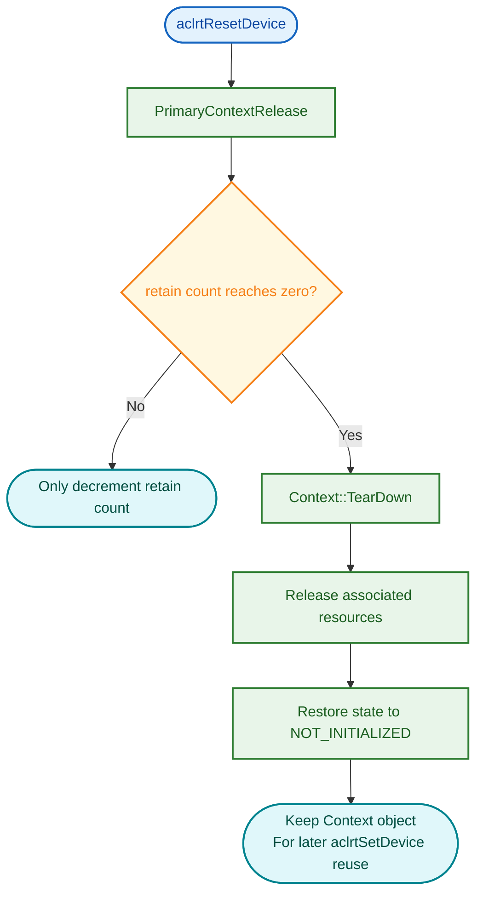

After the retain count reaches zero, the default Context runs teardown and releases associated resources. `RefObject<Context *>` continues to keep the Context object. A later `aclrtSetDevice()` reinitializes and reuses that object.

#### 4.1.2 User Context Core Flows

##### Creation Flow

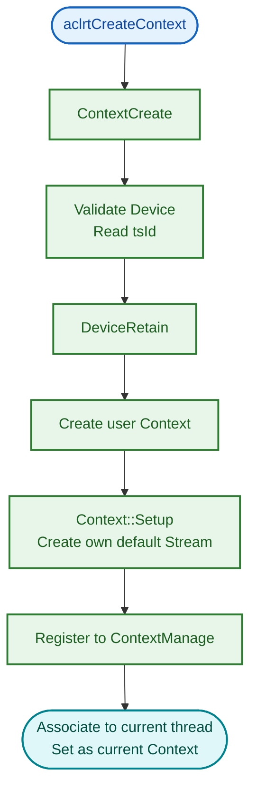

After creation succeeds, `ContextCreate()` immediately calls `ContextSetCurrent()`. The new Context becomes the Context associated with the current thread.

**Key code**:

```cpp
// File location: src/runtime/api/impl/api_impl.cc
rtError_t ApiImpl::ContextCreate(Context ** const inCtx, const int32_t devId)
{
    rtError_t error = NewContext(static_cast<uint32_t>(devId), tsId, inCtx);
    ERROR_RETURN_MSG_INNER(error, "new context failed, drv devId=%d", devId);

    ContextManage::InsertContext(*inCtx);
    error = ContextSetCurrent(*inCtx);
    ERROR_RETURN_MSG_INNER(error, "Failed to set current context");
    return RT_ERROR_NONE;
}
```

##### Destruction Flow

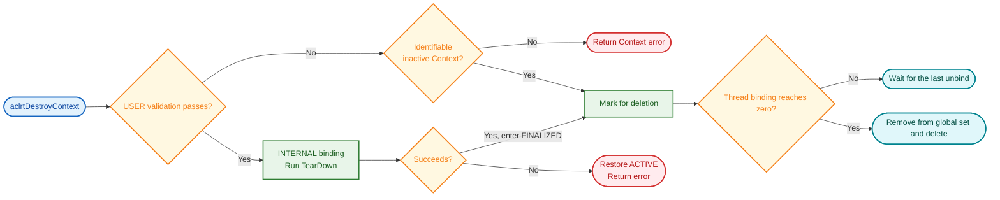

During user Context teardown, INTERNAL access is used. After teardown succeeds, the Context is marked for deletion. When `threadRefCount_` reaches zero, `TryDeleteIfNeeded()` completes the deletion. For details, see the ["Destruction Protection Mechanism" section](#434-destruction-protection-mechanism).

#### 4.1.3 Current Context Set and Get Flow

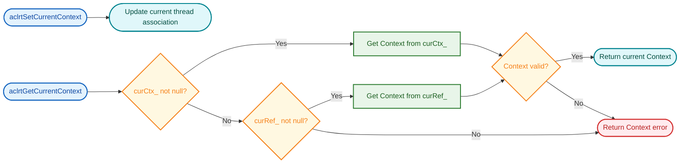

`aclrtSetCurrentContext()` associates the specified valid Context with the current thread. It does not distinguish between default Contexts and user Contexts.

`aclrtGetCurrentContext()` first returns the Context associated with `curCtx_`. When `curCtx_` is empty, it obtains the default Context associated by `aclrtSetDevice()` from `curRef_`.

### 4.2 Context Resource Management

The Context is bound to one Device and manages the Stream, Model, Module, and auxiliary resources in that execution environment. The Context maintains resource ownership and reclaim order. The Device and each resource module perform the actual resource allocation and execution capability.

#### 4.2.1 Resource Overview

The Context establishes resources on demand in `Setup()` and reclaims them in reverse order in `TearDown()` and the destructor. The resource fields held by the Context include:

```cpp
// File location: src/runtime/core/inc/context/context.hpp
class Context : public NoCopy {
protected:
    Device* device_;                                // Bound Device
private:
    Stream* defaultStream_;                         // Default Stream
    Stream* onlineStream_;
    std::list<Stream*> streams_;                    // User Stream set
    SpinLock modelLock_;
    std::list<Model*> models_;                      // Model set
    std::mutex moduleLock_;
    ObjAllocator<Module*>* moduleAllocator_;        // Module allocator (by Program ID)
    void* overflowAddr_ = nullptr;
    Atomic<bool> callBackThreadExist_;
    ContextCallBack threadCallBack_;                // Host Callback executor
    std::unique_ptr<Thread> hostFuncCallBackThread_;// Host Callback thread
    // ...
};
```

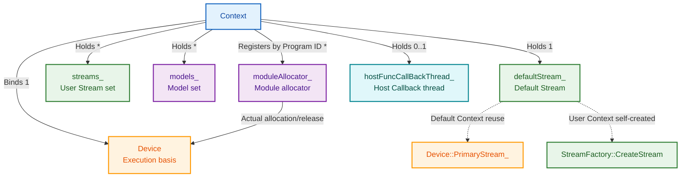

**Resource ownership constraints**:

- **Device**: Each Context binds only one Device. The Stream, Model, and Module owned by the Context all use the execution capability of that Device.
- **Stream, Model, Module**: Related operations must complete under the Context that owns the resource. Cross-Context use, binding, or destruction is not allowed.

#### 4.2.2 Stream Management

The Context mainly takes management responsibility for the following two types of Stream:

| Stream type | Source | Context responsibility | Reclaim path |
| --- | --- | --- | --- |
| Default Stream (`defaultStream_`) | Default Context: reuse `Device::PrimaryStream_()`<br />User Context: `StreamFactory::CreateStream` + `Setup` | Serve as the execution entry when no Stream is explicitly specified | User Context: destroy through `TearDownContextStream`<br />Default Context: only remove the association |
| User Stream (`streams_`) | `StreamCreate` explicitly creates it under the current Context, and then `InsertStreamList` registers it | Record ownership. Handle it together during Context synchronization/destruction | Destroy together through `TearDownOwnedStreamsOnContextTearDown` |

**Context synchronization rules**:

- `Context::Synchronize` traverses `streams_` and skips Streams that do not participate in synchronization (`IsStreamNotSync`).
- A Stream in the capture state immediately reports an error (`RT_ERROR_STREAM_CAPTURED`). The other Streams synchronize after task reclaim.

```cpp
// File location: src/runtime/core/src/context/context.cc
rtError_t Context::Synchronize(int32_t timeout)
{
    for (const auto& syncStream : streams_) {
        if (IsStreamNotSync(syncStream->Flags())) { continue; }
        COND_RETURN_ERROR(syncStream->IsCapturing(), RT_ERROR_STREAM_CAPTURED, ...);
        COND_PROC(syncStream->IsSyncFinished() && (GetCtxMode() == ABORT_ON_FAILURE), continue;);
        syncStreams.push_back(syncStream);
    }
    (void)TaskReclaimforSyncDevice(startTime, timeout);   // Reclaim tasks first
    const rtError_t error = CheckStatus();                // Then check Context state
    return SyncStreamsWithTimeout(syncStreams, timeout, startTime);
}
```

#### 4.2.3 Model Management

The Context records the Models created in its execution environment in `models_`. The binding relationship between a Model and a Stream must satisfy the same Context constraint.

- **Creation**: `ModelCreate` generates a Model, and the Context records it in `models_`.
- **Binding**: `ModelBindStream` requires the Model and the Stream to belong to the same Context. One Model can bind multiple Streams.
- **Reclaim**: During Context TearDown, `TearDownModelsOnContextTearDown()` reclaims all Models that still exist.

```cpp
// File location: src/runtime/core/src/context/context.cc
void Context::TearDownModelsOnContextTearDown()
{
    std::list<Model*> modelsToDelete;
    modelLock_.Lock();
    for (Model* tdModel : models_) {
        PrepareModelForDelete(tdModel);   // Unbind Stream and clean up Executor
    }
    modelsToDelete.swap(models_);
    modelLock_.Unlock();

    for (Model* tdModel : modelsToDelete) {
        DeleteModelOnContextTearDown(tdModel);   // Actually delete
    }
}
```

#### 4.2.4 Module Management

The Device performs the actual memory allocation and release for a Module. On the Context side, `moduleAllocator_` registers, looks up, and reuses Modules by Program ID. The same Program establishes a separate Module registration relationship in each Context.

- **Obtain**: `GetModule(prog)` queries by Program ID. If the Module exists, reuse it. If it does not exist, create and register it.
- **Reclaim**: During final Context release, `ReleaseModulesAfterTearDown()` traverses `moduleAllocator_` and releases all unreleased Modules.

```cpp
// File location: src/runtime/core/src/context/context.cc
void Context::ReleaseModulesAfterTearDown()
{
    uint32_t i = 0U;
    while ((i < Runtime::maxProgramNum_) && (moduleAllocator_ != nullptr)) {
        if (!moduleAllocator_->CheckIdValid(i)) {
            i = moduleAllocator_->NextPoolFirstId(i);
            continue;
        }
        ReleaseModule(i);   // Release the Module for this Program ID
        i++;
    }
}
```

### 4.3 Core Mechanism Details

The Context determines the current execution environment through **thread association**. It controls validity through the **lifecycle state machine** and **access modes**. It protects the destruction process through the **thread binding reference**. It also controls behavior after a fault through **exception state propagation**.

#### 4.3.1 Thread Association Mechanism

**Design idea**: The runtime saves an independent Context association (`curCtx_`) for each thread in TLS, so Runtime APIs without an explicit Context parameter can determine the execution environment. Thread association also provides destruction protection for user Contexts through `threadRefCount_`.

**Two types of thread association**:

| Association method | Storage location | Set entry | Increases `threadRefCount_` | Applicable Context |
| --- | --- | --- | --- | --- |
| `curCtx_` | `Context*` direct pointer | `ContextSetCurrent`, internal `SetCurCtx` | Yes (user Context and non-internal access) | User Context, internal temporary binding |
| `curRef_` | `RefObject<Context*>*` reference object | `aclrtSetDevice` through `SetCurRef` | No (the default Context lifecycle is managed by `RefObject` itself) | Default Context |

**Association establishment and release**:

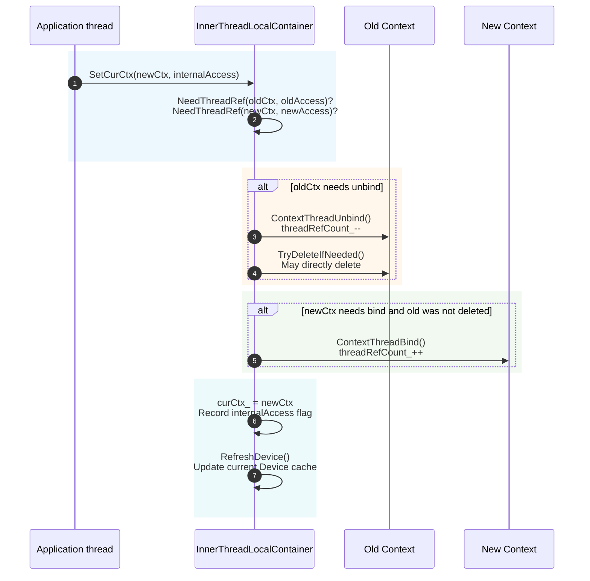

**Key code**:

```cpp
// File location: src/runtime/core/src/common/inner_thread_local.cpp
bool UpdateThreadBinding(Context* oldCtx, bool oldNeedThreadRef,
                         Context* newCtx, bool newNeedThreadRef)
{
    if (needUnbindOldCtx) {
        (void)oldCtx->ContextThreadUnbind();        // threadRefCount_--
        oldCtxDeleted = oldCtx->TryDeleteIfNeeded();// May be the last unbind
    }
    if (needBindNewCtx && ((!oldCtxDeleted) || !oldCtxIsNewCtx)) {
        newCtx->ContextThreadBind();                // threadRefCount_++
    }
    return oldCtxDeleted;
}

bool NeedThreadRef(const Context* const ctx, const bool internalAccess)
{
    // Only "user Context + user access" occupies threadRefCount_
    return (ctx != nullptr) && !internalAccess && !ctx->IsPrimary();
}
```

**Mechanism points**:

1. **Inter-thread isolation**: `curCtx_` is a TLS variable. A switch affects only the current thread.
2. **Multi-thread sharing**: Multiple threads can associate with the same user Context. Each thread binds and unbinds independently.

#### 4.3.2 Lifecycle State Machine

**Design idea**: The Context manages the entire lifecycle through the `lifecycleState_` atomic state machine. All state switches complete through `TrySwitchState` or `SetState`, which ensures state consistency under multi-thread concurrency.

**State definitions and transitions**:

```cpp
// File location: src/runtime/core/inc/context/context.hpp
enum class ContextState : uint8_t {
    CTX_STATE_NOT_INITIALIZED = 0U,   // Not initialized/waiting for reuse after reset
    CTX_STATE_INITIALIZING    = 1U,   // Setup running, internal access only
    CTX_STATE_ACTIVE          = 2U,   // Accessible by user API
    CTX_STATE_FINALIZING      = 3U,   // TearDown running, user access blocked
    CTX_STATE_FINALIZED       = 4U,   // TearDown complete, resources not fully released
    CTX_STATE_DEINITIALIZING  = 5U,   // Final release in progress
};
```

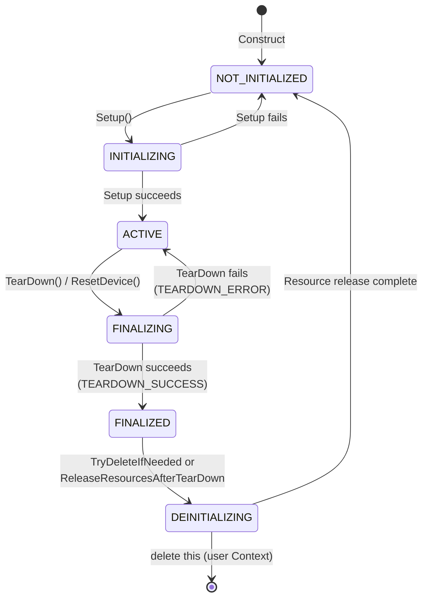

**Key code**:

```cpp
// File location: src/runtime/core/src/context/context.cc
bool Context::TrySwitchState(const ContextState expectedState,
                              const ContextState targetState, const char_t* const trigger)
{
    ContextState expected = expectedState;
    const bool switched = lifecycleState_.compare_exchange_strong(
        expected, targetState, std::memory_order_acq_rel);
    if (switched) { LogStateTransition(expectedState, targetState, trigger); }
    return switched;
}
```

**Mechanism points**:

- `FINALIZING` is the state that blocks user access. After the Context enters this state, all user API access is immediately denied.
- `FINALIZED` is an intermediate state. TearDown is complete and child resources are reclaimed, but final resources such as Module/Device references are not yet released.
- `DEINITIALIZING` is the only state that allows object release. `TryDeleteIfNeeded` or the destructor path triggers it.

#### 4.3.3 Context Handle Validity Check and Access Modes

**Design idea**: All user API entries check Context availability centrally through `CheckContextIsValid`. The check has two steps. It first queries the global valid set (an `unordered_set` protected by a read-write lock) and then queries the state machine. Access is allowed only when both steps pass. In addition, a failed user-mode check actively removes the association between the current thread and that Context, so a thread does not hold an invalid handle for a long time.

**Access modes**:

```cpp
// File location: src/runtime/core/inc/context/context_manage.hpp
enum class ContextAccessMode : uint8_t {
    USER = 0,        // User API access, requires the Context to be ACTIVE
    INTERNAL = 1,    // Runtime internal access, allows INITIALIZING/FINALIZING
};
```

**Check flow**:

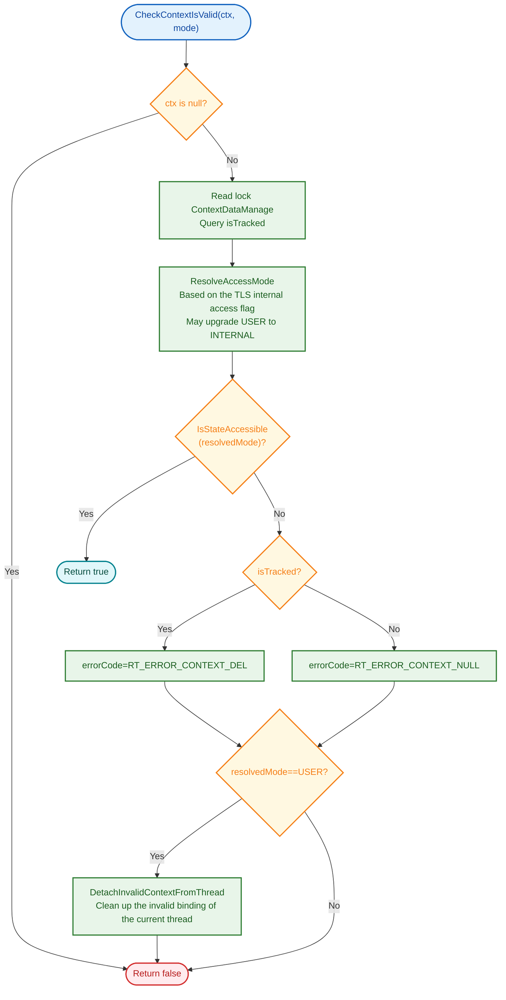

**Key code**:

```cpp
// File location: src/runtime/core/src/context/context_manage.cc
bool ContextManage::CheckContextIsValid(Context* const curCtx,
    ContextAccessMode accessMode, rtError_t* errorCode)
{
    if (curCtx == nullptr) { return false; }
    {
        const ReadProtect rp(&(g_ctxMan.GetSetRwLock()));
        const bool isTracked = g_ctxMan.ExistsSetValueWithoutLock(curCtx);
        const ContextAccessMode resolvedAccessMode = ResolveAccessMode(curCtx, accessMode);
        if (IsContextAccessAllowed(curCtx, resolvedAccessMode, isTracked)) {
            return true;
        }
        needDetachUserBinding = (resolvedAccessMode == ContextAccessMode::USER);
    }
    if (needDetach && needDetachUserBinding) {
        DetachInvalidContextFromThread(curCtx);
    }
    return false;
}
```

**State-access mode matrix** (`Context::IsStateAccessible`):

| Context state | USER access | INTERNAL access |
| --- | --- | --- |
| `ACTIVE` | ✅ Allowed | ✅ Allowed |
| `INITIALIZING` | ❌ Denied | ✅ Allowed |
| `FINALIZING` | ❌ Denied | ✅ Allowed |
| `NOT_INITIALIZED` / `FINALIZED` / `DEINITIALIZING` | ❌ Denied | ❌ Denied |

**Mechanism points**:

- **TRACKED is a prerequisite for USER access**: A user Context must be registered in the global set through `InsertContext` before USER access is allowed. An unregistered Context is available only when the current thread has bound it and the mode is INTERNAL. This supports the `Setup` window of `aclrtCreateContext` before `InsertContext`.
- **Automatic cleanup after a failed check**: When a USER mode check fails, `DetachInvalidContextFromThread` releases the binding of the current thread to that Context. The unbind may be the last reference, which triggers `TryDeleteIfNeeded`.
- **Access mode upgrade**: `ResolveAccessMode` checks the `internalAccess` flag in the TLS of the current thread. If the thread is already in an internal access context, it automatically checks as INTERNAL.

#### 4.3.4 Destruction Protection Mechanism

**Design idea**: User Context destruction has two phases: **stop external use and clean up resources**, and **delete the Context object**. When destruction starts, the Context state switches to `FINALIZING` to block new user API access, and then `TearDown()` cleans up associated resources. After cleanup succeeds, the Context is marked as "to be deleted". The Context object is deleted only after all user threads release their associations, which prevents access after the object is released (Use-After-Free, UAF).

**Destruction protection fields**:

```cpp
// File location: src/runtime/core/inc/context/context.hpp
class Context {
    std::atomic<uint64_t> threadRefCount_;   // User thread binding count
    Atomic<bool> isNeedDelete_;              // Set after TearDown completes
    std::atomic<bool> deleteScheduled_;      // Ensure delete triggers only once
};
```

**Destruction flow**:

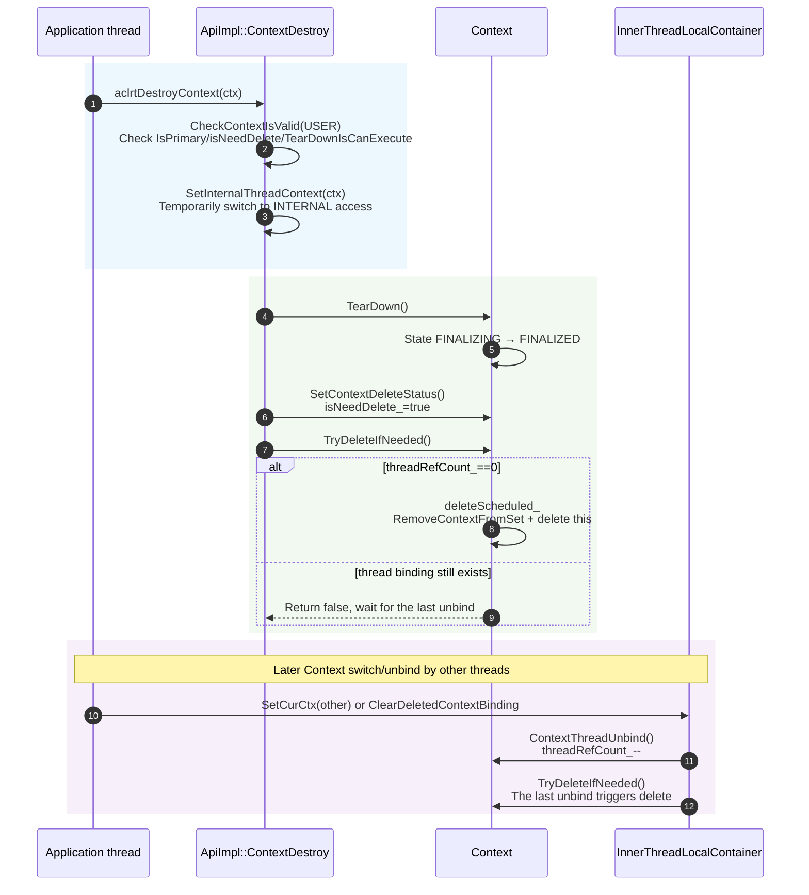

**Key code**:

```cpp
// File location: src/runtime/core/src/context/context.cc
bool Context::TryDeleteIfNeeded()
{
    if (isPrimary_ || !GetContextIsNeedDelStatus()) {
        return false;                          // Default Context or not marked for deletion
    }
    if (GetThreadRefCount() != 0U) {
        return false;                          // User thread binding still exists
    }
    bool expected = false;
    if (!deleteScheduled_.compare_exchange_strong(expected, true, ...)) {
        return false;                          // Another thread already entered the deletion path
    }
    SetState(ContextState::CTX_STATE_DEINITIALIZING, "TryDeleteIfNeeded");
    (void)ContextManage::RemoveContextFromSet(this);
    delete this;                               // Trigger ~Context → ReleaseResourcesAfterTearDown
    return true;
}
```

**Mechanism points**:

1. **Three deletion prerequisites**: Not Primary, `isNeedDelete_==true`, and `threadRefCount_==0`. All are required.
2. **`deleteScheduled_` atomic flag**: Ensures that only one thread runs `delete this` when multiple threads unbind concurrently.
3. **Deletion means destruction**: `delete this` triggers `~Context`→`ReleaseResourcesAfterTearDown` and completes resource release.
4. **TLS fallback cleanup**: `ClearDeletedContextBinding` ensures that a later `SetCurCtx` in other threads does not hold the pointer of a deleted Context.

#### 4.3.5 Exception Handling Mechanism

**Design idea**:

- `ctxMode_` is the stop-on-failure switch. It controls how the Context handles an exception.
- The Context divides exceptions into two channels: the **latest error** (`lastErr_`) and the **failure state** (`failureError_`). The former keeps the latest API error for query. The latter determines whether execution can continue before synchronization or task delivery.

**Failure mode control**:

```cpp
// File location: src/runtime/core/inc/context/context.hpp
TsStreamFailureMode GetCtxMode() const { return ctxMode_; }
void SetCtxMode(const TsStreamFailureMode flag) { ctxMode_ = flag; }
```

- **Enable stop-on-failure**: `aclrtSetStreamFailureMode(stream, ACL_STOP_ON_FAILURE)`→`SetCtxMode(STOP_ON_FAILURE)` inside the Context.
- **`ctxMode_` is the stop-on-failure switch, and `failureError_` is the exception code**: `ctxMode_` determines the behavior after a failure. `failureError_` is only the exception code record for the current failure state.

**Mechanism points**:

1. **Device/Driver exceptions have the highest priority**: The API returns an error directly regardless of `ctxMode_`, which prevents further task delivery on an abnormal Device.
2. **`CONTINUE_ON_FAILURE` is the default mode**: It keeps `failureError_` for later query but does not block the current path, which helps the service side tolerate faults.
3. **`STOP_ON_FAILURE` blocks immediately**: It returns `failureError_` and prevents later task delivery, which helps locate failures quickly.
4. **Device-level propagation is by Device ID** (`SetGlobalFailureErr`): An asynchronous Stream error is written to the owning Context. For a severe device-level exception, the system traverses `ContextDataManage` and synchronously runs `SetFailureError`+`SetStreamsStatus`+`SetDeviceStatus` for all Contexts where `IsContextOnDevice` holds.

**Error channel comparison**:

| Dimension | `lastErr_` | `failureError_` |
| --- | --- | --- |
| Writer | Written by `SetGlobalErrToCtx` when a general API returns an error | Written by `SetGlobalFailureErr` on an asynchronous Stream error or a severe device-level exception |
| Reader | `GetContextLastErr` reads and clears it<br />`PeekContextLastErr` reads and keeps it | `CheckStatus`/`CheckTaskSend` queries before execution |
| Scope | The Context associated with the current thread | All Contexts on that Device (propagated by Device ID) |
| Lifecycle | Cleared on read (one-time) | Until the Device recovers or the Context is destroyed |

**Pre-execution check flow**:

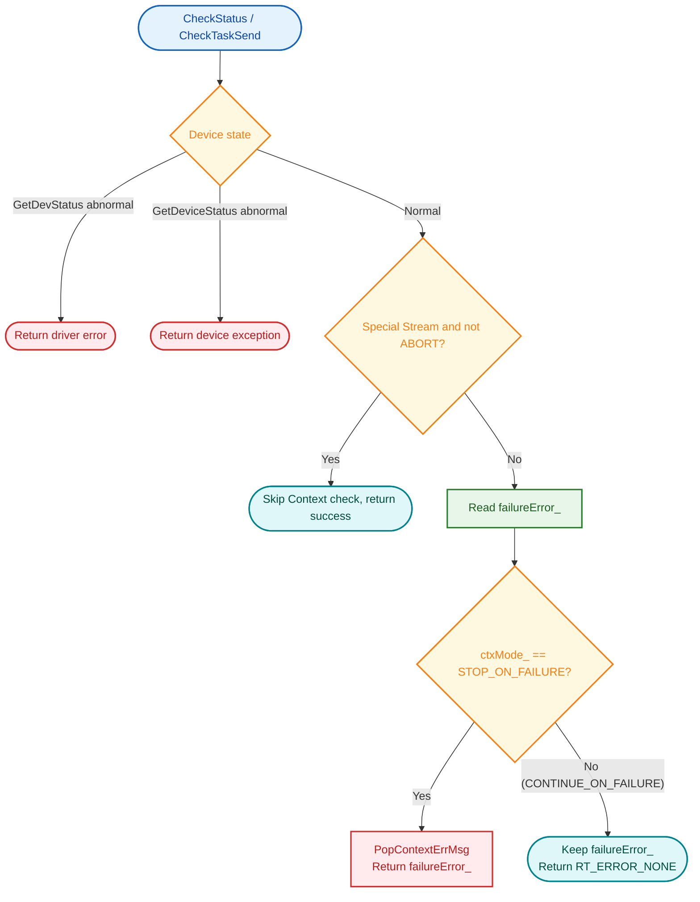

**Key code**:

```cpp
// File location: src/runtime/core/src/context/context.cc
rtError_t Context::CheckStatus(const Stream* const stm, const bool isBlockDefault)
{
    // 1. Check Device/Driver state first (not affected by ctxMode_)
    status = device_->GetDevStatus();
    COND_PROC_RETURN_ERROR_MSG_CALL(ERR_MODULE_DRV, status != RT_ERROR_NONE, ...);
    status = device_->GetDeviceStatus();
    COND_RETURN_ERROR(status != RT_ERROR_NONE, ...);

    // 2. Special Stream (CtrlSQ/Primary) and not ABORT mode: skip Context check
    if (!isBlockDefault && (stm != nullptr) && ... && (stm->GetFailureMode() != ABORT_ON_FAILURE)) {
        return RT_ERROR_NONE;
    }

    // 3. Handle the Context failure state by mode
    status = GetFailureError();
    if (status != RT_ERROR_NONE) { PopContextErrMsg(); }
    if (ctxMode_ != STOP_ON_FAILURE) { return RT_ERROR_NONE; }   // Continue execution
    return status;
}
```

### 4.4 Module Responsibility Division

| Core module or class | Main responsibility | Relation to Context |
| --- | --- | --- |
| `ApiImpl` | Implement core operations such as Context creation, destruction, set current, and get current | Call `Runtime` to manage the default Context, register or validate Contexts through `ContextManage`, and update thread association |
| `Runtime` | Maintain the default Context object and its reference count, link the Device lifecycle, and resolve the current Context | Create or reuse the default Context and resolve the current Context from thread local storage |
| `Context` | The main body of Context lifecycle and resource management | Bind the Device. Manage Stream, Model, Module, error states, and thread association references |
| `ContextManage` | Context registration, validity check, destruction wrap-up, and exception propagation | Maintain the global Context set through `ContextDataManage` and run state checks on Contexts |
| `ContextDataManage` | Provide insertion, removal, existence query, and traversal access for the global Context set | Provide the data basis for validity checks. Fast recovery and Snapshot also traverse this set |
| `InnerThreadLocalContainer` | Save the user or default Context associated with the current thread, and the INTERNAL access flag | Establish or release the association between the thread and the Context, and trigger thread reference increments and decrements |

### 4.5 Core Data Structures

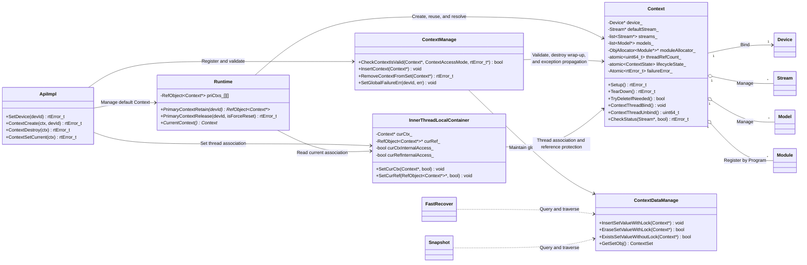

## 5. Key File Index

| Module | File path | Core content |
| --- | --- | --- |
| ACL public header | `include/external/acl/acl_rt.h` | ACL Context API declarations and interface constraints |
| ACL C entry | `src/acl/aclrt_c/runtime/context.c` | ACL Context C symbol entry that forwards to the wrapper |
| ACL implementation | `src/acl/aclrt_impl/context.cpp` | ACL Context implementation, parameter validation, and error code conversion |
| Runtime Context header | `pkg_inc/runtime/runtime/context.h` | Runtime Context handle and internal C API declarations |
| RTS Context header | `pkg_inc/runtime/runtime/rts/rts_context.h` | RTS Context internal C API declarations |
| Runtime C API | `src/runtime/api/api_c.cc` | Context C layer forwarding entry |
| RTS C API | `src/runtime/api/api_c_context.cc` | Context RTS forwarding entry |
| Device C API | `src/runtime/api/api_c_device.cc` | Runtime implementation of Device set and reset, and default Context lifecycle linkage |
| API abstraction | `src/runtime/api/api.hpp` | Context-related virtual interface definitions |
| ApiError | `src/runtime/api/impl/api_error.cc` | Context API parameter validation, null pointer validation, and resource binding relationship validation |
| Profiling decorator | `src/runtime/core/src/profiler/api_profile_decorator.cc`, `src/runtime/core/src/profiler/api_profile_log_decorator.cc` | Context API Profiling records |
| ApiImpl | `src/runtime/api/impl/api_impl.cc` | Context creation, destruction, and thread binding implementation |
| Runtime | `src/runtime/core/inc/runtime.hpp`, `src/runtime/core/src/runtime.cc` | Default Context retain/release, current Context resolution, and internal access context |
| Context header | `src/runtime/core/inc/context/context.hpp` | Context class, state machine, access modes, validation macros, and core method declarations |
| Context implementation | `src/runtime/core/src/context/context.cc` | Context lifecycle, resource management, state transition, thread binding reference, synchronization, and error states |
| Context platform implementation | `src/runtime/core/src/context/context_standard_soc.cc`, `src/runtime/core/src/context/context_stub.cc` | Context difference implementations for the standard platform and stub |
| ContextManage | `src/runtime/core/inc/context/context_manage.hpp`, `src/runtime/core/src/context/context_manage.cc` | Global Context set, USER/INTERNAL validity check, inactive destruction wrap-up, and device exception propagation |
| ContextDataManage | `src/runtime/core/src/common/context_data_manage.h`, `src/runtime/core/src/common/context_data_manage.cc` | Add, remove, query, and traverse the Context set. Also used by validity checks, fast recovery, and Snapshot |
| InnerThreadLocalContainer | `src/runtime/core/inc/common/inner_thread_local.hpp`, `src/runtime/core/src/common/inner_thread_local.cpp` | Current Context in thread local storage, internal access flag, and thread association reference increment and decrement |

## 6. Design Constraints and Maintenance Suggestions

- The default Context is managed by the Device set/reset path. The explicit user destruction interface cannot destroy a Context whose `IsPrimary()` is true.
- Operations on resources such as Stream, Model, and Module must complete under the Context that owns the resource. Cross-Context use, binding, or destruction is not allowed.
- When adding an API that receives `Context *` or depends on the current Context, explicitly use the USER or INTERNAL access mode. External APIs use USER by default.
- Internal resource access during teardown/reset must use `Runtime::SetInternalThreadContext()` or an equivalent INTERNAL binding.

---

_This module document is compiled from source analysis of `src/runtime/core/src/context/`, `src/runtime/core/src/runtime.cc`, `src/runtime/api/impl/api_impl.cc`, `src/runtime/core/src/common/inner_thread_local.cpp`, and Context-related API sources._
