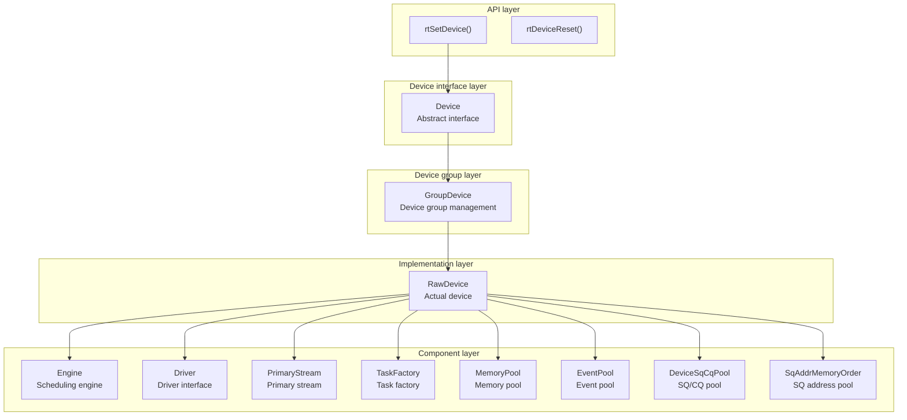
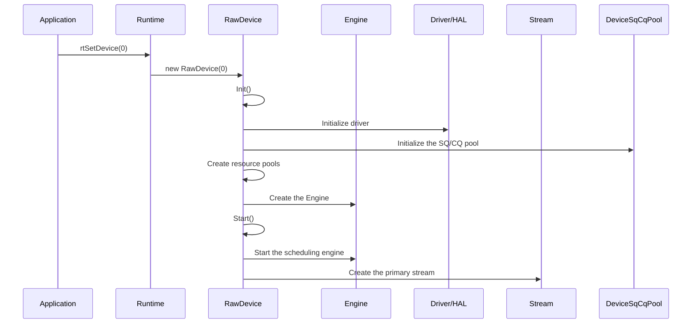
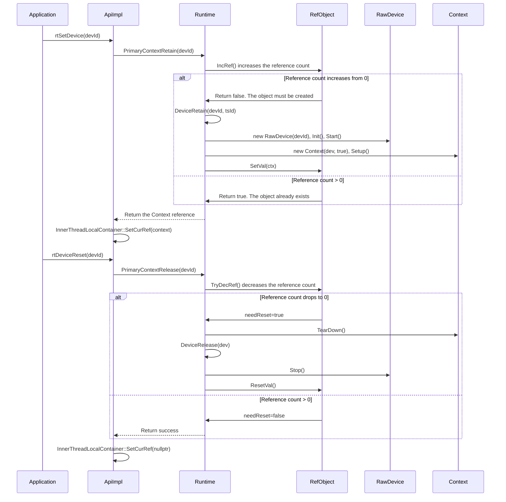
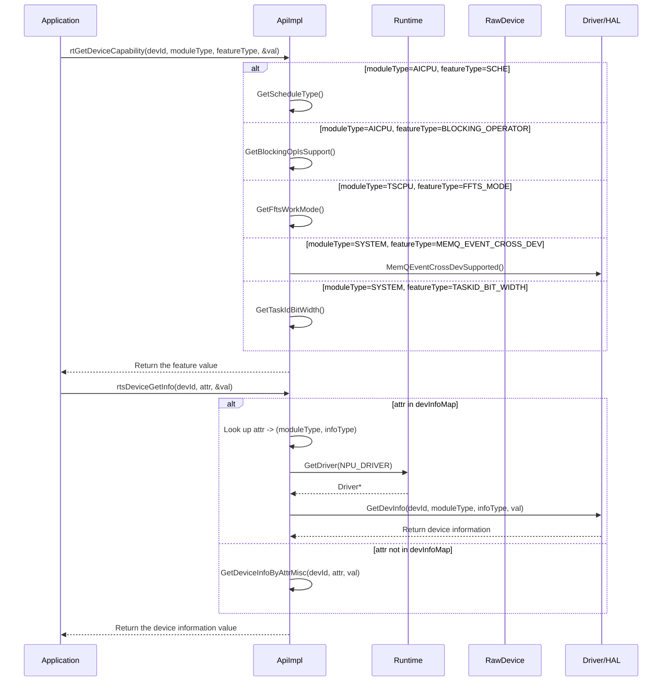
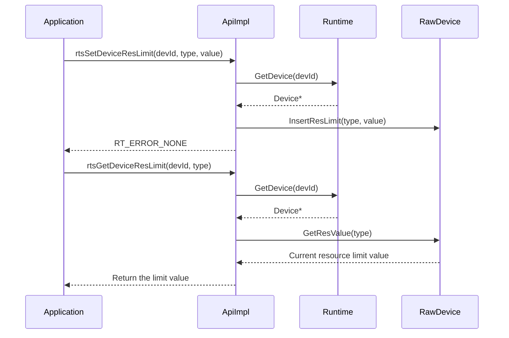
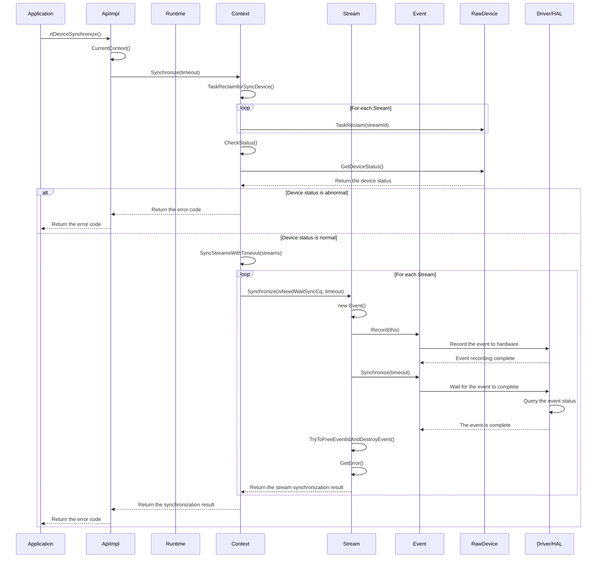
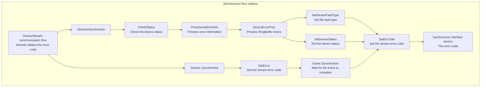
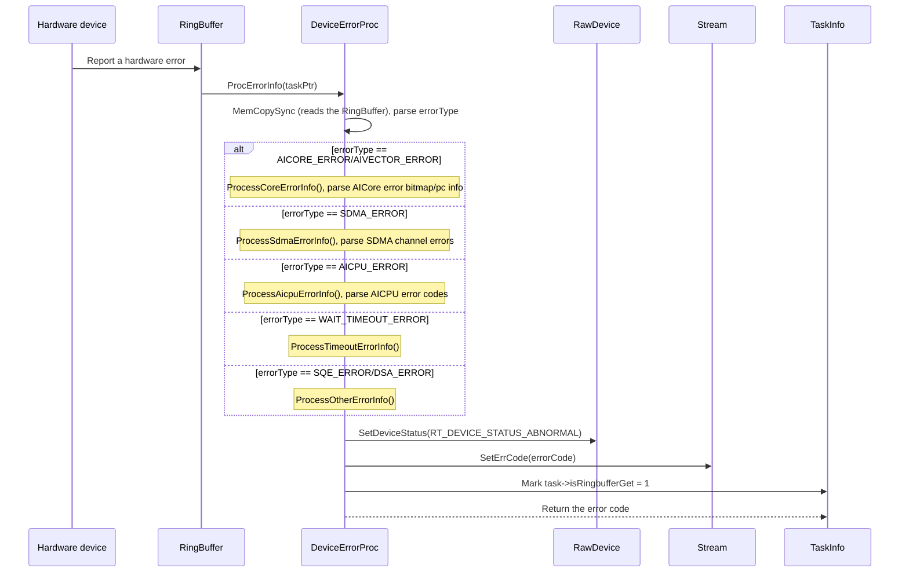
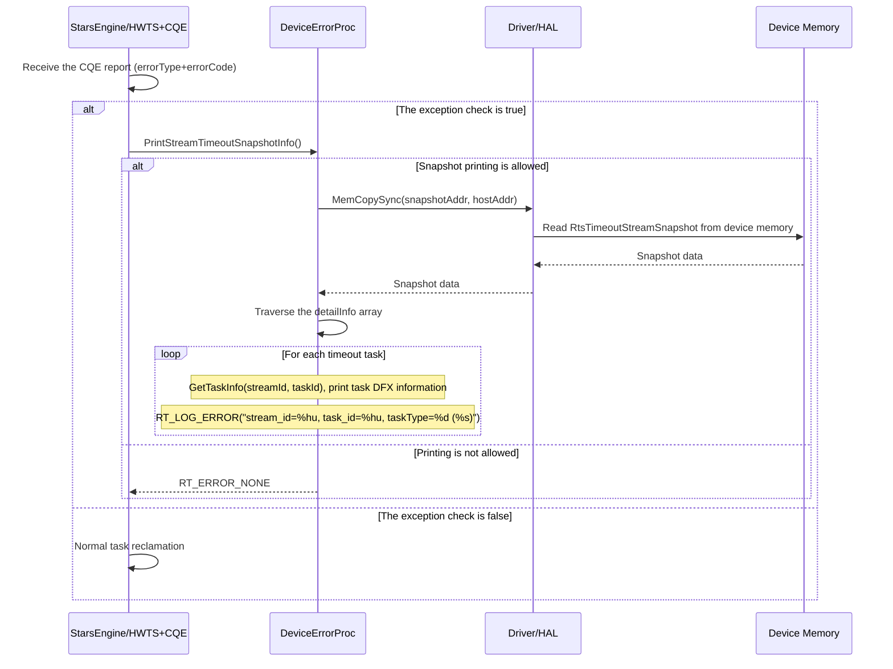

# Device Module Architecture

## 1. Module Overview

- **Feature description**: The Device module manages the device resources of Ascend AI processors. It covers device initialization, start, stop, state management, task submission, and resource pool management. It uses a three-layer inheritance structure: Device (interface) → GroupDevice (device group) → RawDevice (actual device).
- **Design goals**:
  - Provide a unified device management interface
  - Manage the device lifecycle (initialization, running, stop)
  - Provide task submission and reclamation mechanisms
  - Manage device resource pools (Event, Memory, SQ/CQ, and so on)
  - Support device error handling and state callbacks

## 2. Usage Scenarios and External Interfaces

### 2.1 Usage Scenarios

- **Scenario 1**: Set the current compute device
  ```cpp
  rtError_t err = rtSetDevice(0);
  // Runtime::DeviceRetain(0) → Device::Init() → Device::Start()
  ```
  `rtSetDevice()` sets the device ID of the current thread. Most `rt`/`aclrt` interfaces do not carry a device ID parameter. After you set the device, the current thread runs subsequent operations on that device by default. This binds the device context at thread level.

- **Scenario 2**: Obtain device capability information
  
  **Obtain device capability features**:
  ```cpp
  int32_t val;
  rtError_t ret = rtGetDeviceCapability(0, RT_MODULE_TYPE_AICORE, FEATURE_TYPE_SCHE, &val);
  if (ret != RT_ERROR_NONE) {
      // Retrieval failed
  }
  // val contains the scheduling capability information of AI Core
  ```
  | Parameter | Description |
  |------|------|
  | `moduleType` | Module type, for example `RT_MODULE_TYPE_AICORE`, `RT_MODULE_TYPE_AICPU`, `RT_MODULE_TYPE_TSCPU`, and so on |
  | `featureType` | Feature type, for example `FEATURE_TYPE_SCHE` (scheduling capability) and `FEATURE_TYPE_BLOCKING_OPERATOR` (blocking operator), and so on |

- **Scenario 3**: Device status monitoring and exception handling
  
  **Device status query**:
  ```cpp
  rtDeviceStatus deviceStatus;
  rtError_t ret = rtDeviceStatusQuery(0, &deviceStatus);
  if (ret != RT_ERROR_NONE || deviceStatus != RT_DEVICE_STATUS_NORMAL) {
      // The device is abnormal. Further troubleshooting is required.
  }
  ```
  
  `rtDeviceStatus` status values:
  | Status value | Meaning |
  |--------|------|
  | `RT_DEVICE_STATUS_NORMAL` | The device runs normally |
  | `RT_DEVICE_STATUS_ABNORMAL` | The device is abnormal. Troubleshooting is required |
  
  **Device synchronization and error capture**:
  ```cpp
  rtError_t ret = rtDeviceSynchronize();
  if (ret != RT_ERROR_NONE) {
      // Task execution failed. The synchronization interface returns an error code.
      // The upper layer can handle the error based on the error code type.
  }
  // All tasks on the device complete successfully
  ```

### 2.2 External Interfaces

| Interface | File location | Description |
|------|----------|------|
| `rtSetDevice()` | `src/runtime/api/api_c_device.cc` | Set the current device |
| `rtDeviceReset()` | `src/runtime/api/api_c_device.cc` | Reset the device |
| `rtGetDevice()` | `src/runtime/api/api_c_device.cc` | Get the current device ID |
| `rtGetDeviceCapability()` | `src/runtime/api/api_c_device.cc` | Get the device capability |
| `rtsDeviceGetInfo()` | `src/runtime/api/api_c_device.cc` | Get device information |
| `rtsGetDeviceResLimit()` | `src/runtime/api/api_c_device.cc` | Get the device resource limit |
| `rtsSetDeviceResLimit()` | `src/runtime/api/api_c_device.cc` | Set the device resource limit |
| `rtsResetDeviceResLimit()` | `src/runtime/api/api_c_device.cc` | Reset the device resource limit |
| `rtSetDeviceFailureMode()` | `src/runtime/api/api_c_device.cc` | Set the device failure mode |
| `rtDeviceSynchronize()` | `src/runtime/api/api_c_device.cc` | Synchronize the device |
| `rtDeviceStatusQuery()` | `src/runtime/api/api_c_device.cc` | Query the device status |

## 3. Architecture Overview

### Overall Design

Device uses a three-layer inheritance structure for device management. The abstract interface layer (Device) defines all core methods. The middle layer (GroupDevice) handles device group management. The bottom layer (RawDevice) implements specific device operations. Each Device contains core components such as Engine (scheduling engine), Driver (driver), Stream (primary stream), DeviceSqCqPool (SQ/CQ pool), and SqAddrMemoryOrder (SQ address memory pool).

### Architecture Layered Diagram



### Core Module Interaction Diagram

## 4. Detailed Design

### 4.1 Device Initialization Flow

#### Device Initialization Interaction



#### rtSetDevice/rtDeviceReset Reference Count Mechanism

**Design idea**: The `RefObject` class provides thread-safe reference counting and supports concurrent access from multiple threads. The reference count manages the lifecycle of Device and Context objects. An object is actually destroyed only when its reference count drops to 0.

**Reference count flow**:



#### Thread-Local Variable Setup

**Design idea**: `InnerThreadLocalContainer` manages the thread-level device context and ensures that each thread has an independent device binding in a multithreaded environment.

**Thread variables set by rtSetDevice**:

```cpp
// File location: src/runtime/core/inc/common/inner_thread_local.hpp
class InnerThreadLocalContainer {
private:
    static __THREAD_LOCAL__ Context *curCtx_;         // Current Context
    static __THREAD_LOCAL__ RefObject<Context *> *curRef_;  // Context reference object
    static __THREAD_LOCAL__ Device *device_;          // Current Device
    static __THREAD_LOCAL__ uint32_t lastTaskId_;     // Latest task ID
    static __THREAD_LOCAL__ uint32_t lastStreamId_;   // Latest stream ID
    static __THREAD_LOCAL__ rtError_t globalError_;   // Global error code
};
```

**Multithread concurrency safety**:
- Each thread has an independent device context, and threads do not interfere with each other
- The reference count uses atomic operations to ensure multithread safety

### 4.2 Device Capability Information Retrieval

The device capability retrieval interface provides multiple query capabilities, including hardware feature queries and device resource configuration. It gives upper-layer applications awareness of device features and the ability to configure them.

#### Device Capability Query Flow



**rtGetDeviceCapability input type enumerations**:

```cpp
// File location: pkg_inc/runtime/runtime/dev.h
typedef enum tagRtDeviceModuleType {
    RT_MODULE_TYPE_SYSTEM = 0,      // System information
    RT_MODULE_TYPE_AICPU,           // AICPU information
    RT_MODULE_TYPE_CCPU,            // CCPU information
    RT_MODULE_TYPE_DCPU,            // DCPU information
    RT_MODULE_TYPE_AICORE,          // AI Core information
    RT_MODULE_TYPE_TSCPU,           // TSCPU information
    RT_MODULE_TYPE_PCIE,            // PCIe information
    RT_MODULE_TYPE_VECTOR_CORE,     // Vector Core information
    RT_MODULE_TYPE_HOST_AICPU,      // Host AICPU information
    RT_MODULE_TYPE_QOS,             // QoS information
    RT_MODULE_TYPE_MEMORY           // Memory information
} rtModuleType_t;

typedef enum tagRtDeviceFeatureType {
    FEATURE_TYPE_SCHE,                    // Scheduling capability
    FEATURE_TYPE_BLOCKING_OPERATOR,       // Blocking operator support
    FEATURE_TYPE_FFTS_MODE,               // FFTS working mode
    FEATURE_TYPE_MEMQ_EVENT_CROSS_DEV,    // Cross-device event support
    FEATURE_TYPE_MODEL_TASK_UPDATE,       // Model task update support
    FEATURE_TYPE_END,
} rtDeviceFeatureType_t;
```

**rtsDeviceGetInfo input type enumeration**:

```cpp
// File location: pkg_inc/runtime/runtime/rts/rts_device.h
typedef enum { 
    RT_DEV_ATTR_AICPU_CORE_NUM  = 1U,         // Number of AICPU cores
    RT_DEV_ATTR_AICORE_CORE_NUM = 101U,       // Number of AI Core cores
    RT_DEV_ATTR_CUBE_CORE_NUM   = 102U,       // Number of Cube Core cores
    
    RT_DEV_ATTR_VECTOR_CORE_NUM = 201U,       // Number of Vector Core cores
    RT_DEV_ATTR_WARP_SIZE       = 202U,       // Warp size
    RT_DEV_ATTR_MAX_THREAD_PER_VECTOR_CORE  = 203U,  // Maximum threads per Vector Core
    RT_DEV_ATTR_UBUF_PER_VECTOR_CORE   = 204U,       // UB cache size per Vector Core
    
    RT_DEV_ATTR_TOTAL_GLOBAL_MEM_SIZE   = 301U,      // Total global memory size
    RT_DEV_ATTR_L2_CACHE_SIZE           = 302U,      // L2 cache size
    
    RT_DEV_ATTR_SMP_ID = 401U,                      // SMP ID (whether devices are in the same OS)
    RT_DEV_ATTR_PHY_CHIP_ID = 402U,                 // Physical chip ID
    RT_DEV_ATTR_IS_VIRTUAL = 501U,                  // Whether the device is virtual
    RT_DEV_ATTR_NPU_ARCH = 601U,                    // NPU architecture type
    
    RT_DEV_ATTR_MAX
} rtDevAttr;
```

#### Device Resource Limit Management Flow



Currently, you can configure and obtain limits for two resource types: Cube Core and Vector Core:

```cpp
// File location: pkg_inc/runtime/runtime/base.h
typedef enum {
    RT_DEV_RES_CUBE_CORE = 0,      // Cube Core resource limit
    RT_DEV_RES_VECTOR_CORE,        // Vector Core resource limit
    RT_DEV_RES_TYPE_MAX
} rtDevResLimitType_t;
```

### 4.3 Device Synchronization

#### rtDeviceSynchronize Call Flow

**Design idea**: The device synchronization interface waits for all tasks on the device to complete, which implements blocking synchronization. It also captures errors that occur during task execution. During synchronization, it reclaims tasks, checks status, and waits for all Streams. This ensures that upper-layer applications detect device execution exceptions in time.



### 4.4 Exception Handling

**Design idea**: The runtime provides a multi-level error capture mechanism. Each level, from task execution and stream synchronization to device synchronization and application interface calls, captures and passes error information. Exception handling uses a branch dispatch mode and routes errors to dedicated handling functions based on the error type. DFX information is passed from the device to the host through a RingBuffer. It contains detailed error context, task information, and hardware status. The log system outputs this information for fault locating.

#### Error Capture Mechanisms

```mermaid
graph TB
    subgraph Monitor thread capture
        MON1[MonitoringRun<br/>Periodically checks device status]
        SOCKET[ReportSocketCloseProc<br/>Checks the HDC connection status]
        OOM[ReportOomQueryProc<br/>Checks the OOM status]
        HEARTBEAT[ReportHeartBreakProcV2<br/>Checks the device heartbeat]
        
        MON1 --> SOCKET
        MON1 --> OOM
        MON1 --> HEARTBEAT
        
        SOCKET --> GLOBAL1[SetDevStatus<br/>Set the global error code<br/>RT_ERROR_SOCKET_CLOSE]
        OOM --> GLOBAL2[Trigger the exception callback<br/>OOM error]
        HEARTBEAT --> GLOBAL3[SetDevStatus<br/>Set the global error code<br/>RT_ERROR_LOST_HEARTBEAT]
        
        GLOBAL1 --> RETURN1[External rt interface call<br/>Return the error code]
        GLOBAL2 --> RETURN1
        GLOBAL3 --> RETURN1
        
        MON2[MonitorForWatchDog<br/>Monitors the RingBuffer]
        RINGBUFFER[ReportRingBuffer<br/>Reads the RingBuffer]
        MON2 --> RINGBUFFER
        
        RINGBUFFER --> CONTEXT1[SetWatchDogDevStatus<br/>Set the device status<br/>RT_DEVICE_STATUS_ABNORMAL]
        CONTEXT1 --> RECLAIM[MonitorTaskReclaim<br/>Reclaim failed tasks]
        RECLAIM --> CONTEXT2[Report the error through the Context-level<br/>error code]
    end

    subgraph RAS thread capture
        RAS[ReportRasRun thread<br/>Monitors RAS exception alarms]
        HBM_RAS[ReportHBMRasProc<br/>Handles HBM ECC errors]
        PAGE_FAULT[ReportPageFaultProc<br/>Handles page faults]
        UB_RAS[ReportUBMemRasProc<br/>Handles UB memory errors]
        
        RAS --> HBM_RAS
        RAS --> PAGE_FAULT
        RAS --> UB_RAS
        
        HBM_RAS --> GLOBAL4[SetGlobalFailureErr<br/>Set the global error code<br/>RT_ERROR_MEM_RAS_ERROR]
        PAGE_FAULT --> GLOBAL5[Set the global error code<br/>Page Fault error]
        UB_RAS --> GLOBAL6[Set the global error code<br/>UB RAS error]
        
        GLOBAL4 --> RETURN2[External rt interface call<br/>Return the error code]
        GLOBAL5 --> RETURN2
        GLOBAL6 --> RETURN2
    end
```





**Comparison of the four error capture mechanisms**:

| Characteristic | Monitor thread - device status | Monitor thread - RingBuffer | RAS thread - RAS alarm | Synchronous flow active check |
|------|----------------------|------------------------|----------------|------------------|
| **Check method** | Periodic polling (1 second) | Periodic RingBuffer reads (1 second) | Periodic polling (10 ms) | Active calls during synchronization |
| **Error source** | HDC connection, heartbeat, OOM | RingBuffer reports | Hardware RAS alarms | Device/Stream status |
| **Propagation path** | SetDevStatus → external interface | SetWatchDogDevStatus → Context | SetGlobalFailureErr → external interface | GetError → direct return |
| **Applicable scenario** | Device offline, communication interrupted, OOM | Task execution failure | Hardware faults (HBM ECC, UB memory errors) | Task execution exception capture |

#### Exception Branch Handling Flow

DeviceErrorProc reads error information from the RingBuffer. Based on different `errorType` values and register DFX information (for example, Error Bitmap, PC value, and Channel ID), it routes the error to the corresponding error handling function branch. It prints detailed DFX logs, sets the fault type, and returns the corresponding error code.

**Exception branch handling sequence diagram**:



The mapping between error types and handling functions is as follows:

```cpp
// File location: src/runtime/core/src/device/v100/device_error_proc.cc
static const std::map<uint64_t, DeviceErrorProc::StarsErrorInfoProc> starsFuncMap = {
    {AICORE_ERROR, &DeviceErrorProc::ProcessStarsCoreErrorInfo},
    {AIVECTOR_ERROR, &DeviceErrorProc::ProcessStarsCoreErrorInfo},
    {FFTS_PLUS_AICORE_ERROR, &DeviceErrorProc::ProcessStarsCoreErrorInfo},
    {FFTS_PLUS_AIVECTOR_ERROR, &DeviceErrorProc::ProcessStarsCoreErrorInfo},
    {WAIT_TIMEOUT_ERROR, &DeviceErrorProc::ProcessStarsWaitTimeoutErrorInfo},
    {SDMA_ERROR, &DeviceErrorProc::ProcessStarsSdmaErrorInfo},
    {AICPU_ERROR, &ProcessStarsAicpuErrorInfo},
    {FFTS_PLUS_SDMA_ERROR, &DeviceErrorProc::ProcessStarsSdmaErrorInfo},
    {FFTS_PLUS_AICPU_ERROR, &ProcessStarsAicpuErrorInfo},
    {DVPP_ERROR, &DeviceErrorProc::ProcessStarsDvppErrorInfo},
    {DSA_ERROR, &DeviceErrorProc::ProcessStarsDsaErrorInfo},
    {FFTS_PLUS_DSA_ERROR, &DeviceErrorProc::ProcessStarsDsaErrorInfo},
    {SQE_ERROR, &DeviceErrorProc::ProcessStarsSqeErrorInfo},
    {HCCL_FFTSPLUS_TIMEOUT_ERROR, &DeviceErrorProc::ProcessStarsHcclFftsPlusTimeoutErrorInfo},
    {AICORE_TIMEOUT_DFX, &DeviceErrorProc::ProcessStarsCoreTimeoutDfxInfo}
};
```

#### Task Exception Snapshot DFX

When task execution is abnormal, the runtime reads the snapshot information of the timeout task from device memory through `PrintStreamTimeoutSnapshotInfo`. It prints detailed DFX logs to help locate the cause of a task hang or timeout.

**Snapshot printing flow**:



**Snapshot information content**:
- **Basic information**: `stream_id`, `task_id`, `taskType` (task type)
- **Task-specific information**:
  - EVENT_RECORD task: `EventId`
  - STREAM_WAIT_EVENT task: `EventId`
  - NOTIFY_RECORD task: `NotifyId`
  - NOTIFY_WAIT task: `NotifyId`, `waitType`
  - KERNEL task: `kernel_name`

---

_This module document is based on an analysis of the source code in `src/runtime/core/src/device/`._
