# Event Module Architecture

## 1. Module Overview

- **Feature description**: The Event module provides synchronization mechanisms and supports event record, wait, and status query. An Event can record an execution position in a stream. Other streams can wait for the event to complete, which implements cross-stream synchronization. It supports IPC Event for inter-process synchronization.
- **Design goals**:
  - Provide an efficient cross-stream synchronization mechanism
  - Use shared memory for inter-process event synchronization in IPC scenarios
  - Support event status query and timeout wait
  

## 2. Usage Scenarios and External Interfaces

### 2.1 Usage Scenarios

- **Scenario 1**: Cross-stream synchronization

  ```cpp
  aclrtRecordEvent(event, stream1);  // Record the event in stream1
  aclrtStreamWaitEvent(stream2, event);  // stream2 waits for the event
  ```

- **Scenario 2**: Query the event status

  ```cpp
  aclrtEventRecordedStatus status;
  aclrtQueryEventStatus(event, &status);  // Query whether the event is complete
  if (status == ACL_EVENT_RECORDED_STATUS_COMPLETE) {
      // The event is complete
  }
  ```

- **Scenario 3**: Blocking event wait (the host blocks until the Event completes. This is suitable for scenarios that need to wait synchronously for the compute result before continuing)

  ```cpp
  aclrtCreateEventExWithFlag(&event, ACL_EVENT_SYNC);  // Create a synchronous event
  aclrtRecordEvent(event, stream);                      // Record the event on the Stream
  // ... Deliver compute tasks on the Stream ...
  aclrtSynchronizeEvent(event);                         // Block until the event completes. This ensures that all Stream tasks before this Event have finished
  aclrtDestroyEvent(event);                             // Destroy the event
  ```

- **Scenario 4**: IPC inter-process synchronization

  ```cpp
  // Process A: Create an IPC Event, record it, and export the handle
  aclrtCreateEventExWithFlag(&event, ACL_EVENT_IPC);
  aclrtRecordEvent(event, streamA);               // Process A records the event on the stream
  aclrtIpcGetEventHandle(event, &ipcHandle);
  // Pass ipcHandle to process B (for example, through shared memory or a socket)

  // Process B: Open the IPC Event and wait
  aclrtIpcOpenEventHandle(ipcHandle, &remoteEvent);
  aclrtStreamWaitEvent(stream, remoteEvent);
  ```

- **Scenario 5**: Calculate the event elapsed time (requires two Events, startEvent and endEvent, to mark the start and end moments. Before timing, you must wait synchronously for both Events to complete)

  ```cpp
  aclrtCreateEventWithFlag(&startEvent, ACL_EVENT_TIME_LINE);  // Create the start event
  aclrtCreateEventWithFlag(&endEvent, ACL_EVENT_TIME_LINE);    // Create the end event
  aclrtRecordEvent(startEvent, stream);        // Record the start event in the stream
  // ... Execute the tasks to time ...
  aclrtRecordEvent(endEvent, stream);          // Record the end event in the stream
  aclrtSynchronizeEvent(startEvent);           // Wait for the start event to complete
  aclrtSynchronizeEvent(endEvent);             // Wait for the end event to complete
  float elapsedTime = 0.0f;
  aclrtEventElapsedTime(&elapsedTime, startEvent, endEvent);  // Calculate the elapsed time between the two events (milliseconds)
  printf("Task elapsed time: %.3f ms\n", elapsedTime);
  aclrtDestroyEvent(startEvent);
  aclrtDestroyEvent(endEvent);
  ```

### 2.2 External Interfaces

| Interface | Description |
|------|------|
| `aclrtCreateEvent()` | Create an event (default flag) |
| `aclrtCreateEventWithFlag()` | Create an event with a flag |
| `aclrtCreateEventExWithFlag()` ⭐ | Create a reusable event with a flag (**recommended**) |
| `aclrtDestroyEvent()` | Destroy an event |
| `aclrtRecordEvent()` | Record an event in a stream |
| `aclrtResetEvent()` | Reset an event |
| `aclrtQueryEventStatus()` ⭐ | Query the event completion status (**recommended**) |
| `aclrtQueryEventWaitStatus()` | Query the event wait status |
| `aclrtSynchronizeEvent()` | Block until the event completes |
| `aclrtSynchronizeEventWithTimeout()` | Blocking wait with a timeout |
| `aclrtStreamWaitEvent()` | Stream waits for an event |
| `aclrtStreamWaitEventWithTimeout()` | Stream waits for an event with a timeout |
| `aclrtEventElapsedTime()` | Calculate the elapsed time between two events |
| `aclrtEventGetTimestamp()` | Get the event record timestamp |
| `aclrtGetEventId()` | Get the event ID |
| `aclrtIpcGetEventHandle()` | Get the cross-process handle of an IPC Event |
| `aclrtIpcOpenEventHandle()` | Open an IPC Event handle in the current process |

### 2.3 Event Flag Types

Event flags are passed through `aclrtCreateEventWithFlag` or `aclrtCreateEventExWithFlag` and determine the creation branch and synchronization behavior of the Event. `ACL_EVENT_IPC` is supported only through `aclrtCreateEventExWithFlag`:

| Flag | Value | Description |
|------|-----|------|
| `ACL_EVENT_SYNC` | 0x01 | Synchronous event |
| `ACL_EVENT_CAPTURE_STREAM_PROGRESS` | 0x02 | Stream capture progress marker |
| `ACL_EVENT_TIME_LINE` | 0x08 | Timeline event (used for timing) |
| `ACL_EVENT_DEVICE_USE_ONLY` | 0x10 | For internal device use only |
| `ACL_EVENT_EXTERNAL` | 0x20 | Deprecated in CANN 9.3.0 and planned for removal after December 30, 2027 |
| `ACL_EVENT_IPC` | 0x40 | IPC event (inter-process synchronization) |

### 2.4 Event Status Enumerations

| Enumeration type | Value | Description |
|----------|-----|------|
| `aclrtEventRecordedStatus` | `NOT_READY(0)` / `COMPLETE(1)` | Event record status |
| `aclrtEventWaitStatus` | `COMPLETE(0)` / `NOT_READY(1)` / `RESERVED(0xFFFF)` | Event wait status |

## 3. Architecture Overview

**Overall design idea**
**Event management consists of two parts:**
- **Record/Wait handling path**: The Record/Wait entry points of DavidEvent are handled by the `EvtRecord`/`EvtWait` functions in `event_c.cc`. The Record/Wait of IpcEvent are handled by `IpcEventRecordStarsV2`/`IpcEventWaitStarsV2`. Different Event types and Flag combinations take different handling branches.
- **Task delivery flow**: Together with the API interfaces, it completes runtime scheduling through Stream task allocation, SQE assembly, task delivery, and so on.

### 3.1 Event Record/Wait Handling Path Architecture

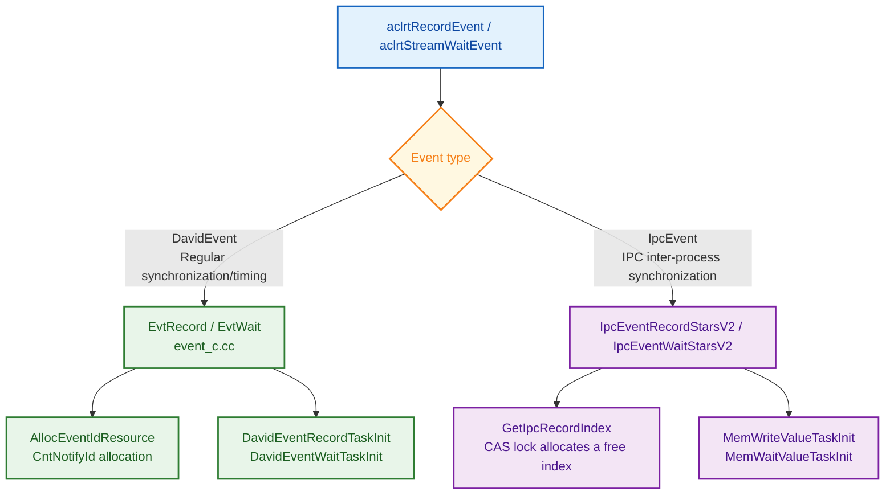

### 3.2 Event Delivery Flow Interaction Diagram

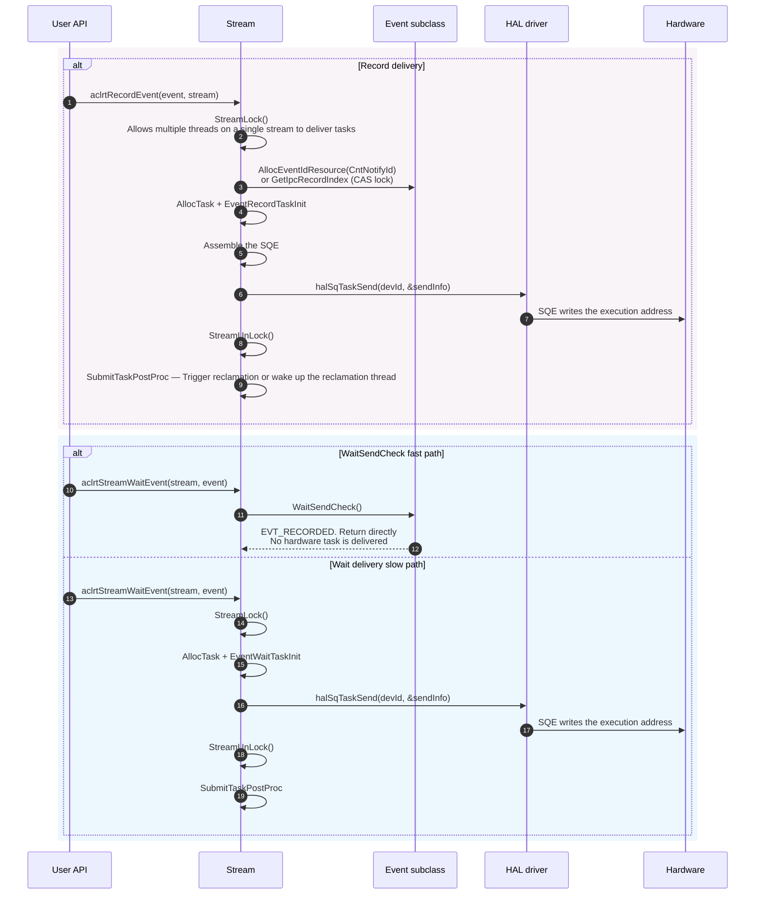

## 4. Detailed Design

### 4.1 DavidEvent Record Flow

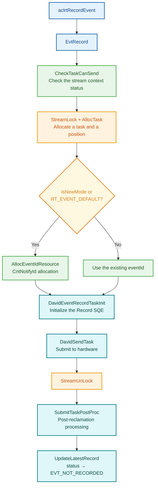

**Flow step description**:

- **CheckTaskCanSend**: Check the stream context status and ensure that the Context is not aborted. Otherwise, return an error.
- **AllocEventIdResource**: DavidEvent uses CntNotifyId instead of the traditional eventId. CntNotifyId is managed by DavidStream (`cntNotifyId_`). On the first Record, it is requested from the driver through `ApplyCntNotifyId`. When `IsCntNotifyReachThreshold` reaches the threshold, wait for previous Wait tasks to complete before requesting a new id.
- **StreamLock / StreamUnLock**: The entire task allocation and submission process runs under the Stream lock. This prevents concurrent modification of the Stream task queue.
- **SubmitTaskPostProc**: Post-reclamation processing after task submission, including updating the Stream queue position and triggering Profiling

### 4.2 DavidEvent Wait Flow

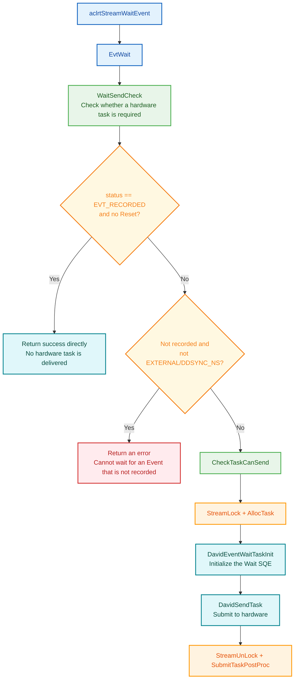

**Flow step description**:

- **WaitSendCheck** is the key decision point. If the Event status is EVT_RECORDED and the Event is not reset, return success directly without delivering a hardware task. This is the DavidEvent optimization: when Record is complete, Wait only needs to check the status and does not insert an extra SQE.
- If the Event is not recorded and the flag is not EXTERNAL/DDSYNC_NS, return `ACL_ERROR_RT_INVALID_VALUE` because you cannot wait for an Event that is not recorded.
- Otherwise, deliver a Wait task to hardware and wait for CntNotifyId to complete through the SQE.

### 4.3 IPC Event Record Flow (StarsV2)

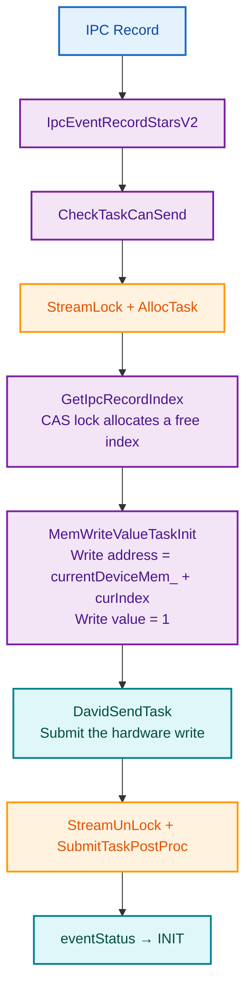

**Flow step description**:

- IPC Record does not use CntNotifyId/eventId. It uses a **shared memory index** for synchronization: `GetIpcRecordIndex` allocates a free `curIndex` in `IpcHandleVa.deviceMemRef[]` through a CAS spin lock (`IpcVaLock/IpcVaUnLock`).
- The hardware executes the `MemWriteValue` SQE and writes the value 1 to the `currentDeviceMem_ + curIndex` address. The value is visible across processes through P2P shared memory.
- After the write completes, the MemWaitValue of the remote process detects the value change at that address.

### 4.4 IPC Event Wait Flow (StarsV2)

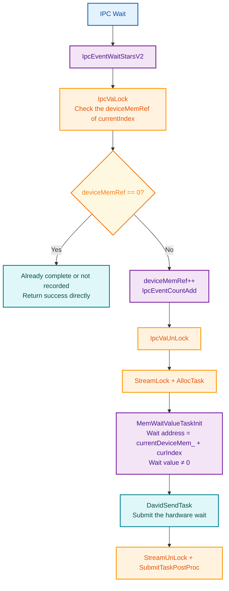

**Flow step description**:

- IPC Wait uses the `MemWaitValue` SQE to wait until the shared memory address becomes a non-zero value. After the hardware finishes the MemWriteValue of Record, the address changes from 0 to 1, and the Wait task completes.
- `IpcVaLock` (a CAS spin lock) protects the concurrent count of `deviceMemRef[]` and supports reference count management for multiple Wait calls on the same IPC Event.
- `deviceMemRef == 0` means that Record is already complete (the Ref is consumed) or not yet recorded. In both cases, no hardware task is required, and the interface returns directly.

### 4.5 Core Mechanism Details

#### DavidEvent State Machine and CntNotify Mechanism

**Design idea**: DavidEvent simplifies the three-state state machine of the base class (INIT/RECORDING/RECORDED) into two states (`EVT_NOT_RECORDED`/`EVT_RECORDED`). It uses the CntNotifyId maintained by DavidStream instead of traditional eventId pool allocation, which reduces cross-component resource management overhead.

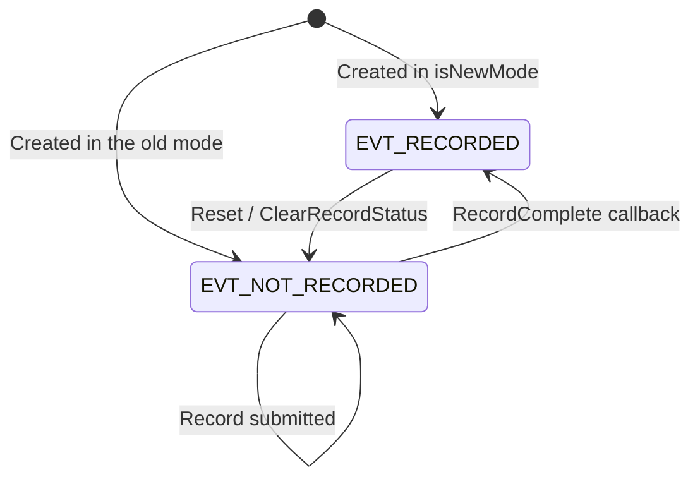

CntNotifyId is managed by DavidStream:
- The `cntNotifyId_` member maintains the NotifyId of the current Stream
- It is requested from the driver through `ApplyCntNotifyId` on first use
- When `IsCntNotifyReachThreshold` reaches the threshold, wait for previous Wait tasks to complete
- The `isCntNotify_` flag distinguishes two id sources: pre-allocation (newMode/RT_EVENT_DEFAULT) and driver allocation

#### IPC Event Shared Memory Synchronization Mechanism

**Design idea**: IPC Event does not rely on CntNotifyId hardware synchronization. It uses P2P shared memory and the MemWriteValue/MemWaitValue SQE to implement cross-process event synchronization. This avoids the limitation that NotifyId cannot be shared between processes.

Core data structure `IpcHandleVa`:

| Field | Type | Description |
|------|------|------|
| `lockStatus` | `uint64_t volatile` | CAS spin lock (LOCK_RELEASED/LOCK_OCCUPIED) |
| `deviceMemHandle` | `void*` | P2P shared memory handle (exported by Export) |
| `deviceMemRef[8192]` | `uint64_t[IPC_EVENT_P2P_SIZE]` | Ring index array. Each slot records the Record/Wait count |
| `currentIndex` | `uint16_t` | Current Record position |

**Setup flow (creator side)**:

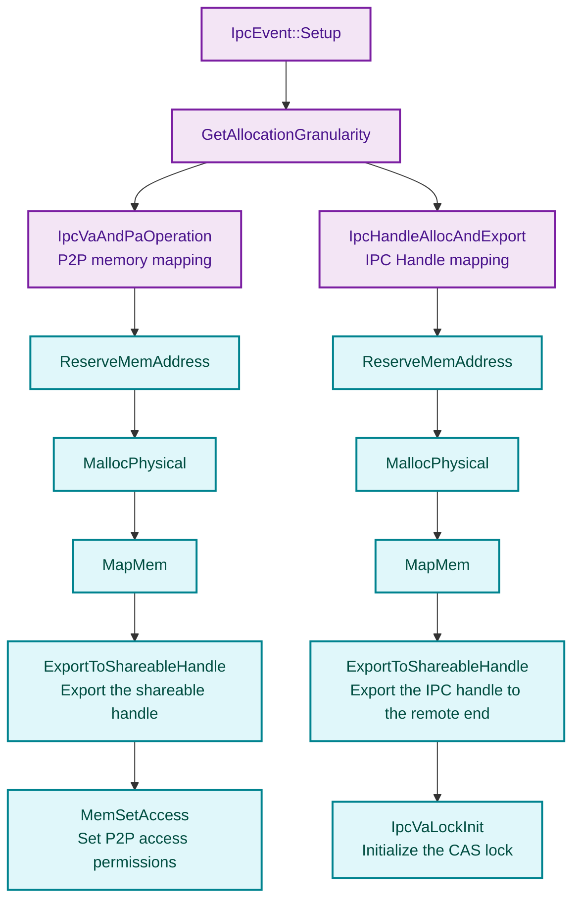

**Open flow (remote process)**:

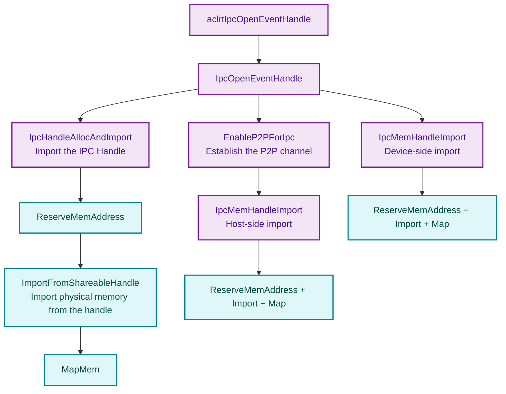

- **Creator side**: Allocate P2P shared memory and the IPC Handle, and export two shareable handles (deviceMemHandle + ipcHandle)
- **Remote process**: Import the IPC Handle → Obtain the IpcHandleVa pointer → Enable P2P → Import shared memory on both the host and device sides
- Cross-process synchronization: The creator side writes to `currentDeviceMem_ + curIndex` through MemWriteValue. The remote side waits for the value change at the same address through MemWaitValue.

### 4.6 Module Responsibility Division

| Module | Responsibility | Location |
|------|------|------|
| Event | Event base class, state management, taskId mapping, Synchronize | `core/inc/event/event.hpp` |
| DavidEvent | Stars architecture Event subclass, CntNotifyId mode, two-state state machine | `core/inc/event/event_david.hpp` |
| IpcEvent | IPC Event subclass, P2P shared memory synchronization | `core/inc/event/ipc_event.hpp` |
| event_c.cc | Stars architecture Record/Wait/Reset entry points | `core/src/event/event_c.cc` |
| event_david.cc | DavidEvent implementation | `core/src/event/event_david.cc` |
| ipc_event.cc | IpcEvent basic implementation (Setup/Open) | `core/src/event/ipc_event.cc` |
| ipc_event_starsV2.cc | IPC StarsV2 Record/Wait | `core/src/event/ipc_event_starsV2.cc` |

### 4.7 Core Data Structures

#### 4.7.1 Event Inheritance Class Diagram

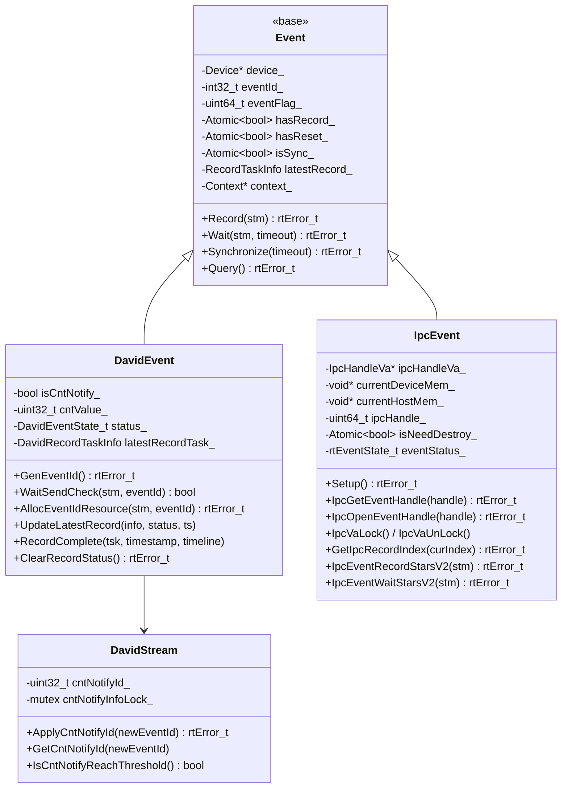

#### 4.7.2 IpcHandleVa Data Structure Class Diagram

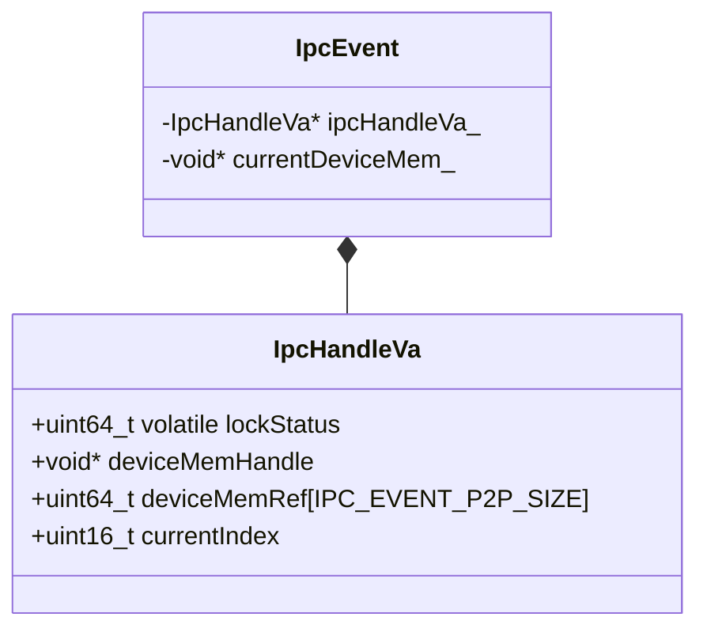

## 5. Key File Index

| Module | File path | Core content |
|------|----------|----------|
| Event base class | `src/runtime/core/inc/event/event.hpp` | Event class definition |
| Event base class implementation | `src/runtime/core/src/event/event.cc` | Event base class core implementation |
| DavidEvent definition | `src/runtime/core/inc/event/event_david.hpp` | DavidEvent class definition, two-state state machine |
| DavidEvent implementation | `src/runtime/core/src/event/event_david.cc` | CntNotifyId, state management, Query |
| Stars entry | `src/runtime/core/src/event/event_c.cc` | EvtRecord/EvtWait/EvtReset |
| IpcEvent definition | `src/runtime/core/inc/event/ipc_event.hpp` | IpcEvent class, IpcHandleVa |
| IpcEvent implementation | `src/runtime/core/src/event/ipc_event.cc` | Setup/Open flow |
| IPC StarsV2 | `src/runtime/core/src/event/ipc_event_starsV2.cc` | IPC Record/Wait StarsV2 |
| C interface layer | `src/runtime/api/api_c_event.cc` | aclrt/rt Event external interfaces |
| Task definition | `src/runtime/core/src/task/task_info/event/` | Event/Notify task types |

## 6. Performance Optimization Strategies

- **CntNotifyId mode**: DavidEvent uses the CntNotifyId maintained by the Stream instead of global pool allocation, which reduces cross-component id management overhead
- **Two-state state machine**: DavidEvent is simplified to the two states EVT_NOT_RECORDED/EVT_RECORDED, which reduces state-check complexity
- **Wait fast path**: When WaitSendCheck detects a completed Event, it returns directly and does not deliver a hardware task

---

_This module document is based on an analysis of the source code in `src/runtime/core/src/event/` and `src/runtime/core/inc/event/`._
