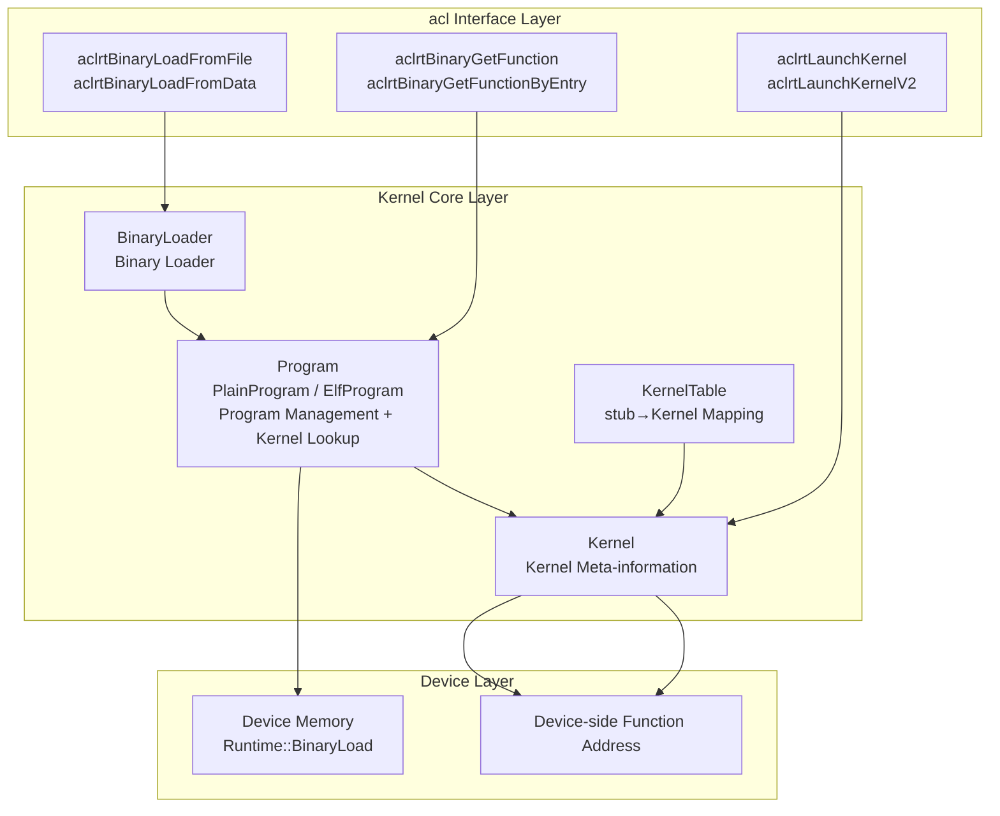
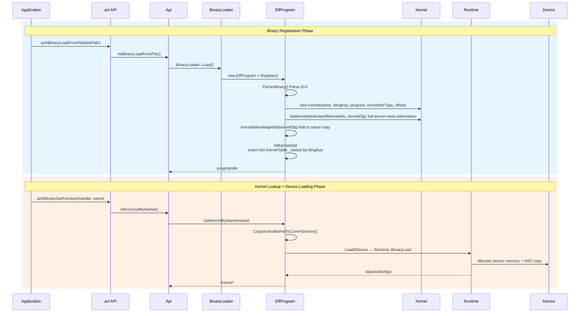
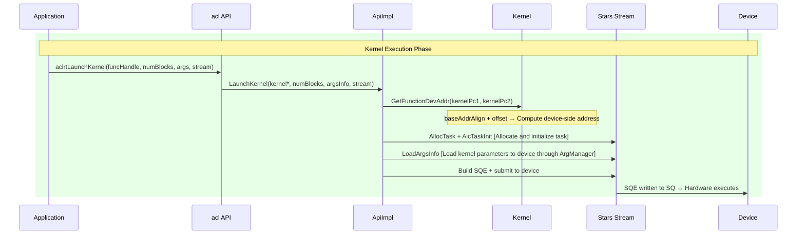
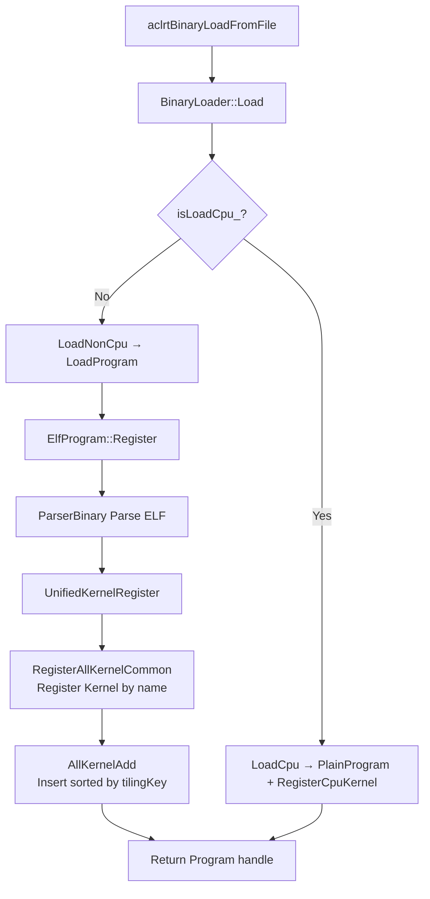
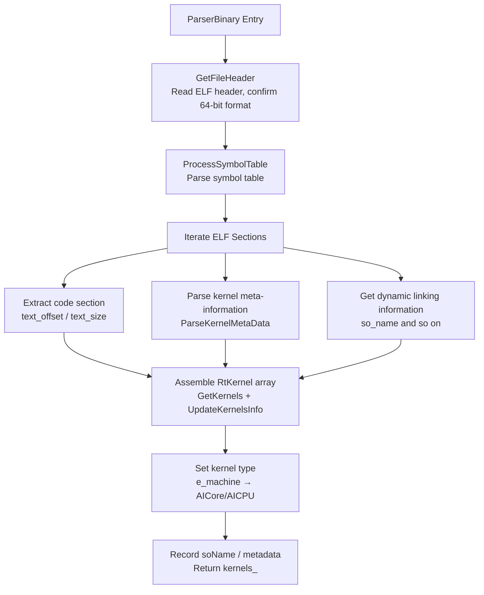
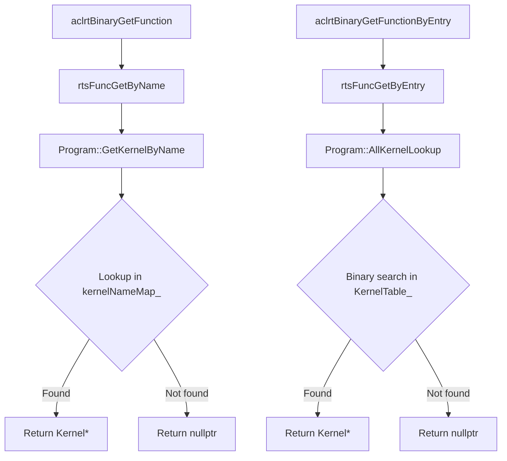
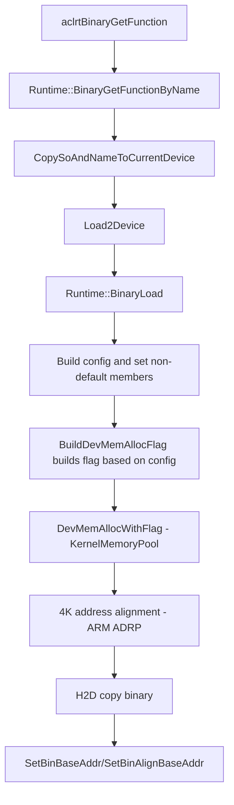
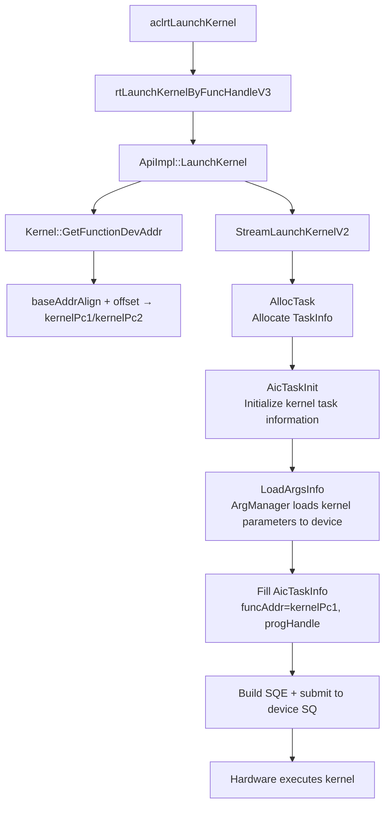
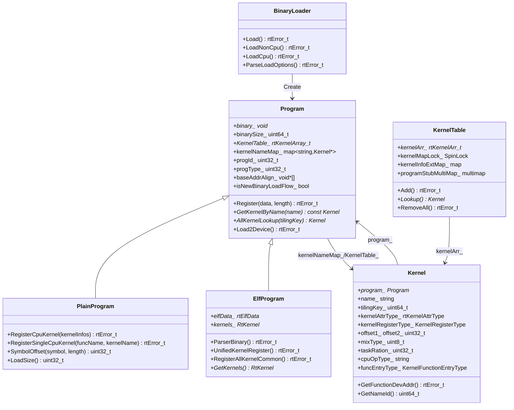

# Kernel Module Architecture

## 1. Module Overview

- **Function description**: The Kernel module manages registration, lookup, and execution of kernel binaries. Kernel maintains kernel meta-information (name, offset, parameters, and so on).
- **Design objectives**:
  - Provide kernel registration and lookup mechanisms.
  - Manage kernel meta-information.
  - Support loading kernel binaries to the device.
  - Support registration of multiple operator types: AI Core (AI Cube, AI Vector), MIX (mixed AI Cube and AI Vector), and AICPU.
  - Support two lookup methods: by function name (Function Name) and by function entry (Function Entry).

## 2. Usage Scenarios and External Interfaces

### 2.1 Usage Scenarios

- **Scenario 1**: Binary registration (from a file)
  ```cpp
  aclrtBinHandle binHandle = nullptr;
  aclrtBinaryLoadFromFile(binPath, nullptr, &binHandle);
  // Internal path: rtsBinaryLoadFromFile → BinaryLoader::Load → ElfProgram::Register → UnifiedKernelRegister
  ```

- **Scenario 2**: Binary registration (from memory)
  ```cpp
  aclrtBinHandle binHandle = nullptr;
  aclrtBinaryLoadFromData(data, length, nullptr, &binHandle);
  // Internal path: rtsBinaryLoadFromData → BinaryLoader::Load → ElfProgram::Register
  ```

- **Scenario 3**: Kernel lookup and execution
  ```cpp
  aclrtFuncHandle funcHandle = nullptr;
  aclrtBinaryGetFunction(binHandle, kernelName, &funcHandle);
  aclrtLaunchKernel(funcHandle, numBlocks, argsData, argsSize, stream);
  ```

- **Scenario 4**: Kernel lookup (by function entry)
  ```cpp
  aclrtFuncHandle funcHandle = nullptr;
  aclrtBinaryGetFunctionByEntry(binHandle, funcEntry, &funcHandle);
  ```

### 2.2 External Interfaces

| Interface | Corresponding rt call | Description |
|------|-------------|------|
| `aclrtCreateBinary()` | Local new rtDevBinary_t | Create a binary description object |
| `aclrtDestroyBinary()` | Local delete | Destroy the binary description object |
| `aclrtBinaryLoad()` | `rtBinaryLoadWithoutTilingKey()` | Register a binary (legacy interface, no tiling key) |
| `aclrtBinaryUnLoad()` | `rtBinaryUnLoad()` | Unload a binary |
| `aclrtBinaryLoadFromFile()` | `rtsBinaryLoadFromFile()` | Register a binary from a file |
| `aclrtBinaryLoadFromData()` | `rtsBinaryLoadFromData()` | Register a binary from memory |
| `aclrtBinaryGetFunction()` | `rtsFuncGetByName()` | Get a kernel function by name |
| `aclrtBinaryGetFunctionByEntry()` | `rtsFuncGetByEntry()` | Get a kernel function by function entry |
| `aclrtBinaryGetDevAddress()` | `rtsBinaryGetDevAddress()` | Get the device-side address of a binary |
| `aclrtBinaryGetGlobal()` | `rtBinaryGetGlobal()` | Get a global symbol address |
| `aclrtBinarySetExceptionCallback()` | `rtBinarySetExceptionCallback()` | Set an exception callback |
| `aclrtLaunchKernel()` | `rtLaunchKernelByFuncHandleV3()` | Execute a kernel |
| `aclrtLaunchKernelV2()` | `rtsLaunchKernelWithDevArgs()` | Execute a kernel (V2) |
| `aclrtLaunchKernelWithConfig()` | `rtsLaunchKernelWithConfig()` | Execute a kernel (with config) |
| `aclrtLaunchKernelWithHostArgs()` | `rtsLaunchKernelWithHostArgs()` | Execute a kernel (Host args) |
| `aclrtLaunchKernelWithArgsArray()` | `rtLaunchKernelWithArgsArray()` | Execute a kernel (args array) |

## 3. Architecture Overview

### 3.1 Overall Design

- **BinaryLoader**: The kernel registration entry point. It loads binaries from a file or memory and creates a Program.
- **Program**: Manages kernel binaries and lookup. It maintains two lookup mechanisms: a name map and an ordered tilingKey table. ElfProgram parses ELF and registers kernels. PlainProgram registers CPU kernels.
- **Kernel**: Maintains kernel meta-information. It computes the device-side function address directly from the base address of the owning Program.
- **KernelTable**: A global ordered stub→Kernel mapping table with binary search. It supports batch unload by Program.
- Device-side loading is completed through Program::Load2Device → Runtime::BinaryLoad, and is triggered inside aclrtBinaryGetFunction.

### 3.2 Architecture Layer Diagram



### 3.3 Core Module Interaction Diagram





## 4. Detailed Design

### 4.1 Core Flows

#### Binary Registration Flow



**Flow step description**:

1. BinaryLoader determines the CPU or non-CPU path (distinguished by the `isLoadCpu_` flag).
2. Non-CPU path: LoadProgram creates an ElfProgram → Register saves the binary → ParserBinary parses ELF symbols and attributes → UnifiedKernelRegister performs two-step registration.
3. UnifiedKernelRegister first calls RegisterAllKernelCommon to register by name into `kernelNameMap_`, then iterates over all Kernels and inserts them into `KernelTable_` sorted by tilingKey.
4. CPU path: Create a PlainProgram, load CPU operator information based on the mode, and register it.

**Key code**:

```cpp
// File location: src/runtime/core/src/kernel/program.cc
rtError_t ElfProgram::UnifiedKernelRegister() {
    rtError_t error = RegisterAllKernelCommon();
    ERROR_RETURN(error, "register all kernel failed, retCode=%#x.", static_cast<uint32_t>(error));

    const std::map<std::string, Kernel *>& kernelNameMap = GetKernelNameMap();
    for (auto iter = kernelNameMap.begin(); iter != kernelNameMap.end(); ++iter) {
        Kernel* kernelObj = iter->second;
        if (kernelObj->GetFunctionEntryType() == KernelFunctionEntryType::KERNEL_TYPE_NOT_SUPPORT_FUNCTION_ENTRY) {
            continue;
        }
        bool isRepeated = false;
        error = AllKernelAdd(kernelObj, isRepeated);
        ERROR_RETURN(error, "add kernel to tilingKey table failed, kernel_name=%s, tilingKey=%llu.",
            kernelObj->Name_().c_str(), kernelObj->TilingKey());
    }
    return RT_ERROR_NONE;
}
```

#### ELF Parsing Flow



**Flow step description**:

1. Read the ELF file header and confirm a valid 64-bit format.
2. Iterate over each ELF Section: extract the code section position and size, parse the meta-information of each kernel (name, offset, length, funcType, funcEntryType, and so on), and obtain so_name.
3. Assemble the parsing results into an RtKernel array (each RtKernel contains all description information of one kernel).
4. Set the default kernel type (AICore/AICPU) based on e_machine in the ELF header, and record soName and metadata.

**Key code**:

```cpp
// File location: src/runtime/core/src/kernel/program.cc
rtError_t ElfProgram::ParserBinary() {
    elfData_->obj_size = binarySize_;
    kernels_ = ProcessObject(RtPtrToPtr<char_t *>(binary_), elfData_);
    if (elfData_->elf_header.e_machine == 183U) {
        SetDefaultKernelAttrType(RT_KERNEL_ATTR_TYPE_AICPU);
    } else {
        SetDefaultKernelAttrType(RT_KERNEL_ATTR_TYPE_AICORE);
    }
    SetMachine(elfData_->elf_header.e_machine);
    SetStackSize(elfData_->stackSize);
    soName_ = elfData_->so_name;
}
```

```cpp
// File location: src/runtime/core/src/kernel/program.cc
void ElfProgram::SetKernelAttribute(const RtKernel *kernel, Kernel *kernelObj) {
    const RtKernelMetaInfo *metaInfo = &(kernel->metaInfo);
    kernelObj->SetKernelLength1(kernel->length);
    kernelObj->SetKernelVfType_(metaInfo->kernelVfType);
    kernelObj->SetFuncType(metaInfo->funcType);
    kernelObj->SetTaskRation(metaInfo->taskRation);
    kernelObj->SetFunctionEntryType(metaInfo->funcEntryType);
    kernelObj->SetParamTotalSize(metaInfo->paramTotalSize);
}
```

#### Kernel Lookup Flow



**Flow step description**:

- Lookup by name (`aclrtBinaryGetFunction`): look up directly in `kernelNameMap_` through `rtsFuncGetByName` → `Program::GetKernelByName`.
- Lookup by function entry (`aclrtBinaryGetFunctionByEntry`): binary search for tilingKey in the ordered array `KernelTable_` through `rtsFuncGetByEntry` → `Program::AllKernelLookup`.

#### Kernel Loading to Device Flow



**Flow step description**: Device-side loading is triggered inside aclrtBinaryGetFunction through CopySoAndNameToCurrentDevice. Program::Load2Device calls Runtime::BinaryLoad to complete the actual copy: because several non-default config members exist here, it first builds a config and sets the non-default members, then builds the flag through `NpuDriver::BuildDevMemAllocFlag(deviceId, &config)`, and then allocates Runtime internal device memory through `DevMemAllocWithFlag` (preferring the KernelMemoryPool memory pool), performs 4K address alignment (required by the ARM ADRP instruction), performs the H2D copy, and records baseAddr/baseAddrAlign.

#### Kernel Execution Flow



**Flow step description**:

1. aclrtLaunchKernel passes funcHandle (Kernel*) and parameters to rtLaunchKernelByFuncHandleV3.
2. ApiImpl::LaunchKernel obtains the device-side function address: Kernel::GetFunctionDevAddr computes kernelPc1/kernelPc2 directly through baseAddrAlign + offset.
3. StreamLaunchKernelV2 allocates a TaskInfo from the Stream task pool, and AicTaskInit initializes the kernel type, blockDim, qos, and other information.
4. Load kernel parameters to the device through ArgManager (ArgPool or H2D copy).
5. Fill the AicTaskInfo fields (kernel, progHandle, funcAddr), build the SQE and submit it to the device SQ, and the hardware executes the kernel.

**Key code**:

```cpp
// File location: src/runtime/core/src/launch/aix_starsv2.cc
rtError_t StreamLaunchKernelV2(Kernel *kernel, const uint32_t coreDim, Stream *stm,
    const rtStreamLaunchKernelV2ExtendArgs_t *extendAgrs, const bool isLaunchVec) {
    Program * const prog = kernel->Program_();
    // Obtain the device-side function address
    error = kernel->GetFunctionDevAddr(kernelPc1, kernelPc2);
    // Allocate TaskInfo (unified entry, internally handles capture/non-capture/auto-split dispatch)
    // stars v2 path passes nullptr, stars v1 path passes &submitTask (temporary variable)
    kernelTask = stm->AllocTask(nullptr, TS_TASK_TYPE_KERNEL_AICORE, error, 1U, UpdateTaskFlag::SUPPORT);
    // Initialize the kernel task
    AicTaskInit(kernelTask, kernelAttrType, static_cast<uint16_t>(coreDim), extendAgrs->taskCfg, false);
    // Load parameters
    error = static_cast<DavidStream *>(dstStm)->LoadArgsInfo(argsInfo, useArgPool, &result);
    // Fill task information
    aicTask->kernel = const_cast<Kernel *>(kernel);
    aicTask->progHandle = prog;
    aicTask->funcAddr = kernelPc1;
    aicTask->funcAddr1 = kernelPc2;
    // Submit to device
    error = DavidSendTask(kernelTask, dstStm);
}
```

### 4.2 Core Mechanisms

#### Kernel Meta-information

**Design idea**: Kernel maintains all kernel meta-information and supports two registration types: CPU and non-CPU. Each type uses a different constructor. A non-CPU Kernel is created by ElfProgram when parsing ELF, and a CPU Kernel is created by PlainProgram when registering a CPU operator.

Key fields (grouped by function):

| Function group | Field | Type | Meaning |
|---------|------|------|------|
| Basic identity | `program_` | Program* | Owning program |
| | `name_` | string | Kernel name |
| | `tilingKey_` | uint64_t | Tiling Key |
| | `kernelAttrType_` | rtKernelAttrType | Kernel type (AIC/AIV/MIX (mixed AI Cube and AI Vector)/AICPU) |
| | `kernelRegisterType_` | KernelRegisterType | Registration type (CPU/non-CPU) |
| Device address | `offset1_`/`offset2_` | uint32_t | Function offset 1/offset 2 |
| | `stubFun_` | const void* | stub function address |
| | `funcEntryType_` | KernelFunctionEntryType | Function entry type (TilingKey/FunctionEntry) |
| Execution parameters | `mixType_` | uint8_t | Mixed type (AIC+AIV mode) |
| | `taskRation_` | uint32_t | AIC:AIV task ratio |
| | `schedMode_` | uint32_t | Scheduling mode |
| | `length1_`/`length2_` | uint32_t | Kernel code length |
| CPU operator | `cpuOpType_` | string | CPU operator type |
| | `cpuKernelSo_` | string | CPU SO name |
| | `cpuFunctionName_` | string | CPU function name |
| DFX/Profiling | `dfxAddr_`/`dfxSize_` | void*/uint16_t | DFX debugging information |
| | `nameId_` | uint64_t | Name hash ID (used for Profiling) |
| | `isSupportOverFlow_` | bool | Whether overflow detection is supported |

Core methods:

| Method | Function |
|------|------|
| `GetFunctionDevAddr()` | Get the device-side function address (baseAddrAlign + offset) |
| `GetNameId()` | Get the kernel name hash ID (computed and cached on the first call) |
| `SetKernelAttribute()` | Batch-set kernel attributes during ElfProgram registration |

#### KernelTable Kernel Mapping Table

**Design idea**: Use an ordered array plus binary search to implement efficient stub→Kernel mapping, and maintain additional auxiliary mapping tables to support different lookup scenarios.

Key fields:

| Field | Type | Meaning |
|------|------|------|
| `kernelArr_` | rtKernelArr_t* | Ordered array (sorted by stub address), supports binary search |
| `kernelMapLock_` | SpinLock | Concurrency protection lock |
| `kernelInfoExtMap_` | map&lt;string, Kernel*&gt; | kernelInfoExt→Kernel mapping (extended information lookup) |
| `invKernelMap_` | map&lt;string, const void*&gt; | name→stub reverse lookup |
| `programStubMultiMap_` | multimap&lt;Program*, const void*&gt; | Program→stubs mapping (batch delete by Program during unload) |

Key methods:

| Method | Function |
|------|------|
| `Add()` | Register a kernel: binary search to locate → ArrayInsert to insert into the ordered array → update auxiliary mappings |
| `Lookup()` | stub lookup: binary search → return Kernel* (also checks whether the Program is already unloaded) |
| `RemoveAll()` | Batch unload by Program: iterate over programStubMultiMap → binary search to locate → memmove to delete → update auxiliary mappings |

#### Program Inheritance Hierarchy

**Design idea**: The Program base class defines common interfaces and binary management logic. PlainProgram and ElfProgram implement management of simple CPU operator binaries and ELF-format kernels respectively.

Key fields of the Program base class:

| Field | Type | Meaning |
|------|------|------|
| `binary_`/`binarySize_` | void*/uint64_t | Binary data and size |
| `KernelTable_` | rtKernelArray_t* | Ordered tilingKey→Kernel table in the Program |
| `kernelNameMap_` | map&lt;string, Kernel*&gt; | name→Kernel mapping |
| `progId_` | uint32_t | Program ID |
| `progType_` | uint32_t | Program type (PLAIN/ELF) |
| `baseAddr_[]`/`baseAddrAlign_[]` | void*[] | Binary base address on each device |
| `isNewBinaryLoadFlow_` | bool | New registration flow flag |

Core methods of the Program base class:

| Method | Function |
|------|------|
| `Register()` | Save binary data → ParserBinary → AddProgramToPool |
| `GetKernelByName()` | Look up by name from kernelNameMap_ |
| `AllKernelLookup()` | Binary search by tilingKey from KernelTable_ |
| `Load2Device()` | Load the binary to the device through Runtime::BinaryLoad (triggered inside aclrtBinaryGetFunction) |
| `BuildTilingTbl()`/`BuildTilingTblForDavid()` | Build the Tiling table for task delivery |

**PlainProgram** (CPU operator):

- `RegisterCpuKernel()`: batch-register CPU kernels from CpuKernelInfo parsed from JSON
- `RegisterSingleCpuKernel()`: register a single CPU kernel individually, including device-side name storage

**ElfProgram** (ELF kernel):

- `ParserBinary()`: parse the ELF format and extract kernel symbols and attributes
- `UnifiedKernelRegister()`: unified registration flow (nameMap first, then KernelTable)
- `RegisterAllKernelCommon()`: iterate over ELF kernels, create a Kernel by name, and register it into kernelNameMap_

#### BinaryLoader Binary Loader

**Function description**: BinaryLoader is the entry component for kernel registration. It loads binary data from a file or memory and creates the corresponding Program object. It distinguishes two loading paths: CPU operator and non-CPU operator, and supports multiple loading options.

Core method functions:

| Method | Function |
|------|------|
| `Load()` | Main entry. Parses loading options and dispatches to LoadCpu or LoadNonCpu |
| `LoadNonCpu()` | Non-CPU path: LoadProgram → UnifiedKernelRegister |
| `LoadCpu()` | CPU path: dispatches to LoadCpuKernelFromFile or LoadCpuKernelFromData based on isLoadFromFile |
| `LoadFromFile()`/`LoadFromData()` | Create an ElfProgram and call Register + ParseKernelJsonFile |
| `ParseLoadOptions()` | Parse loading options (Magic, CPU Kernel Mode) |

Three CPU registration modes:

- Mode 0: Load only the JSON file (self-developed operator, only a JSON description is required)
- Mode 1: Load the SO + JSON file (custom operator, requires both the SO and the JSON)
- Mode 2: Load from memory data (Data mode, generates the SO name through hash)

#### Module Module Management

> **Note**: Module is used only for the legacy rtBinaryLoad flow. The new aclrt flow (aclrtBinaryLoadFromFile/Data) does not use Module. In the aclrt flow, device-side loading is completed by Runtime::BinaryLoad, and the kernel address is computed directly by Kernel::GetFunctionDevAddr.

**Function description**: Module loads the Program binary data into device-side memory and provides kernel function address lookup. Its core responsibilities include device-side memory allocation (supporting the KernelMemoryPool memory pool), 4K address alignment (required by the ARM ADRP instruction), H2D data copy, and device-side storage of kernelNames/soNames for CPU operators.

Core method functions:

| Method | Function |
|------|------|
| `Load(prog)` | Load a Program to the device: allocate memory → 4K alignment → H2D copy → record the address |
| `GetFunction(kernel)` | Compute the kernel function address: baseAddrAlign + offset |
| `GetPrefetchCnt(kernel)` | Compute the ICache prefetch count |

#### Other Submodule Responsibilities

- **arg_loader/**: Mechanism for loading parameters from the Host side to the Device side. UbArgLoader uses a UB cache pool, UmaArgLoader supports PCIE BAR and multiple allocation policies, and StarsArgManager is the stream-level parameter management base class (from which UbArgManage/PcieArgManage are derived).
- **args/**: Parameter format conversion and allocation. ArgsHandleAllocator manages RtArgsHandle memory, and ParaConvertor implements adaptation between new and old aclrt parameter formats.
- **elf.hpp / elf.cc**: ELF format parsing. ProcessObject parses ELF files and extracts kernel symbols, RtKernel/RtKernelMetaInfo describes kernel meta-information, and GetKernelTlvInfo parses TLV-format attributes.
- **kernel_utils.hpp / cc**: Kernel task parameter computation utilities. ComputeRatio computes the mixed execution ratio, and ConvertTaskType/GetKernelTaskParams extract task parameters.
- **program_common.hpp / cc**: CPU operator attribute setting helper. SetCpuKernelAttr sets the SO/FuncName/OpType attributes of a CPU Kernel uniformly.

### 4.3 Module Responsibility Division

| Module | Responsibility | Location |
|------|------|------|
| Kernel | Kernel meta-information management, supports CPU/non-CPU types | `inc/kernel/kernel.hpp` |
| KernelTable | stub→Kernel ordered mapping table with binary search | `inc/kernel/kernel.hpp` |
| Program | Program management base class, binary data + kernel lookup | `inc/kernel/program.hpp` |
| PlainProgram | CPU operator program management | `inc/kernel/program.hpp` |
| ElfProgram | ELF kernel program management + parsing | `inc/kernel/program.hpp` |
| BinaryLoader | Binary loading entry, CPU/non-CPU registration | `src/kernel/binary_loader.hpp` |
| Module | Device-side loading (legacy rtBinaryLoad flow only) | `inc/kernel/module.hpp` |
| Elf | ELF format parsing | `inc/kernel/elf.hpp` |
| KernelUtils | Kernel task parameter computation | `src/kernel/kernel_utils.hpp` |
| ProgramCommon | CPU operator attribute helper | `src/kernel/program_common.hpp` |
| ArgLoader | Parameter H2D loading mechanism | `src/kernel/arg_loader/` |
| Args | Parameter format conversion and allocation | `src/kernel/args/` |

### 4.4 Core Data Structures



## 5. Key File Index

| Module | File path | Core content |
|------|----------|----------|
| Kernel core class | `src/runtime/core/inc/kernel/kernel.hpp` | Kernel class definition + KernelTable class definition |
| Kernel implementation | `src/runtime/core/src/kernel/kernel.cc` | Kernel + KernelTable implementation |
| Program | `src/runtime/core/inc/kernel/program.hpp` | Program/PlainProgram/ElfProgram definitions |
| Program implementation | `src/runtime/core/src/kernel/program.cc` | Three Program implementations |
| Module | `src/runtime/core/inc/kernel/module.hpp` | Module class definition (legacy rtBinaryLoad flow only) |
| Module implementation | `src/runtime/core/src/kernel/module.cc` | Module::Load and other implementations (legacy rtBinaryLoad flow only) |
| BinaryLoader | `src/runtime/core/src/kernel/binary_loader.hpp` | BinaryLoader class definition |
| BinaryLoader implementation | `src/runtime/core/src/kernel/binary_loader.cc` | CPU/non-CPU loading paths |
| ELF parsing | `src/runtime/core/inc/kernel/elf.hpp` | ELF data structure definitions |
| ELF implementation | `src/runtime/core/src/kernel/elf.cc` | ProcessObject and other parsing functions |
| KernelUtils | `src/runtime/core/src/kernel/kernel_utils.hpp` | Utility function declarations |
| KernelUtils implementation | `src/runtime/core/src/kernel/kernel_utils.cc` | Utility function implementations |
| ProgramCommon | `src/runtime/core/src/kernel/program_common.hpp` | CPU helper function declarations |
| ProgramCommon implementation | `src/runtime/core/src/kernel/program_common.cc` | SetCpuKernelAttr implementation |
| ArgLoader | `src/runtime/core/src/kernel/arg_loader/` | Parameter loading mechanism |
| Args | `src/runtime/core/src/kernel/args/` | Parameter conversion and allocation |
| C interface layer | `src/runtime/api/api_c_kernel.cc` | rt kernel external interfaces |
| aclrt implementation | `src/acl/aclrt_impl/kernel.cpp` | aclrt kernel interface implementation |

---

_This module document is based on an analysis of the source code in `src/runtime/core/src/kernel/`._
