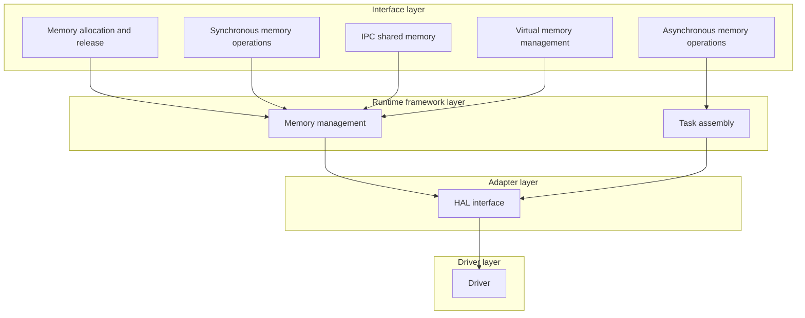
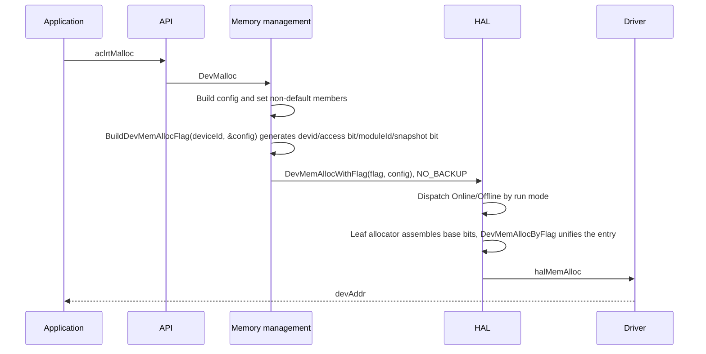
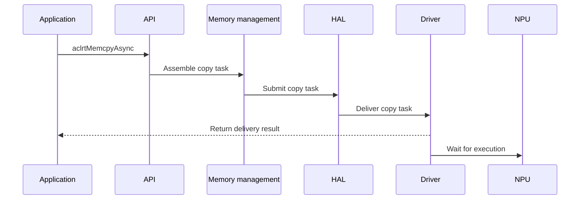
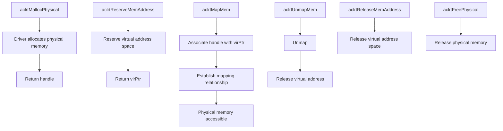
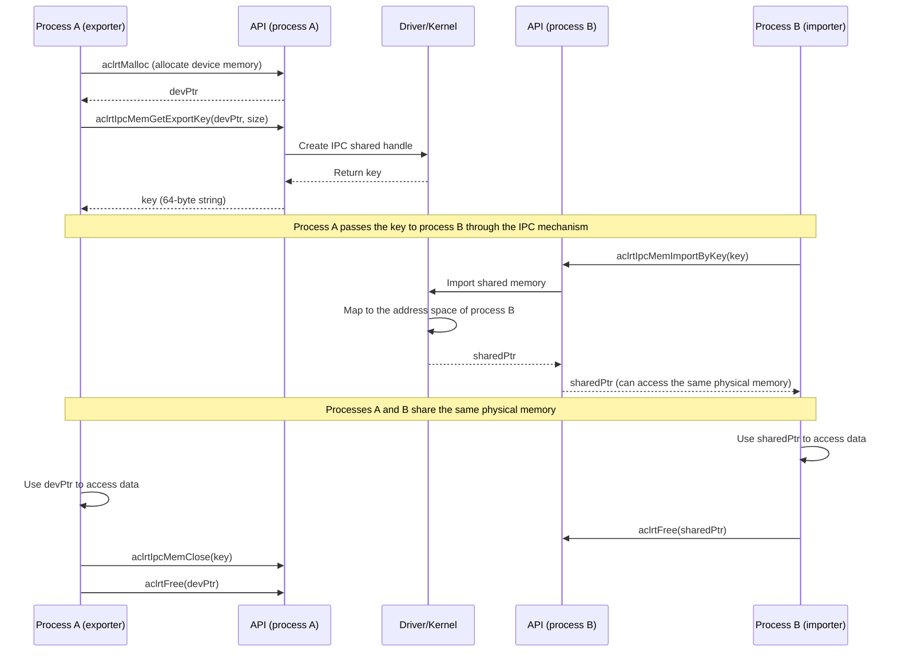

# Memory Module Architecture

## 1. Module Overview

- **Function introduction**: The memory module manages device memory allocation, operations, and release. It provides a set of memory management APIs so developers can manage memory usage in applications efficiently and conveniently.
- **Design goals**:
  - Provide unified memory management interfaces
  - Support multiple memory types
  - Support efficient memory copy
  - Support inter-process memory sharing

## 2. Usage Scenarios and External Interfaces

### 2.1 Basic Usage Scenarios

- **Scenario 1**: Allocate device memory
  ```cpp
  void *devPtr;
  aclrtMalloc(&devPtr, size, ACL_MEM_MALLOC_HUGE_FIRST);
  ```

- **Scenario 2**: Allocate host memory
  ```cpp
  void *hostPtr;
  aclrtMallocHost(&hostPtr, size);
  ```

- **Scenario 3**: Synchronous memory copy
  ```cpp
  aclrtMemcpy(dstPtr, dstSize, srcPtr, srcSize, ACL_MEMCPY_HOST_TO_DEVICE);
  ```

- **Scenario 4**: Asynchronous memory copy
  ```cpp
  aclrtStream stream;
  aclrtCreateStream(&stream);
  // Asynchronous copy, does not block the host
  aclrtMemcpyAsync(dstPtr, dstSize, srcPtr, srcSize, ACL_MEMCPY_HOST_TO_DEVICE, stream);
  ```

- **Scenario 5**: IPC memory sharing
  ```cpp
  // Process A: export the shared handle
  void *ptr;
  aclrtMalloc(&ptr, size, ACL_MEM_MALLOC_HUGE_FIRST);  // Allocate device memory in advance
  char key[65];
  aclrtIpcMemGetExportKey(ptr, size, key, 65, ACL_RT_IPC_MEM_EXPORT_FLAG_DEFAULT);
  
  // Process B: import the shared memory
  void *sharedPtr;
  aclrtIpcMemImportByKey(&sharedPtr, key, ACL_RT_IPC_MEM_IMPORT_FLAG_DEFAULT);
  
  // Close the IPC memory after use
  aclrtIpcMemClose(key);
  aclrtFree(ptr);  // Process A releases the original memory
  ```

- **Scenario 6**: Physical memory management
  ```cpp
  aclrtDrvMemHandle handle;
  aclrtPhysicalMemProp prop = {...};
  aclrtMallocPhysical(&handle, size, &prop, 0);  // Allocate physical memory
  void *virPtr;
  aclrtReserveMemAddress(&virPtr, size, 0, nullptr, 0);  // Reserve virtual address space
  aclrtMapMem(virPtr, size, 0, handle, 0);  // Map physical memory to a virtual address
  
  // Unmap and release memory after use
  aclrtUnmapMem(virPtr);  // Unmap
  aclrtReleaseMemAddress(virPtr);  // Release virtual address space
  aclrtFreePhysical(handle);  // Release physical memory
  ```

### 2.2 External Interfaces

| Interface | Description |
|------|------|
| **Memory allocation/release** |
| `aclrtMalloc`/`aclrtMallocWithCfg` | Allocate device memory |
| `aclrtMallocHost`/`aclrtMallocHostWithCfg` | Allocate host memory |
| `aclrtFree` | Release device memory |
| `aclrtFreeHost` | Release host memory |
| **Memory copy** |
| `aclrtMemcpy`/`aclrtMemcpyAsync` | Synchronous/asynchronous memory copy |
| `aclrtMemcpy2d`/`aclrtMemcpy2dAsync` | 2D synchronous/asynchronous memory copy |
| `aclrtMemcpyBatch`/`aclrtMemcpyBatchAsync` | Batch synchronous/asynchronous memory copy |
| **Memory set** |
| `aclrtMemset` | Memory set |
| `aclrtMemsetAsync` | Asynchronous memory set |
| **Physical memory management** |
| `aclrtMallocPhysical` | Allocate physical memory |
| `aclrtReserveMemAddress` | Reserve virtual address space |
| `aclrtMapMem` | Map physical memory to a virtual address |
| `aclrtUnmapMem` | Unmap memory |
| `aclrtReleaseMemAddress` | Release virtual address space |
| `aclrtFreePhysical` | Release physical memory |
| **Memory registration** |
| `aclrtHostRegister` | Register host memory |
| `aclrtHostUnregister` | Unregister host memory |

### 2.3 Memory Copy Types

| Copy type | Description |
|----------|------|
| `ACL_MEMCPY_HOST_TO_HOST` | Host to host |
| `ACL_MEMCPY_HOST_TO_DEVICE` | Host to device |
| `ACL_MEMCPY_DEVICE_TO_HOST` | Device to host |
| `ACL_MEMCPY_DEVICE_TO_DEVICE` | Device to device |
| `ACL_MEMCPY_DEFAULT` | Default copy type (the system infers the direction automatically) |
| `ACL_MEMCPY_HOST_TO_BUF_TO_DEVICE` | Host to device (the runtime caches the data, so the application can release Host memory after the call returns) |
| `ACL_MEMCPY_INNER_DEVICE_TO_DEVICE` | Copy within the same device |
| `ACL_MEMCPY_INTER_DEVICE_TO_DEVICE` | Copy across devices |

## 3. Architecture Overview

### Architecture Layering Diagram




## 4. Detailed Design

### 4.1 Core Flows

#### Memory Allocation Flow
The interface for allocating device memory is as follows:

```cpp
aclError aclrtMalloc(void **devPtr, size_t size, aclrtMemMallocPolicy policy);
```
- `devPtr`: A double pointer to the allocated memory address. After the function succeeds, `*devPtr` is the allocated device memory address.
- `size`: Memory size to allocate, in bytes.
- `policy`: Memory allocation policy. Developers can specify the policy based on actual application scenarios and requirements. Ordinary small pages (4 KB) save more resources, while large pages (2 MB) perform better when processing massive amounts of data. Supported policies are described as follows:

| Policy | Description |
|------|------|
| `ACL_MEM_MALLOC_HUGE_FIRST` | Prefer large page memory and use normal page memory when large page memory is insufficient |
| `ACL_MEM_MALLOC_HUGE_ONLY` | Use large page memory only and return an error when large page memory is insufficient |
| `ACL_MEM_MALLOC_NORMAL_ONLY` | Use normal page memory only |
| `ACL_MEM_MALLOC_HUGE_FIRST_P2P` | Prefer large page memory (P2P scenario) |
| `ACL_MEM_MALLOC_HUGE_ONLY_P2P` | Use large page memory only (P2P scenario) |
| `ACL_MEM_MALLOC_NORMAL_ONLY_P2P` | Use normal page memory only (P2P scenario) |
| `ACL_MEM_MALLOC_HUGE1G_ONLY` | Use 1 GB large page memory only |
| `ACL_MEM_MALLOC_HUGE1G_ONLY_P2P` | Use 1 GB large page memory only (P2P scenario) |
| `ACL_MEM_TYPE_LOW_BAND_WIDTH` | Low bandwidth memory type |
| `ACL_MEM_TYPE_HIGH_BAND_WIDTH` | High bandwidth memory type |
| `ACL_MEM_ACCESS_USER_SPACE_READONLY` | User space read-only access permission |

The detailed allocation flow is as follows:


The driver abstraction layer (`src/runtime/core/inc/drv/driver.hpp`) provides two device memory allocation entries. Choose one based on whether the config needs changes:

| Entry | Positioning | Usage |
|------|------|---------|
| `DevMemAllocWithBackupFlag` | **General fast path (explicitly pass the backup tag)** | The backup tag `type` is explicitly passed through the fifth positional parameter (default `SNAPSHOT_REQUIRED_BACKUP`), and all other config members are default |
| `DevMemAllocWithFlag` | **General method (when config needs changes)** | First build config and assign non-default members, then generate `drvFlag` through `BuildDevMemAllocFlag(deviceId, &config)`, and finally call with both |

**`DevMemAllocWithBackupFlag`: general fast interface.** Use the 6-parameter signature when all attributes are default and only the backup type needs to be specified. Pass the backup tag explicitly through the `type` positional parameter. Runtime internal memory passes required or optional based on the snapshot requirement. External user memory of aclrt-related interfaces passes `SNAPSHOT_NO_BACKUP`. The call site does not need to construct a config. The implementation writes `type` into a local copy of the config and does not affect variables at the call site.

**`DevMemAllocWithFlag`: general usage method when config needs changes.** When any config member must deviate from the default value (custom `moduleId`, `isLogError=false`, `readOnlyFlag` / `cpOnlyFlag` / `privateFlag`), follow the standard three steps:

```cpp
// 1. Build config and assign only non-default members
DevMemAllocConfig allocConfig = {};
allocConfig.moduleId = moduleId;
allocConfig.isLogError = false;
// 2. Generate drvFlag from config (deviceId, moduleId, access bit, and backup tag encoded together)
const uint64_t drvFlag = NpuDriver::BuildDevMemAllocFlag(devId, &allocConfig);
// 3. Call with drvFlag and config
rtError_t ret = driver->DevMemAllocWithFlag(devPtr, tmpSize, type, devId, &allocConfig, drvFlag);
```

`BuildDevMemAllocFlag` receives `deviceId` and `const DevMemAllocConfig* const config`. It reads `moduleId`, `readOnlyFlag`, `cpOnlyFlag`, `privateFlag`, and `type` from the config in a unified way, so the caller does not pass these attributes repeatedly. `deviceId` does not belong to the config and is still passed separately. The caller ensures that the config pointer is not null, consistent with other device memory allocation entries.

Both entries eventually converge to the same dispatch chain. `DevMemAllocWithBackupFlag` internally builds a flag from the config through `BuildDevMemAllocFlag` and then delegates to `DevMemAllocWithFlag`. That method dispatches to the Online/Offline leaf allocator by run mode (the offline path masks the access bit and keeps historical behavior). Finally, `DevMemAllocByFlag` unifies the entry and calls `halMemAlloc`.

#### Memory Copy Flow
Common memory copies fall into synchronous copy and asynchronous copy:

**Synchronous copy (aclrtMemcpy):**
- Blocks the host thread after the call and returns only after the copy completes
- Use cases: scenarios that need the copy result immediately, small data volumes, and simple data transfer
- Advantage: simple to use and no need to consider stream synchronization
- Disadvantage: blocks the host and affects concurrency performance

**Asynchronous copy (aclrtMemcpyAsync):**
- Returns immediately after the call, does not block the host thread, and the copy task runs asynchronously on the specified Stream
- Use cases: large data volumes, scenarios that need to run in parallel with other compute tasks, and multi-stream concurrency scenarios
- Advantage: improves host-device parallelism and fully uses hardware performance
- Disadvantage: requires Event or Stream synchronization to ensure the copy completes before using the data

The main asynchronous copy flow is as follows:


#### Batch Memory Copy Flow

Batch memory copy allows submitting multiple memory copy tasks at one time, which reduces task submission overhead and improves overall copy efficiency. It supports synchronous batch copy (`aclrtMemcpyBatch`) and asynchronous batch copy (`aclrtMemcpyBatchAsync`), and suits scenarios that need to transfer multiple data blocks at the same time.

**Interface parameters:**
```cpp
aclError aclrtMemcpyBatch(void **dsts, size_t *destMaxs, void **srcs, 
                          size_t *sizes, size_t numBatches,
                          aclrtMemcpyBatchAttr *attrs, size_t *attrsIndexes,
                          size_t numAttrs, size_t *failIdx);

aclError aclrtMemcpyBatchAsync(void **dsts, size_t *destMaxs, void **srcs,
                               size_t *sizes, size_t numBatches,
                               aclrtMemcpyBatchAttr *attrs, size_t *attrsIndexes,
                          size_t numAttrs, size_t *failIdx,
                               aclrtStream stream);
```

**Parameter description:**
| Parameter | Type | Description |
|------|------|------|
| `dsts` | IN `void**` | Destination address array |
| `destMaxs` | IN `size_t*` | Array of maximum capacities of destination addresses |
| `srcs` | IN `void**` | Source address array |
| `sizes` | IN `size_t*` | Copy size array |
| `numBatches` | IN `size_t` | Number of batch copy tasks |
| `attrs` | IN `aclrtMemcpyBatchAttr*` | Copy attribute array (can specify the copy direction of each task) |
| `attrsIndexes` | IN `size_t*` | Start task index of each attribute array item. Attribute item n applies to the range [attrsIndexes[n], attrsIndexes[n+1]); the last item applies until numBatches |
| `numAttrs` | IN `size_t` | Number of elements in attrs and attrsIndexes |
| `failIdx` | OUT `size_t*` | Index of the failed task. It is SIZE_MAX when all tasks succeed or the error is unrelated to a single copy |
| `stream` | IN `aclrtStream` | Stream used for the asynchronous copy |


#### Physical Memory Management Flow

Physical memory management allows users to directly control physical memory allocation and mapping and provides finer memory management capabilities. It mainly serves advanced scenarios such as inter-process memory sharing, large memory pool management, and specific memory attributes. Through physical memory management interfaces, users can:
- Allocate physical memory independently and obtain a handle (`aclrtMallocPhysical`)
- Reserve virtual address space (`aclrtReserveMemAddress`)
- Map physical memory to the virtual address space (`aclrtMapMem`)
- Unmap and release resources after use (`aclrtUnmapMem`, `aclrtReleaseMemAddress`, `aclrtFreePhysical`)



#### IPC Memory Sharing

IPC (Inter-Process Communication) memory sharing allows different processes to share the same device memory and enables efficient cross-process data transfer. Through the IPC mechanism, process A can export allocated device memory as a shared key. Process B imports through that key and accesses the same physical memory, which avoids data copy overhead.


| Core interface | Description |
|------|------|
| `aclrtIpcMemGetExportKey` | Export device memory as an IPC key for other processes to import |
| `aclrtIpcMemImportByKey` | Import shared memory into the current process through the key |
| `aclrtIpcMemClose` | Close IPC shared memory (called by the exporter) |
| `aclrtIpcMemSetImportPid` | Set the PID whitelist of processes allowed to import |



### 4.2 Key File Index

| Function module | File path | Core content |
|------|----------|----------|
| ACL memory interfaces | `include/external/acl/acl_rt.h` | External interfaces such as aclrtMalloc, aclrtMemcpy, aclrtIpcMem |
| Runtime interface layer implementation | `src/runtime/api/api_c_memory.cc` | Internal rtMem* interface implementation |
| Memory tasks | `src/runtime/core/src/task/task_info/memory/memory_task.cc` | MemcpyAsyncTask and MemcpyBatchTask implementation |
| Memory task header file | `src/runtime/core/src/task/inc/memory_task.h` | Memory task interface definitions |
