# Model Module Architecture

## 1. Module Overview

- **Function overview**: The Model module manages the execution model of compute graphs. It covers the full lifecycle, including model creation, Stream binding, task loading, model execution, and destruction. It supports Normal Model and Capture Model. It implements task scheduling and execution through the SQ/CQ mechanism.
- **Design goals**:
  - Provide unified model management interfaces
  - Support multi-Stream binding and scheduling
  - Implement batch submission and execution of tasks
  - Support Label allocation and jump control
  - Provide synchronous and asynchronous model execution modes

## 2. Usage Scenarios and External Interfaces

### 2.1 Usage Scenarios

- **Scenario 1**: Create and execute a compute model (using ACL interfaces)
  ```cpp
  aclmdlRI modelRI;
  aclmdlRIBuildBegin(&modelRI, 0);  // Start building the model
  aclmdlRIBindStream(modelRI, stream, ACL_MODEL_STREAM_FLAG_HEAD);  // Bind a Stream
  // Add tasks to the stream
  aclmdlRIEndTask(modelRI, stream);  // Mark the end of tasks
  aclmdlRIBuildEnd(modelRI, nullptr);  // End building
  aclmdlRIExecute(modelRI, -1);  // Synchronous execution
  aclmdlRIDestroy(modelRI);  // Destroy the model
  ```

- **Scenario 2**: Asynchronous model execution (using ACL interfaces)
  ```cpp
  aclmdlRIExecuteAsync(modelRI, execStream);
  // Wait for execution completion through Stream synchronization
  aclrtSynchronizeStream(execStream);
  ```

### 2.2 External Interfaces

| ACL interface | File location | Description |
|----------|----------|------|
| `aclmdlRIBuildBegin()` | `include/external/acl/acl_rt.h`<br>`src/acl/aclrt_impl/model_ri.cpp` | Create a model (start building) |
| `aclmdlRIDestroy()` | `include/external/acl/acl_rt.h`<br>`src/acl/aclrt_impl/model_ri.cpp` | Destroy a model |
| `aclmdlRIBindStream()` | `include/external/acl/acl_rt.h`<br>`src/acl/aclrt_impl/model_ri.cpp` | Bind a Stream to a model |
| `aclmdlRIUnbindStream()` | `include/external/acl/acl_rt.h`<br>`src/acl/aclrt_impl/model_ri.cpp` | Unbind a Stream |
| `aclmdlRIExecute()` | `include/external/acl/acl_rt.h`<br>`src/acl/aclrt_impl/model_ri.cpp` | Execute a model synchronously |
| `aclmdlRIExecuteAsync()` |`include/external/acl/acl_rt.h`<br>`src/acl/aclrt_impl/model_ri.cpp` | Execute a model asynchronously |
| `aclmdlRIBuildEnd()` | `include/external/acl/acl_rt.h`<br>`src/acl/aclrt_impl/model_ri.cpp` | Complete model building (LoadComplete) |
| `aclmdlRIEndTask()` | `include/external/acl/acl_rt.h`<br>`src/acl/aclrt_impl/model_ri.cpp` | Mark the end of tasks |
| `aclmdlRISetName()` | `include/external/acl/acl_rt.h`<br>`src/acl/aclrt_impl/model_ri.cpp` | Set the model name |
| `aclmdlRIAbort()` |`include/external/acl/acl_rt.h`<br>`src/acl/aclrt_impl/model_ri.cpp` | Abort model execution |

## 3. Architecture Overview

### 3.1 Overall Design Approach

Model uses a two-layer inheritance structure: the base class Model provides the complete functions of a normal model. Each Model binds multiple Streams, submits execution tasks through ModelExecuteTask, and uses Notify to notify execution completion.

| Design point | Description |
|--------|------|
| **Model as a task container** | Binds multiple Streams and uniformly manages SQE delivery and execution |
| **Stream as a task queue** | Each Stream maintains an SQ task sequence and supports task reclaim |
| **Label implements control flow** | Model allocates Label IDs, and Stream records jump points |
| **headStreams mechanism** | Marks entry Streams and activates execution from them at Execute |
| **Execution stream mechanism** | Delivers model execution tasks and activates model stream execution |

### 3.2 Architecture Layer Diagram

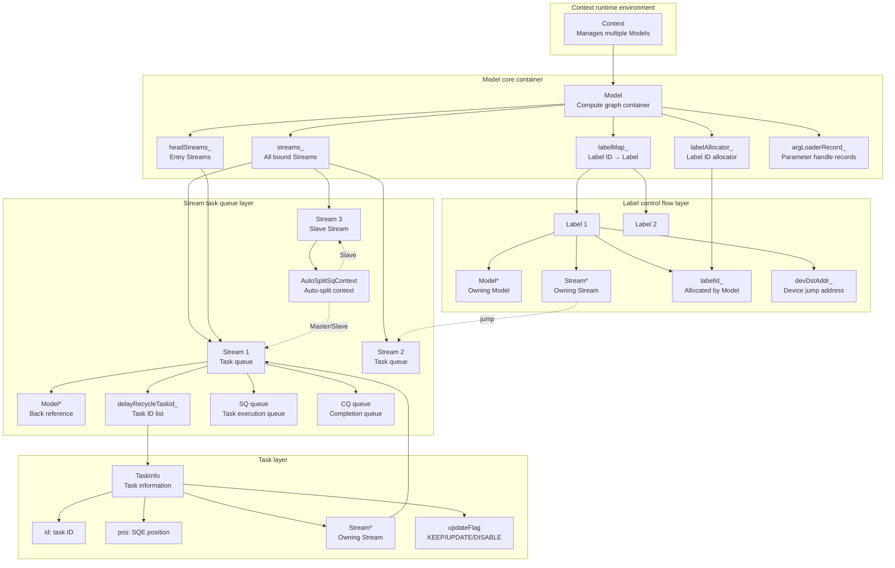

### 3.3 Three-Layer Architecture Relationship of Model-Stream-Label

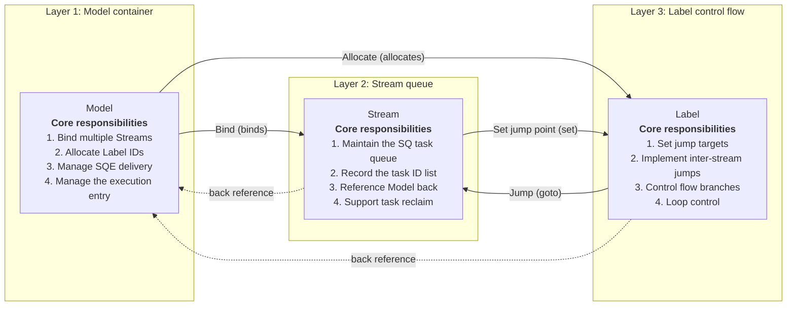

### 3.4 Core Module Interaction Diagram (with Hardware Interaction)

This section uses sequence diagrams to show the key differences between AutoSplit and non-AutoSplit scenarios.

#### 3.4.1 Stream Binding Phase

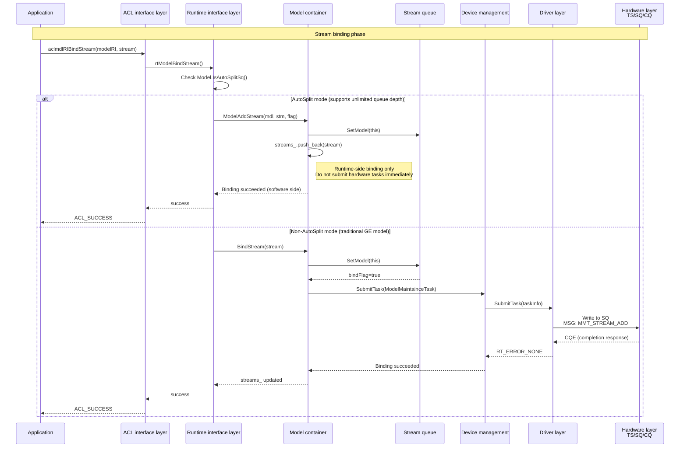

**Difference description**:
| Comparison item | AutoSplit mode | Non-AutoSplit mode |
|--------|----------------|-------------------|
| Binding timing | Software binding on the Runtime side only | Submit a hardware binding task immediately |
| Hardware interaction | Establish hardware relationships only at LoadComplete | Write to SQ immediately at bind time |
| Task queue | Host SQE buffer (extensible) | Fixed hardware SQ |

#### 3.4.2 Task Submission Phase

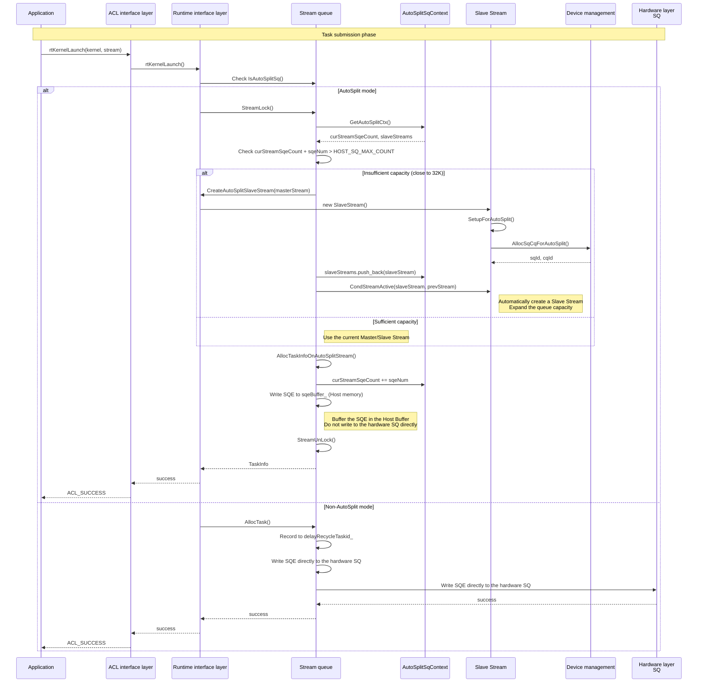

**Difference description**:
| Comparison item | AutoSplit mode | Non-AutoSplit mode |
|--------|----------------|-------------------|
| SQE storage location | Host sqeBuffer_ | Device SQ |
| Capacity limit | Unlimited (Slave Stream expansion) | Fixed depth |
| Submission timing | Batch delivery at LoadComplete | Real-time submission |
| Slave Stream | Created automatically when tasks approach 32K | Not supported |

#### 3.4.3 EndGraph Marking Phase

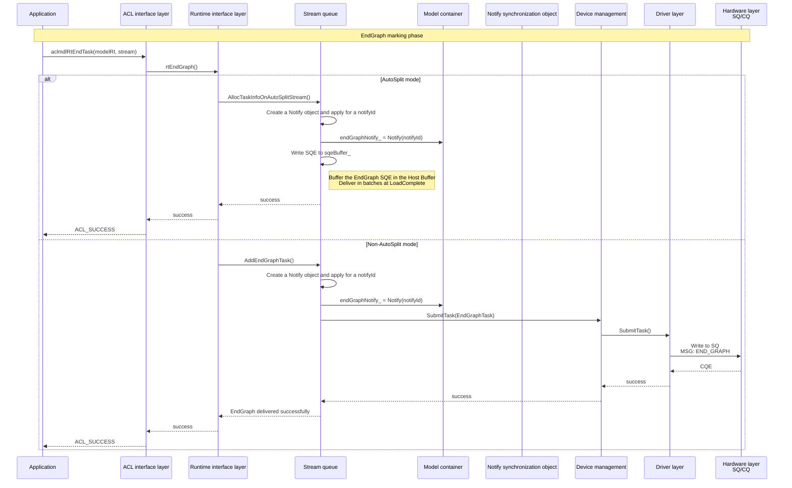

#### 3.4.4 LoadComplete Phase

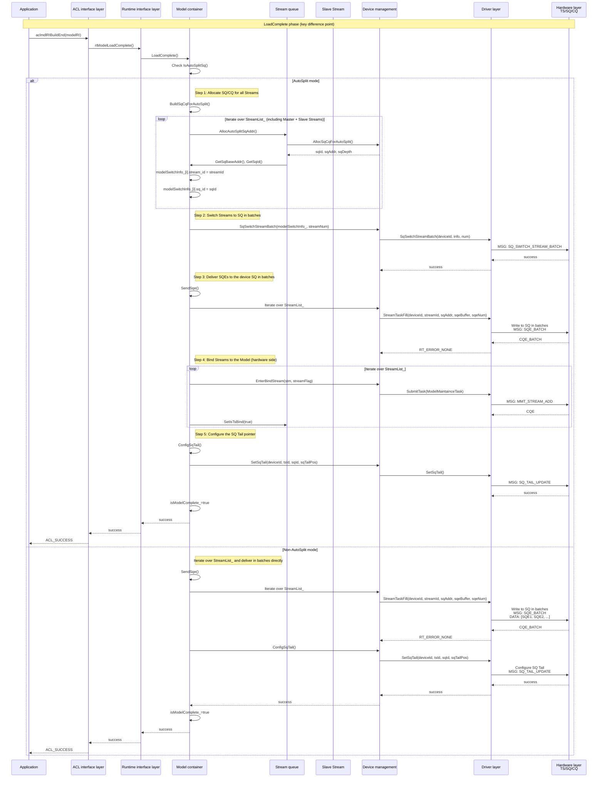

**Difference description**:
| Comparison item | AutoSplit mode | Non-AutoSplit mode |
|--------|----------------|-------------------|
| SQ/CQ allocation | Allocated dynamically at LoadComplete | Already allocated at Stream creation |
| Stream switching | Batch switching with SqSwitchStreamBatch | No switching needed |
| Hardware binding | Establish hardware relationships only at LoadComplete | Already established at bind time |
| Slave Stream | Must handle all Master + Slave | Handle only bound Streams |

#### 3.4.5 Model Execution Phase

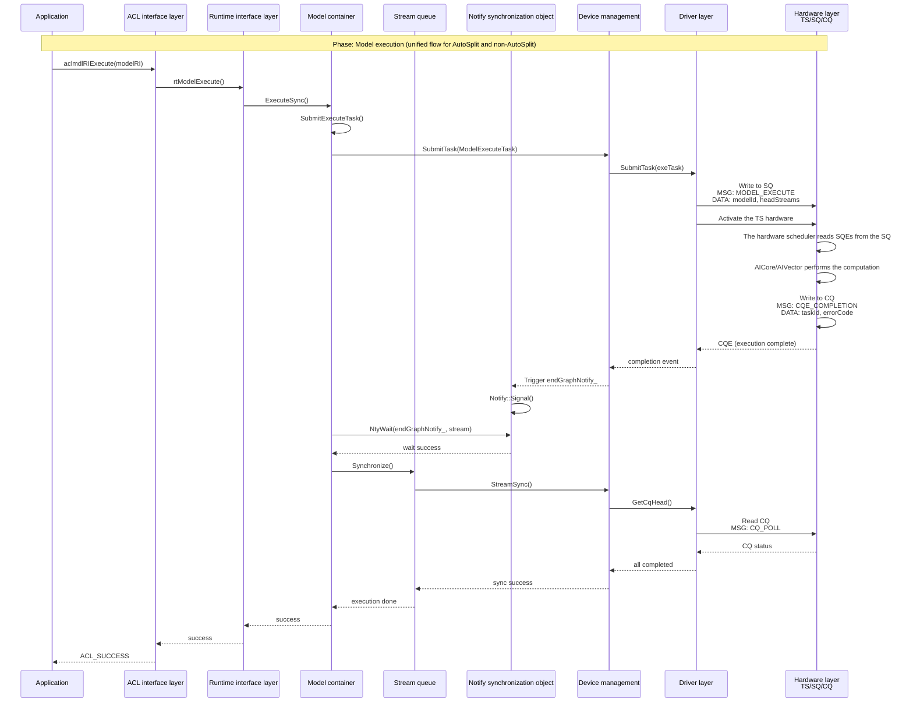

**Note**: In the model execution phase, the AutoSplit and non-AutoSplit flows are unified. The difference lies in the SQE source:
- AutoSplit: SQEs are already delivered from the Host Buffer to the device SQ in batches at LoadComplete
- Non-AutoSplit: SQEs are already written directly to the device SQ at task submission

#### 3.4.6 Model Destruction Phase

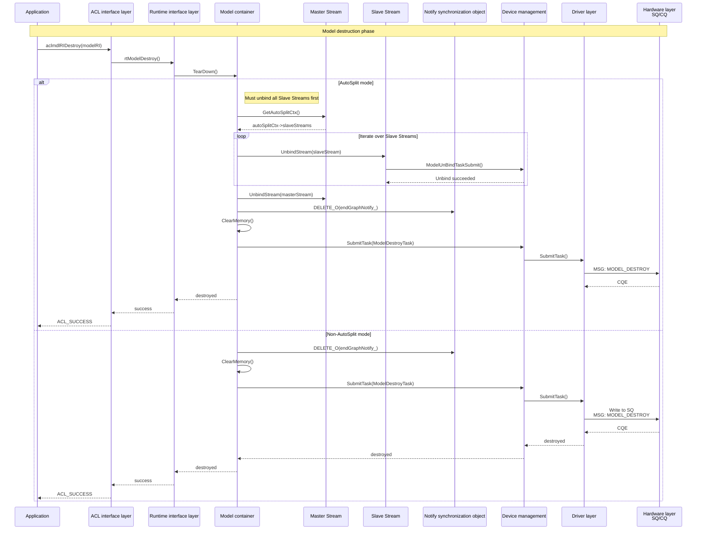

## 4. Detailed Design

### 4.1 Core Flows

#### Model Creation and Initialization Flow

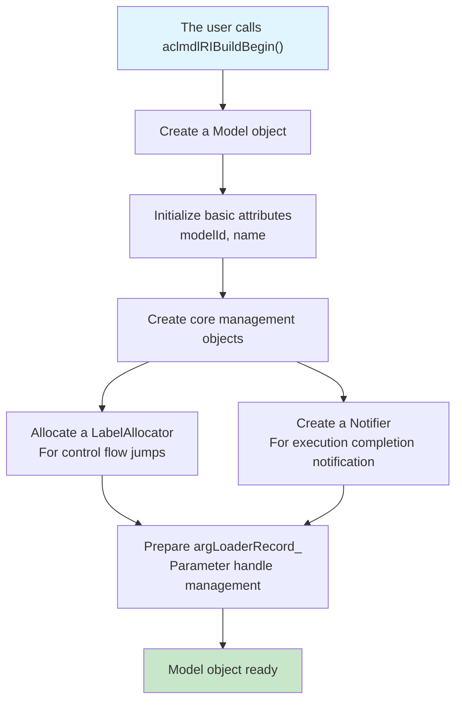

**Flow description**:
1. The user initiates a model creation request through the ACL interface
2. Runtime creates a Model object and allocates a unique modelId
3. Initialize the Label allocator to support later branch jump control
4. Create a Notifier object for the notification mechanism after model execution completes
5. Allocate device-side memory to store model metadata
6. Prepare the parameter handle record table to manage task parameter memory

#### Stream Binding Flow

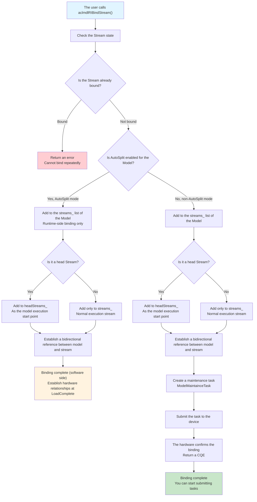

**Flow description**:

| Step | AutoSplit mode | Non-AutoSplit mode |
|------|----------------|-------------------|
| 1 | The user requests to bind a Stream to the Model | The user requests to bind a Stream to the Model |
| 2 | Check the Stream state to prevent repeated binding | Check the Stream state to prevent repeated binding |
| 3 | Add to the streams_ list on the Runtime side only | Add to the streams_ list |
| 4 | Determine whether it is a head Stream | Determine whether it is a head Stream |
| 5 | Establish a bidirectional reference | Establish a bidirectional reference |
| 6 | **Do not submit hardware tasks immediately** | Create a maintenance task and notify the hardware |
| 7 | **Wait for LoadComplete** | Submit the task to the device, and the hardware returns a CQE |
| 8 | Binding complete (software side) | Binding complete, and you can start submitting tasks |

**Key difference**: In AutoSplit mode, Stream binding completes only the software-side record. The hardware binding is delayed until the LoadComplete phase. This approach enables more flexible task queue management.

#### Task Submission Flow

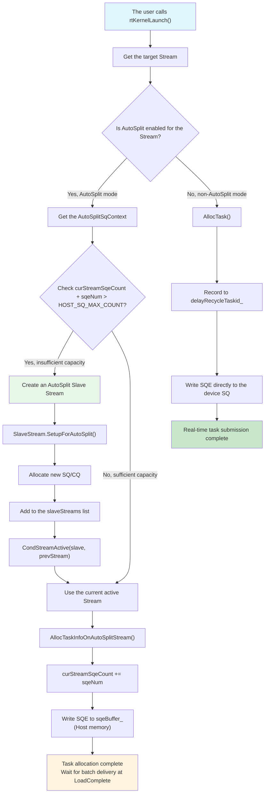

**Flow description**:

| Comparison item | AutoSplit mode | Non-AutoSplit mode |
|--------|----------------|-------------------|
| Capacity check | Check whether curStreamSqeCount approaches 32K | No capacity limit check |
| Slave creation | Create a Slave Stream automatically to expand capacity | Not supported |
| SQE storage | Write to the Host sqeBuffer_ | Write directly to the device SQ |
| Submission timing | Batch delivery at LoadComplete | Real-time submission |

**Key mechanism**:
- `HOST_SQ_MAX_COUNT = 32K`: Maximum capacity of the Host SQE buffer
- `AutoSplitSqContext`: Maintains curStreamSqeCount and the slaveStreams list
- `Slave Stream`: Created automatically when the task count approaches 32K to achieve unlimited queue depth

#### EndGraph Marking Flow

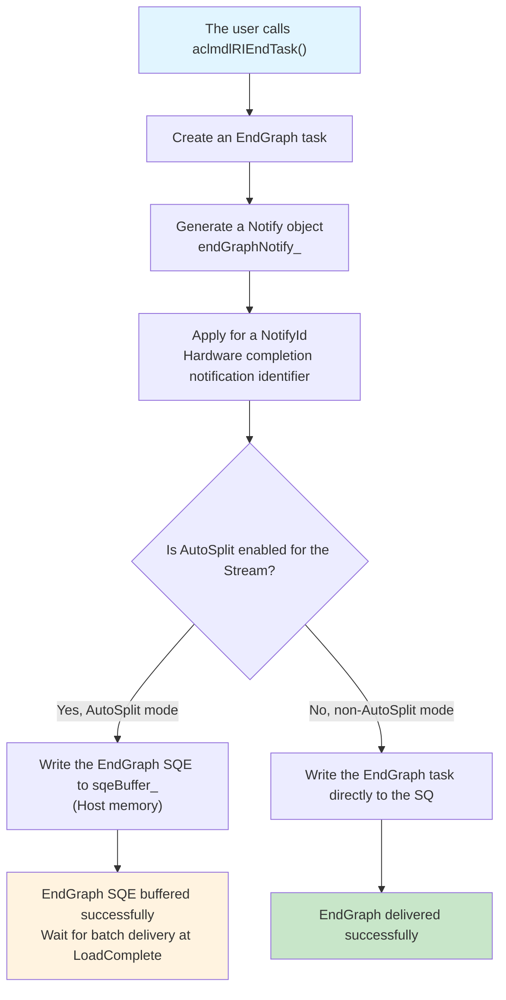

**Flow description**:

| Step | AutoSplit mode | Non-AutoSplit mode |
|------|----------------|-------------------|
| 1 | The user marks the end of task delivery | The user marks the end of task delivery |
| 2 | Create an EndGraph task | Create an EndGraph task |
| 3 | Create a Notify object and apply for a NotifyId | Create a Notify object and apply for a NotifyId |
| 4 | **Write the SQE to the Host Buffer** | Write the EndGraph task to the SQ |
| 5 | **Wait for batch delivery at LoadComplete** | Delivery succeeds immediately |
| 6 | Trigger the Notify Signal during hardware execution | Trigger the Notify Signal during hardware execution |

#### Model LoadComplete Flow

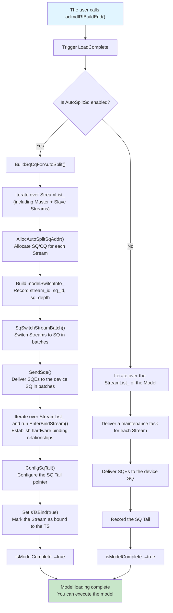

**Flow description**:

| Step | AutoSplit mode | Non-AutoSplit mode |
|------|----------------|-------------------|
| 1 | BuildSqCqForAutoSplit() | Iterate over StreamList_ directly |
| 2 | Allocate SQ/CQ for all Streams (including Slave) | SQ/CQ is already allocated at creation |
| 3 | Build modelSwitchInfo_ | Not needed |
| 4 | Batch switching with SqSwitchStreamBatch | Not needed |
| 5 | Deliver SQEs in batches with SendSqe | Deliver SQEs |
| 6 | **Establish hardware binding with EnterBindStream** | **Hardware binding already established** |
| 7 | SQ Tail |Configure SQ Tail |
| 8 | SetIsTsBind(true) | Not needed |
| 9 | isModelComplete_=true | isModelComplete_=true |

**Key difference**: In AutoSplit mode, LoadComplete requires:
1. Dynamically allocate SQ/CQ resources
2. Switch Streams to SQ in batches
3. Establish hardware binding relationships (EnterBindStream)
4. Mark the Stream as bound to the TS (SetIsTsBind)

#### Model Execution Flow

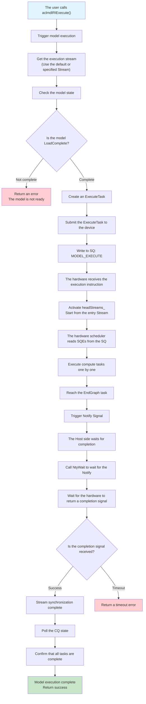

**Flow description**:

| Step | Description | Difference between AutoSplit and non-AutoSplit |
|------|------|------------------------------|
| 1 | The user calls Execute to trigger model execution | No difference |
| 2 | Prepare the execution environment and get the execution Stream | No difference |
| 3 | Check the model state to ensure LoadComplete is finished | No difference |
| 4 | Create an ExecuteTask and set execution parameters | No difference |
| 5 | Submit the ExecuteTask to the device and write it to the SQ | No difference |
| 6 | The hardware TS receives the execution instruction and activates headStreams_ | No difference |
| 7 | **The TS reads SQEs from the SQ** | **SQE source difference** |
| 8 | AICore/AIVector executes compute tasks | No difference |
| 9 | Reach the EndGraph task and trigger Notify Signal | No difference |
| 10 | The Host side waits for completion (NtyWait) | No difference |
| 11 | After receiving the completion signal, poll the CQ state | No difference |
| 12 | Confirm that all tasks are complete and return success | No difference |

**SQE source difference description**:
- **AutoSplit mode**: SQEs are already delivered from the Host sqeBuffer_ to the device SQ in batches during LoadComplete
  - Write to the Host Buffer at task submission (delayed submission)
  - Deliver all SQEs in one batch at LoadComplete
  - Support unlimited queue depth (Slave Stream expansion)
  
- **Non-AutoSplit mode**: SQEs are already written directly to the device SQ at task submission
  - Write directly to the device SQ at task submission (real-time submission)
  - Deliver immediately at EndGraph marking
  - Fixed queue depth

**Unified execution phase**: In either mode, all SQEs reside in the device SQ at execution time. The hardware TS reads from the SQ and executes directly. The flow is completely the same.

#### Label Control Flow Setup Flow

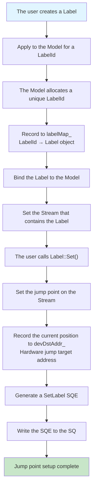

**Flow description**:
1. The user creates a Label and applies to the Model for a unique LabelId
2. The Model allocates an ID through the LabelAllocator and records the mapping
3. The Label binds to the Model and the Stream
4. The user calls Label::Set to set the jump target point on the Stream
5. Record the current position to the device-side address (devDstAddr_)
6. Generate a SetLabel SQE and write it to the Stream cache
7. The jump point setup completes, and the Label waits for later jumps

#### Label Control Flow Jump Flow

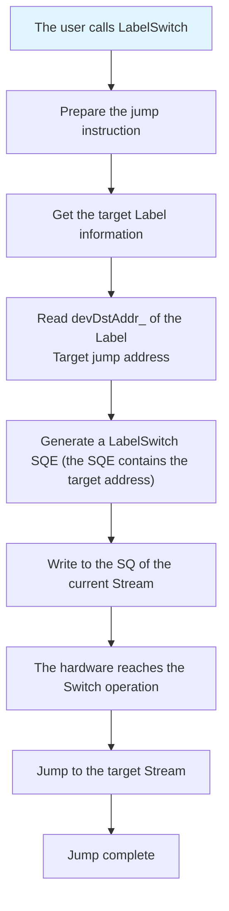

**Flow description**:
1. The user calls the LabelSwitch interface to initiate a jump instruction
2. Get the device-side address of the target Label (devDstAddr_)
3. Generate a LabelSwitch SQE that contains the target jump address
4. Write to the SQ of the current Stream
5. The hardware TS reaches the Switch operation and jumps to the target position

#### Model Destruction Flow

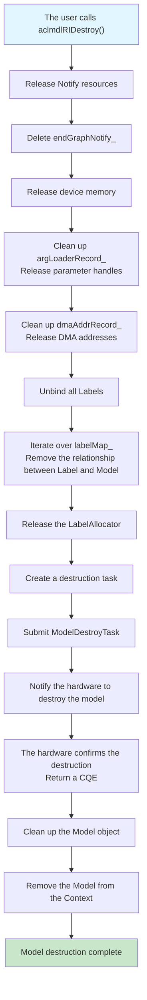

**Flow description**:
1. The user calls Destroy to trigger model destruction
2. Release Notify resources and delete endGraphNotify_
3. Release device memory and clean up parameter handle records
4. Release DMA address records
5. Unbind all Labels and remove their relationships with the Model
6. Release LabelAllocator resources
7. Create a destruction task and notify the hardware to destroy the model
8. The hardware confirms the destruction and returns a CQE
9. Clean up the Model object and remove it from the Context
10. Model destruction completes, and all resources are released

### 4.2 Core Mechanism Details

#### Model Container Management Mechanism

**Design concept**: Model is the container of the compute graph. It uniformly manages all bound Streams and Labels and implements batch task delivery and execution entry control.

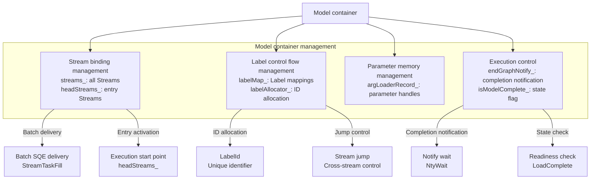

**Mechanism description**:
- **Stream binding management**: Maintains the list of all Streams, and headStreams_ serves as the execution start point
- **Label control flow management**: Allocates Label IDs and manages jump relationships
- **Parameter memory management**: Records task parameter handles to avoid repeated allocation
- **Execution control**: The Notify mechanism implements asynchronous waits, and state flags ensure execution order

#### Stream Task Queue Mechanism

**Design concept**: Stream acts as a task queue. It buffers SQEs and supports task reclaim and automatic SQ splitting.

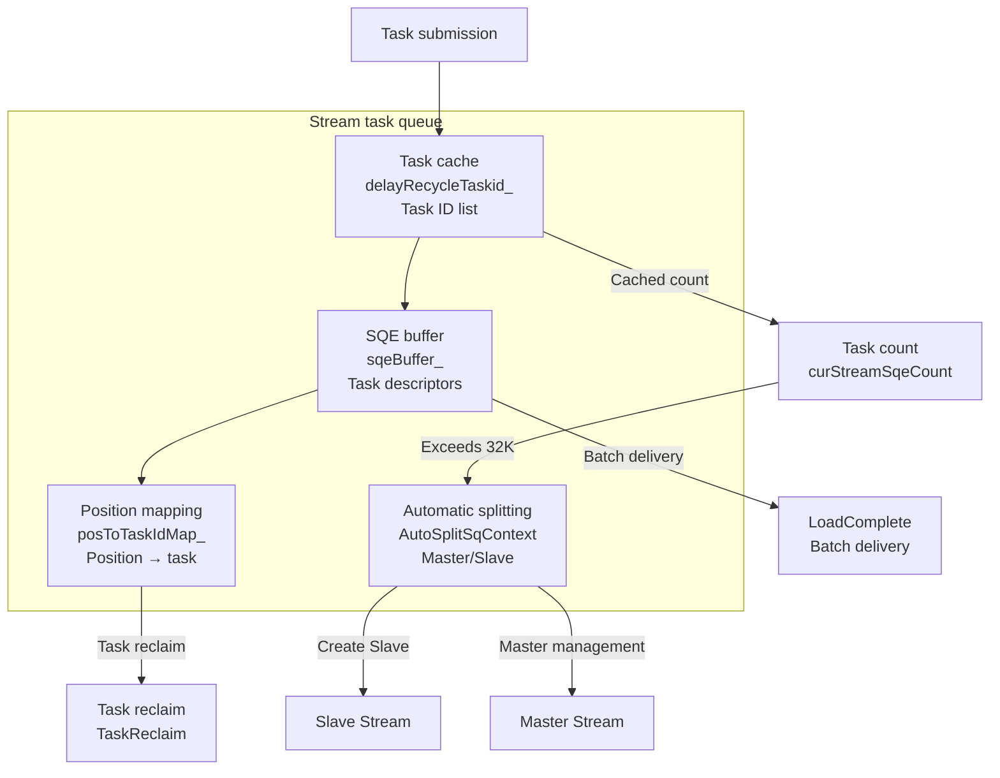

**Mechanism description**:
- **Task cache**: delayRecycleTaskid_ records task IDs and waits for batch delivery
- **SQE buffer**: sqeBuffer_ stores task descriptors and prepares them for writing to the hardware SQ
- **Position mapping**: posToTaskIdMap_ records the correspondence between SQE positions and tasks
- **Automatic splitting**: When tasks exceed 32K, automatically create a Slave Stream to expand capacity

#### Label Control Flow Jump Mechanism

**Design concept**: Label implements cross-Stream jumps and loop control. It performs hardware-level jumps through device-side addresses.

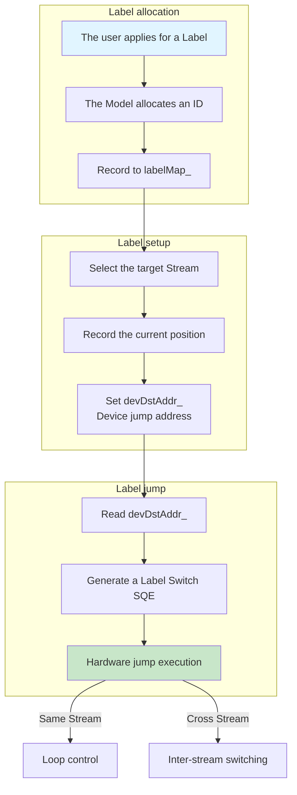

**Mechanism description**:
- **Label allocation**: The Model allocates a unique ID through the LabelAllocator
- **Label setup**: Record the jump position on the target Stream and set the device-side address
- **Label jump**: Read the device address, generate a jump SQE, and let the hardware execute the jump
- **Control flow implementation**: Support loops (same Stream) and cross-Stream task switching

#### Notify Completion Notification Mechanism

**Design concept**: Notify implements hardware completion notification. The Host gets the execution result by waiting for the Notify.

```mermaid
sequenceDiagram
    participant Model as Model
    participant EndGraph as EndGraphTask
    participant Notify as endGraphNotify_
    participant Driver as Driver
    participant HW as Hardware TS
    
    %% EndGraph creates the Notify
    Model->>EndGraph: rtEndGraph(model, stream)
    EndGraph->>Notify: Create a Notify object
    Notify->>Driver: AllocNotifyId()
    Driver->>HW: Apply for a notifyId
    HW-->>Driver: notifyId
    Driver-->>Notify: notifyId
    Notify-->>Model: endGraphNotify_
    
    %% Write the EndGraph Task at execution
    Model->>EndGraph: Execute()
    EndGraph->>Driver: SubmitTask(EndGraphTask)
    Driver->>HW: SQE: END_GRAPH<br/>notifyId=notifyId_
    HW->>HW: Execute all preceding tasks
    HW->>HW: Execute the EndGraph Task
    HW->>HW: Signal Notify<br/>notifyId ← value++
    
    %% The Host waits for the Notify
    Model->>Notify: NtyWait(endGraphNotify_, stream)
    Notify->>Driver: Notify::Wait()
    Driver->>HW: Poll Notify Value<br/>MSG: NOTIFY_POLL
    HW-->>Driver: notifyValue
    Driver-->>Notify: value matched
    Notify-->>Model: wait success
    Model->>Model: Execution complete
```

**Mechanism description**:
- **Notify creation**: The EndGraph task applies for a NotifyId and binds it to the Model
- **Notify wait**: The Host polls the Notify Value through NtyWait
- **Notify trigger**: The hardware reaches EndGraph, signals the Notify, and updates the Value
- **Completion confirmation**: The Host detects a Value match and confirms that execution is complete

### 4.3 Module Responsibility Division

The Model module is divided into submodules by function, including the core container, task management, interface layer, and auxiliary tools. Each module has clear responsibilities and works together to complete full model lifecycle management.

#### Core Container Modules

| Module name | Core responsibility | Code location | Main functions |
|----------|----------|----------|----------|
| **Model core class** | Compute graph container that uniformly manages Stream/Label/Notify | `src/runtime/core/inc/model/model.hpp`<br/>`src/runtime/feature/model/model.cc` | • Bind/unbind Streams<br/>• Allocate/release Labels<br/>• Execute models synchronously/asynchronously<br/>• Deliver SQEs in batches<br/>• Manage argLoaderRecord |
| **Model C interface** | C-style API wrapper for external use | `src/runtime/api/api_c_model.cc` | • rtModelCreate<br/>• rtModelDestroy<br/>• rtModelBindStream<br/>• rtModelExecute<br/>• rtEndGraph<br/>• rtModelLoadComplete |

#### Task Management Modules

| Task type | Task responsibility | Code location | Trigger timing |
|----------|----------|----------|----------|
| **ModelExecuteTask** | Trigger model execution and activate headStreams | `src/runtime/core/src/task/task_info/model/model_execute_task.cc`<br/>`src/runtime/core/src/task/task_info/model/model_execute_task_v100.cc`<br/>`src/runtime/core/src/task/task_info/model/model_execute_task_v200_base.cc` | On Execute/ExecuteAsync calls |
| **ModelMaintainceTask** | Maintain the relationship between Stream and Model | `src/runtime/core/src/task/task_info/model/model_maintaince_task.cc`<br/>`src/runtime/core/src/task/task_info/model/model_maintaince_task_v100.cc`<br/>`src/runtime/core/src/task/task_info/model/model_maintaince_task_v200_base.cc` | On BindStream/UnbindStream<br/>At LoadComplete |
| **ModelGraphTask** | Mark EndGraph and create a Notify | `src/runtime/core/src/task/task_info/model/model_graph_task.cc`<br/>`src/runtime/core/src/task/task_info/model/model_graph_task_v100.cc`<br/>`src/runtime/core/src/task/task_info/model/model_graph_task_v200_base.cc` | On rtEndGraph calls |

#### Auxiliary Tool Modules

| Tool module | Auxiliary responsibility | Code location | Service target |
|----------|----------|----------|----------|
| **LabelAllocator** | Label ID allocator | `src/runtime/core/inc/launch/label.hpp` | Model Label management |
| **Notify** | Hardware completion notification object | `src/runtime/core/inc/notify/notify.hpp`<br/>`src/runtime/core/src/notify/notify.cc` | EndGraph Notify |

#### Interface Adaptation Layer

| Adaptation layer | Adaptation responsibility | Code location | Service target |
|----------|----------|----------|----------|
| **ACL interface wrapper** | ACL → RT interface mapping | `src/acl/aclrt_impl/model_ri.cpp` | Calls to aclmdlRI interfaces by users |
| **API decorator** | API error handling decoration | `src/runtime/api/impl/api_decorator.cc`| ApiImpl call chain |


### 5 Key File Path Index

| Module category | File path | Core content |
|----------|----------|----------|
| **Model header file** | `src/runtime/core/inc/model/model.hpp` | Model class definition and data structures |
| **Model implementation** | `src/runtime/feature/model/model.cc` | Core Model implementation |
| **Model C interface** | `src/runtime/feature/model/model_c.cc` | C-style interface implementation |
| **Model Execute Task** | `src/runtime/core/src/task/task_info/model/model_execute_task.cc` | Execution task implementation |
| **Model Execute Task V100** | `src/runtime/core/src/task/task_info/model/model_execute_task_v100.cc` | V100 version adaptation |
| **Model Execute Task V200** | `src/runtime/core/src/task/task_info/model/model_execute_task_v200_base.cc` | V200 version adaptation |
| **Model Maintaince Task** | `src/runtime/core/src/task/task_info/model/model_maintaince_task.cc` | Maintenance task implementation |
| **ACL interface header file** | `include/external/acl/acl_rt.h` | External ACL interface definitions |
| **ACL interface implementation** | `src/acl/aclrt_impl/model_ri.cpp` | ACL interface implementation (aclmdlRI series) |
