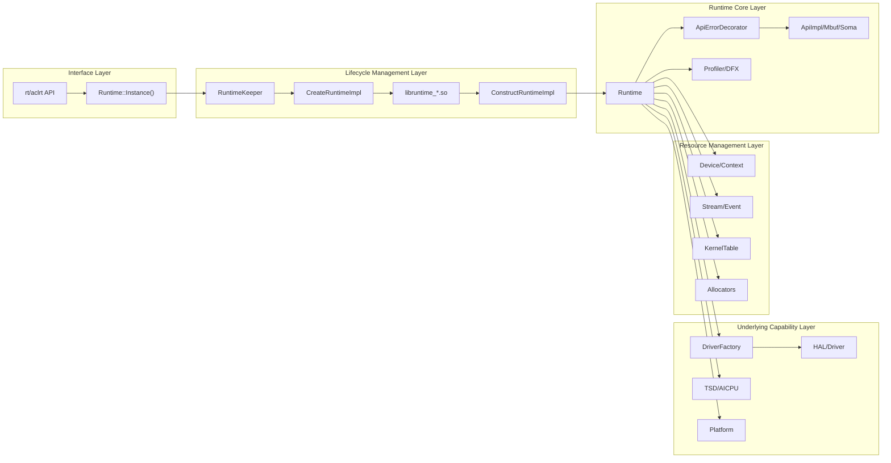
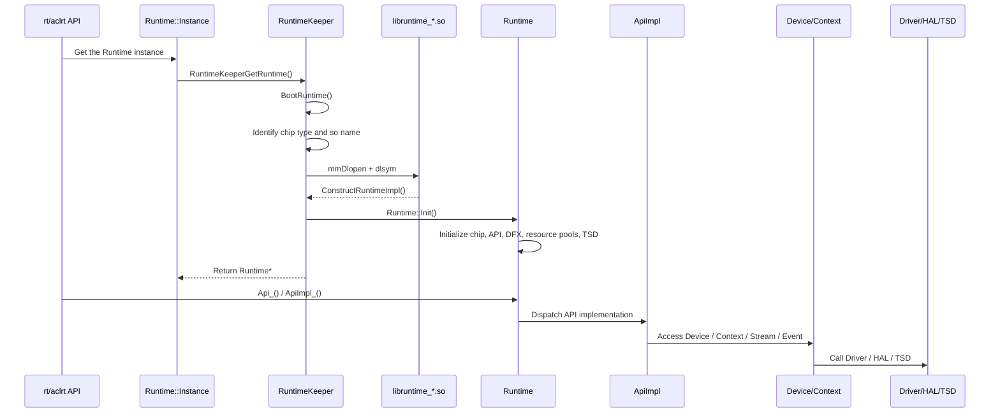
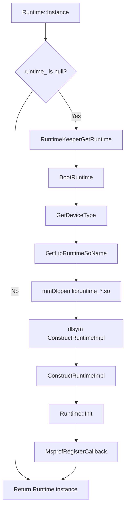
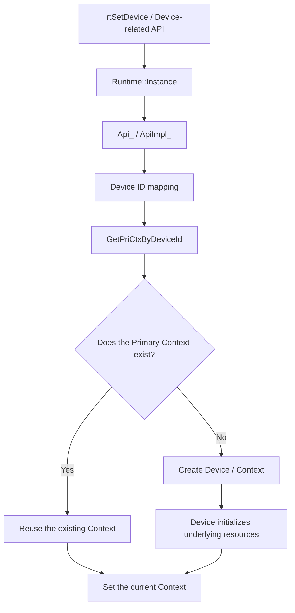
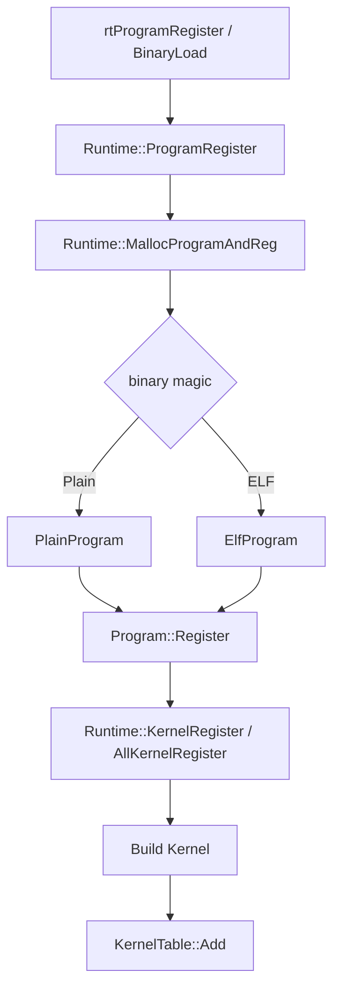

# Runtime Global Management Module Architecture

## 1. Module Overview

- **Function description**: Runtime is the process-level global runtime instance inside the CANN Runtime component. It receives upper-layer Runtime API calls, maintains global runtime state such as Device, Context, Stream, Event, Program, Kernel, Profiling, and error handling, and completes Ascend NPU resource management and task execution through the Driver, TSD, HAL, and platform capabilities.
- **Design objectives**:
  - Provide a process-level unique Runtime access entry.
  - Aggregate the global state, resource tables, and underlying capability entries required by Runtime APIs.
  - Mask underlying capability differences across different chips, different SoCs, and different running modes.
  - Manage the lifecycle of core resources such as Device, Context, Program, and Kernel.
  - Maintain a unified dispatch data path from Runtime APIs to internal implementation modules.
  - Support DFX capabilities such as Profiling, error callbacks, Task Abort callbacks, and RAS reporting.

Runtime does not correspond to a single Device or a single Context. Instead, it is the unified scheduling center inside the Runtime component. Each internal module of Runtime obtains the global Runtime instance in the current process through `Runtime::Instance()`, and uses that instance to access API implementations, device resources, contexts, the Kernel registry, Profiling state, and global feature configuration.

This document focuses on the functions and design of the `Runtime` class itself. Objects such as `RuntimeKeeper`, plugin so files, Driver, and TSD are described only as dependencies of Runtime construction, initialization, and running. The Runtime class itself is the global state carrier, the API dispatch center, and the resource coordination entry.

## 2. Usage Scenarios and External Interfaces

### 2.1 Usage Scenarios

- **Scenario 1: First access to the Runtime instance**

  ```cpp
  Runtime *rt = Runtime::Instance();
  // RuntimeKeeper creates the Runtime instance on first access and calls Runtime::Init()
  ```

- **Scenario 2: Runtime API access to internal implementation**

  ```cpp
  Api *api = Runtime::Instance()->Api_();
  // External rt/aclrt APIs enter the concrete implementation through ApiErrorDecorator and ApiImpl
  ```

- **Scenario 3: Get the current Context or primary Context**

  ```cpp
  Context *ctx = Runtime::Instance()->CurrentContext();
  Context *priCtx = Runtime::Instance()->GetPriCtxByDeviceId(deviceId, tsId);
  ```

- **Scenario 4: Program and Kernel registration**

  ```cpp
  Program *prog = nullptr;
  Runtime::Instance()->ProgramRegister(&bin, &prog);
  Runtime::Instance()->KernelRegister(prog, stubFunc, stubName, kernelInfoExt);
  const Kernel *kernel = Runtime::Instance()->KernelLookup(stubFunc);
  ```

- **Scenario 5: Profiling and error callback management**

  ```cpp
  Runtime::Instance()->ProfilerStart(profConfig, numsDev, deviceList, cacheFlag);
  Runtime::Instance()->SetExceptCallback(callback);
  ```

### 2.2 External Interfaces

Runtime itself is an internal C++ global management class. External APIs are usually received by rt/aclrt C interfaces and then enter the Runtime internal implementation through `Runtime::Instance()`. The main interface relationships are as follows:

| Interface/Entry | File location | Description |
|----------|----------|------|
| `Runtime::Instance()` | `src/runtime/core/inc/runtime.hpp` | Get the process-level Runtime singleton. The first access triggers the RuntimeKeeper startup flow |
| `RuntimeKeeperGetRuntime()` | `src/runtime/core/src/plugin_manage/runtime_keeper.cc` | Lazy loading entry of the Runtime singleton |
| `RuntimeKeeper::BootRuntime()` | `src/runtime/core/src/plugin_manage/runtime_keeper.cc` | Create Runtime, call `Runtime::Init()`, and register the Profiling callback |
| `Runtime::Init()` | `src/runtime/core/src/runtime.cc` | Runtime core initialization flow |
| `Runtime::Api_()` | `src/runtime/core/inc/runtime.hpp` | Return the API facade with error handling decoration capability |
| `Runtime::ApiImpl_()` | `src/runtime/core/inc/runtime.hpp` | Return the underlying API implementation object |
| `Runtime::CurrentContext()` | `src/runtime/core/src/runtime.cc` | Get the Runtime Context of the current thread |
| `Runtime::GetPriCtxByDeviceId()` | `src/runtime/core/src/runtime.cc` | Get the device-dimension primary context |
| `Runtime::ProgramRegister()` | `src/runtime/core/src/runtime.cc` | Register a Runtime Program |
| `Runtime::KernelRegister()` | `src/runtime/core/src/runtime.cc` | Register a Kernel into the Runtime KernelTable |
| `Runtime::KernelLookup()` | `src/runtime/core/src/runtime.cc` | Look up a Kernel by stub function |
| `Runtime::ProfilerStart()` / `Runtime::ProfilerStop()` | `src/runtime/core/src/runtime.cc` | Manage Runtime Profiling |

## 3. Architecture Overview

### 3.1 Overall Design

The Runtime class itself adopts the design of "process-level singleton + global state aggregation + API facade + resource coordination + platform capability adaptation". `RuntimeKeeper` is responsible only for lifecycle actions before and after the Runtime instance is created. After the Runtime instance is created, the Runtime class itself carries most runtime capabilities.

The overall data path is as follows:

1. Upper-layer Runtime APIs call internal Runtime capabilities.
2. Internal modules obtain the global Runtime instance through `Runtime::Instance()`.
3. The first access to `Runtime::Instance()` calls `RuntimeKeeperGetRuntime()`.
4. `RuntimeKeeper` identifies the chip type, selects the corresponding `libruntime_*.so`, and completes Runtime instance construction.
5. `Runtime::Init()` initializes global running environments such as chip capabilities, API implementations, DFX, resource pools, and TSD.
6. Subsequent API calls complete concrete operations through the Api, Device, Context, KernelTable, Driver, TSD, and other objects held by Runtime.

### Architecture Layer Diagram



### 3.2 Core Module Interaction Diagram



## 4. Detailed Design

### 4.1 Core Flows

#### Initialization Flow

Runtime initialization has two layers: the startup flow of `RuntimeKeeper` and the internal initialization flow of `Runtime::Init()`.



`Runtime::Init()` internally completes the following main steps:

1. **Feature and Atrace initialization**: Initialize the TS version feature mapping and Atrace information.
2. **Chip and SoC initialization**: Call `InitChipTypeAndSocVersion()` to obtain the chip type, SoC version, TS count, AICPU count, and chip attributes.
3. **Device visibility initialization**: Read the visible devices configuration and establish the mapping between user device IDs and Runtime device IDs.
4. **API implementation initialization**: Create `ApiImpl`, `ApiImplMbuf`, and `ApiImplSoma`.
5. **Log and DFX initialization**: Create `Logger`, `Profiler`, and `ApiErrorDecorator`.
6. **Thread and execution observer initialization**: Create `ThreadGuard` and `EngineStreamObserver`.
7. **AICPU Stream ID management initialization**: Create the AICPU Stream ID bitmap.
8. **Callback Subscribe initialization**: Create the callback subscribe management object.
9. **Program/Label resource pool initialization**: Create the Program allocator and Label allocator.
10. **Runtime version setting**: Set the Runtime API version through HAL.
11. **TSD initialization**: Load the TSD client and save TSD-related function pointers.
12. **Task function registration**: Register Runtime task handling functions.
13. **Execution mode configuration**: Initialize the stream sync mode, dcache lock auxiliary resources, and so on.

Key code locations:

```cpp
// src/runtime/core/src/runtime.cc
rtError_t Runtime::Init();

// src/runtime/core/src/plugin_manage/runtime_keeper.cc
Runtime *RuntimeKeeper::BootRuntime();
```

#### Device Acquisition Flow

Runtime itself does not represent a specific device. Instead, it maintains the global access entry for devices and Contexts. Device-related APIs usually enter Runtime through `ApiImpl` and then access Device/Context.



Core relationships between Device and Context:

- Runtime maintains the primary context.
- Context is organized by device id and TS id.
- Device carries device-side resources.
- Stream, Event, and Notify usually attach to the current Context and Device.

### 4.2 Core Mechanisms

#### Runtime Class Function Model

The Runtime class itself is the core carrier of runtime capabilities. Its functions fall into six groups:

| Function group | Responsibilities of the Runtime class | Representative members/interfaces |
|--------|----------------------|---------------|
| API facade | Save API implementation objects and decoration objects, and provide internal dispatch entries for rt/aclrt APIs | `Api_()`, `ApiImpl_()`, `api_`, `apiImpl_`, `apiError_` |
| Platform capability state | Save the chip type, SoC version, TS count, chip attributes, and visible device mapping | `chipType_`, `socVersion_`, `tsNum_`, `curChipProperties_`, `propertiesMap_` |
| Resource management | Maintain core resource entries such as Device, Context, Program, Kernel, and Label | `priCtxs_`, `programAllocator_`, `kernelTable_`, `labelAllocator_` |
| Execution coordination | Provide global execution configuration and shared objects for Stream, Event, Task, and Kernel Launch | `streamObserver_`, `cbSubscribe_`, `aicpuStreamIdBitmap_`, timeout configuration |
| Underlying capability access | Hold Driver, HAL, TSD, and AICPU-related entries, and mask underlying differences upward | `driverFactory_`, `facadeDriver_`, `tsdClientHandle_`, `tsdOpen_` |
| DFX capability | Uniformly manage diagnostic capabilities such as Profiling, exception callbacks, Task Abort, Snapshot, and RAS | `profiler_`, `excptCallBack_`, callback management objects, RAS-related state |

From a design perspective, the Runtime class is not a simple singleton wrapper. Instead, it is the "runtime-state context object" inside the Runtime component. It centralizes chip capabilities, API implementations, resource tables, underlying driver entries, and DFX state in one process-level object. This ensures that all API calls see a consistent device view, context state, and capability configuration.

#### Singleton Pattern

The Runtime singleton is stored in `Runtime::runtime_` and accessed through `Runtime::Instance()`. On first access, `Runtime::Instance()` calls `RuntimeKeeperGetRuntime()`, and the static global object `g_runtimeKeeper` completes the actual creation.

```cpp
static Runtime *Instance()
{
#if RUNTIME_API || STATIC_RT_LIB
    if (runtime_ == nullptr) {
        runtime_ = RuntimeKeeperGetRuntime();
    }
#endif
    return runtime_;
}
```

Singleton creation is not a simple `new Runtime()`. Instead, `RuntimeKeeper` manages it uniformly:

- `RuntimeKeeper` controls the boot stage.
- In non-static link scenarios, it dynamically loads `libruntime_*.so` based on the chip type.
- The plugin library exports `ConstructRuntimeImpl()` to create the real Runtime instance.
- The plugin library exports `DestructorRuntimeImpl()` to destroy the Runtime instance.

#### Reference Count Management

Runtime manages multiple lifecycle objects, including Context, Program, Kernel, Device, and so on. Different objects use different reference methods:

- Program is managed by `ObjAllocator<RefObject<Program *>>`.
- Primary Context is managed by `RefObject<Context *>`.
- Kernel is tied to the Program lifecycle through `KernelTable`.
- Device/Context release is coordinated during set device, retain/release, and destructor flows.

##### Reference Count Core Classes

The reference relationships of Program and Context in Runtime mainly depend on `RefObject`:

```cpp
RefObject<Context *> priCtxs_[RT_MAX_DEV_NUM][RT_MAX_TS_NUM];
ObjAllocator<RefObject<Program *>> *programAllocator_;
```

`RefObject` stores the object pointer and reference state, and supports operations such as increasing the reference, decreasing the reference, and resetting the object. Runtime uses it to prevent a Program or Context from being released prematurely while still in use.

##### Device Reference Count Management Timing

The Device lifecycle is usually driven by device enabling, context creation, device release, and Runtime destruction. During device-related flows, Runtime is responsible for:

- Converting user device IDs into Runtime internal device IDs.
- Obtaining or creating the primary context of the corresponding device.
- Initializing underlying resources through Device.
- Cleaning up remaining device and context resources when Runtime is destroyed.

##### Context Reference Count Management Timing

Primary Context is the key object through which Runtime manages device contexts. Runtime stores the primary context by device and TS dimension, and maintains its reference relationships during acquisition, release, and destruction.

Key points of Context management:

- The current thread can obtain the current Context through `Runtime::CurrentContext()`.
- The device dimension can obtain the primary context through `Runtime::GetPriCtxByDeviceId()`.
- When Runtime is destroyed, it iterates over the primary context table and executes `TearDown()` and release for Contexts no longer used externally.

##### Device and Context Reference Count Coordination Mechanism

The relationship between Device and Context can be summarized as follows:

```text
Runtime
    -> Primary Context Table
        -> Context
            -> Device
                -> RawDevice / Driver
                -> Stream / Event / Notify
```

Context represents the context environment in which Runtime APIs execute, and Device carries the actual device resources. Device switching, context creation, Stream/Event creation, and task delivery all depend on the consistency of the current Context and Device.

##### Reference Count Management in Multithreaded Scenarios

Runtime uses a global singleton to receive multithreaded API calls, and maintains state consistency in multithreaded scenarios through the following mechanisms:

- `RuntimeKeeper::bootStage_` controls that the Runtime boot stage executes only once.
- `ThreadGuard` manages thread-related protection logic.
- Objects such as `ThreadLocalContainer` and `InnerThreadLocal` store thread-local runtime state.
- Resources such as Context and Program protect their lifecycle through reference objects and locks.

RuntimeKeeper boot states include:

| State | Meaning |
|------|------|
| `BOOT_INIT` | Not yet started, or returned to the initial state after a boot failure |
| `BOOT_ON` | Runtime is being started |
| `BOOT_DONE` | Runtime has started successfully |

#### Kernel Registration and Lookup

Runtime maintains the global registration relationship between Program and Kernel. This relationship looks up Kernel meta-information by stub function, kernel name, or tiling key before Kernel Launch.

##### Kernel Registration Flow



During registration, Runtime is responsible for:

- Determining the Program type based on binary magic.
- Determining Kernel attributes based on chip capabilities.
- Creating and registering `PlainProgram` or `ElfProgram`.
- Constructing the Kernel object.
- Establishing the lookup relationship between stub function, kernel name, tiling key, and the Kernel object.
- Maintaining the Program reference count and lifecycle.

##### Kernel Lookup Flow

Kernel lookup is mainly completed through the `KernelTable` held by Runtime:

```cpp
const Kernel *Runtime::KernelLookup(const void * const stub)
{
    return kernelTable_.Lookup(stub);
}

const void *Runtime::StubFuncLookup(const char_t * const name)
{
    return kernelTable_.InvLookup(name);
}
```

Typical lookup path:

```text
Kernel Launch API
    -> Runtime::Instance()
    -> KernelLookup(stubFunc)
    -> KernelTable
    -> Kernel meta-information
    -> Device/Stream task delivery
```

### 4.3 Module Responsibility Division

| Module | Responsibility |
|------|------|
| `RuntimeKeeper` | Manage the Runtime instance lifecycle, chip plugin loading, and Runtime construction and destruction |
| `Runtime` | Process-level global runtime instance. Serves as the API facade, resource management center, platform capability state center, execution coordination center, and DFX management entry |
| `RuntimeIntf` | Runtime abstract interface. Defines the Runtime capabilities that API calls need to access |
| `ApiErrorDecorator` | Decoration layer for API error handling, parameter checking, and general log reporting |
| `ApiImpl` | Main internal implementation of Runtime APIs |
| `Device` | Device-side resource carrier object |
| `Context` | Runtime context object. Carries the current device and execution environment |
| `Stream/Event/Notify` | Asynchronous task, synchronization, notification, and event management |
| `Program/Kernel` | Binaries, Kernel meta-information, and registration/lookup relationships |
| `DriverFactory/FacadeDriver` | Underlying Driver access entry |
| `TSD/AICPU` | AICPU scheduler, TSD connection, queue, and FlowGw management |
| `Profiler/DFX` | Diagnostic capabilities such as Profiling, error callbacks, RAS, Task Abort, and Snapshot |

### 4.4 Core Data Structures

| Data structure/member | Description |
|---------------|------|
| `Runtime::runtime_` | Runtime global instance pointer |
| `RuntimeKeeper g_runtimeKeeper` | Static global object for Runtime lifecycle management |
| `RuntimeKeeper::bootStage_` | Runtime boot stage state |
| `RuntimeKeeper::soHandle_` | Handle of the dynamically loaded Runtime plugin library |
| `api_` | API facade, usually points to `ApiErrorDecorator` |
| `apiImpl_` | Main API implementation object |
| `apiImplMbuf_` | Mbuf API implementation object |
| `apiImplSoma_` | Soma API implementation object |
| `profiler_` | Runtime Profiling object |
| `threadGuard_` | Thread protection object |
| `streamObserver_` | Stream observer |
| `cbSubscribe_` | Callback subscribe management object |
| `aicpuStreamIdBitmap_` | AICPU Stream ID allocation bitmap |
| `programAllocator_` | Program global allocator |
| `kernelTable_` | Kernel global lookup table |
| `labelAllocator_` | Label allocator |
| `priCtxs_` | primary context table |
| `chipType_` | Current chip type |
| `socVersion_` | Current SoC version |
| `tsNum_` | Current TS count |
| `curChipProperties_` | Current chip attributes |
| `propertiesMap_` | Full chip attribute table |
| `driverFactory_` | Driver factory |
| `facadeDriver_` | Driver facade |
| `tsdClientHandle_` | TSD client dynamic library handle |
| `tsdOpen_ / tsdClose_` | TSD open/close function pointers |

## 5. Key File Index

| File | Description |
|------|------|
| `src/runtime/core/inc/runtime.hpp` | Runtime class declaration. Defines the Runtime global entry and core members |
| `src/runtime/core/inc/runtime_intf.hpp` | Runtime abstract interface. Declares the Runtime capabilities that API calls need to access |
| `src/runtime/core/src/runtime.cc` | Core implementation of Runtime construction, initialization, chip capabilities, Program/Kernel, Profiling, and so on |
| `src/runtime/core/src/plugin_manage/runtime_keeper.h` | RuntimeKeeper class declaration |
| `src/runtime/core/src/plugin_manage/runtime_keeper.cc` | RuntimeKeeper lifecycle management, chip identification, plugin loading, and Runtime startup and destruction |
| `src/runtime/core/src/plugin_manage/v100/plugin_old_arch.cc` | v100 plugin construction and destruction entry |
| `src/runtime/core/src/plugin_manage/v200/plugin_old_arch.cc` | v200 plugin construction and destruction entry |
| `src/runtime/core/src/runtime_v100/runtime_adapt.cc` | v100 platform Runtime destruction and adaptation logic |
| `src/runtime/core/src/runtime_v200/runtime_adapt.cc` | v200 platform Runtime destruction and adaptation logic |
| `src/runtime/api/impl/api_impl.cc` | Main internal implementation of Runtime APIs. Widely calls `Runtime::Instance()` |
| `src/runtime/core/src/device/device.cc` | Device management logic |
| `src/runtime/core/src/event/event.cc` | Event management logic |
| `src/runtime/core/src/launch/` | Implementation of various task Launch types |
