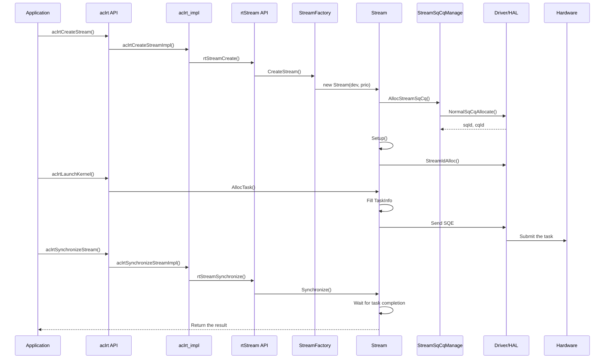
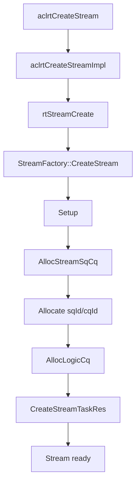
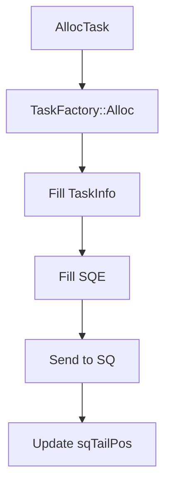
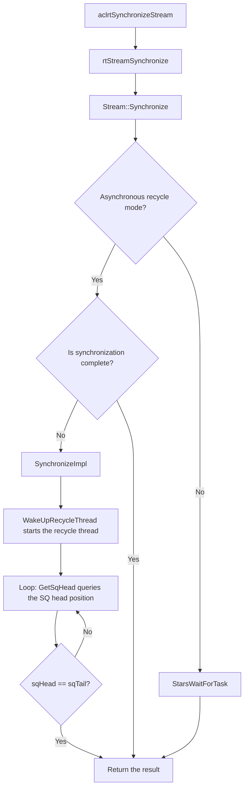
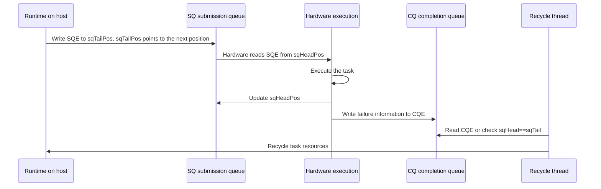
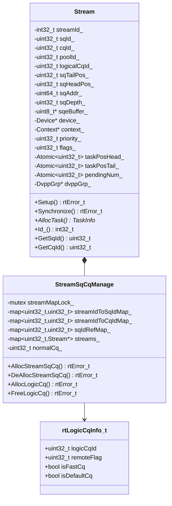

# Stream Module Architecture

## 1. Module Overview

- **Function introduction**: The Stream module manages task queues and implements asynchronous execution and synchronization mechanisms. It interacts with hardware through the SQ (Submission Queue) and CQ (Completion Queue) mechanisms.
- **Design goals**:
  - Provide an efficient asynchronous task execution mechanism
  - Implement task queue management and synchronization mechanisms
  - Support SQ/CQ resource management and reuse

## 2. Usage Scenarios and External Interfaces

### 2.1 Usage Scenarios

- **Scenario 1**: Create a stream and submit a task
  ```cpp
  aclrtStream stream;
  aclrtCreateStream(&stream);  // Create a stream
  aclrtLaunchKernel(stream, ...);  // Submit a kernel task
  aclrtSynchronizeStream(stream);  // Wait for completion
  ```

- **Scenario 2**: Multi-stream parallel execution
  ```cpp
  aclrtStream stream1, stream2;
  aclrtCreateStream(&stream1);
  aclrtCreateStream(&stream2);
  // Execute tasks in parallel on different streams
  aclrtLaunchKernel(stream1, kernel1, ...);
  aclrtLaunchKernel(stream2, kernel2, ...);
  ```

- **Scenario 3**: Create a stream with configuration
  ```cpp
  aclrtStream stream;
  aclrtCreateStreamWithConfig(&stream, 0, ACL_STREAM_FAST_SYNC);  // Create a fast-sync stream
  ```

### 2.2 External Interfaces

#### Core Interfaces

| Interface | Description |
|------|------|
| `aclrtCreateStream()` | Create a stream |
| `aclrtCreateStreamWithConfig()` | Create a stream with priority and flags |
| `aclrtDestroyStream()` | Destroy a stream |
| `aclrtDestroyStreamForce()` | Forcefully destroy a stream |
| `aclrtSynchronizeStream()` | Synchronize a stream |
| `aclrtStreamQuery()` | Query the stream status |

#### Extended Interfaces

| Interface | Description |
|------|------|
| `aclrtSynchronizeStreamWithTimeout()` | Synchronize a stream with a timeout |
| `aclrtStreamGetPriority()` | Get the stream priority |
| `aclrtStreamGetFlags()` | Get the stream flags |
| `aclrtStreamAbort()` | Abort stream execution |
| `aclrtStreamGetId()` | Get the stream ID |
| `aclrtGetStreamAvailableNum()` | Get the number of available streams |

#### Stream Attribute Interfaces

| Interface | Description |
|------|------|
| `aclrtSetStreamAttribute()` | Set stream attributes |
| `aclrtGetStreamAttribute()` | Get stream attributes |
| `aclrtSetStreamFailureMode()` | Set the stream failure mode |
| `aclrtSetStreamOverflowSwitch()` | Set the stream overflow switch |
| `aclrtGetStreamOverflowSwitch()` | Get the stream overflow switch |

#### Stream Control Interfaces

| Interface | Description |
|------|------|
| `aclrtActiveStream()` | Activate a stream |
| `aclrtSwitchStream()` | Switch streams |
| `aclrtStreamStop()` | Stop a stream |
| `aclrtPersistentTaskClean()` | Clean persistent tasks |

#### Stream Configuration Interfaces

| Interface | Description |
|------|------|
| `aclrtCreateStreamConfigHandle()` | Create a stream configuration handle |
| `aclrtDestroyStreamConfigHandle()` | Destroy a stream configuration handle |
| `aclrtSetStreamConfigOpt()` | Set stream configuration options |
| `aclrtCreateStreamV2()` | Create a stream with configuration |

## 3. Architecture Overview

### Overall Design Idea

Stream implements task execution using the SQ/CQ asynchronous mechanism: a task is submitted to hardware through the SQ, and hardware returns the result through the CQ after execution completes. Stream maintains the task queue (taskPosHead/taskPosTail) and supports task allocation, recycling, and synchronization. Stream inherits from the NoCopy base class to prevent copying.

### Core Module Interaction Diagram



## 4. Detailed Design

### 4.1 Core Flows

#### Stream Creation Flow



**Key code**:

```cpp
// File location: src/acl/aclrt_impl/stream.cpp:33-50
aclError aclrtCreateStreamImpl(aclrtStream *stream) {
    rtStream_t rtStream = nullptr;
    const rtError_t rtErr = rtStreamCreate(&rtStream, 
        static_cast<int32_t>(RT_STREAM_PRIORITY_DEFAULT));
    if (rtErr != RT_ERROR_NONE) {
        return ACL_GET_ERRCODE_RTS(rtErr);
    }
    *stream = static_cast<aclrtStream>(rtStream);
    return ACL_SUCCESS;
}

// File location: src/runtime/core/src/stream/stream.cc:606-788
rtError_t Stream::Setup() {
    // Set the SQ depth
    const uint32_t rtsqDepth = 
        (((flags_ & RT_STREAM_HUGE) != 0U) && 
         (device_->GetDevProperties().maxTaskNumPerHugeStream != 0)) ?
            device_->GetDevProperties().maxTaskNumPerHugeStream :
            device_->GetDevProperties().rtsqDepth;
    SetSqDepth(rtsqDepth);

    // Allocate a streamId
    error = device_->Driver_()->StreamIdAlloc(&streamId_, device_->Id_(), 
                                               device_->DevGetTsId(), priority_);
    
    // Allocate SQ/CQ
    error = stmSqCqManage->AllocStreamSqCq(this, priority_, 0U, tmpSqId, tmpCqId);
    sqId_ = tmpSqId;
    cqId_ = tmpCqId;

    // Allocate a logical CQ
    error = AllocLogicCq(isDisableThread, starsFlag, stmSqCqManage);
    
    // Create task resources
    CreateStreamTaskRes();
    error = CreateStreamArgRes();
    
    return RT_ERROR_NONE;
}
```

#### Task Submission Flow



**Key code**:

```cpp
// 1. Allocate a task
// File location: src/runtime/core/src/stream/stream.cc:4937-4956
TaskInfo* Stream::AllocTask(
    TaskInfo* pTask, tsTaskType_t taskType, rtError_t& errorReason, uint32_t sqeNum,
    UpdateTaskFlag flag) {
    // TaskGroup update path
    if (IsTaskGroupUpdate() && flag != UpdateTaskFlag::NOT_SUPPORT_AND_SKIP) {
        return HandleTaskGroupUpdate(taskType, flag, errorReason);
    }
    // AutoSplit path
    if (IsAutoSplitSq()) {
        TaskInfo* task = nullptr;
        errorReason = AllocAutoSplitTaskInfo(&task, this, sqeNum);
        return task;
    }
    // Capture path
    if (GetCaptureStatus() != RT_STREAM_CAPTURE_STATUS_NONE) {
        return AllocCaptureTask(taskType, sqeNum, pTask, errorReason);
    }
    // Non-capture path
    return AllocNonCaptureTask(this, pTask, taskType, errorReason, sqeNum);
}

// 2. Fill TaskInfo (using an AICore task as an example)
// File location: src/runtime/core/src/task/task_info.hpp
TaskInfo* taskInfo = stream->AllocTask(nullptr, TS_TASK_TYPE_KERNEL_AICORE, error, 1U);
taskInfo->type = TS_TASK_TYPE_KERNEL_AICORE;
taskInfo->typeName = "AICoreKernel";
taskInfo->stream = stream;
taskInfo->sqeNum = 1;
// Fill AICore kernel parameters
taskInfo->u.aicoreKernel.kernel = kernel;         // Kernel object
taskInfo->u.aicoreKernel.args = args;             // Argument address
taskInfo->u.aicoreKernel.blockDim = blockDim;     // Block dimension
taskInfo->u.aicoreKernel.smDesc = smDesc;         // Shared memory descriptor

// 3. Fill the SQE
// File location: src/runtime/core/src/task/task_submit/v200/task_david.cc:497-589
rtError_t DavidSendTask(TaskInfo *taskInfo, Stream *stm) {
    const uint16_t pos = taskInfo->id;
    uint64_t sqBaseAddr = stm->GetSqBaseAddr();
    
    // Determine the SQE write target
    rtDavidSqe_t *sqeAddr = nullptr;
    if (sqBaseAddr != 0ULL) {
        // Hardware SQ mode: write directly to device SQ memory
        sqeAddr = RtPtrToPtr<rtDavidSqe_t*>(sqBaseAddr + (pos << SHIFT_SIX_SIZE));
    }
    
    // Build the SQE content
    TaskSqeInfo sqeInfo = {sqBaseAddr, 0ULL};
    ToConstructSqe(taskInfo, static_cast<void *>(sqeAddr), sqeInfo);
    SetExpectedTaskReportNum(taskInfo, taskInfo->sqeNum);
}

// 4. Send to the SQ
// File location: src/runtime/core/src/task/task_submit/v200/task_david.cc
struct halTaskSendInfo sendInfo = {0};
sendInfo.sqId = stm->GetSqId();
sendInfo.cqId = stm->GetCqId();
sendInfo.sqeAddr = sqeAddr;
sendInfo.sqeNum = taskInfo->sqeNum;

drvError_t drvRet = halSqTaskSend(devId, &sendInfo);  // The DRV layer submits to the hardware SQ
if (drvRet != DRV_ERROR_NONE) {
    return RT_ERROR_DRV_INNER_ERROR;
}

// Update the SQ tail position
stm->UpdateSqTailPos(taskInfo->sqeNum);
```

`sqeNum` indicates the number of SQEs actually sent, which queue management and recycling use after sending; `expectPackage` indicates the
number of reports that task completion must wait for. The two have different meanings, and the report number must be set according to platform rules after the SQE is constructed.

#### Stream Synchronization Flow



**Key code**:

```cpp
// File location: src/runtime/core/src/stream/stream.cc:1868-1913
rtError_t Stream::SynchronizeExecutedTask(const uint32_t taskId, const mmTimespec &beginTime, int32_t timeout) {
    uint16_t sqHead = static_cast<uint16_t>(MAX_UINT16_NUM);
    while (true) {
        // Check whether the task has finished execution
        if (sqHead == GetTaskPosTail()) {
            return RT_ERROR_NONE;
        }
        // Start the recycle thread (call only once)
        if (!device_->GetIsDoingRecycling()) {
            device_->WakeUpRecycleThread();
        }
        // Get the SQ head position and wait in a loop
        error = device_->Driver_()->GetSqHead(Device_()->Id_(), Device_()->DevGetTsId(), sqId_, sqHead);
        if (IsTaskExcuted(finishedId, taskId)) {
            return RT_ERROR_NONE;
        }
    }
}

// File location: src/runtime/core/src/stream/stream.cc:1941-1959
rtError_t Stream::SynchronizeImpl(const uint32_t syncTaskId, const uint16_t concernedTaskId, int32_t timeout) {
    const mmTimespec beginTime = mmGetTickCount();
    error = SynchronizeExecutedTask(syncTaskId, beginTime, timeout);  // Wait in a loop for task execution to complete
    StreamSyncFinishReport();
    if (concernedTaskId == MAX_UINT16_NUM) {
        device_->WakeUpRecycleThread();  // Wake up the recycle thread for later recycling
        return error;
    }
    error = WaitConcernedTaskRecycled(concernedTaskId, beginTime, timeout);
    return error;
}
```

### 4.2 Core Mechanisms

#### SQ/CQ Asynchronous Mechanism

**Design idea**: Implement asynchronous task execution through the SQ (submission queue) and the CQ (completion queue). A task is submitted to the SQ in the form of an SQE (Submission Queue Entry), and hardware returns the result through a CQE (Completion Queue Entry) after execution completes (usually, only failed tasks return a CQE; normal tasks do not return a CQE).

**Task execution flow**:



**Key points**:

- **Task submission**: Host writes the SQE to the sqTail position, and sqTailPos points to the next available position
- **Hardware execution**: Hardware reads the SQE from the sqHeadPos position and updates sqHeadPos after executing the task
- **Completion check**: The recycle thread reads the CQE to get the result, or checks sqHead == sqTail to confirm that task execution is complete

```cpp
// File location: src/runtime/core/src/stream/stream.hpp
class Stream : public NoCopy {
protected:
    uint32_t sqId_;                     // SQ ID
    uint32_t cqId_;                     // CQ ID
    uint32_t sqTailPos_;                // SQ tail position (host submission position)
    uint32_t sqHeadPos_;                // SQ head position (hardware processing position)
    uint64_t sqRegVirtualAddr_;         // SQ register virtual address
private:
    uint64_t sqAddr_;                   // SQ base address (up to 2M)
    uint32_t sqDepth_;                  // SQ depth
    uint8_t* sqeBuffer_;                // SQE buffer pointer
    Atomic<uint32_t> taskPosHead_;      // Task position head (Stars)
    Atomic<uint32_t> taskPosTail_;      // Task position tail (Stars)
};
```

### 4.3 Module Responsibility Division

| Module | Responsibility | Location |
|------|------|------|
| aclrt API | External ACL interfaces | `include/external/acl/acl_rt.h` |
| aclrt_impl | ACL interface implementation | `src/acl/aclrt_impl/stream.cpp` |
| rt API | Internal RT interfaces | `src/runtime/api/api_c_stream.cc` |
| Stream | Core stream management class, inherits from NoCopy | `stream/stream.hpp` |
| StreamFactory | Static stream creation factory, version dispatch | `stream/stream_factory.hpp` |
| StreamSqCqManage | SQ/CQ ID management and reuse | `stream/stream_sqcq_manage.hpp` |
| TaskAllocator | Task object allocator | `core/src/pool/task_allocator.hpp` |
| TaskResManage | Task resource management | `task/task_res_manage/` |
| EngineStreamObserver | Stream status observer | `stream/engine_stream_observer.hpp` |

### 4.4 Core Data Structures



## 5. Performance Optimization Strategies

- **Task preallocation**: TaskAllocator preallocates task objects to reduce allocation overhead
- **Asynchronous recycling**: Support asynchronous task recycling so that task submission is not blocked
- **Fast synchronization mode**: The ACL_STREAM_FAST_SYNC flag supports fast synchronization

_This module document is based on source code analysis. All ACL interfaces are verified to come from `include/external/acl/acl_rt.h`, and the implementation comes from `src/acl/aclrt_impl/stream.cpp`._
