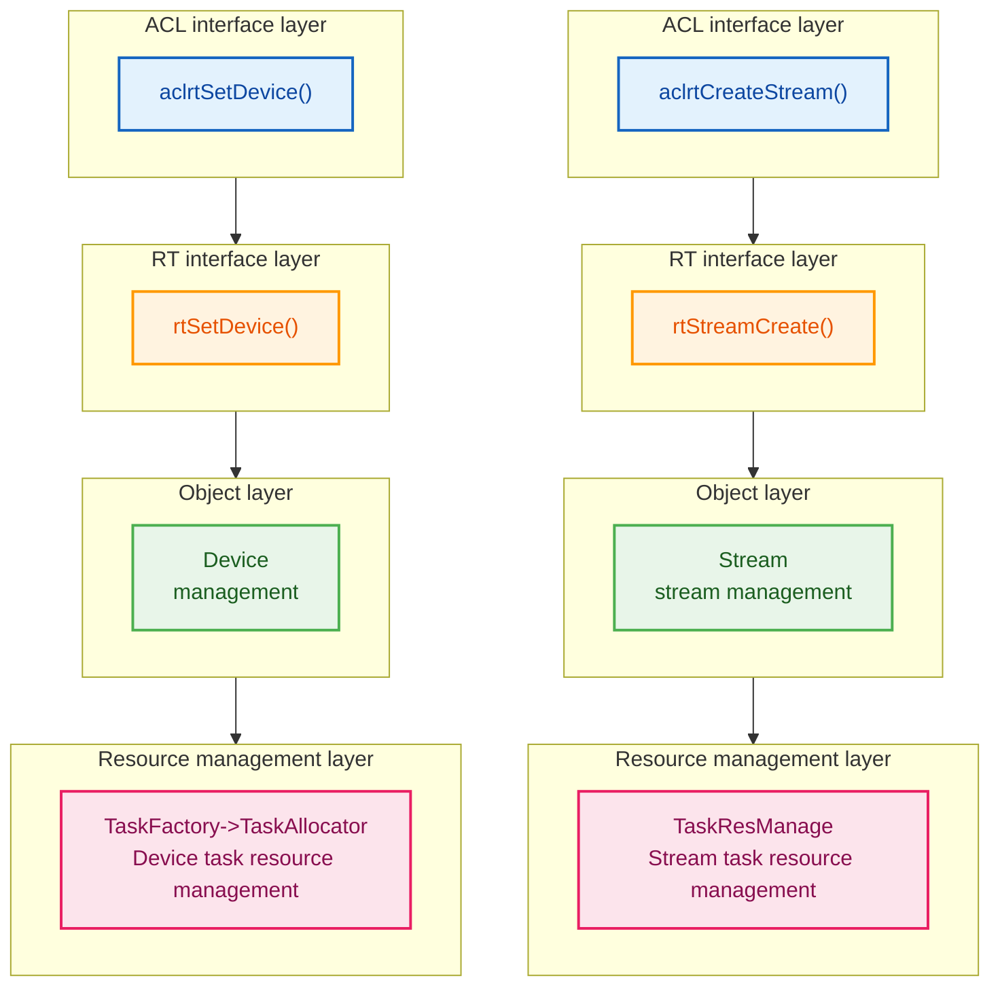
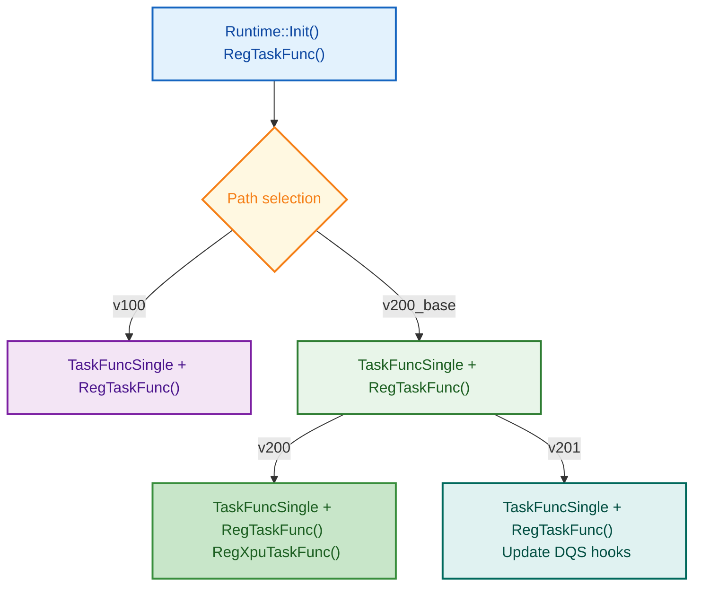
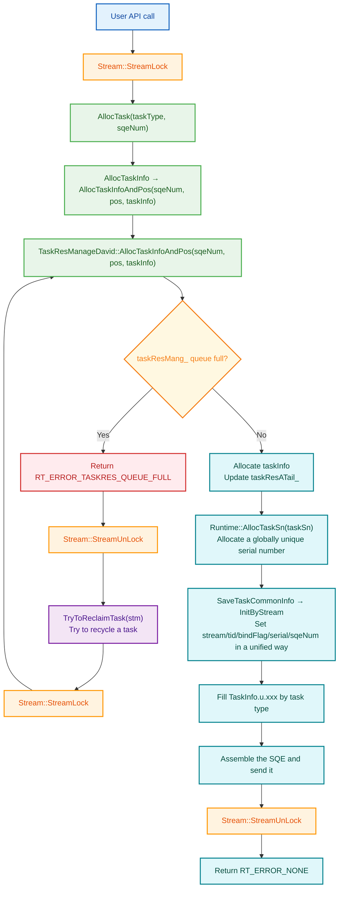
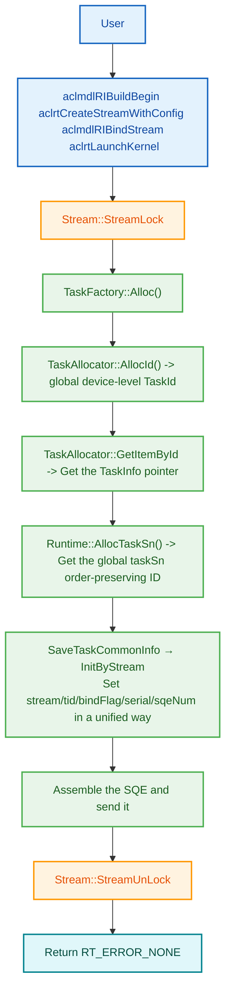
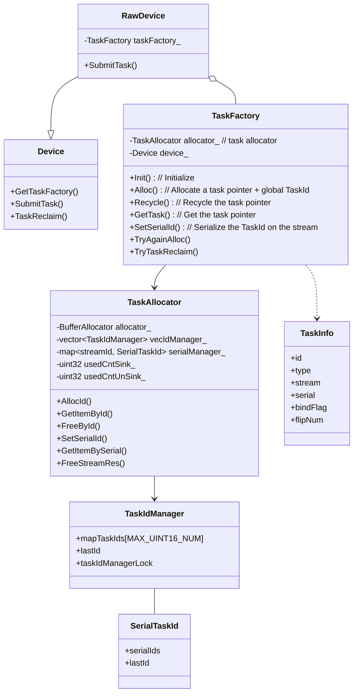
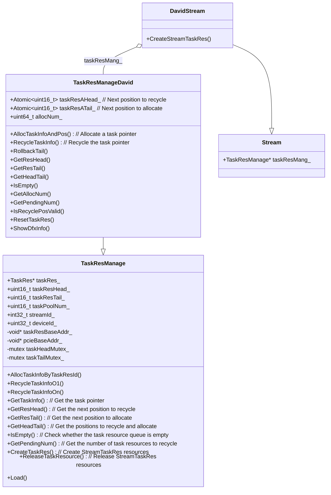

# Task Module Architecture

## 1. Module Overview

- **Function introduction**: The Task module manages the creation, execution, and recycling of various tasks. It supports multiple task types (kernel execution, memory operations, event synchronization, model execution, and so on) and carries task information in the TaskInfo structure. Stream::taskResMang_ and TaskFactory work together to allocate and recycle task objects.
- **Design goals**:
  - Provide a unified task management interface
  - Support the extension of multiple task types
  - Implement efficient task allocation and recycling mechanisms
  - Support task status management and error handling

## 2. Usage Scenarios and External Interfaces

### 2.1 Usage Scenario Examples

- **Scenario 1**: Kernel execution task
  ```cpp
    // Deliver a single-operator task
    aclrtLaunchKernel(funcHandle, numBlocks, argsData, argsSize, stream);
    aclrtLaunchKernelXXX();
  ```

- **Scenario 2**: Event synchronization task
  ```cpp
  // Deliver an event synchronization task and synchronize the stream result
  aclrtRecordEvent(event, stream1);  // Record an event on stream1
  aclrtStreamWaitEvent(stream2, event);  // stream2 waits for the event
  aclrtSynchronizeStream(stream1);  // Synchronize stream1 and trigger recycling
  aclrtSynchronizeStream(stream2);  // Synchronize stream2 and trigger recycling
  ```

### 2.2 Task Types
| Task category | Task type | Header file | Description |
|---------|---------|--------|------|
| Compute task | `TS_TASK_TYPE_KERNEL_AICORE` <br> `TS_TASK_TYPE_KERNEL_AICPU` <br> `TS_TASK_TYPE_KERNEL_AIVEC` | `davinci_kernel_task.h` | Operator kernel execution |
| Memory task | `TS_TASK_TYPE_MEMCPY` | `memory_task.h` | Asynchronous copy task execution, including H2D, D2D, D2H, and so on |
| Event synchronization task | `TS_TASK_TYPE_EVENT_RECORD` <br> `TS_TASK_TYPE_STREAM_WAIT_EVENT` <br> `TS_TASK_TYPE_NOTIFY_RECORD` <br> `TS_TASK_TYPE_NOTIFY_WAIT` <br> `TS_TASK_TYPE_DAVID_EVENT_*` <br> `TS_TASK_TYPE_MEM_WRITE/WAIT_VALUE` | `event_task.h` <br> `notify_task.h` <br> `common_task.h` |Event wait execution for inter-stream synchronization, inter-card synchronization, and so on|
| Conditional task | `TS_TASK_TYPE_LABEL_*` <br> `TS_TASK_TYPE_STREAM_SWITCH` <br> `TS_TASK_TYPE_STREAM_ACTIVE` | `cond_op_label_task.h` | Label control type |
| Management task | `TS_TASK_TYPE_MAINTENANCE` <br> `TS_TASK_TYPE_MODEL_MAINTAINCE` <br> `TS_TASK_TYPE_MODEL_EXECUTE`| `maintenance_task.h` <br>  `model_maintaince_task.h` <br> `model_execute_task.h` | Maintenance operations (stream/event destruction) <br> Model binding/unbinding to streams <br> Model execution |

## 3. Architecture Overview

**Overall design idea**
**Task management is divided into three parts:**
- **Task resource management:** Task resources fall into two parts: device-level task resources and stream-level resources.
- **Task handler functions:** Task handlers mainly register and manage task initialization, SQE encapsulation, post-recycle processing, and post-exception processing in a unified way for different task types.
- **Task delivery flow:** Together with API interfaces, complete runtime scheduling through a combination of task resource requests, task assembly, and task delivery interfaces.


### 3.1 Task Resource Management Architecture



### 3.2 Task Handler Registration Architecture



Every platform registers `TaskFuncSingle::toSqeFunc` through `RegTaskFunc`, and the unified `ToConstructSqe` entry calls it.

### 3.3 David Task Delivery Flow

```mermaid

sequenceDiagram
    autonumber
    participant User as User API
    participant Stream as Stream
    participant TaskResMang as TaskResManageDavid
    participant PublicQueue as PublicTaskBuff
    participant Driver as HAL driver
    participant HWTS as Hardware

    User->>Stream: aclrtLaunchKernel
    Stream->>Stream: StreamLock() <br/> Allow multi-threaded task delivery on a single stream; taskId order is strictly preserved
    Stream->>Stream: AllocTask(taskType, sqeNum) <br/> Internally calls AllocTaskInfo + SaveTaskCommonInfo
    Stream-->>Stream: task pointer TaskInfo* (id/pos comes from task->id)
    Stream->>Stream: Fill TaskInfo.u.xxx by task type
    rect rgba(245, 237, 244, 0.62)
        alt DavidSendTask
            Stream->>Stream: Prepare TaskSqeInfo
            Stream->>Stream: ToConstructSqe(taskInfo, sqeAddr, sqeInfo) <br/> Build the SQE
            Stream->>Stream: SetExpectedTaskReportNum(taskInfo, taskInfo->sqeNum) <br/> Set the task report count
            Stream->>PublicQueue: AddTaskToPublicQueue(taskInfo, sqeNum) <br/> Add to the task queue
            Stream->>Driver: halSqTaskSend(devId, &sendInfo) <br/> Send the SQE to hardware
            Driver-->>HWTS: The SQE is written to the execution address
        end
    end
    Stream->>Stream: StreamUnLock()
    Stream->>Stream: SubmitTaskPostProc — trigger recycling or wake up the recycle thread
    HWTS->>HWTS: Execute the task

```

## 4. Detailed Design

### 4.1 Core Flows

#### 4.1.1 Task Resource Request and Delivery Flow on a Single-Operator Stream



#### 4.1.2 Task Resource Request and Delivery Flow on a Model Stream



### 4.2 Core Mechanisms

#### 4.2.1 TaskInfo Structure Design

**Design idea**: TaskInfo is the unified carrier of a task and contains the task type, parameters, status, bit field flags, and other information. It stores the dedicated information structures of different task types through a union.

```cpp
// File location: core/inc/task/task_info.hpp
typedef struct tagTaskInfoStru {
    Stream *stream;              // Owning stream
    tsTaskType_t type;           // Task type enumeration
    uint32_t errorCode;          // Error code
    uint32_t taskSn;             // Serial number (used for profiling)
    uint32_t pos;                // SQ position (used by David)
    uint16_t id;                 // Task ID
    uint16_t flipNum;            // Flip count (taskId wraparound)
    uint8_t profEn;              // Profiling enable flag
    ...
    uint8_t serial : 1;          // Serial ID mode
    uint8_t bindFlag : 1;        // Model bind-stream flag
    uint8_t isCqeNeedConcern : 1; // CQE needs attention
    uint8_t isNeedStreamSync : 1; // Stream synchronization required
    uint8_t sqeNum : 7;           // Number of SQEs actually sent, kept until task recycling after sending
    ...
    union {
        AicTaskInfo aicTaskInfo;
        AicpuTaskInfo aicpuTaskInfo;
        DavinciMultiTaskInfo davinciMultiTaskInfo;
        MemcpyAsyncTaskInfo memcpyAsyncTaskInfo;
        ...
    } u;   // Dedicated information for each task type
    ...
} TaskInfo;
```

`sqeNum` is the number of SQEs actually sent, and `expectPackage` is the number of task reports that completion determination must wait for. The two are not necessarily equal.
`SetExpectedTaskReportNum` sets the task report count according to platform rules after the SQE is constructed.

#### 4.2.2 TaskRes Resource Allocation Core Logic

**TaskResManageDavid core allocation code**: The TaskId on a stream must strictly preserve order. From requesting the TaskInfo pointer to assembling the SQE and delivering it to hardware, the whole process must be consistent with TaskId behavior. Therefore StreamLock controls the whole process.

**Multi-SQE design**: A task may occupy multiple SQEs (for example, `sqeNum=2`), and all `taskInfo.id` values point to the first position `pos`. During recycling, `taskResAHead_` is refreshed by `sqeNum`.

```cpp
// task_res_da.cc
rtError_t TaskResManageDavid::AllocTaskInfoAndPos(uint32_t sqeNum, uint32_t &pos, TaskInfo **task, bool needLog) {
    const uint16_t head = taskResAHead_.Value();
    uint16_t tail = taskResATail_.Value();
    const uint32_t taskDesTailIdx = (tail + sqeNum) % taskPoolNum_;
    
    // Full check: consider ring queue wraparound
    if (((tail < head) && ((tail + sqeNum) >= head)) ||
        ((tail > head) && ((tail + sqeNum) >= taskPoolNum_) && (taskDesTailIdx >= head))) {
        return RT_ERROR_TASKRES_QUEUE_FULL;
    }
    
    pos = tail;
    *task = &taskRes_[pos].taskInfo;
    (void)memset_s(*task, sizeof(TaskInfo), 0, sizeof(TaskInfo));
    
    // Multi-SQE task: all sqeNum share the same id (= pos)
    while (tail != taskDesTailIdx) {
        taskRes_[tail].taskInfo.id = pos;
        tail = (tail + 1U) % taskPoolNum_;
    }
    
    taskResATail_.Set(tail);   // Update tail
    allocNum_++;                // Cumulative allocation count (used to trigger periodic recycling)
    return RT_ERROR_NONE;
}
```

**Recycle retry when the queue is full**:

```cpp
// task_david.cc
static rtError_t AllocTaskInfo(TaskInfo** taskInfo, Stream* const stm, uint32_t& pos, uint32_t sqeNum) {
    TaskResManageDavid *taskResMang = ...;
    rtError_t error = taskResMang->AllocTaskInfoAndPos(sqeNum, pos, taskInfo);
    
    while (error == RT_ERROR_TASKRES_QUEUE_FULL) {
        // Release StreamLock and try to recycle
        stm->StreamUnLock();
        TryToReclaimTask(stm, needLog);  // Call TaskReclaimByStream or wake up the recycle thread
        stm->StreamLock();
        // Retry allocation
        error = taskResMang->AllocTaskInfoAndPos(sqeNum, pos, taskInfo, needLog);
    }
    if (error == RT_ERROR_NONE) {
        Runtime::Instance()->AllocTaskSn((*taskInfo)->taskSn);
        SaveTaskCommonInfo(*taskInfo, stm, sqeNum);  // Internally calls InitByStream to set common header information in a unified way
    }
    return error;
}
```

#### 4.2.3 Callback Framework for Task Handlers

**1. TaskFuncSingle structure** <br/>
This structure holds task callback functions for different TASK_TYPE values. It handles different CHIP_TYPE and taskType values separately, and the function void RegTaskFunc(rtChipType_t chipType, tsTaskType_t taskType, const TaskFuncSingle& funcs) registers them globally.

```cpp
// src/runtime/core/src/task/inc/runtime_task_manager.h
using PfnTaskToSqe = void (*)(TaskInfo* taskInfo, void* const sqe, const TaskSqeInfo& sqeInfo);

struct TaskFuncSingle {
    PfnTaskToCmd toCommandFunc;
    PfnTaskToSqe toSqeFunc;
    PfnDoCompleteSucc doCompleteSuccFunc;
    PfnTaskUnInit taskUnInitFunc;
    PfnWaitAsyncCpCompleteFunc waitAsyncCpCompleteFunc;
    PfnPrintErrorInfo printErrorInfoFunc;
    PfnTaskSetResult setResultFunc;
    PfnTaskSetStarsResult setStarsResultFunc;
};

void ToConstructSqe(TaskInfo* taskInfo, void* const sqe, const TaskSqeInfo& sqeInfo);
```

**2. TaskFuncArrays structure** <br/>
TaskFuncArrays g_taskFuncArrays[CHIP_END] stores the corresponding TaskFunc according to CHIP_TYPE when the runtime initializes.

```cpp
// src/runtime/core/src/task/inc/runtime_task_manager.h
struct TaskFuncArrays {
    PfnTaskToCmd toCommandFunc[TS_TASK_TYPE_RESERVED];           // [0] TaskCommand construction
    PfnTaskToSqe toSqeFunc[TS_TASK_TYPE_RESERVED];               // [1] SQE construction
    PfnDoCompleteSucc doCompleteSuccFunc[TS_TASK_TYPE_RESERVED];  // [2] Post-task processing
    PfnTaskUnInit taskUnInitFunc[TS_TASK_TYPE_RESERVED];          // [3] Clear the task pointer
    PfnWaitAsyncCpCompleteFunc waitAsyncCpCompleteFunc[TS_TASK_TYPE_RESERVED]; // [4] Asynchronous wait
    PfnPrintErrorInfo printErrorInfoFunc[TS_TASK_TYPE_RESERVED];  // [5] Error printing
    PfnTaskSetResult setResultFunc[TS_TASK_TYPE_RESERVED];        // [6] Set the task exception result (v100)
    PfnTaskSetStarsResult setStarsResultFunc[TS_TASK_TYPE_RESERVED]; // [7] Set the task exception result (v100)
    PfnTaskSqeHeaderPostProc sqeHeaderPostProcFunc;
};
```
**3. Global variables used during task processing**  <br/>
Service code calls back taskType through g_XXX variables.
```cpp
static PfnTaskToCmd *g_toCommandFunc = g_taskFuncArrays[CHIP_BEGIN].toCommandFunc;
static PfnTaskToSqe *g_toSqeFunc = g_taskFuncArrays[CHIP_BEGIN].toSqeFunc;
static PfnDoCompleteSucc *g_doCompleteSuccFunc = g_taskFuncArrays[CHIP_BEGIN].doCompleteSuccFunc;
static PfnWaitAsyncCpCompleteFunc *g_waitAsyncCpCompleteFunc = g_taskFuncArrays[CHIP_BEGIN].waitAsyncCpCompleteFunc;
static PfnPrintErrorInfo *g_printErrorInfoFunc = g_taskFuncArrays[CHIP_BEGIN].printErrorInfoFunc;
static PfnTaskSetResult *g_setResultFunc = g_taskFuncArrays[CHIP_BEGIN].setResultFunc;
static PfnTaskSetStarsResult *g_setStarsResultFunc = g_taskFuncArrays[CHIP_BEGIN].setStarsResultFunc;
PfnTaskUnInit *g_taskUnInitFunc = g_taskFuncArrays[CHIP_BEGIN].taskUnInitFunc;
PfnTaskSqeHeaderPostProc g_taskSqeHeaderPostProcRunningFunc =
    g_taskFuncArrays[CHIP_BEGIN].sqeHeaderPostProcFunc;

```

### 4.2.4 Task Recycling Flow
#### 4.2.4.1 David Task Recycling Trigger Timing

| Trigger condition | Invocation method | Description |
|----------|---------|------|
| After every 64 delivered tasks | `WakeUpRecycleThread` | Periodic recycling, triggered when `allocNum_ % 64 == 0` |
| Delivery task queue full | `TryToReclaimTask` | Trigger active recycling when the allocation queue is full |
| Stream synchronization (Synchronize) | `WakeUpRecycleThread` | Trigger the recycle thread and wait for all tasks to complete |
| Stream destruction (TearDown) | `TaskReclaimByStream` | Clear all tasks |
| Separate recycle thread | `RecycleThreadDoForStarsV2` | `IsSeparateSendAndRecycle()` mode |

#### 4.2.4.2 Separate Recycle Thread

```cpp
// task_recycle.cc:310-341
void RecycleThreadDoForStarsV2(Device *deviceInfo) {
    // Iterate over all streams on the device
    for (const auto &id : streamIdList) {
        stream->StreamRecycleLock();
        stream->ProcArgRecycleList();     // Process the arg recycle list
        
        // Skip empty queues, DVPP binding, and non-separate recycle modes
        if (taskResMang->IsEmpty() || stream->IsBindDvppGrp() || !stream->IsSeparateSendAndRecycle()) {
            continue;
        }
        
        TaskReclaimForSeparatedStm(stream);
        //   → ProcLogicCqUntilEmpty(stm)  // Collect CQEs first
        //   → RecycleTaskBySqHeadForRecycleThread(stm)  // Then recycle by drv sqHead
        
        stream->StreamRecycleUnlock();
    }
}
```

### 4.3 Module Responsibility Division
 | Module | Responsibility | Location | 
 |------|------|------| 
 | TaskInfo | Task information structure | `core/inc/task/task_info.hpp` |
 | TaskFactory | Task object factory class, held by the Device object; allocates and recycles task objects | `core/inc/task/task.hpp` |
 | TaskAllocator | Task object allocator that manages the task pool; belongs to TaskFactory | `core/src/pool/task_allocator.hpp` |
 | TaskResManage | Task resource management, held by Stream | `task/task_res_manage/` | 
 | DavidSendTask <br/> SubmitTask | Task submission module | `task/task_submit/v200/task_david.cc` <br/> `engine/engine.cc`|
 | RecycleThreadDoForStarsV2 | Task recycling module | `task/task_recycle/` <br/> `stars_engine.cc`| 

### 4.4 Core Data Structures

#### 4.4.1 Device TaskFactory Class Diagram



#### 4.4.2 Stream TaskRes Class Diagram



## 5. Key File Index

| Function module | File path | Core content |
|----------|---------|---------|
| Stream declaration | `core/src/stream/stream.hpp` | `taskResMang_` field |
| DavidStream | `core/src/stream/stream_david.cc` | CreateStreamTaskRes<br>TearDown |
| TaskInfo definition | `core/inc/task/task_info.hpp` | TaskInfo structure |
| TaskRes base class | `core/inc/task/task_res.hpp` | TaskRes structure <br> TaskResManage class declaration |
| TaskResManageDavid | `core/inc/task/task_res_da.hpp` | Atomic head/tail<br> AllocTaskInfoAndPos |
| TaskResManage implementation | `core/src/task/task_res_manage/task_res.cc` | v100 allocation/recycling/Load |
| TaskResManageDavid implementation | `core/src/task/task_res_manage/v200/task_res_da.cc` | David allocation/recycling/rollback |
| David task delivery | `core/src/task/task_submit/v200/task_david.cc` | AllocTask (unified entry)<br>AllocTaskInfo <br> SaveTaskCommonInfo <br> DavidSendTask |
| David task recycling | `core/src/task/task_recycle/v200/task_recycle.cc` | TryRecycleTask <br> recycle thread |
| Common recycling logic | `core/src/task/task_recycle/v200/task_recycle_common_base.cc` | TaskReclaimForSeparatedStm <br> Recycle CQE, recycle Task |
---

_This module document is based on an analysis of the source code in `src/runtime/core/src/task/`._
