# 机密计算（CC Mode）特性

## 1. 特性概述

### 1.1 特性介绍

机密计算（Confidential Computing，下文简称 CC）特性面向 Host 运行于机密虚机、Device 运行于 NPU TEE 的部署形态。Runtime 在 Feature 层接管 H2D/D2H 数据搬运：业务数据在 Host 侧加密后经明文 DMA 通道传输，再由 Device 侧解密写入私有内存，对上层业务完全透明。

CC 功能由 `src/runtime/feature/cc_manager/` 实现，编译进 `libruntime_v200.so`，与 ACL Graph、jetty 等特性同级。当前支持两种加解密模式（GCM、CTR）以及面向单算子流小数据的简化通路。

### 1.2 问题背景

- 机密虚机中的 Host 内存由硬件加密保护，但 Host 与 Device 之间的 PCIe DMA 通道本身不提供机密性，业务数据直接搬运会被明文暴露。
- 控制面数据（SQE、task args、队列控制头）不具备整块加密条件，需要与数据面分离处理。
- 全量数据都走“Host 回调 + 多任务下发 + 工作线程”链路时，小数据（几十字节）的线程唤醒与调度开销会超过加解密本身，需要旁路。

### 1.3 设计目标

- H2D/D2H 业务数据透明加密，上层 `aclrtMemcpy*` 接口无需改造。
- 控制面不加密，通过共享内存队列与分片协议与设备核协作。
- 支持 GCM（带完整性认证）与 CTR（低开销密钥流）两种模式，模式由部署形态与内核节点决定。
- 支持单算子流小数据简化通路，避免 Host 回调与工作线程唤醒。
- 环境异常时 fail closed：Host 处于机密环境但 Device 不支持 CC 时初始化失败，不降级明文。
- 非机密环境下零开销：不注册任何回调，普通路径不受影响。

### 1.4 两种加密模式对比

加密模式由部署形态决定：A+X（x86 服务器 + 昇腾 NPU）的 SEV 机密虚机仅支持 GCM；A+K（鲲鹏服务器 + 昇腾 NPU）的机密虚机支持 GCM/CTR 切换，由内核节点 `/sys/kernel/security/cvm_guest/mem_encrypt_alg` 决定（节点值为 `AES_CTR` 时为 CTR，其余情况或读取失败为 GCM）。模式在进程内首次读取后缓存，不支持运行期切换。

| 维度 | GCM（AES-128-GCM） | CTR（AES-128-CTR） |
|------|--------------------|--------------------|
| 生效条件 | A+X 固定 GCM；A+K 节点非 `AES_CTR` 时为 GCM | A+K 节点值为 `AES_CTR` 时为 CTR |
| Host 侧原语 | OpenSSL EVP AEAD（加密+认证） | AES-CTR 生成密钥流 + 本地 XOR |
| 设备侧核 | AICPU `AiccCrypto` | AIV `AiccKeystreamXor`（填充用 AICPU `AiccKeystreamFill`） |
| 分片描述符 | `AiccCryptoSliceDesc`（32B） | `AiccKeystreamXorSliceDesc`（40B，含 `keystreamAddr`） |
| 密文格式 | 84B `AiccCiphertextHeader` + 密文体 | 纯密文体，无头部 |
| 使用密钥 | H2D、D2H 两把方向密钥 | 两方向共用 H2D 密钥 |
| 额外资源 | 无 | 每设备密钥流池 + 填充/生成线程 |
| 典型场景 | 缺省配置、需要防篡改 | 追求低开销与大吞吐 |

补充说明：

- `CC_CRYPTO_CIPHER` 预留了 `SM4` 槽位，但当前仅注册 `AES_128`，选择 SM4 时加解密返回 `ACL_ERROR_RT_FEATURE_NOT_SUPPORT`（207000，`crypto/cc_crypto.cc:454-458`）。
- CTR 无认证标签，密文被篡改不会被检测；对完整性有要求的场景必须使用 GCM。

### 1.5 缩略语

| 缩略语 | 全称 | 说明 |
|--------|------|------|
| GCM | Galois/Counter Mode | 伽罗瓦/计数器模式 |
| CTR | Counter Mode | 计数器模式 |
| AES | Advanced Encryption Standard | 高级加密标准，本文使用 AES-128 |
| AEAD | Authenticated Encryption with Associated Data | 带关联数据的认证加密 |
| AAD | Additional Authenticated Data | 附加认证数据 |
| IV | Initialization Vector | 初始向量 |
| SM4 | ShangMi 4 | 国密分组密码算法 |
| XOR | Exclusive OR | 异或 |
| TEE | Trusted Execution Environment | 可信执行环境 |
| SEV | AMD Secure Encrypted Virtualization | AMD 安全加密虚拟化 |
| NPU | Neural Processing Unit | 神经网络处理器 |
| H2D | Host-to-Device | 主机到设备 |
| D2H | Device-to-Host | 设备到主机 |
| D2D | Device-to-Device | 设备到设备 |
| AICPU | AI CPU | AI 处理器 |
| AIV | AI Vector Core | AI 向量核 |

## 2. 使用场景与对外接口

### 2.1 使用场景

CC 特性没有新增公开接口，用户代码与普通模式一致。以下片段中的 `stream`、`devBuf`、`hostSrc`、`hostDst` 均为已准备好的对象。

- **场景一**：单算子流大块 GCM 拷贝（缺省模式）

  ```cpp
  aclrtSetDevice(devId);
  aclrtMalloc(&devBuf, size, ACL_MEM_MALLOC_HUGE_FIRST);

  // H2D：Host 加密 → DMA → AICPU 解密写入私有 HBM
  aclrtMemcpyAsync(devBuf, size, hostSrc, size, ACL_MEMCPY_HOST_TO_DEVICE, stream);

  // D2H：AICPU 加密写入中转 buffer → DMA → Host 解密
  aclrtMemcpyAsync(hostDst, size, devBuf, size, ACL_MEMCPY_DEVICE_TO_HOST, stream);
  aclrtSynchronizeStream(stream);
  ```

  走完整通路的每次异步拷贝在流上展开为 `[HostCallback][MemWait][AiccCrypto][HostCallback]` 四个任务（见 §4.1.3）：首个 HostCallback 只把任务推入共享队列，最后一个 HostCallback 是等待 Worker 收尾的收尾同步；Host 侧加解密与 DMA 由 CCWorker 完成，设备侧加解密由 AICPU `AiccCrypto` 完成。

  其他同步/异步、2D、Batch、memset 等场景与普通拷贝接口的使用方式一致，CC 在分发层透明生效，无需额外适配。

### 2.2 对外接口

CC 特性通过 `DevDynInfoProcFunc` 注册 `MemProcFunc` 与 `CCProcFunc` 函数表，ApiImpl 层在既有内存接口入口做一次判空分发。回调为空或返回 `RT_ERROR_CONTINUE_EXECUTE`（内部信号）时回退原有逻辑。

正文与表格使用 ACL 错误码；后续代码片段保留内部返回码（如 `RT_ERROR_NONE`），经错误码映射后对外为 `ACL_RT_SUCCESS`。

| 接口 | 实际分发点 | 说明 |
|------|-----------|------|
| `aclrtMemcpyAsync` | `src/runtime/api/impl/api_impl_david.cc:997` | 进入 `CCManager::CCMemcpyAsync`（`cc_manager.cc:676`） |
| `aclrtMemcpy` | `src/runtime/api/impl/api_impl.cc:2547` | 进入 `CCManager::CCMemCopySync`（`cc_manager.cc:635`） |
| `aclrtMemcpy2dAsync` | `src/runtime/api/impl/api_impl_david.cc:806` | 进入 `CCManager::CCMemCopy2DAsync` |
| `aclrtMemcpy2d` | `src/runtime/api/impl/api_impl_memory.cc:197` | 进入 `CCManager::CCMemCopy2DSync` |
| `aclrtMemcpyBatchAsync` | `src/runtime/api/impl/api_impl_david.cc:958` | 进入 `CCManager::CCMemcpyBatchAsync` |
| `aclrtMemcpyBatch` | `src/runtime/api/impl/api_impl_memory.cc:422` | 进入 `CCManager::CCMemcpyBatch` |
| `aclrtMalloc` | `src/runtime/api/impl/api_impl.cc:2419` | 进入 `CCManager::CCDevMalloc`，按 32B 对齐并置私有内存标志 |
| `aclrtMallocWithCfg` | `src/runtime/api/impl/api_impl_memory.cc:405` | 进入 `CCManager::CCDevMallocWithCfg` |
| `aclrtMemsetAsync` | `src/runtime/core/src/launch/memory_common.cc:264` | 进入 `CCManager::CCDevMemSetAsync` |

说明：`memProcFunc.devMemset32`（`CCManager::CCDevMemSetD32`）已注册，当前主 memset 路径经 `devMemsetAsync` 分发。

### 2.3 环境检测与模式选择

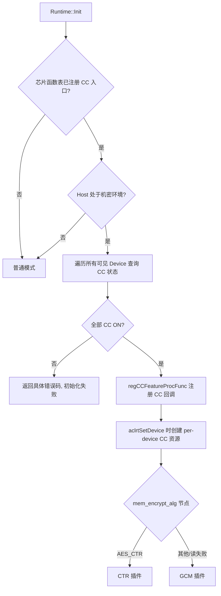

关键点：

- Host 机密环境判定同时支持两种形态（`runtime_adapt.cc:59`）：存在 `/dev/sev-guest`，或 `/sys/kernel/security/cvm_guest/mem_encrypt_enable` 值为 1。
- Device 状态查询走 `NpuDriver::QueryDeviceCcStatus`（`npu_driver_mem.cc:2319`），`HAL_CC_MODE_NORMAL` 与 `HAL_CC_MODE_ADDITIONAL` 均视为 CC ON。
- 只有配置表静态填写了 `regCCFeatureProcFunc` 的芯片才进入探测（当前为 950，`config/950/dev_info_proc_func.cc:24`），其余芯片直接返回，v100 为空实现（`runtime_v100/runtime_adapt.cc:134`）。

### 2.4 关键数据类型与常量

```cpp
// 分片队列控制头（PCIe BAR 空间，Host 与设备核共享 ld/st）
struct BarTaskQueue {
    volatile TaskQueueStatus hostStatus;   // Host 状态：WAITING / WORKING / TERMINATED
    volatile TaskQueueStatus deviceStatus; // Device 状态
    volatile uint32_t complete;            // 设备已完成的任务数
    volatile uint32_t head;                // Host 发布位置
    volatile uint32_t tail;                // Device 消费位置
    volatile uint32_t depth;               // 环深度，可用槽位 = depth - 1
    volatile uint32_t taskDescSize;        // 单条描述符大小
    volatile uint32_t deviceErrCode;       // 设备侧错误码
    uint8_t taskDescList[];                // 描述符数组
};

// 分片描述符公共前缀
struct AiccSliceDescBase {
    volatile uint64_t ciphertextAddr;
    volatile uint64_t plaintextAddr;
    volatile uint32_t ciphertextLen;
    volatile uint32_t plaintextLen;
    volatile uint32_t sliceIdx;
};
```

常量（`cc_task_queue.h:26-32`、`cc_crypto.h:80-82`）：

| 常量 | 值 | 含义 |
|------|----|------|
| `CC_SLICE_SIZE` | 2MB | Worker 中转 buffer 大小；GCM 为密文头 + 明文，CTR 为密文 |
| `CC_CIPHER_HEADER_SIZE` | 84B | `sizeof(AiccCiphertextHeader)` |
| `CC_PLAINTEXT_SLICE_SIZE` | 2MB − 84B | 单分片最大明文 |
| `CC_SLICE_DESC_SLOT_NUM` | 3 | 环深度，可用槽位 2 |
| `CC_BUFFER_SLOT_NUM` | 2 | Worker 的 Device Buffer A/B |
| `CC_SMALL_PLAINTEXT_CAPACITY` | 64B | 小数据明文上限 |
| `CC_SMALL_CIPHER_CAPACITY` | 84B + 64B | 小数据密文 buffer 容量 |

GCM 密文头（`cc_crypto.h:62`）为 84 字节：`version`、`totalLen`、`ivLen`、`iv[32]`、`tagLen`、`tag[32]`、`ciphertextLen`。

## 3. 架构总览

### 3.1 整体设计思路

CC 采用 **进程级单例 CCManager + per-device CCResManage + 每设备算法插件 + Worker 池** 的结构：ApiImpl 通过函数指针表把内存接口分发到 CCManager；CCManager 按 deviceId 找到 CCResManage；CCResManage 持有密钥上下文、算法插件、共享任务队列与 Worker；Worker 通过 Stream 级 `BarTaskQueue` 与设备核协作；会话数据在 Host 侧由 OpenSSL 原语处理，在 Device 侧由 AICPU（GCM/密钥流填充）或 AIV（CTR XOR）处理。

### 3.2 架构分层图

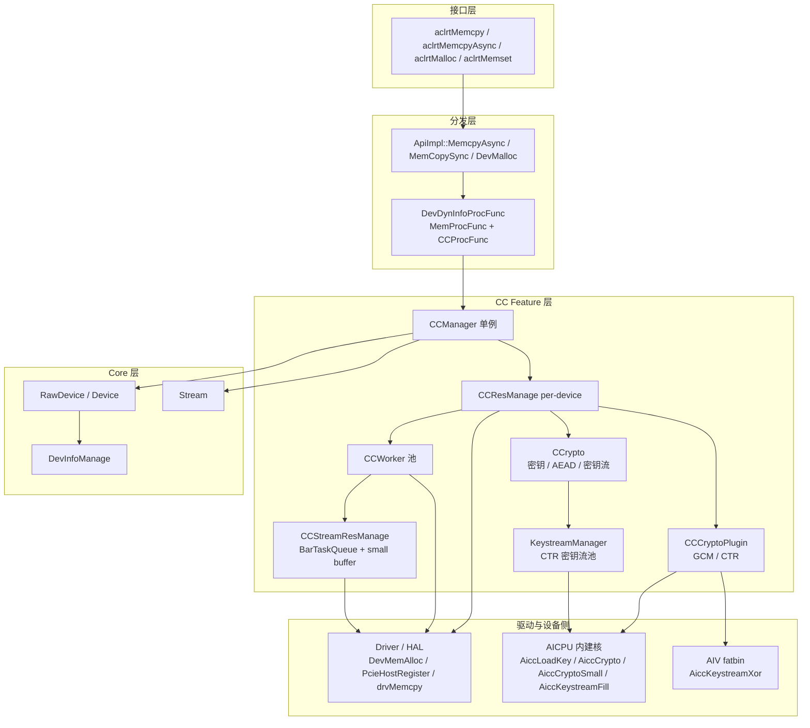

### 3.3 模块依赖关系

- `CCManager`：依赖 `CCResManage`、`DevInfoManage`、`Runtime`；不持有 Device，仅通过回调接入设备生命周期。
- `CCResManage`：依赖 `CCrypto`、`CCCryptoPlugin`、`CCWorker`、`CCMemcpyTaskQueue`、`CCStreamResManage`。
- `CCWorker`：依赖插件钩子、`BarTaskQueue`、`Stream`、`Driver`；不直接持有 `CCrypto`。
- `CCrypto`：依赖 `OpenSSLLoader`、`KeystreamManager`、`GetSlotKey`。
- Core 层（`RawDevice`、`Stream`、`ApiImpl`）不 include CC 头文件，只通过 `MemProcFunc` / `CCProcFunc` 函数指针交互。

### 3.4 全链路时序图（GCM 异步 H2D）

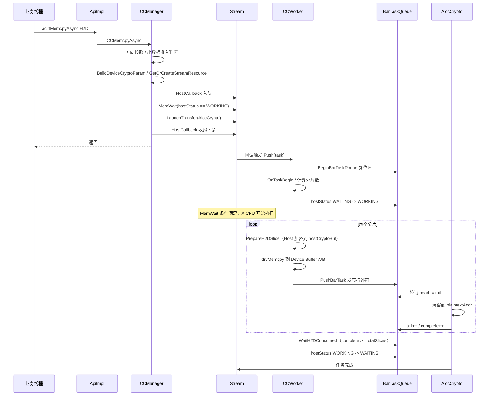

## 4. 详细设计

### 4.1 核心流程

#### 4.1.1 CC 环境检测与回调注册

`Runtime::Init()` 末尾调用 `InitCcFeature()`（`runtime_adapt.cc:150`），依次完成芯片入口判定、Host 环境判定、可见设备校验与回调注册：

```cpp
// 文件位置：src/runtime/core/src/runtime_v200/runtime_adapt.cc:150-174
rtError_t Runtime::InitCcFeature() const
{
    DevDynInfoProcFunc func{};
    COND_RETURN_INFO(
        (GET_DEV_INFO_PROC_FUNC(chipType_, func) != RT_ERROR_NONE) || (func.regCCFeatureProcFunc == nullptr),
        RT_ERROR_NONE, "CC feature is not registered for chip_type=%d.", static_cast<int32_t>(chipType_));

    COND_RETURN_INFO(!IsHostCcMode(), RT_ERROR_NONE, "CC mode is disabled because host CC is off.");

    rtError_t error = CheckVisibleDevicesCcStatus();
    COND_RETURN_ERROR(error != RT_ERROR_NONE, error, "Failed to validate visible devices for confidential computing.");

    error = func.regCCFeatureProcFunc(chipType_);
    COND_RETURN_ERROR(error != RT_ERROR_NONE, error, "Failed to register CC process functions.");
    return RT_ERROR_NONE;
}
```

`RegCCManagerProcFunc`（`cc_manager.cc:338`）逐字段填充函数表后调用 `DevInfoManage::RegDevInfoProcFunc` 动态注册，保留芯片表已有回调：

```cpp
procFunc.memProcFunc.memcpyAsync     = &CCManager::CCMemcpyAsync;
procFunc.memProcFunc.memCopySync     = &CCManager::CCMemCopySync;
procFunc.memProcFunc.memCopy2DAsync  = &CCManager::CCMemCopy2DAsync;
procFunc.memProcFunc.memCopy2DSync   = &CCManager::CCMemCopy2DSync;
procFunc.memProcFunc.memcpyBatchAsync = &CCManager::CCMemcpyBatchAsync;
procFunc.memProcFunc.memcpyBatch     = &CCManager::CCMemcpyBatch;
procFunc.memProcFunc.devMalloc       = &CCManager::CCDevMalloc;
procFunc.memProcFunc.devMallocWithCfg = &CCManager::CCDevMallocWithCfg;
procFunc.memProcFunc.devMemsetAsync  = &CCManager::CCDevMemSetAsync;
procFunc.memProcFunc.devMemset32     = &CCManager::CCDevMemSetD32;

procFunc.ccProcFunc.devResourceInit    = &CCManager::InitDeviceResource;
procFunc.ccProcFunc.devResourceRelease = &CCManager::ReleaseDeviceResource;
procFunc.ccProcFunc.streamResDestroy   = &CCManager::DestroyStreamResource;
```

注意：`CheckVisibleDevicesCcStatus`（`runtime_adapt.cc:83`）会展开 `ASCEND_RT_VISIBLE_DEVICES`，对每个可见 Device 调用 `CheckDeviceCcStatus`；任一设备查询失败或 CC 关闭都返回错误，使 `Runtime::Init` 失败，不降级明文。

#### 4.1.2 设备与 Stream 生命周期接入

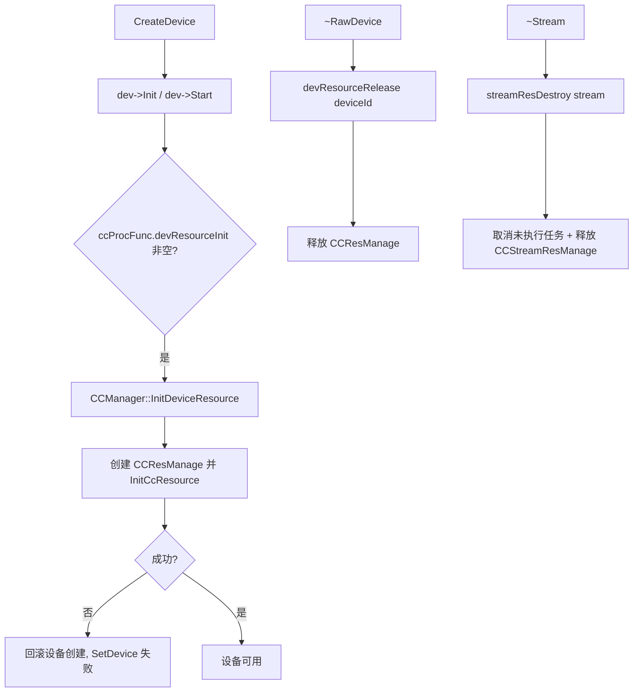

关键代码：

```cpp
// 文件位置：src/runtime/core/src/runtime.cc:3386-3394
if ((GET_DEV_INFO_PROC_FUNC(dev->GetChipType(), devInfoProcFunc) == RT_ERROR_NONE) &&
    (devInfoProcFunc.ccProcFunc.devResourceInit != nullptr)) {
    error = devInfoProcFunc.ccProcFunc.devResourceInit(dev);
    if (error != RT_ERROR_NONE) {
        dev->SetDeviceRelease();
        (void)dev->Stop();
        goto DEV_ROLLBACK;
    }
}

// 文件位置：src/runtime/core/src/device/raw_device.cc:158-159
if ((GET_DEV_INFO_PROC_FUNC(chipType_, devInfoProcFunc) == RT_ERROR_NONE) &&
    (devInfoProcFunc.ccProcFunc.devResourceRelease != nullptr)) {
    devInfoProcFunc.ccProcFunc.devResourceRelease(deviceId_);
}

// 文件位置：src/runtime/core/src/stream/stream.cc:332-333
if ((GET_DEV_INFO_PROC_FUNC(chipType_, func) == RT_ERROR_NONE) &&
    (func.ccProcFunc.streamResDestroy != nullptr)) {
    func.ccProcFunc.streamResDestroy(this);
}
```

`CCManager::InitDeviceResource`（`cc_manager.cc:369`）使用 `resourceInitMutex_` 串行化初始化、`resourceMutex_` 保护数组写入。初始化期间会下发设备核，可能同线程回调 CCManager，因此资源创建阶段不持 `resourceMutex_`。

#### 4.1.3 GCM 全量通路

GCM 是缺省模式。走完整通路的每次异步拷贝（非小数据、非 D2D）在流上提交四个任务，把“入队”“等待 worker 就绪”“设备加解密”“worker 收尾”串成完整语义。

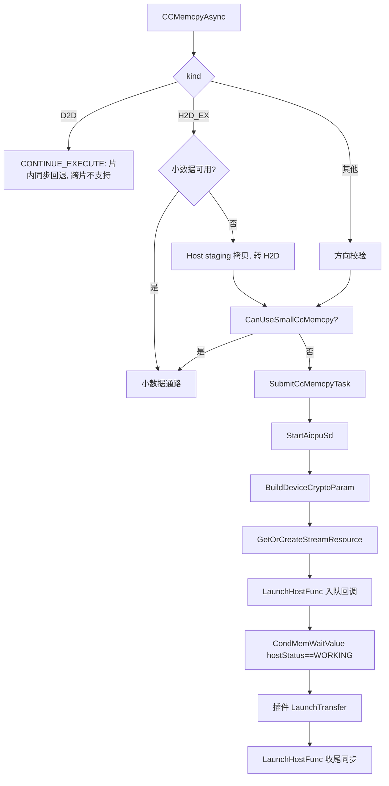

关键代码（`cc_manager.cc:477-549`，节选）：

```cpp
rtError_t CCManager::SubmitCcMemcpyTask(...)
{
    ...
    ret = Runtime::Instance()->StartAicpuSd(device);
    ...
    CCStreamResManage* streamResource = nullptr;
    ret = manager.resources_[deviceId]->GetOrCreateStreamResource(resourceStm, streamResource);
    const uint64_t taskQueueAddr = streamResource->DeviceQueueAddr();

    CCHostCallbackParam* cbParam = nullptr;
    ret = AllocCcCallbackParam(ownerModel, deviceId, task, cbParam);

    std::unique_lock<std::mutex> memSubmitLock(streamResource->MemSubmitMutex());
    ret = Runtime::Instance()->ApiImpl_()->LaunchHostFunc(stm, &CCManager::SubmitCcTaskCallback, cbParam);

    const uint64_t memWaitAddr = taskQueueAddr + static_cast<uint64_t>(offsetof(BarTaskQueue, hostStatus));
    ret = CondMemWaitValue(
        RtValueToPtr<void*>(memWaitAddr), static_cast<uint64_t>(TASK_QUEUE_STATUS_WORKING),
        static_cast<uint32_t>(MEM_WAIT_VALUE_TYPE_EQ), stm, RT_STARS_WRITE_VALUE_SIZE_TYPE_32BIT);

    ret = plugin->LaunchTransfer(stm, taskQueueAddr, task);

    // D2H 在设备核完成后仍需由 worker 搬运、解密到用户缓冲，流完成必须等待 worker 收尾。
    ret = Runtime::Instance()->ApiImpl_()->LaunchHostFunc(
        stm,
        [](void* data) {
            auto* resource = static_cast<CCStreamResManage*>(data);
            const std::lock_guard<std::mutex> lock(resource->ProcessMutex());
        },
        streamResource);
    return RT_ERROR_NONE;
}
```

方向处理规则（`cc_manager.cc:676-725`）：

- `RT_MEMCPY_DEVICE_TO_DEVICE` 直接返回 `RT_ERROR_CONTINUE_EXECUTE`（内部信号）：片内同步 D2D 由普通路径处理；跨片 D2D（同步/异步）不支持（见 §6）。
- `RT_MEMCPY_HOST_TO_DEVICE_EX` 先尝试小数据；否则申请 Host staging buffer 把源数据拷为 pinned 内存后按 H2D 处理（`PrepareCcAsyncH2dEx`）。
- `checkKind == false` 时按地址属性推导方向；仍无法判定为 H2D/D2H 则回退。
- 仅 H2D/D2H 进入 CC 通道。

GCM 插件在 Host 侧完成加密，在设备侧完成解密：

```cpp
// 文件位置：src/runtime/feature/cc_manager/crypto/gcm/cc_gcm_plugin.cc:26-43
rtError_t CCGcmPlugin::PrepareH2DSlice(CCCryptoSliceCtx& ctx, size_t& dmaLen)
{
    auto* const desc = reinterpret_cast<AiccCryptoSliceDesc*>(ctx.desc);
    desc->ciphertextLen = CC_CIPHER_HEADER_SIZE + static_cast<uint32_t>(ctx.sliceSize);
    size_t ctLen = 0U;
    const rtError_t ret = crypto_->Encrypt(
        ctx.deviceId, Cipher(), static_cast<const uint8_t*>(ctx.src), ctx.sliceSize,
        reinterpret_cast<const uint8_t*>(desc), sizeof(*desc), static_cast<uint8_t*>(ctx.hostBuf), &ctLen);
    dmaLen = ctLen;
    return ret;
}
```

D2H 方向相反：设备核加密写入 Device Buffer，Worker DMA 回读后调用 `FinishD2HSlice` 做 Host 解密，AAD 仍是描述符。

#### 4.1.4 CTR 密钥流通路

CTR 模式用“预生成密钥流 + 纯 XOR”替代逐块分组加密：Host 侧与设备侧共同维护按段切分的密钥流，传输时只做异或。

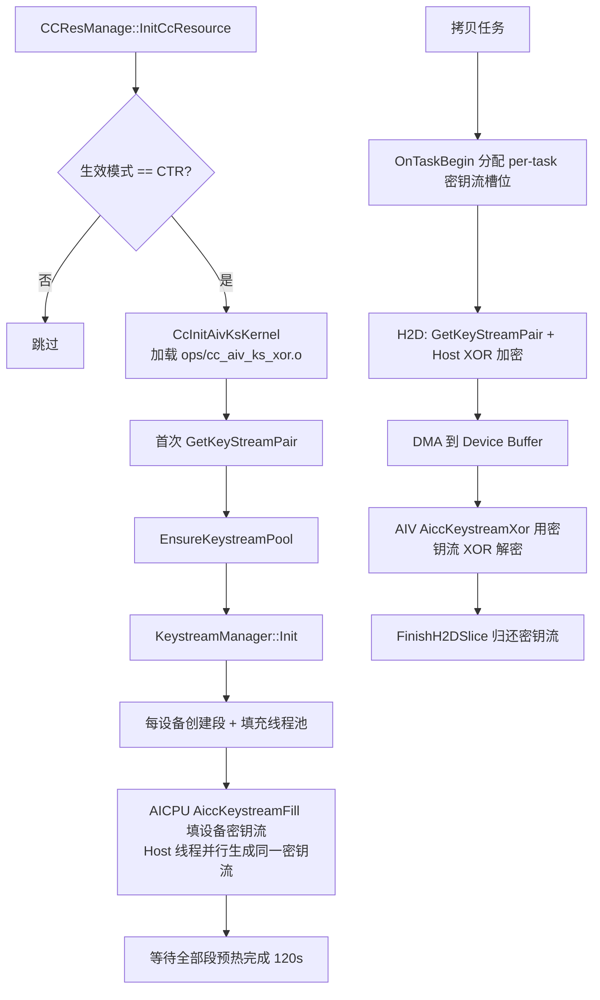

关键实现：

- 段配置（`keystream_manager.cc:498`）：7 档，段大小统一为 4MB，阈值从 32KB 到 2MB；前 6 档各 2 段、末档 4 段，合计 16 段/设备。请求长度按 16B 对齐占用，段的 `availablePos` 不足时触发补填。
- 设备密钥流填充（`keystream_manager.cc:258`）：`BuildKsFillTasks` 按 128KB 分页生成任务，Host 用 OpenSSL AES-CTR 加密全零块生成同一密钥流，设备用 `AiccKeystreamFill` 并行填充；Host 生成池为进程级 2→8 弹性线程。
- 传输核（`cc_ctr_plugin.cc:65-79`）：`PrepareH2DSlice` 取密钥流对并做本地 XOR，`dmaLen = sliceSize`；`FinishH2DSlice` 归还密钥流。D2H 由设备核加密、Worker 回读后 `KeystreamDecrypt`。
- 设备核下发（`cc_ctr_plugin.cc:112-127`）：参数为 `AiccKeystreamXorParam`，`mode` 指明 ENCRYPT/D2H 或 DECRYPT/H2D，`reserved` 携带本次明文字节数用于选择 AIV blockDim。
- AIV blockDim（`cc_defs.h:41`）：每核 256KB，向上取 2 的幂并夹到 `AICC_MAX_BLOCK_DIM = 8`；AIV 核使用 `SyncAll<true>()`，同步粒度为 8 个 AIV，因此上限为 8。
- 失败兜底：任务失败时 `OnTaskEnd` 逐片归还仍持有的密钥流（`cc_ctr_plugin.cc:129-141`）。

#### 4.1.5 同步、2D、Batch 与 memset

- **同步拷贝**（`cc_manager.cc:635`）：按地址属性推导方向，复用当前 Context 的默认 Stream；小数据优先走简化通路，其余走完整通路后 `Stream::Synchronize()`。Context 处于失败态时直接返回 `ACL_ERROR_RT_FEATURE_NOT_SUPPORT`（207000）并给出错误说明。
- **2D 异步/同步**：按 `height` 拆行，每行提交一次 1D 拷贝；同步版本在完整通路或小数据 H2D 场景下，所有行提交后统一同步一次；小数据 D2H 每行在简化通路内部已同步，外层仍会再同步。同步 2D 有捕获模式检查。
- **Batch 异步/同步**：按 `count` 拆 entry，逐个校验属性与地址后提交 1D 拷贝；同步版本的同步次数与 2D 一致（H2D 末尾一次，小数据 D2H 逐 entry 同步）。
- **memset / memset32**：Host 申请 64MB（或剩余大小）的临时 buffer 并填充，然后按块走 H2D 加密通路；`guardMem` 保证异步任务完成前临时 buffer 存活（`cc_manager.cc:908-948`）。
- **方向回退**：2D/Batch 中小数据通路返回 `RT_ERROR_CONTINUE_EXECUTE`（内部信号）时回退到完整 CC 通路；Batch 检测到源/目的位置类型相同（同为 Host 或同为 Device）时直接报错 `ACL_ERROR_RT_PARAM_INVALID`（107000，EE1016），仅支持 H2D/D2H。

#### 4.1.6 单算子流小数据通路

小数据通路面向“单算子流 + 极小数据”，把“Host 回调 + MemWait + Worker 唤醒”压缩为一次 AICPU 下发。准入条件（`cc_manager.cc:551-568`）：

- `count <= CC_SMALL_PLAINTEXT_CAPACITY`（64B）；
- 非捕获流，且 `stm->Model_() == nullptr`（排除 ACL Graph / 普通模型）；
- 流未设置 `RT_STREAM_AICPU` 标志；
- 生效模式为 GCM、生效 cipher 为 `AES_128`，且设备支持 `AiccCryptoSmall` 内核（初始化时经 `AicpuTimeoutControl::CheckKernelSupported` 探测）；
- 方向限制：H2D 不限同步/异步；D2H 仅同步。

**H2D（3 步）**：调用线程直接 AEAD 加密，密文内联进 `CCSmallCryptoKernelParam.ciphertext`；元数据整块（含零填充）作为 AAD；只下发 1 个 AICPU `AiccCryptoSmall`（DECRYPT 模式），无 Host 回调、无 MemWait、无 Worker。

**D2H（5 步）**：取 Stream 级专用 small buffer（设备 buffer + pinned host buffer，锁覆盖同步与后处理）→ 下发 AICPU `AiccCryptoSmall`（ENCRYPT 模式）→ 流同步 → DMA 回读并校验密文头 → AEAD 解密到栈上私有 buffer 后 `memcpy_s` 到用户 dst。

| 维度 | 小数据 H2D | 小数据 D2H |
|------|-----------|-----------|
| 流上任务数 | 1（AICPU） | 1（AICPU） |
| 同步语义 | 异步提交，调用即返回 | 仅同步接口，内部流同步 |
| 数据缓冲 | 密文内联在算子 args | Stream 级专用 small buffer |
| 失败行为 | 准入不满足时入口直接选完整通路；已选小数据后错误直接返回 | `CONTINUE_EXECUTE` 回退完整通路；`copyError` 隔离不复用 |

关键代码（`cc_manager.cc:551-633`，节选）：

```cpp
bool CCManager::CanUseSmallCcMemcpy(uint64_t count, rtMemcpyKind_t kind, Stream* stm, bool isSync)
{
    if (count > CC_SMALL_PLAINTEXT_CAPACITY) { return false; }
    if (stm->IsCapturing() || (stm->Model_() != nullptr) || ((stm->Flags() & RT_STREAM_AICPU) != 0U)) { return false; }
    if ((kind != RT_MEMCPY_HOST_TO_DEVICE) && (!isSync || (kind != RT_MEMCPY_DEVICE_TO_HOST))) { return false; }
    const CCResManage* const resource = Instance().resources_[stm->Device_()->Id_()].get();
    return (resource != nullptr) && resource->SupportsSmallCrypto();
}
```

### 4.2 核心机制详解

#### 4.2.1 CCManager

**设计思想**：进程级单例，持有 `resources_[RT_MAX_DEV_NUM]`，对外只暴露静态分发入口与三个生命周期回调。

```cpp
// 文件位置：src/runtime/feature/cc_manager/cc_manager.h:24-89
class CCManager : public NoCopy {
public:
    static CCManager& Instance();
    static rtError_t InitDeviceResource(Device* device);
    static void ReleaseDeviceResource(const uint32_t deviceId);
    static void DestroyStreamResource(Stream* stm);

    static rtError_t CCDevMalloc(...);
    static rtError_t CCMemcpyAsync(...);
    static rtError_t CCMemCopySync(...);
    static rtError_t CCMemCopy2DAsync(...);
    static rtError_t CCMemcpyBatchAsync(...);
    static rtError_t CCDevMemSetAsync(...);
    ...
private:
    std::unique_ptr<CCResManage> resources_[RT_MAX_DEV_NUM]{};
    std::mutex resourceMutex_;      // 保护 resources_ 数组
    std::mutex resourceInitMutex_;  // 串行化同设备首次初始化
};
```

`CCDevMalloc` 将大小按 `CcAlignUp` 对齐到 32B，并通过 `DevMemAllocConfig.privateFlag = true` 申请 TEE 内私有内存（`cc_manager.cc:426-440`）。

#### 4.2.2 CCResManage 与 Worker 池

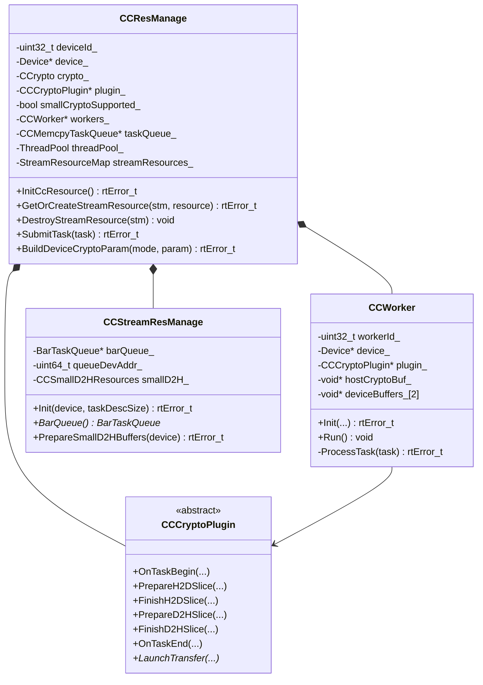

初始化顺序（`cc_res_manage.cc:56-112`）：`InitKey` → 创建插件 → `LoadKeyToAicpu` → CTR 时 `CcInitAivKsKernel` → `InitWorkerPool(6, 2MB)` → 探测 small 内核。任一步失败都回滚已建资源，对外返回 `ACL_ERROR_RT_INTERNAL_ERROR`（507000）。

Worker 池由 `ThreadPool` 承载（`threadPool_.Init("CC_WORKER", 1, 6)`），初始只创建 1 个 Worker，`SubmitTask` 每次尝试扩容 1 个，直到上限 6（`cc_res_manage.cc:213-308`）。每个 Worker 持有：

- 1 个 pinned Host 中转 buffer（`HostDmaMap`，不支持时回退 `HostRegister`）；
- 2 个 2MB Device 中转 buffer（A/B，`SNAPSHOT_NO_BACKUP`）。

#### 4.2.3 CCWorker 分片编排

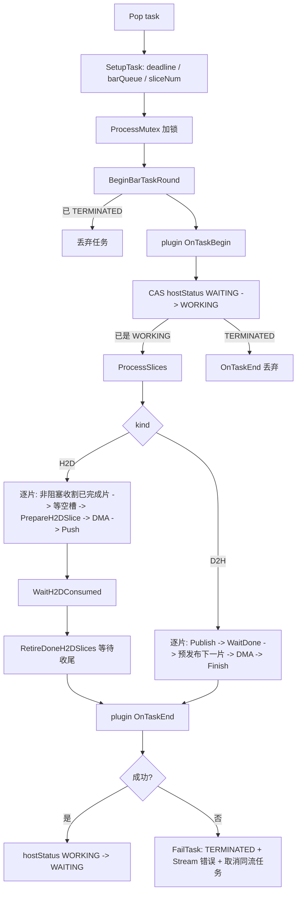

关键点：

- 同流所有任务在 `resource->ProcessMutex()` 内串行，覆盖环复位、发布与消费确认，避免多个 Worker 相互重置环状态（`cc_worker.cc:295`）。
- H2D 每发布一片前先非阻塞收割已完成片，H2D 结束后等待 `complete >= totalSlices`，确保设备核已消费完 A/B 才能返回。
- D2H 先发布首片，等待完成后再提前发布下一片，使设备加密与 Host 搬运解密并行；最后一片完成后才允许流结束。
- `ShouldWorkerExit`（`cc_worker.cc:171`）内检查取消标志、流销毁、流 abort、设备故障、`ABORT_ON_FAILURE`、CC 资源缺失与 18 分钟超时。

#### 4.2.4 BarTaskQueue 协议

`BarTaskQueue` 是 Host 与设备核共享的 SPSC 环（`task_queue/task_queue_abi.h:29`）：

| 字段 | 写入方 | 含义 |
|------|--------|------|
| `hostStatus` | Host | `WAITING` / `WORKING` / `TERMINATED` |
| `deviceStatus` | Device | 同上，设备消费中或终止 |
| `head` | Host | 下一个发布槽位 |
| `tail` | Device | 下一个消费槽位 |
| `complete` | Device | 已完成任务数，Host 据此收割 |
| `depth` | Host | 环深度（固定 3） |
| `taskDescSize` | Host | 描述符大小（GCM 32B / CTR 40B） |
| `deviceErrCode` | Device | 设备侧错误码 |

状态机：

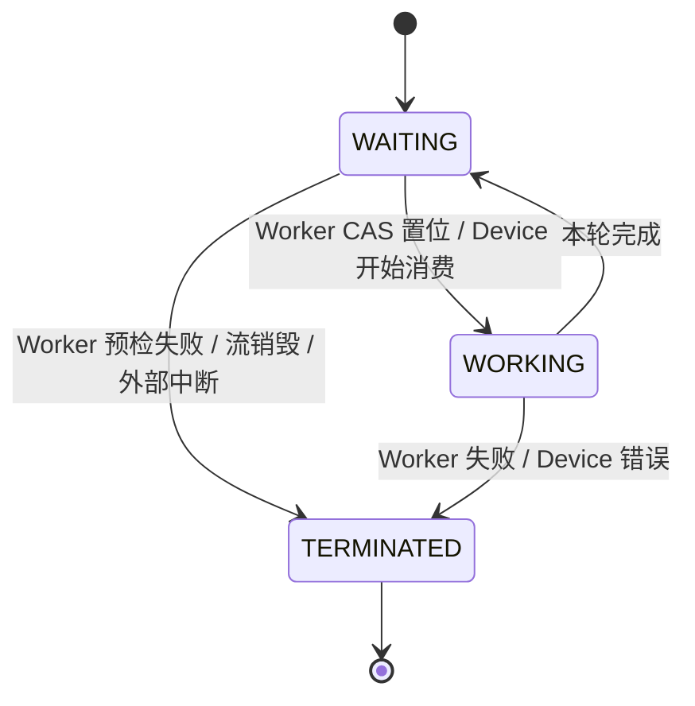

Host 侧封装（`task_queue/host_task_queue.cc`）：

- `CreateBarTaskQueue`：`DevMemAllocWithBackupFlag(RT_MEMORY_P2P_HBM)` + `PcieHostRegister`，清零并初始化控制头，元信息记录在独立 Host 表中（不改设备侧布局）。
- `BeginBarTaskRound`：Host 已终止时保留信号并置 `proceed=false`，否则 `ResetBarTaskQueue` 复位 `complete/head/tail/status`。
- `PushBarTask`：等待非满槽位（默认 30s 超时），拷贝描述符后 `__sync_synchronize()` 再推进 `head`。
- `GetCompletedBarTaskNum`：读取 `complete` 后加内存屏障，保证随后可读设备写入的描述符结果。

#### 4.2.5 CCStreamResManage

Stream 级资源（`cc_stream_res_manage.cc:24`）包括：

- `BarTaskQueue`：深度 3，描述符尺寸由插件决定（GCM 32B、CTR 40B）。
- `processMutex_`：同流任务处理大锁。
- `memSubmitMutex_`：保护“入队回调 + MemWait + 设备核 + 收尾同步”四段提交不被多线程交叉插入。
- `CCSmallD2HResources`：小数据 D2H 专用 buffer（设备 + pinned host）、`pending`、`copyError` 与互斥锁；分配或映射失败返回 `RT_ERROR_CONTINUE_EXECUTE`（内部信号）并回滚。

资源首次 CC 拷贝时惰性创建，登记到 `CCResManage::streamResources_`；Stream 析构回调中先从映射表移除再释放，避免重复释放（`cc_res_manage.cc:169-211`）。

#### 4.2.6 CCCryptoPlugin 与 CCrypto

**插件注册**（`cc_crypto_plugin.cc:107-147`）：静态初始化期通过 `CC_REGISTER_CRYPTO_PLUGIN` 登记工厂；`CreateCryptoPlugin` 按生效模式创建实例。插件保存：

- `algType`、`kernelName`、`sliceDescSize`；
- 指向全局生效 cipher 的原子引用，切换 cipher 后已建插件立即读到新值。

**模式选择**（`cc_crypto_plugin.cc:135`）：首次调用读取 `/sys/kernel/security/cvm_guest/mem_encrypt_alg`，`AES_CTR` 映射为 CTR，其余与读失败映射为 GCM；结果缓存在 `g_activeCryptoAlg`。

**CCrypto**（`cc_crypto.cc`）负责密钥与 Host 原语：

- `InitKey`：从驱动槽位读取方向密钥（GCM 读 H2D/D2H，CTR 只读 H2D），生成 8B 随机 IV 基址，申请 32B private 设备密钥区。
- `Encrypt`/`Decrypt`：按 `CC_CRYPTO_CIPHER` 在注册表中查找 cipher，未注册（如 SM4）返回 `ACL_ERROR_RT_FEATURE_NOT_SUPPORT`（207000）；IV 为“8B 随机基址 + 4B 递增计数器”，计数器回绕时重生成基址。
- `GetDeviceKeyAddr`：按方向返回设备密钥区地址（ENCRYPT 偏移 16B）。
- CTR 相关：`GetKeyStreamPair` / `FreeKeyStream` / `KeystreamEncrypt` / `KeystreamDecrypt`，其中 XOR 使用 `XorBytesOptimized`（NEON / AVX2 / SSE2 分派）。
- `BuildLoadKeyParam`：CTR 两方向都填 H2D 槽位，GCM 分别填 H2D/D2H 槽位。

密钥装载（`cc_res_manage.cc:125`）在设备打开阶段经 Ctrl SQ Stream 下发 `AiccLoadKey` 并同步等待；下发前后保存/恢复 `InnerThreadLocalContainer` 的 last task/stream id，避免控制面任务被计入维测统计。

#### 4.2.7 KeystreamManager

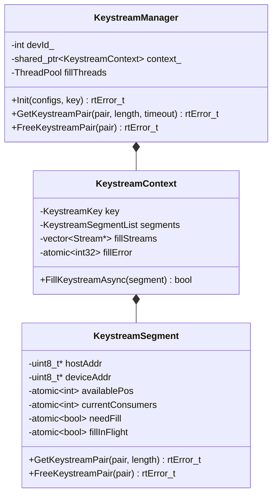

- 取流策略：低段优先，跳过 `needFill`/未 `ready`/容量不足的段；段内 `availablePos` 按 16B 对齐推进，超过阈值置 `needFill`，由 `FreeKeystreamPair` 在消费者归零后异步补填。
- 预热：Init 时全部段首次填充，`KS_INIT_FILL_TIMEOUT_SEC = 120`；填充失败 fail-fast，后续取流立即返回错误。
- 资源归属：段 host buffer 为普通 `malloc`，device buffer 为 `DevMemAllocWithBackupFlag(HBM)`；每个 `CCrypto`（即每个 device）独占一个 `KeystreamManager`。

#### 4.2.8 AIV 设备核构建与加载

- 构建：`cmake/cc_aiv_kernels.cmake` 在 `CC_BUILD_AIV_KERNELS=ON`（缺省）时通过 bisheng 编译 `crypto/device/kernel_ks_xor_aiv.cpp`，再用 `ld.lld` 生成 `cc_aiv_ks_xor.o`；UT 构建自动关闭。
- 安装：非独立构建时安装到 `<arch>-linux/lib64/ops`（开源构建）或 `lib/ops`，与 `libruntime*.so` 同目录。
- 加载：CTR 初始化时 `CcInitAivKsKernel`（`crypto/aiv/cc_aiv_launch.cc:45`）通过 `dladdr` 定位运行时所在目录，拼接 `ops/cc_aiv_ks_xor.o`，调用 `BinaryLoadFromFile` 与 `BinaryGetFunctionByName` 获取核句柄。
- 下发：`CcLaunchAivKsXor`（`cc_aiv_launch.cc:76`）把环地址与 `{mode, totalSlices}` 打包为两个 8B 标量入参，`blockDim` 由 `CcSelectAivBlockDim` 计算，调用 `Api::LaunchKernel`。
- 设备核：`KernelKsXorAiv` 只由 0 号核推进 `tail/complete`，其余核只读描述符，每片结束 `SyncAll<true>()`；块内按 24KB 分块，偶数字节走向量 XOR，尾部单字节走标量。

### 4.3 模块职责划分

| 模块 | 职责 | 位置 |
|------|------|------|
| CCManager | 进程级单例、函数表注册、设备资源生命周期、内存接口分发 | `cc_manager.h` / `cc_manager.cc` |
| CCResManage | per-device 密钥、插件、Worker 池、任务队列、Stream 资源管理 | `cc_res_manage.h` / `cc_res_manage.cc` |
| CCWorker | 分片编排、Host 加解密与 DMA、环发布与消费确认 | `cc_worker.h` / `cc_worker.cc` |
| CCStreamResManage | Stream 级 BarTaskQueue 与小数据 D2H buffer | `cc_stream_res_manage.h` / `.cc` |
| BarTaskQueue | 跨端 SPSC 环协议与 Host 侧封装 | `task_queue/task_queue_abi.h`、`task_queue/host_task_queue.*` |
| CCCryptoPlugin | 算法路由与分片钩子 | `crypto/cc_crypto_plugin.*` |
| CCGcmPlugin | GCM 描述符、Host AEAD、AICPU 参数 | `crypto/gcm/*` |
| CCCtrPlugin | CTR 密钥流申请/归还、AIV XOR 参数 | `crypto/ctr/*` |
| CCrypto | 密钥管理、AEAD 原语、cipher 注册表、密钥流接口 | `crypto/cc_crypto.*` |
| KeystreamManager | CTR 密钥流池、段分配、并行填充 | `crypto/keystream/*` |
| AIV Launch | fatbin 加载与 AIV 核下发 | `crypto/aiv/*`、`crypto/device/*` |
| 公共工具 | 对齐、自旋等待、XOR、sysfs 读取 | `common/cc_defs.h`、`common/cc_utils.*` |

### 4.4 核心数据结构

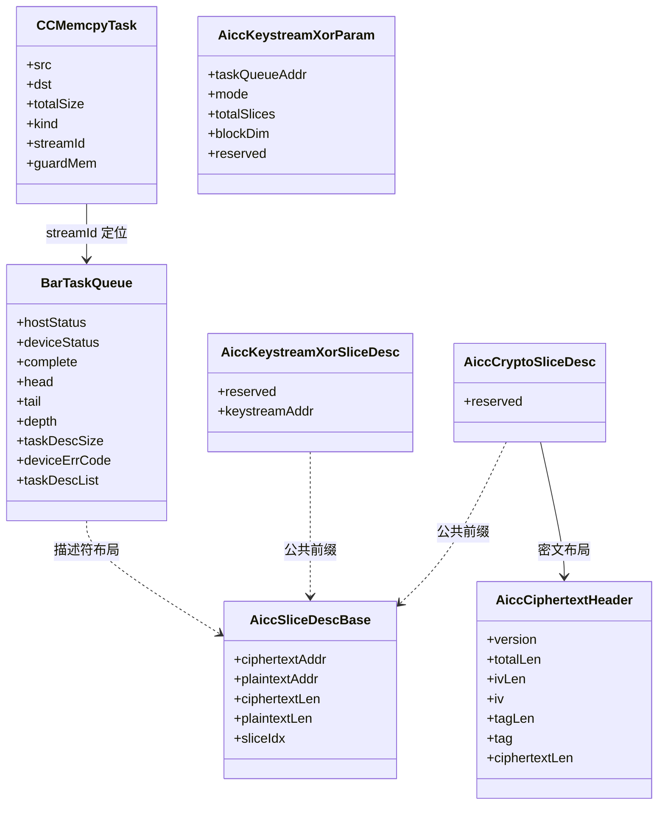

## 5. 关键设计思想

### 5.1 透明拦截与零开销回退

CC 不改 ACL 接口签名，只在 ApiImpl 的内存入口做一次函数指针判空分发。非机密环境不注册回调，判空后走原有路径；已注册但方向不适用（如片内同步 D2D）时返回 `RT_ERROR_CONTINUE_EXECUTE`（内部信号），继续原逻辑；跨片 D2D 不支持。两种情形都不会引入额外系统调用。

### 5.2 双模式插件化

`CCCryptoPlugin` 把“算法元数据 + 分片钩子”从 Worker 主流程中抽出，Worker 只按固定顺序调用钩子。GCM 与 CTR 的差异集中在插件内：

- GCM 使用 32B 描述符、84B 密文头、AAD、双向密钥、AICPU 核；
- CTR 使用 40B 描述符、无头部、单密钥、AIV 核与密钥流池。

新增算法（如 SM4）不需要新增插件：插件按 GCM/CTR 模式复用，cipher 通过 `RegisterCryptoAlg` 注册；只有新增全新加密模式才需扩展插件。

### 5.3 环 + AB 双缓冲流水

`BarTaskQueue` 深度固定 3（可用 2 槽），与 Worker 的两块 Device Buffer A/B 严格对应：分片 `sliceIdx` 按奇偶映射物理槽，描述符槽位按 `head/tail` 取模推进。协议约束：

- 生产者发布描述符前必须完成密文 DMA 与字段写入，并用内存屏障保证顺序；
- H2D 全部分片发布后仍需等待 `complete >= totalSlices`，防止下一任务覆盖尚未消费的 A/B；
- D2H 提前发布下一片，使设备加密与 Host 回搬解密重叠。

### 5.4 小数据零唤醒

64B 以内的单算子流拷贝不再经过 Host 回调与 Worker，调用线程直接加密并把密文放进算子参数，流上只有一个 AICPU 任务。收益是去掉线程唤醒、任务入队与环协议开销；代价是参数体积受限于小数据上限，且 D2H 必须同步（异步 D2H 无法在返回前回读解密）。

### 5.5 收尾同步与流语义

完整通路在设备核之后追加一个 Host 收尾同步回调，回调内获取 `ProcessMutex`。由于 Worker 处理任务期间一直持有该锁，该回调返回时意味着：

- H2D：所有分片已发布且被设备消费；
- D2H：所有分片已回搬并解密到用户缓冲。

因此 `aclrtSynchronizeStream` 能真正等待到数据可用，而不是仅等设备核退出。

### 5.6 错误处理与场景适配

- **初始化阶段**：环境或设备 CC 状态校验、密钥、插件、Worker、密钥流池任一初始化失败时，`Runtime::Init` 或 `SetDevice` 返回错误并回滚已创建资源，不降级明文。
- **运行期**：Host 加解密、DMA 或设备核失败时，Worker 将发送队列置为 `TERMINATED`、设置 Stream 错误与 abort 状态，并取消同流未执行任务；后续任务被丢弃。
- **中断场景**：快恢、快照、Model abort、Stream abort/stop 下 Worker 仅尽力静默退出，不保证任务完成与数据一致，详见 §6。
- **超时**：Worker 任务级 deadline 为 18 分钟；设备核与 MemWait 由 SQE 超时兜底，不支持毫秒级算子超时感知。
- **小数据 D2H**：回读失败会记录 `copyError` 隔离 Stream 级专用 buffer，后续请求回退完整通路。

错误码映射：

| 场景 | 对外 ACL 错误码 |
|------|------------------|
| CC 初始化、密钥、加解密、Worker 失败/超时、GCM tag 校验失败 | `ACL_ERROR_RT_INTERNAL_ERROR`（507000） |

CC 内部错误码仅用于日志区分场景，不再作为对外错误码。

除上述运行时错误处理行为外，驱动与 Runtime 的能力边界见第 6 章。

## 6. 机密计算约束

CC 模式在驱动适配与 Runtime 能力上存在以下边界，使用前需评估业务场景是否满足。约束随驱动适配进度可能变化，以实际发布版本为准；§6.1 为能力确认结果（含不支持、待验证与已支持项）。

| 编号 | 约束项 | 说明 |
|------|--------|------|
| 1 | 不支持 abort 相关能力 | CCWorker 的加解密与 DMA 搬运不参与快速恢复、快照（Snapshot）、Model abort、Stream abort、Stream stop 的完成/回滚语义；上述场景下 Worker 仅尽力静默退出，不保证任务完成、资源回收时序与数据一致性（Runtime 限制）。 |
| 2 | 不支持毫秒级算子超时故障感知 | 驱动未适配，无法在毫秒级感知算子超时；当前依赖 SQE 默认超时（约 18 分钟）兜底。 |
| 3 | 不支持 CC dev 模式开启 profiling 维测能力 | 驱动未适配，CC dev 模式下无法启用 profiling 维测。 |
| 4 | 不支持 Host 内存映射 Device 内存后经 PCIe 直接访问 | 驱动未适配。 |
| 5 | 不支持跨片 D2D 拷贝 | 跨片同步 D2D 与异步 D2D 不支持（驱动未适配，待驱动确认）；片内同步 D2D 不在本约束范围，由普通路径处理。 |
| 6 | 遇错即停后不支持同步拷贝 | Runtime 限制：Context 进入失败态后，`CCMemCopySync` 直接返回 `ACL_ERROR_RT_FEATURE_NOT_SUPPORT`（207000，`cc_manager.cc:654-660`）。 |
| 7 | 每条 Stream 额外占用 notify 与 groupId | 拷贝通过 HostCallback 实现入队与收尾同步，每条 Stream 会额外占用 1 个 notify 和 1 个 groupId，大规模流场景需预留对应资源。 |
| 8 | Worker 初始化会申请中转 buffer | 每个 Worker 初始化时申请 1 个 Host 中转 buffer 与 2 个 Device 中转 buffer（各 2MB），会改变进程内存占用与相邻内存布局，依赖布局的越界拷贝用例需单独评估预期结果。 |

### 6.1 能力确认结果

| 编号 | 能力 | 结论 |
|------|------|------|
| 1 | 统一虚拟内存（Unified Virtual Memory，UVM） | 不支持：UVM 分配与回调路径未做 CC 适配；现有 UVM UT 仅覆盖 910B（`tests/ut/runtime/runtime/test/platform/910B/rt_utest_uvm.cc`），无 950/CC 专项用例。 |
| 2 | mbuf | 待验证：mbuf 内存 / 拷贝（`RT_FEATURE_MEM_MBUF_COPY`）与 CC 分发链路的兼容性待验证，结论明确前不建议在 CC 模式下使用。 |
| 3 | IPC Memory | 支持：IPC 内存导入/导出（`aclrtIpcMemGetExportKey` / `aclrtIpcMemImportByKey`）可用。 |
| 4 | Stream 有序内存分配（SOMA） | 暂不支持（待实测）：评估不需要适配；现有 `rt_utest_soma.cc` / `rt_utest_api_soma.cc` 覆盖 SOMA 自身功能，但缺少 CC 场景实测，结论明确前按不支持处理。 |
| 5 | Tensor 数据传输 / 共享队列管理 | 无应用场景，不支持：`acltdtCreateChannel` 等 Tensor 数据传输接口与 `acltdtEnqueueData` 等共享队列管理接口无应用场景（驱动未适配）。 |
| 6 | DVPP | 申请接口需适配 `aclrtDvppMalloc`；当前未适配 CC 标志，DVPP 任务及流组在机密虚机下的可用性待确认。 |

## 7. 关键文件索引

| 模块 | 文件路径 | 核心内容 |
|------|----------|----------|
| 特性总入口 | `src/runtime/feature/cc_manager/cc_manager.h` / `.cc` | 单例、函数表注册、内存分发、设备生命周期 |
| per-device 资源 | `src/runtime/feature/cc_manager/cc_res_manage.h` / `.cc` | 密钥、插件、Worker 池、Stream 资源 |
| Worker | `src/runtime/feature/cc_manager/cc_worker.h` / `.cc` | 分片编排、Host 加解密与 DMA |
| Stream 资源 | `src/runtime/feature/cc_manager/cc_stream_res_manage.h` / `.cc` | BarTaskQueue、小数据 D2H buffer |
| 跨端队列 ABI | `src/runtime/feature/cc_manager/task_queue/task_queue_abi.h` | `BarTaskQueue`、描述符、XOR 参数布局 |
| Host 队列实现 | `src/runtime/feature/cc_manager/task_queue/host_task_queue.h` / `.cc` | 建环、复位、发布、完成计数 |
| 设备队列辅助 | `src/runtime/feature/cc_manager/task_queue/aivec_task_queue.h` | 设备侧 Pop/Peek/Complete |
| Host 任务结构 | `src/runtime/feature/cc_manager/cc_task_queue.h` | `CCMemcpyTask`、共享任务队列、分片常量 |
| 插件基类 | `src/runtime/feature/cc_manager/crypto/cc_crypto_plugin.h` / `.cc` | 插件注册、模式选择、设备核下发 |
| GCM 插件 | `src/runtime/feature/cc_manager/crypto/gcm/cc_gcm_plugin.h` / `.cc` | GCM 描述符与分片钩子 |
| CTR 插件 | `src/runtime/feature/cc_manager/crypto/ctr/cc_ctr_plugin.h` / `.cc` | 密钥流申请、AIV XOR 参数 |
| 加密原语 | `src/runtime/feature/cc_manager/crypto/cc_crypto.h` / `.cc` | 密钥、AEAD、cipher 注册表、密钥流接口 |
| 密钥流池 | `src/runtime/feature/cc_manager/crypto/keystream/keystream_manager.h` / `.cc` | 段管理、并行填充、取流/归还 |
| AIV 下发 | `src/runtime/feature/cc_manager/crypto/aiv/cc_aiv_launch.h` / `.cc` | fatbin 加载与核启动 |
| AIV 设备核 | `src/runtime/feature/cc_manager/crypto/device/kernel_ks_xor_aiv.cpp` | KeystreamXor 实现 |
| 设备 ABI | `src/runtime/feature/cc_manager/crypto/device/cc_kernel_abi.h` | `AICC_MAX_BLOCK_DIM` |
| 设备核构建 | `src/runtime/feature/cc_manager/crypto/device/CMakeLists.txt`、`src/runtime/cmake/cc_aiv_kernels.cmake` | bisheng 编译、安装到 `ops/` |
| 公共定义 | `src/runtime/feature/cc_manager/common/cc_defs.h` | 核名、对齐、AIV blockDim 选择 |
| 公共工具 | `src/runtime/feature/cc_manager/common/cc_utils.h` / `.cc` | 自旋等待、XOR、sysfs 读取 |
| OpenSSL 加载 | `src/runtime/feature/cc_manager/crypto/openssl_loader.h` / `.cc` | `libcrypto.so.3` 动态加载 |
| 注册入口 | `src/runtime/config/950/dev_info_proc_func.cc` | `regCCFeatureProcFunc = &RegCCManagerProcFunc` |
| 环境检测 | `src/runtime/core/src/runtime_v200/runtime_adapt.cc` | Host/Device CC 检测与注册 |
| 设备状态查询 | `src/runtime/driver/npu_driver_mem.cc` | `QueryDeviceCcStatus` |
| 设备接入 | `src/runtime/core/src/runtime.cc`、`device/raw_device.cc` | `devResourceInit` / `devResourceRelease` |
| Stream 接入 | `src/runtime/core/src/stream/stream.cc` | `streamResDestroy` |
| 构建 | `src/runtime/cmake/v200.cmake` | CC 源文件列表 |
| 单元测试 | `tests/ut/runtime/runtime/test/platform/950/rt_utest_cc_manager.cc` | 插件、密钥流、Worker、小数据通路等 98 个用例 |
